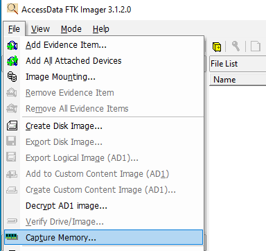
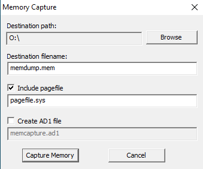
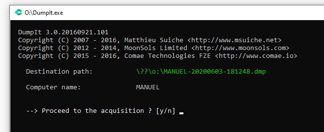

> [[02 - MODULOS/05 - Prácticas (PoCs)|← Volver a Prácticas (PoCs)]] | [[02 - MODULOS/Prácticas (PoCs)/Gestión de Incidentes/00 - Índice del Módulo Gestión de Incidentes|Índice del Módulo]]

---
# Adquisición de RAM e Información Volátil

# Adquisición de RAM e Información Volátil

 

## Introducción al análisis forense de memoria

 

El **análisis forense digital** es la disciplina que permite recopilar, preservar y analizar evidencias digitales de forma que sean válidas para una investigación. Dentro de esta disciplina, el análisis de **memoria RAM** y de **información volátil** es uno de los aspectos más críticos y delicados, ya que se trabaja con datos que desaparecen en el momento en que el sistema se apaga.

 

A diferencia del análisis de disco duro, donde los datos persisten aunque el equipo esté apagado, la memoria RAM contiene información que solo existe mientras el sistema está encendido: procesos en ejecución, conexiones de red activas, contraseñas en texto claro, claves de cifrado, historial de comandos y fragmentos de conversaciones o documentos abiertos. Por este motivo, la adquisición de memoria debe ser siempre **la primera acción** al llegar a una escena donde el equipo está encendido.

 

### ¿Qué es la información volátil?

 

Se denomina **información volátil** a todos los datos que residen en la memoria del sistema y que se pierden irremediablemente al apagar el equipo. Siguiendo el **Orden de Volatilidad** definido por el estándar RFC 3227, la recogida debe realizarse siempre de mayor a menor volatilidad:
 

 
1. Registros de CPU y caché.
 
2. Tabla de enrutamiento, caché ARP, tabla de procesos, estadísticas del kernel.
 
3. Memoria RAM.
 
4. Archivos temporales del sistema.
 
5. Disco duro.
 
6. Logs remotos y datos de monitorización.
 
7. Configuración física y topología de red.
 
8. Medios de almacenamiento de archivo.
 

 

### ¿Qué encontramos en la RAM?

 

Un volcado de memoria puede revelar información de enorme valor forense:
 

 
* **Procesos activos** en el momento del volcado, incluyendo malware que no escribe en disco (*fileless malware*).
 
* **Conexiones de red** abiertas y su estado (puertos, IPs remotas, protocolos).
 
* **Credenciales y contraseñas** que el sistema mantiene en memoria para autenticación.
 
* **Claves de cifrado** de volúmenes BitLocker, VeraCrypt u otros.
 
* **Historial de comandos** ejecutados en la sesión actual.
 
* **Artefactos de navegación**: URLs visitadas, credenciales de webmail, sesiones activas.
 
* **Documentos y archivos abiertos**, incluso si no han sido guardados.
 
* **Inyecciones de código malicioso** en procesos legítimos del sistema.
 

 

### Herramientas que usaremos

 

 
* **FTK Imager (Portable):** herramienta de AccessData ampliamente utilizada en investigaciones forenses profesionales. Permite capturar la memoria RAM y generar hashes de verificación de la evidencia.
 
* **DumpIt (Comae):** utilidad ligera y portable que realiza el volcado completo de la RAM con un solo clic. Genera un archivo de imagen compatible con herramientas de análisis como Volatility.
 
* **pen-volatil:** conjunto de utilidades que recopila de forma automatizada la información volátil del sistema (procesos, conexiones, usuarios, etc.) sin necesidad de volcado completo de RAM.
 
* **HashCodes:** herramienta para calcular y verificar hashes criptográficos (MD5, SHA1, SHA256) de los archivos de evidencia, garantizando la integridad de la cadena de custodia.
 

 

> [!note]
> 
 
> **Principio fundamental:** toda evidencia digital debe ir acompañada de su hash criptográfico, calculado en el momento de la adquisición, para garantizar que no ha sido alterada. Sin hash, la evidencia puede ser impugnada en un proceso judicial.
> 

 

## Preparación de la VM Windows 7

 

Antes de comenzar con la adquisición, preparamos el entorno de trabajo en una máquina virtual Windows 7. El objetivo es crear una unidad de disco separada que actuará como **destino de evidencias**, de forma que las herramientas forenses y los archivos capturados no contaminen el sistema objetivo.

 

Esta separación es una buena práctica forense: el disco del sistema analizado no debe modificarse durante la adquisición, y los archivos de volcado deben almacenarse en un medio externo o una partición independiente.

 

 
1. Crear una partición de disco de unos **10 GB** (unidad `O:`).
 
2. Formatear y generar la unidad de disco.
 
3. En la unidad nueva, descargar y descomprimir **FTK Imager (Portable)**:

 ⬇️ Descargar FTKImager.7z
 
4. En la unidad nueva, descargar y descomprimir **Comae (DumpIt)**:

 ⬇️ Descargar comae.7z
 
5. En la unidad nueva, descargar y descomprimir las utilidades **pen_volatil**:

 ⬇️ Descargar pen_volatil.7z
 
6. En la unidad nueva, descargar **HashCodes_x86**:

 ⬇️ Descargar HashCodes_x86.exe
 
7. Bajar la RAM del equipo a **1 GB** para que el volcado sea más rápido durante la práctica.
 

 

## Adquisición de RAM con FTK Imager

 

**FTK Imager** es una de las herramientas más utilizadas en investigaciones forenses profesionales. Su función de captura de memoria permite obtener un volcado completo de la RAM del sistema, incluyendo opcionalmente el archivo de paginación (`pagefile.sys`), que puede contener fragmentos de memoria que el sistema operativo trasladó al disco.

 

 
1. Abre FTK Imager y ve a **File → Capture Memory**.
 

 



 

 
1. Elige el **destino** donde se guardará el volcado (unidad `O:`).
 
2. Asigna un **nombre** descriptivo al archivo de volcado.
 
3. Marca la opción **pagefile.sys** para incluir el archivo de paginación en la captura.
 

 



 

 
1. Pulsa **Capture Memory** para iniciar el proceso. Espera a que finalice.
 
2. Una vez completado, **calcula el hash** de los archivos de volcado generados con HashCodes para garantizar la integridad de la evidencia.
 

 

> [!note]
> 
 
> El archivo `pagefile.sys` es especialmente valioso porque puede contener datos de procesos que ya no están activos pero que el sistema operativo desalojó de la RAM hacia el disco, como fragmentos de documentos, credenciales o actividad de malware.
> 

 

## Adquisición de RAM con DumpIt (Comae)

 

**DumpIt** es una herramienta minimalista que realiza el volcado completo de la RAM con un solo clic. Antes de ejecutarla, vamos a generar actividad en el sistema para que el volcado contenga información forense relevante y observable. Esto simula un escenario real donde el analista llega a un sistema en funcionamiento con actividad del usuario.

 

### Generar actividad en el sistema antes del volcado

 

 
1. Abre **Mozilla Firefox** y busca imágenes de animales.
 
2. En otras pestañas, navega por distintas páginas web.
 
3. Abre **CMD** y ejecuta los siguientes comandos para dejar rastro en memoria:
 

 

```
ping 8.8.8.8
ipconfig
arp -a
nmap (si está instalado)
```

 

 
1. Abre el **Bloc de notas** y escribe algo (no guardes el archivo).
 
2. Abre la **Calculadora**.
 
3. Inicia sesión en el correo electrónico de práctica:
 

 

> [!note]
> 
 
> **URL:** webmail.cursosmfr.es
> 
 **Usuario:** usuario@cursosmfr.es
> 
 **Contraseña:** password
> 

 

 
1. Ejecuta **DumpIt como administrador** y acepta el volcado de memoria.
 

 



 

> [!note]
> 
 
> Toda esta actividad quedará registrada en el volcado de RAM. En la siguiente práctica de análisis con Volatility podremos recuperar las URLs visitadas, los procesos abiertos, los comandos ejecutados e incluso fragmentos de las credenciales usadas en el webmail.
> 

 

## Adquisición de información volátil con pen-volatil

 

Mientras que FTK Imager y DumpIt realizan un volcado completo de la RAM, **pen-volatil** toma un enfoque diferente y más selectivo: en lugar de capturar toda la memoria, recopila de forma estructurada la información volátil más relevante del sistema activo, como la lista de procesos, las conexiones de red, los usuarios conectados, las variables de entorno o las tareas programadas.

 

Esta técnica es especialmente útil cuando el tiempo de respuesta es crítico o cuando se quiere obtener un inventario rápido del estado del sistema sin generar un archivo de volcado de varios gigabytes.

 

 
1. Descomprime el archivo `pen_volatil.7z` en la raíz de `C:\`.
 
2. Ejecuta el archivo **`main.bat`** como administrador.
 
3. En el menú que aparece, selecciona la información que quieres adquirir.
 
4. Una vez terminado el proceso, **comprime la carpeta** con los resultados.
 
5. Calcula el **hash** del archivo comprimido para documentar la cadena de custodia.
 

 

> [!note]
> 
 
> Documenta siempre la fecha y hora exacta de cada adquisición, el nombre del analista, el equipo analizado y los hashes calculados. Esta información forma parte de la **cadena de custodia** y es imprescindible para que la evidencia sea válida en un proceso judicial o disciplinario.
> 

 

## 📚 Navegación

 
 
 → Siguiente práctica
 
 
 ↑ Volver al Índice

---

> [[02 - MODULOS/05 - Prácticas (PoCs)|← Volver a Prácticas (PoCs)]] | [[02 - MODULOS/Prácticas (PoCs)/Gestión de Incidentes/00 - Índice del Módulo Gestión de Incidentes|Índice del Módulo]]
