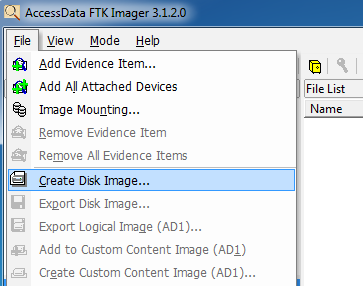
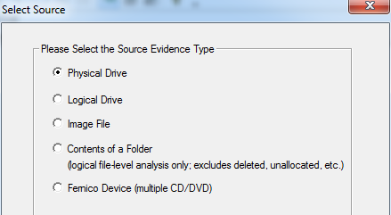
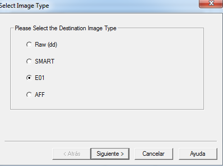
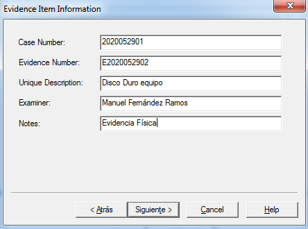
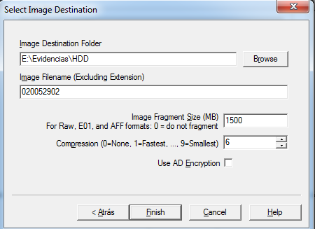
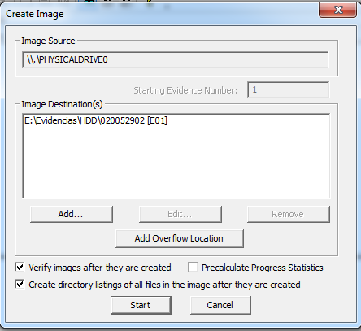
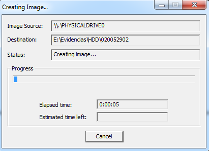
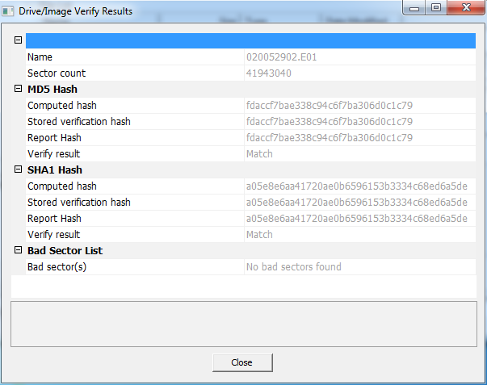
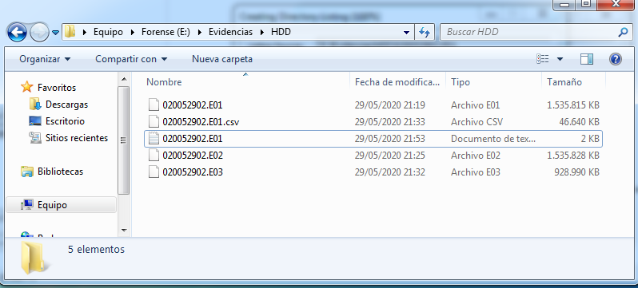

> [[02 - MODULOS/05 - Prácticas (PoCs)|← Volver a Prácticas (PoCs)]] | [[02 - MODULOS/Prácticas (PoCs)/Gestión de Incidentes/00 - Índice del Módulo Gestión de Incidentes|Índice del Módulo]]

---
# Adquisición de Disco Duro con FTK Imager (E01)

# Adquisición de Disco Duro con FTK Imager

 

## Introducción a la adquisición de disco

 

Si en la práctica anterior nos ocupamos de la memoria RAM —los datos más efímeros de un sistema—, ahora abordamos la otra gran fuente de evidencia digital: el **disco duro**. A diferencia de la RAM, el disco conserva su contenido cuando el equipo se apaga, lo que lo convierte en la fuente de evidencia más completa y duradera en una investigación forense.

 

Sin embargo, trabajar directamente sobre el disco original es un error grave en forense: cualquier operación de lectura puede modificar metadatos, timestamps o registros del sistema de archivos, contaminando la evidencia. Por este motivo, el estándar forense establece que **nunca se debe analizar el disco original**, sino una copia exacta bit a bit denominada **imagen forense**.

 

### ¿Qué es una imagen forense?

 

Una imagen forense es una **copia exacta y verificable de un disco o partición**, que incluye no solo los archivos visibles sino también el espacio libre, los archivos eliminados, los metadatos del sistema de archivos y cualquier otra información que pueda ser relevante para la investigación. Esta copia se acompaña siempre de un **hash criptográfico** que permite demostrar en cualquier momento que la imagen es idéntica al original y no ha sido alterada.

 

### Adquisición en caliente vs. en frío

 

Existen dos escenarios de adquisición según el estado del sistema en el momento de la intervención:
 

 
* **Adquisición en caliente (live acquisition):** el sistema está encendido y el disco está montado. Es el caso de las unidades `C:` o `D:` de un equipo en funcionamiento. Tiene la ventaja de que podemos capturar también información volátil, pero implica que el sistema operativo sigue escribiendo en disco durante el proceso, lo que puede generar ligeras discrepancias.
 
* **Adquisición en frío (dead acquisition):** el disco se extrae del equipo o se conecta como unidad externa con el sistema apagado. Es el método preferido cuando es posible, ya que garantiza que nada modifica el disco durante la captura.
 

 

### El formato E01

 

FTK Imager puede generar imágenes en varios formatos. El más recomendable para investigaciones profesionales es el formato **E01 (EnCase Evidence File)**, por varias razones:
 

 
* Es el formato **más extendido** en la industria forense y compatible con la mayoría de herramientas de análisis.
 
* Incluye **compresión interna**, lo que reduce significativamente el tamaño del archivo respecto al disco original.
 
* Almacena los **hashes de verificación** (MD5 y SHA1) dentro del propio archivo, facilitando la verificación de integridad.
 
* Permite dividir la imagen en **segmentos** para facilitar su almacenamiento y transporte.
 
* Incorpora un **bloque de metadatos** donde se puede documentar información del caso, el analista y las circunstancias de la adquisición.
 

 

> [!note]
> 
 
> **Regla de oro:** el hash calculado al inicio de la adquisición debe coincidir exactamente con el hash calculado sobre la imagen final. Si no coinciden, la evidencia ha sido comprometida y no puede utilizarse.
> 

 

## Preparación de la VM Windows 7

 

Para simular el escenario de adquisición, añadimos un segundo disco duro a la máquina virtual que actuará como **disco destino** donde se guardará la imagen forense. De esta forma, el disco del sistema (el que vamos a adquirir) permanece sin modificaciones durante todo el proceso.

 

 
1. Añadir un **nuevo disco duro a la VM de 10 GB**.
 
2. Formatear y generar la unidad de disco en Windows.
 

 

## Adquisición de HDD con FTK Imager

 

A continuación seguimos el proceso completo de adquisición paso a paso. FTK Imager guía al analista a través de un asistente que garantiza que todos los parámetros quedan correctamente documentados antes de iniciar la captura.

 

### Paso 1: Iniciar la adquisición

 

Abre FTK Imager y accede a la opción de creación de imagen de disco.
 

 

### Paso 2: Seleccionar tipo de adquisición y disco origen

 

Seleccionamos el tipo de adquisición y elegimos el disco que queremos adquirir. Si es la unidad `C:` o `D:` del propio equipo se trata de una adquisición **en caliente**; si es una unidad externa conectada al sistema, hablamos de una adquisición **en frío**.
 

 

### Paso 3: Seleccionar tipo de imagen

 

Elegimos el formato de imagen a crear. Se recomienda **E01** por ser el estándar más extendido en forense profesional y porque además comprime la imagen respecto al tamaño original del disco, ahorrando espacio de almacenamiento sin pérdida de datos.
 

 

### Paso 4: Metadatos del caso

 

FTK Imager solicita información sobre el caso que quedará embebida en la propia imagen: número de caso, número de evidencia, descripción, nombre del examinador y notas adicionales. Este bloque de metadatos es fundamental para la **documentación de la cadena de custodia**.
 

 

### Paso 5: Destino y nombre de la imagen

 

Indicamos la ruta de destino donde se guardará la imagen (el nuevo disco de 10 GB) y el nombre del archivo. FTK Imager también permite configurar el tamaño máximo de cada segmento si queremos dividir la imagen en partes.
 

 

### Paso 6: Resumen y verificación antes de comenzar

 

FTK Imager muestra un resumen completo de los parámetros configurados antes de iniciar el proceso. Es el momento de revisar que todo es correcto: disco origen, formato, destino, metadatos y opciones de verificación.
 

 

### Paso 7: Proceso de adquisición

 

Comienza la adquisición. FTK Imager lee el disco sector a sector, comprimiendo y escribiendo la imagen en el destino indicado. El tiempo depende del tamaño del disco y la velocidad del sistema. Durante este proceso se muestra el progreso y la tasa de transferencia.
 

 

### Paso 8: Verificación y hashes finales

 

Al finalizar, FTK Imager calcula y muestra los hashes **MD5 y SHA1** tanto del disco original como de la imagen generada. Si ambos coinciden, la adquisición es íntegra y la evidencia es válida. Estos valores deben quedar documentados en el informe forense.
 

 

 

> [!note]
> 
 
> El resultado es una **imagen física del disco comprimida en formato E01**. Este archivo es el que utilizaremos en las siguientes prácticas para el análisis forense del sistema de archivos, la recuperación de archivos eliminados y el análisis de artefactos del sistema operativo. Nunca trabajaremos sobre el disco original.
> 

 

## 📚 Navegación

 
 
 → Siguiente práctica
 
 
 ← Anterior: Adquisición de RAM
 
 
 ↑ Volver al Índice

---

> [[02 - MODULOS/05 - Prácticas (PoCs)|← Volver a Prácticas (PoCs)]] | [[02 - MODULOS/Prácticas (PoCs)/Gestión de Incidentes/00 - Índice del Módulo Gestión de Incidentes|Índice del Módulo]]
