> [[02 - MODULOS/05 - Prácticas (PoCs)|← Volver a Prácticas (PoCs)]] | [[02 - MODULOS/Prácticas (PoCs)/Gestión de Incidentes/00 - Índice del Módulo Gestión de Incidentes|Índice del Módulo]]

---
# Análisis de Volcados de RAM con Volatility

# Análisis de RAM con Volatility

 

## Introducción al análisis de memoria con Volatility

 

En la práctica anterior capturamos un volcado completo de la RAM del sistema. Ahora llega el momento de **analizar ese volcado** para extraer toda la información que contiene. Esta es la fase donde el análisis forense de memoria muestra su verdadero valor: a partir de un único archivo de imagen podemos reconstruir con gran precisión qué estaba ocurriendo en el sistema en el momento de la captura.

 

**Volatility** es el framework de referencia mundial para el análisis forense de memoria RAM. Desarrollado enteramente en Python bajo licencia GNU, es una herramienta de código abierto que permite extraer información estructurada de volcados de memoria de sistemas Windows, Linux y macOS, sin depender del sistema operativo del investigador.

 

Entre la información que podemos extraer con Volatility encontramos:
 

 
* Tipo de sistema, fecha y hora del volcado.
 
* Procesos que se estaban ejecutando y su árbol de dependencias.
 
* Puertos abiertos y conexiones de red activas.
 
* DLLs y ficheros cargados por cada proceso.
 
* Claves del registro utilizadas por los procesos.
 
* Módulos del kernel cargados.
 
* Hashes de contraseñas de usuarios del sistema.
 
* Indicios de malware inyectado en procesos legítimos.
 
* Archivos abiertos en el momento del volcado.
 
* Artefactos de navegación web, documentos abiertos y comandos ejecutados.
 

 

> [!note]
> 
 
> El análisis de memoria con Volatility es especialmente valioso para detectar **malware fileless**, un tipo de amenaza que opera exclusivamente en RAM y no deja rastro en el disco duro, siendo invisible para los antivirus tradicionales.
> 

 

## Preparación del entorno

 

Descarga las herramientas necesarias para esta práctica:
 

 
* ⬇️ Descargar volatility.exe
 
* ⬇️ Descargar testdisk.zip (incluye Photorec)
 

 

## El archivo pagefile.sys

 

Antes de comenzar con Volatility, conviene entender otro artefacto de memoria muy valioso: el archivo **pagefile.sys**. Windows utiliza este archivo como extensión virtual de la RAM: cuando la memoria física se llena, el sistema operativo mueve páginas de memoria al disco en este archivo para liberar RAM. Cuando las necesita de nuevo, las vuelve a cargar.

 

Desde el punto de vista forense, el pagefile.sys puede contener fragmentos de información que ya no están en la RAM en el momento del volcado pero que estuvieron cargados anteriormente: contraseñas, fragmentos de documentos, historial de actividad, claves de cifrado, etc.

 

 
* Sus atributos son **ocultos** y se encuentra en el directorio raíz (`C:\`).
 
* Su tamaño suele ser **1,5 veces mayor que la RAM** del sistema.
 
* Puede contener recursos de red, claves, nombres de usuario, fragmentos de archivos, etc.
 
* Usando el comando `strings` podemos extraer todas las cadenas de texto legibles:
 

 

```
strings pagefile.sys > pagefile.txt
findstr "password" pagefile.txt > passwd.txt
```

 

> [!note]
> 
 
> Una forma de adquirir el pagefile.sys sin modificarlo es copiarlo con el programa **Shadow Copy**, ya que Windows bloquea el acceso directo al archivo mientras el sistema está en ejecución.
> 

 

## Carving de imágenes con Photorec

 

El **carving** es una técnica forense que permite recuperar archivos a partir de un flujo de datos binarios sin depender de la estructura del sistema de archivos. Photorec, incluido dentro del paquete testdisk, aplica esta técnica sobre volcados de memoria para recuperar archivos que estaban cargados en RAM en el momento de la captura.

 

Esto significa que podemos recuperar imágenes que el usuario estaba viendo en el navegador, documentos PDF abiertos, archivos descargados y cualquier otro tipo de archivo que estuviera mapeado en memoria.

 

Abrimos el volcado de memoria con Photorec:

 

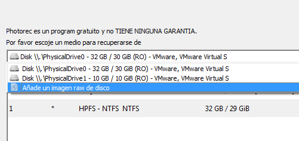

 

> [!note]
> 
 
> Es posible que necesitemos renombrar el archivo de volcado con extensión `.dd` para que Photorec lo reconozca correctamente.
> 

 

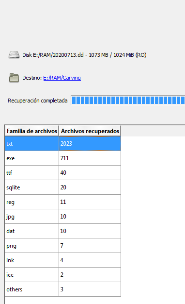

 

Con este proceso puedes averiguar qué imágenes, documentos u otros archivos había cargados en memoria cuando se realizó la captura, incluyendo imágenes que el usuario estaba visualizando en el navegador en ese preciso momento.

 

## Análisis con Volatility

 

### Identificar el perfil del sistema

 

Antes de cualquier análisis, Volatility necesita saber qué sistema operativo generó el volcado para aplicar las estructuras de datos correctas. El comando `imageinfo` analiza el volcado y sugiere los perfiles compatibles:

 

```
volatility -f imagen.dmp imageinfo
```

 

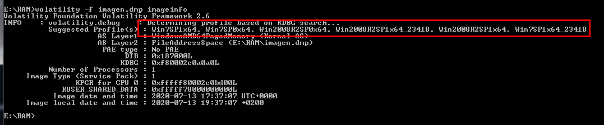

 

En el ejemplo el volcado corresponde a un sistema **Windows 7 Service Pack 1**. Los perfiles disponibles para este sistema son:
 

 
* `Win7SP1x64`
 
* `Win7SP1x64_23418`
 

 

A partir de aquí, todos los comandos seguirán la estructura:
 

```
volatility -f imagen.dmp --profile=Win7SP1x64 [opción]
```

 

También pueden usarse parámetros adicionales como `--dtb`, `--kdbg` y `--kpcr` si el análisis estándar no produce resultados correctos:
 

```
volatility -f imagen.dmp --profile=Win7SP1x64 --dtb=valor --kdbg=valor --kpcr=valor imageinfo
```

 

## Fecha y hora del volcado

 

Permite conocer exactamente cuándo se realizó el volcado de memoria. Este dato es fundamental para la línea de tiempo de la investigación y debe documentarse en el informe forense.

 

```
volatility -f imagen.dmp --profile=Win7SP1x64 imageinfo
```

 

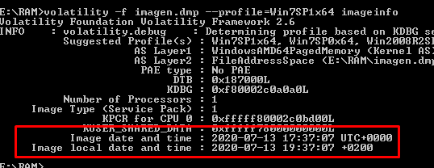

 

## Análisis de procesos

 

### Lista de procesos

 

Muestra todos los procesos que estaban en ejecución en el momento del volcado, con su PID, nombre, fecha de inicio y otros metadatos. Es uno de los primeros comandos que se ejecuta en cualquier análisis, ya que permite identificar procesos sospechosos o inusuales.

 

```
volatility -f imagen.dmp --profile=Win7SP1x64 pslist
```

 

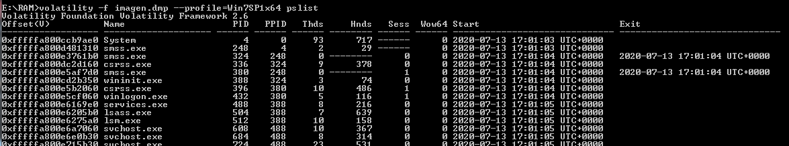

 

### Árbol de procesos dependientes

 

Muestra los procesos organizados en una jerarquía padre-hijo. Esto es especialmente útil para detectar malware, ya que un proceso malicioso suele aparecer como hijo de un proceso legítimo del sistema (por ejemplo, `cmd.exe` ejecutado desde `explorer.exe` podría ser normal, pero desde `svchost.exe` resultaría sospechoso).

 

```
volatility -f imagen.dmp --profile=Win7SP1x64 pstree
```

 

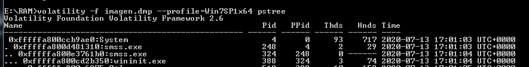

 

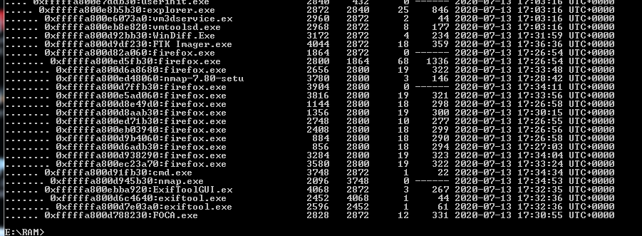

 

**PID:** identificador del proceso. **PPid:** identificador del proceso padre.

 

### Exportar árbol de procesos como grafo

 

Genera un archivo en formato DOT que puede visualizarse como un grafo interactivo, facilitando enormemente la comprensión de las relaciones entre procesos en sistemas con mucha actividad.

 

```
volatility -f imagen.dmp --profile=Win7SP1x64 pstree --output=dot --output-file=pstree.dot
```

 

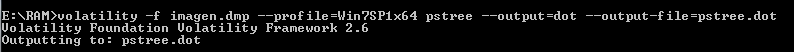

 

Abre el archivo generado en https://sketchviz.com/new y pega todo el código para visualizar el árbol de procesos.

 

## Extracción de información de procesos

 

### Extraer el espacio de memoria de un proceso

 

Una vez identificado un proceso de interés (por ejemplo Firefox con PID 2800), podemos volcar todo su espacio de memoria para analizarlo en busca de páginas web visitadas, credenciales, fragmentos de documentos u otra información sensible.

 

```
volatility -f imagen.dmp --profile=Win7SP1x64 vaddump -p 2800 --dump-dir=web
```

 

Una vez volcado, podemos buscar cadenas de texto dentro de los archivos generados:

 

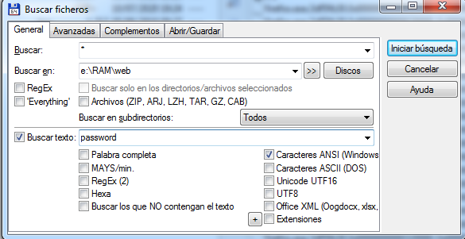

 

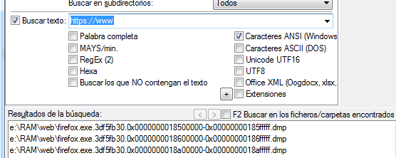

 

Por ejemplo buscar lo siguiente: "cursosmfr.es&password"

 

> [!note]
> 
 
> Esta técnica no se limita a navegadores web: puede aplicarse a cualquier proceso. Por ejemplo, volcando la memoria de Microsoft Word podríamos recuperar el contenido de un documento que el usuario estaba editando y nunca guardó, o volcando un lector de PDF podríamos ver el documento que tenía abierto.
> 

 

### Extraer el ejecutable completo de un proceso

 

Permite extraer el ejecutable del proceso tal como estaba cargado en memoria. Este archivo puede analizarse estáticamente, enviarse a VirusTotal o ejecutarse en un sandbox para estudiar su comportamiento.

 

```
volatility -f imagen.dmp --profile=Win7SP1x64 procdump -p 2800 --dump-dir=web
```

 

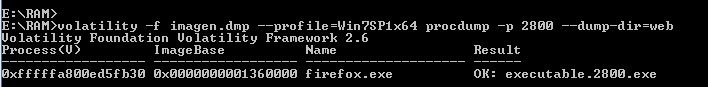

 

## Búsqueda de malware

 

El plugin `malfind` busca indicios de código malicioso inyectado en procesos legítimos. Detecta regiones de memoria con permisos de ejecución inusuales, que son una señal típica de técnicas como la inyección de procesos o el uso de shellcode.

 

```
volatility -f imagen.dmp --profile=Win7SP1x64 malfind >> malware.txt
```

 

El archivo generado contiene información sobre los procesos sospechosos. Un proceso limpio mostrará una representación hexadecimal normal:

 

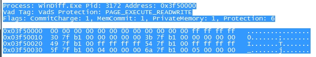

 

Un proceso con código inyectado mostraría una cabecera MZ (inicio de un ejecutable PE) en una región de memoria que no debería contenerla:

 

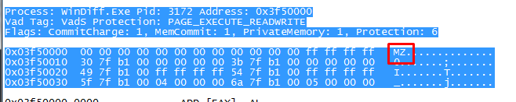

 

Si se detecta un proceso sospechoso (por ejemplo con PID 3172), el siguiente paso sería volcarlo y analizarlo:

 

```
volatility -f imagen.dmp --profile=Win7SP1x64 malfind --dump-dir=dump
```

 

## Extracción de credenciales

 

### Hashes de contraseñas (hashdump)

 

Windows almacena los hashes de las contraseñas de usuario en el archivo SAM del registro. Volatility puede extraer estos hashes directamente de la memoria, donde las estructuras del registro están cargadas. Primero identificamos las direcciones de memoria de las hives del registro:

 

```
volatility -f imagen.dmp --profile=Win7SP1x64 hivelist
```

 

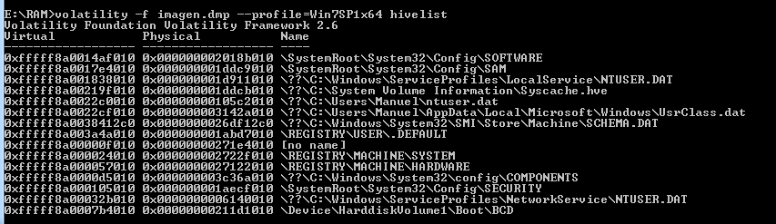

 

A continuación extraemos los hashes pasando la dirección virtual del hive SYSTEM con `-y` y la del archivo SAM con `-s`:

 

```
volatility -f imagen.dmp --profile=Win7SP1x64 hashdump -y 0xfffff8a000024010 -s 0xfffff8a0017e4010
```

 

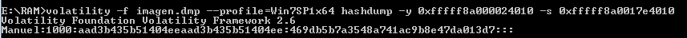

 

También puede funcionar directamente sin especificar las direcciones:
 

```
volatility -f imagen.dmp --profile=Win7SP1x64 hashdump
```

 

### Secretos LSA (lsadump)

 

El plugin `lsadump` extrae los secretos almacenados por el subsistema de seguridad LSA, que puede incluir credenciales usadas por DPAPI, la clave pública RDP o contraseñas de cuentas con autologin configurado.

 

```
volatility -f imagen.dmp --profile=Win7SP1x64 lsadump
```

 

O especificando las direcciones virtuales de SYSTEM y SECURITY:
 

```
volatility -f imagen.dmp --profile=Win7SP1x64 lsadump -y 0xfffff8a000024010 -s 0xfffff8a000105010
```

 

## Análisis del sistema de archivos y registro

 

### Archivos abiertos

 

Muestra una lista de todos los archivos que estaban abiertos en el momento del volcado. Permite conocer qué documentos, ejecutables o recursos de red tenía el sistema accediendo activamente.

 

```
volatility -f imagen.dmp --profile=Win7SP1x64 filescan
```

 

### Extraer el registro de Windows

 

Extrae los archivos del registro que estaban cargados en memoria. Estos archivos pueden analizarse posteriormente con herramientas especializadas como **RegRipper** para obtener artefactos forenses del registro: software instalado, dispositivos USB conectados, URLs visitadas, usuarios del sistema, etc.

 

```
volatility -f imagen.dmp --profile=Win7SP1x64 dumpregistry -D registro
```

 

### Extraer archivos de eventos (.evtx)

 

Los logs de eventos de Windows (`.evtx`) son una fuente fundamental de evidencia. Volatility puede extraerlos directamente de la caché de memoria usando el plugin `dumpfiles` con una expresión regular:

 

```bash
volatility -f imagen.dmp --profile=Win7SP1x64 dumpfiles --regex=.evtx$ --dump-dir=evtx
```

 

Una vez extraídos, pueden analizarse con **evtx_dump** para obtener información como las redes WiFi a las que el equipo se conectó, con sus fechas y horas de conexión.

 

## Análisis adicional

 

### Línea de tiempo

 

Genera una línea de tiempo completa con toda la actividad registrada en el volcado, ordenada cronológicamente. Es especialmente útil para reconstruir la secuencia de eventos durante un incidente y correlacionar acciones del atacante.

 

```
volatility -f imagen.dmp --profile=Win7SP1x64 timeliner > lineatiempo.txt
```

 

### Drivers en memoria

 

Lista todos los módulos del kernel cargados en memoria. La presencia de drivers desconocidos o sin firma puede ser indicativo de rootkits u otro tipo de malware a nivel de kernel.

 

```
volatility -f imagen.dmp --profile=Win7SP1x64 modules
```

 

### Servicios en memoria

 

Muestra todos los servicios de Windows registrados en el sistema, tanto los activos como los detenidos. Un atacante puede instalar servicios maliciosos para mantener persistencia.

 

```
volatility -f imagen.dmp --profile=Win7SP1x64 svcscan
```

 

### Comandos ejecutados en CMD

 

Extrae el historial de comandos ejecutados en consolas `cmd.exe` durante la sesión. Permite reconstruir qué acciones realizó el usuario o el atacante desde la línea de comandos.

 

```
volatility -f imagen.dmp --profile=Win7SP1x64 consoles
```

 

### Cadenas de texto del volcado completo

 

Extrae todas las cadenas de texto legibles del volcado completo. El archivo resultante puede analizarse con `grep` (Linux) o `findstr` (Windows) para buscar términos específicos: URLs, contraseñas, nombres de usuario, rutas de archivos, etc.

 

> [!note]
> 
 
> La combinación de todos estos comandos permite construir una imagen muy completa de lo que ocurrió en el sistema. En la práctica profesional, el análisis de memoria con Volatility suele ser el primer paso tras la adquisición, antes incluso que el análisis del disco, precisamente porque revela la actividad más reciente y puede apuntar directamente a los artefactos más relevantes del disco.
> 

 

## 📚 Navegación

 
 
 → Siguiente práctica
 
 
 ← Anterior: Adquisición de HDD
 
 
 ↑ Volver al Índice

---

> [[02 - MODULOS/05 - Prácticas (PoCs)|← Volver a Prácticas (PoCs)]] | [[02 - MODULOS/Prácticas (PoCs)/Gestión de Incidentes/00 - Índice del Módulo Gestión de Incidentes|Índice del Módulo]]
