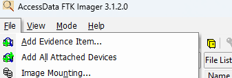
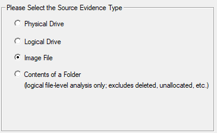
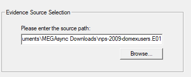
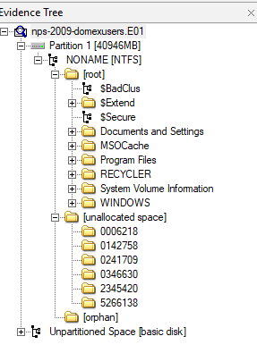

> [[02 - MODULOS/05 - Prácticas (PoCs)|← Volver a Prácticas (PoCs)]] | [[02 - MODULOS/Prácticas (PoCs)/Gestión de Incidentes/00 - Índice del Módulo Gestión de Incidentes|Índice del Módulo]]

---
# Análisis de Disco Forense con FTK Imager

# Análisis de Disco con FTK Imager

 

## Introducción al análisis de imágenes forenses

 

En las prácticas anteriores aprendimos a **adquirir** evidencias digitales: volcados de RAM con FTK Imager y DumpIt, e imágenes de disco en formato E01. Ahora comenzamos la fase de **análisis**, que es donde realmente extraemos el valor forense de esas imágenes.

 

Trabajar con una imagen forense tiene una ventaja fundamental sobre trabajar con el disco original: podemos abrir la imagen, explorar su contenido, buscar archivos, recuperar datos eliminados y exportar evidencias, todo ello **sin modificar en ningún momento el original**. La imagen actúa como una instantánea congelada del estado del disco en el momento de la adquisición.

 

FTK Imager no es solo una herramienta de adquisición: también es un **visor y explorador de imágenes forenses** completo. Permite navegar por la estructura del sistema de archivos, visualizar archivos individuales, examinar los metadatos asociados, buscar contenido específico y exportar datos relevantes para la investigación.

 

## FTK Imager como herramienta de análisis

 

Desarrollado por AccessData (ahora parte de Exterro), FTK Imager es una de las herramientas más utilizadas en investigaciones forenses profesionales. Sus principales capacidades de análisis son:

 

 
1. **Adquisición de imágenes forenses:** crea imágenes de discos físicos, lógicos, memoria RAM y realiza copias bit a bit de medios de almacenamiento.
 
2. **Soporte para múltiples formatos:** compatible con EnCase (E01), Advanced Forensic Format (AFF), Raw (DD) y otros, lo que permite interoperabilidad con otras herramientas forenses.
 
3. **Análisis de imágenes forenses:** permite navegar por la estructura del sistema de archivos, buscar archivos específicos, ver el contenido de archivos individuales y extraer datos relevantes.
 
4. **Verificación de integridad:** incluye funciones de validación mediante hash para garantizar que las adquisiciones son correctas y que los datos no han sido modificados.
 
5. **Funcionalidades adicionales:** montaje de imágenes como unidades lógicas, búsqueda en archivos y metadatos, y generación de informes de evidencia forense.
 

 

> [!note]
> 
 
> La versión gratuita **FTK Imager Lite** cubre perfectamente las necesidades de esta práctica. Para análisis forense más profundo y automatizado existe la versión comercial **FTK (Forensic Toolkit)**, que incorpora búsqueda por palabras clave, indexación completa del disco, análisis de correo electrónico y otras funcionalidades avanzadas.
> 

 

## La imagen de práctica: nps-2009-domexusers.E01

 

Para esta práctica trabajaremos con el archivo **nps-2009-domexusers.E01**, una imagen forense real creada por el *National Institute of Standards and Technology (NIST)* como parte de su programa de *Digital Forensics Tool Testing*. Estas imágenes se distribuyen públicamente para que los investigadores puedan practicar y validar sus técnicas forenses sobre casos reales documentados.

 

Al tratarse de una imagen E01, contiene una copia exacta y verificable de un disco de un sistema Windows con usuarios de dominio (*domain users*), lo que nos permitirá practicar la exploración del sistema de archivos, la búsqueda de artefactos y la extracción de evidencias en un entorno controlado y reproducible.

 

## Análisis de la imagen con FTK Imager

 

### Paso 1: Abrir FTK Imager y añadir la evidencia

 

Instala y abre FTK Imager. Ve a **File → Add Evidence Item** para cargar la imagen forense.

 

 

### Paso 2: Seleccionar el tipo de evidencia

 

Marcamos **Image File** ya que vamos a abrir una imagen forense previamente adquirida, no un disco físico conectado al equipo.

 

 

### Paso 3: Seleccionar el archivo de imagen

 

Navegamos hasta el archivo **nps-2009-domexusers.E01** y lo seleccionamos. Si la imagen está dividida en segmentos (E01, E02, E03...) basta con seleccionar el primer segmento: FTK Imager reconocerá automáticamente el resto.

 

 

Pulsamos **Finish** para cargar la imagen.

 

### Paso 4: Explorar el contenido de la imagen

 

Una vez cargada, FTK Imager muestra el árbol de la imagen en el panel izquierdo, con todos los volúmenes y particiones detectados. Desde aquí podemos explorar la estructura del sistema de archivos exactamente como si fuera un disco real, pero en modo de solo lectura.

 

 

> [!note]
> 
 
> En el panel de árbol verás que FTK Imager distingue entre archivos activos, archivos en la papelera de reciclaje y **archivos eliminados** (marcados con una X roja). Esta capacidad de ver archivos eliminados es uno de los aspectos más valiosos del análisis forense de disco: incluso si el usuario borró un archivo, la imagen forense puede conservar su contenido mientras el espacio no haya sido sobreescrito.
> 

 

A partir de este punto podemos explorar libremente el contenido de la imagen: navegar por carpetas, visualizar archivos, comprobar metadatos, exportar evidencias y buscar artefactos relevantes para la investigación.

 

## 📚 Navegación

 
 
 → Siguiente práctica
 
 
 ← Anterior: Análisis de RAM
 
 
 ↑ Volver al Índice

---

> [[02 - MODULOS/05 - Prácticas (PoCs)|← Volver a Prácticas (PoCs)]] | [[02 - MODULOS/Prácticas (PoCs)/Gestión de Incidentes/00 - Índice del Módulo Gestión de Incidentes|Índice del Módulo]]
