> [[02 - MODULOS/05 - Prácticas (PoCs)|← Volver a Prácticas (PoCs)]] | [[02 - MODULOS/Prácticas (PoCs)/Gestión de Incidentes/00 - Índice del Módulo Gestión de Incidentes|Índice del Módulo]]

---
# Análisis Integral de Disco con Autopsy

# Análisis de Disco con Autopsy

 

## ¿Qué es Autopsy?

 

Autopsy es un software forense digital de código abierto ampliamente utilizado en investigaciones criminales y de seguridad cibernética. Su disponibilidad gratuita, su interfaz gráfica intuitiva y su potente motor de análisis lo convierten en una de las herramientas más populares de la comunidad forense. Sus principales capacidades son:

 

 
1. **Análisis de imágenes forenses:** examina imágenes en formatos como EnCase (E01) y Raw (DD), entre otros.
 
2. **Interfaz gráfica intuitiva:** facilita la navegación y el acceso a funcionalidades sin necesidad de línea de comandos.
 
3. **Análisis de sistemas de archivos y metadatos:** explora la estructura del sistema de archivos, visualiza archivos y carpetas, y examina metadatos como fechas de creación, modificación y tamaños.
 
4. **Carving de archivos:** busca y extrae archivos eliminados o fragmentados, recuperando evidencia que pudo haber sido borrada intencionalmente.
 
5. **Búsqueda por palabras clave:** permite búsquedas en archivos y metadatos, con soporte para expresiones regulares y hash de archivos.
 
6. **Análisis de artefactos digitales:** extrae historiales de navegación, registros de chat, correos electrónicos, actividad en redes sociales y más.
 
7. **Generación de informes:** crea informes forenses detallados con capturas, metadatos, registros de actividad y otra información relevante.
 

 

## Análisis de HDD con Autopsy

 

Para esta práctica usaremos el archivo **nps-2009-domexusers.E01**.

 

### Paso 1: Instalar y abrir Autopsy

 

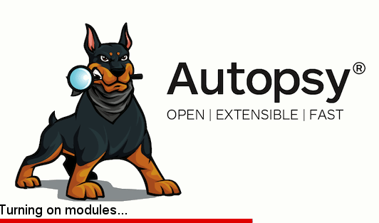

 

### Paso 2: Crear un nuevo caso

 

Comenzamos creando un **Nuevo Caso** y seleccionando el directorio de trabajo donde se almacenará toda la información del análisis.
 

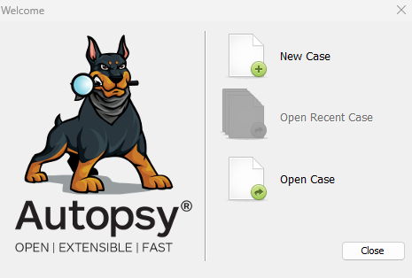

 

### Paso 3: Rellenar los datos del caso

 

Rellenamos el nombre del caso y seleccionamos el directorio donde se guardarán los resultados. Es importante elegir una ruta con suficiente espacio en disco.
 

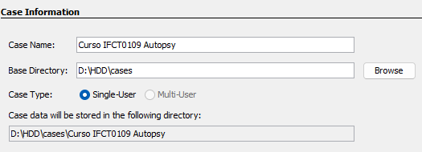

 

Pulsamos **Next**.

 

### Paso 4: Datos adicionales del caso

 

Rellenamos los datos adicionales del caso (número de caso, examinador, etc.) y pulsamos **Finish**.
 

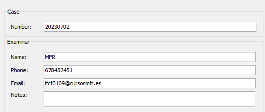

 

### Paso 5: Añadir la fuente de datos

 

El siguiente paso es añadir la fuente de datos. Podemos añadirla en este momento o más adelante desde el botón correspondiente.
 

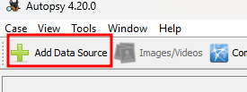

 

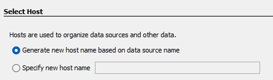

 

La adquisición es una imagen, en concreto el archivo **nps-2009-domexusers.E01**.
 

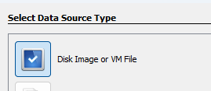

 

Seleccionamos el archivo y la zona horaria correcta.
 

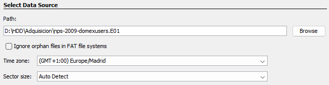

 

En los módulos de ingest dejamos todos marcados **excepto Plaso**.

 

> [!note]
> 
 
> **Plaso** (anteriormente conocido como log2timeline) es un módulo utilizado para el análisis de registros temporales y la generación de líneas de tiempo forenses. Se excluye porque tarda mucho tiempo en completarse. Seleccionando cada módulo de ingest se puede ver la descripción de su función.
> 

 

Pulsamos **Next** y, tras un breve momento, podemos finalizar.

 

### Paso 6: Esperar a que finalice el triaje

 

Comienza ahora un proceso que puede durar bastante tiempo, durante el cual Autopsy analiza y clasifica toda la información de la imagen. En la zona inferior se puede ver el progreso y haciendo clic se muestra el punto en el que se encuentra.
 

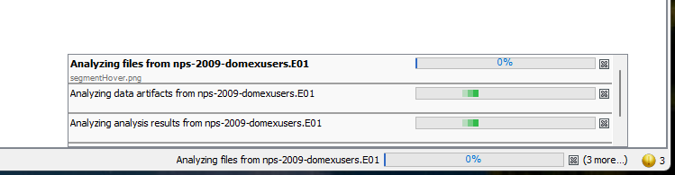

 

## Entorno de Autopsy

 

El entorno del programa está dividido en varias zonas bien diferenciadas.
 

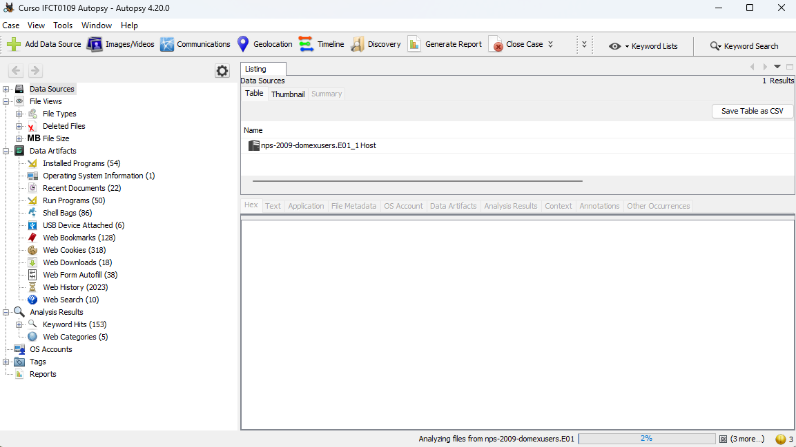

 

### Árbol de vista

 

El panel izquierdo muestra la estructura del sistema de archivos de la imagen forense. Puedes navegar por el árbol para explorar carpetas y archivos. La información va apareciendo progresivamente según avanza el triaje.
 

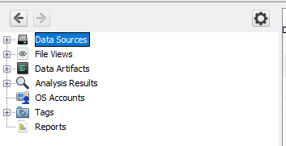

 

> [!note]
> 
 
> **Data Sources:** estructura de datos tal y como se ve en la fuente.
> 
 **File Views:** archivos ordenados por tipo y distintas características.
> 
 **Artefactos:** artefactos del sistema operativo y aplicaciones.
> 
 **Cuentas del sistema:** usuarios y cuentas identificadas.
> 
 **Tags:** etiquetas que crearemos nosotros para marcar elementos relevantes.
> 
 **Informes:** generados por Autopsy en función de la actividad realizada.
> 

 

### Visor de archivos

 

Al hacer doble clic en un archivo en el árbol de vista, se abre el visor de archivos en el panel central. Aquí puedes ver el contenido del archivo seleccionado: texto, imágenes, documentos, etc. Autopsy también muestra metadatos y miniaturas para facilitar el análisis.
 

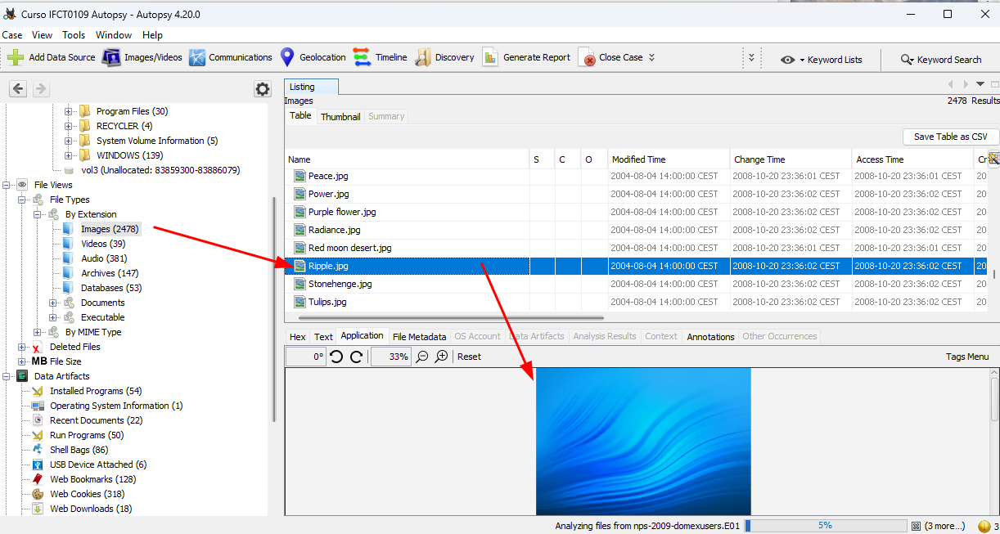

 

### Vista DataResult

 

Proporciona una visión general de los atributos y metadatos de los elementos analizados. La información que muestra incluye:
 

 
* **Nombre del archivo:** nombre del archivo o carpeta analizada.
 
* **Tamaño del archivo:** tamaño en bytes.
 
* **Ruta:** ubicación completa en la imagen forense.
 
* **Fecha y hora:** fechas de creación, modificación y acceso.
 
* **Tipo de archivo:** documento, imagen, vídeo, etc.
 
* **MD5, SHA1, SHA256:** hashes del archivo para verificación de integridad.
 
* **Estado:** "eliminado" o "normal".
 
* **Etiquetas:** etiquetas asignadas al archivo.
 
* **Flags:** información adicional, como si está marcado como relevante o potencialmente malicioso.
 

 

> [!note]
> 
 
> **S (Score):** marca si el ítem está etiquetado (botón derecho → Tags para aplicar distintas opciones).
> 
 **C (Comentarios):** comentarios añadidos por el analista.
> 
 **O (Ocurrencias):** cuántas veces se ha visto el documento en casos pasados.
> 

 

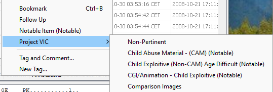

 

En esta vista podemos pulsar el botón derecho sobre un elemento para extraerlo de la adquisición, abrirlo con software específico, localizarlo en distintas posiciones o crear un tag para tenerlo más localizado.
 

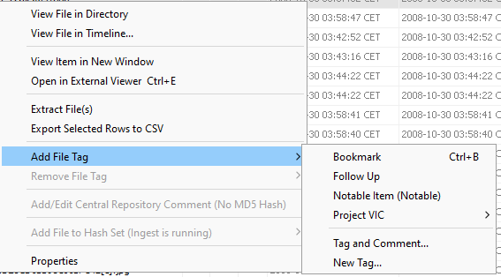

 

### Vista File Content

 

Muestra el contenido del archivo seleccionado en la vista DataResult. Las posibilidades de visualización incluyen:
 

 
* **Vista de texto:** muestra el contenido legible del archivo.
 
* **Vista hexadecimal:** muestra los datos binarios en formato hexadecimal, útil para análisis a nivel de bytes.
 
* **Vista de imagen:** muestra imágenes con herramientas de zoom.
 
* **Vista de miniaturas:** genera previsualizaciones rápidas de múltiples imágenes.
 
* **Vista de metadatos:** muestra metadatos como EXIF en imágenes, autor y fecha en documentos.
 
* **Vista de estructura:** muestra la estructura interna de archivos compuestos como documentos Office o ZIP.
 
* **Anotaciones:** permite añadir notas sobre el contenido analizado.
 

 

## Panel de vistas

 

En la parte superior tenemos el panel de vistas que permite acceder y explorar diferentes aspectos de la investigación de forma organizada.
 

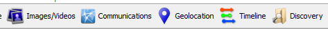

 

### Images/Videos

 

Muestra todas las imágenes y vídeos identificados durante el análisis. Incluye miniaturas para previsualizarlos rápidamente, metadatos (fecha, dimensiones, información EXIF) y herramientas de filtrado y clasificación.

 

### Communications

 

Permite examinar y analizar las comunicaciones: mensajes, correos electrónicos, chats, etc. Muestra remitente, destinatario, fecha, hora y contenido. Incluye opciones de filtrado, análisis de metadatos y exportación de datos.

 

### Geolocation

 

Visualiza y analiza datos de geolocalización extraídos de la imagen. Puede integrarse con mapas interactivos para mostrar ubicaciones, identificar patrones de movimiento y resaltar puntos de interés. Dispone de filtrado por fechas, palabras clave y otros criterios.

 

### Timeline

 

Muestra una secuencia cronológica de todos los eventos extraídos: creación y modificación de archivos, accesos al sistema, actividad de red, instalación de software, etc. Permite filtrar por rango de fechas, tipos de eventos y palabras clave, y está sincronizado con otras vistas para correlacionar eventos.

 

### Discovery

 

Permite realizar búsquedas avanzadas de información según diversos criterios definibles por el analista.

 

### Generate Report

 

Genera informes detallados y personalizados sobre los resultados de la investigación, listos para su presentación o inclusión en el expediente del caso.

 

### Keyword Search

 

Permite buscar palabras clave y términos específicos en todos los datos forenses. Soporta múltiples términos separados por comas y operadores lógicos (AND, OR, NOT). Incluye previsualizaciones del contexto en que aparecen los términos, filtrado de resultados y exportación.

 

### Keyword List

 

Sirve para definir búsquedas según palabras clave y máscaras predefinidas. Desde el panel se accede a **Manage List** para crear listas personalizadas con términos relacionados con el caso. Los resultados aparecerán agrupados en la zona de tags, facilitando su localización.

 

## Módulos Ingest

 

Autopsy cuenta con módulos de ingreso que permiten la extracción y análisis automatizado de diferentes tipos de evidencia digital:

 

 
1. **File Ingest Modules:** extracción y análisis de archivos en diversos formatos: imágenes de disco (E01), ZIP, documentos Office, PDF, correos electrónicos (PST, MBOX), bases de datos, entre otros.
 
2. **Mobile Device Ingest Modules:** extracción de datos de dispositivos Android e iOS: contactos, mensajes, registros de llamadas, fotos, vídeos y ubicaciones geográficas.
 
3. **Internet Artifacts Ingest Modules:** historial de navegación, cookies, cachés, descargas, actividad en redes sociales y correo electrónico.
 
4. **Registry Ingest Module:** extracción y análisis del registro de Windows, que almacena configuraciones, metadatos y datos del sistema operativo y las aplicaciones instaladas.
 
5. **Thumbnail Ingest Module:** extrae miniaturas de imágenes y vídeos para identificar rápidamente contenido visual relevante y agilizar la revisión.
 

 

## 📚 Navegación

 
 
 → Siguiente práctica
 
 
 ← Anterior: Análisis con FTK Imager
 
 
 ↑ Volver al Índice

---

> [[02 - MODULOS/05 - Prácticas (PoCs)|← Volver a Prácticas (PoCs)]] | [[02 - MODULOS/Prácticas (PoCs)/Gestión de Incidentes/00 - Índice del Módulo Gestión de Incidentes|Índice del Módulo]]
