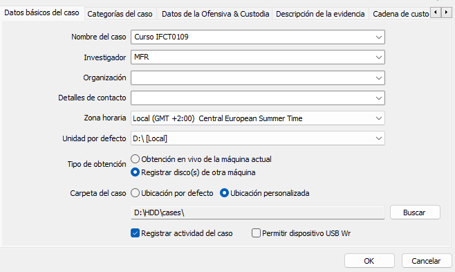
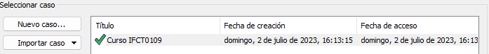
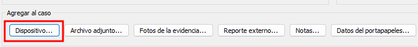
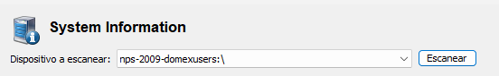
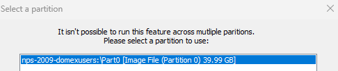

> [[02 - MODULOS/05 - Prácticas (PoCs)|← Volver a Prácticas (PoCs)]] | [[02 - MODULOS/Prácticas (PoCs)/Gestión de Incidentes/00 - Índice del Módulo Gestión de Incidentes|Índice del Módulo]]

---
# Análisis Forense con OSForensics

# Análisis de Disco con OS Forensics

 

## ¿Qué es OS Forensics?

 

OSForensics es un software forense para sistemas operativos Windows que proporciona una amplia gama de herramientas diseñadas para examinar y recuperar datos en investigaciones digitales. Sus principales características son:

 

 
1. **Análisis del sistema:** recopila información exhaustiva sobre hardware, software instalado, usuarios, registros de eventos, servicios y más.
 
2. **Recuperación de archivos:** busca y recupera archivos borrados o fragmentados, reconstruyendo datos de sectores no asignados.
 
3. **Análisis de archivos y metadatos:** examina propiedades, fechas de creación y modificación, atributos y realiza análisis de hash comparándolos con bases de datos de hashes conocidos.
 
4. **Búsqueda avanzada:** búsqueda rápida por palabras clave, expresiones regulares y operadores lógicos en discos e imágenes forenses.
 
5. **Análisis de memoria:** adquiere y analiza la memoria volátil en busca de procesos, archivos abiertos, conexiones de red y claves de registro.
 
6. **Análisis de internet:** examina historial de navegación, cookies, archivos temporales y otras actividades en línea.
 
7. **Informes forenses:** genera informes detallados con capturas de pantalla, metadatos, registros y otra información relevante.
 

 

## Análisis de HDD con OS Forensics

 

Para esta práctica usaremos el archivo **nps-2009-domexusers.E01**.

 

### Paso 1: Instalar y abrir OS Forensics

 

Instala OS Forensics y ábrelo. Utilizaremos la **versión Trial**.

 

### Paso 2: Crear un nuevo caso

 

Ve al menú **Gestionar Caso**, crea un **Nuevo Caso** y rellena los datos básicos.
 

 

Pulsamos **OK**.

 

### Paso 3: Añadir la fuente de datos al caso

 

Seguimos en el menú **Gestionar Caso** con el caso recién creado seleccionado en la parte superior.
 

 

En la zona *Agregar al caso*, seleccionamos **Dispositivo...**
 

 

Vamos a añadir una imagen de adquisición, por lo que en la siguiente ventana marcamos **Archivo de imagen** y navegamos hasta el archivo **nps-2009-domexusers.E01**, usando el archivo de imagen completo.
 

 

Pulsamos **OK**.

 

### Paso 4: Explorar la imagen

 

Una vez cargada la imagen, podemos movernos por toda su información. Por ejemplo, podemos ir al apartado **Información del sistema**. En cada apartado, en la zona superior aparecerá la adquisición cargada. Pulsamos **Escanear**.
 

 

Seleccionamos la partición y pulsamos **OK**.
 

 

Y veremos la información del apartado correspondiente.

 

## 📚 Navegación

 
 
 → Siguiente práctica
 
 
 ← Anterior: Análisis con Autopsy
 
 
 ↑ Volver al Índice

---

> [[02 - MODULOS/05 - Prácticas (PoCs)|← Volver a Prácticas (PoCs)]] | [[02 - MODULOS/Prácticas (PoCs)/Gestión de Incidentes/00 - Índice del Módulo Gestión de Incidentes|Índice del Módulo]]
