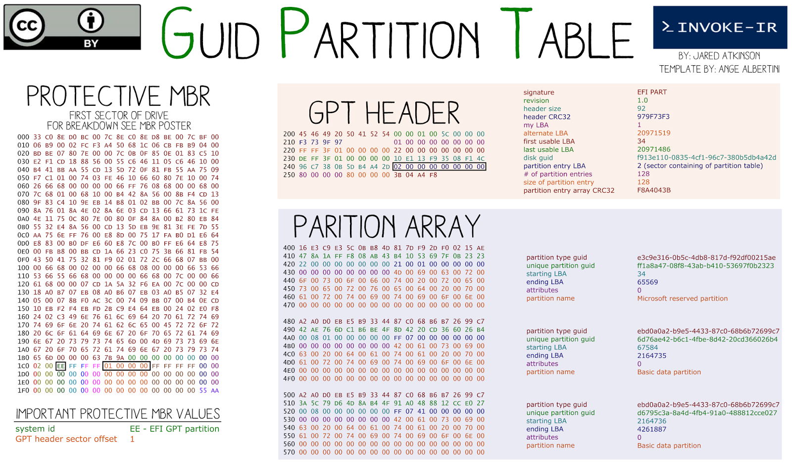
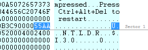
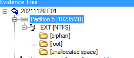
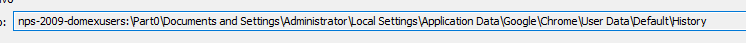
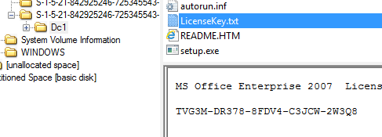
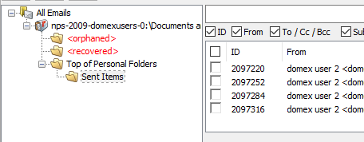

> [[02 - MODULOS/05 - Prácticas (PoCs)|← Volver a Prácticas (PoCs)]] | [[02 - MODULOS/Prácticas (PoCs)/Gestión de Incidentes/00 - Índice del Módulo Gestión de Incidentes|Índice del Módulo]]

---
# Práctica: Análisis Forense de Disco (20 Preguntas)

# Práctica: Análisis de Disco Forense

 

## Instrucciones

 

Usa las herramientas vistas en las prácticas anteriores (FTK Imager, Autopsy u OS Forensics) para analizar la imagen **nps-2009-domexusers.E01** y responde las siguientes preguntas. Bajo cada pregunta encontrarás una pista que te indica dónde buscar la respuesta. Selecciona tu respuesta y pulsa **Comprobar**.

 
 
 Pregunta 1
 

¿Qué tipo de tabla de particiones tiene el disco?
 A. GUID Partition Table / GPT.
 B. MBR.
 C. NTFS.
 D. No es posible determinarlo.
 Comprobar
 
 

💡 Pista: En RAW Disk Viewer de FTK Imager.
 

 

 

 
 
 Pregunta 2
 

¿Cuántas particiones tiene el disco?
 A. Una partición primaria.
 B. Una partición extendida.
 C. Dos particiones (una primaria y una extendida).
 D. Dos particiones primarias.
 Comprobar
 
 

💡 Pista: El sistema numera las 4 primeras particiones; a partir de la 4ª empiezan las extendidas.
 

 

 
 
 Pregunta 3
 

¿Qué programas de mensajería instantánea hay instalados en el sistema? Elige la respuesta que mejor se ajuste.
 A. AIM de AOL.
 B. Windows Messenger.
 C. Son correctas A y B.
 D. Ninguna de las anteriores.
 Comprobar
 
 

💡 Pista: En User Activity → Installed Programs.
 

 
 
 Pregunta 4
 

¿Qué usuario descargó (e instaló) el programa Pidgin?
 A. Administrator.
 B. Domex1.
 C. Domex2.
 D. Ninguno de ellos.
 Comprobar
 
 

💡 Pista: En User Activity → Browse History.
 

 
 
 Pregunta 5
 

¿En cuál de estos momentos se inicia la instalación de Pidgin?
 A. 2008-10-21 00:43:20.
 B. 2008-10-20 03:01:32.
 C. 2008-10-21 19:49:45.
 D. 2008-10-21 04:18:18 GMT.
 Comprobar
 
 

💡 Pista: En User Activity → Installed Programs. Revisa la hora GMT de la imagen.
 

 
 
 Pregunta 6
 

¿Cuál de las siguientes cuentas NO tiene configurada el usuario domex1 en Pidgin?
 A. domexuser1 (AIM).
 B. domexuser1@gmail.com (Jabber).
 C. domexuser1@live.com (MSN).
 D. domexuser1@hotmail.com (MSN).
 Comprobar
 
 

💡 Pista: En domex1 → Application Data →.purple → accounts.xml.
 

 
 
 Pregunta 7
 

¿A qué tipo de sistema parece corresponder la imagen que estamos analizando?
 A. A una máquina virtual VMware.
 B. A una máquina virtual VirtualBox.
 C. A una máquina virtual Xen.
 D. A una máquina física.
 Comprobar
 
 

💡 Pista: En User Activity → Installed Programs.
 

 
 
 Pregunta 8
 

¿Cuál de los siguientes usuarios ha utilizado Microsoft Outlook para descargar su correo?
 A. Administrator.
 B. domex1.
 C. domex2.
 D. Ninguno de ellos.
 Comprobar
 
 

💡 Pista: En domex2 → Application Data → Outlook lo tiene configurado.
 

 
 
 Pregunta 9
 

¿Con qué navegador web se ha accedido a la URL `http://internap.dl.sourceforge.net/sourceforge/pidgin/pidgin-2.5.2.exe`? Elige la respuesta que mejor se ajuste.
 A. Con Internet Explorer.
 B. Con Mozilla Firefox.
 C. Con Google Chrome.
 D. Con todos ellos.
 Comprobar
 
 

💡 Pista: Busca en el historial de navegación de Chrome.
 

 

 
 
 Pregunta 10
 

De acuerdo con los archivos recientes del usuario Administrator, ¿en qué ruta se encontraba el instalador de Office 2007 y su correspondiente clave de licencia?
 A. En un pendrive USB.
 B. En un disco DVD.
 C. En una carpeta compartida de otro equipo en la red.
 D. En el escritorio del usuario.
 Comprobar
 
 

💡 Pista: En User Activity → Link Files.
 

 
 
 Pregunta 11
 

Mirando el archivo `c:\windows\setuplog.txt`, ¿cuál de estos atributos indica el momento en que se instaló Windows en este ordenador?
 A. Su m-time: 2008-10-21 03:34:37 GMT.
 B. Su a-time: 2008-10-21 03:34:37 GMT.
 C. Su c-time: 2008-10-21 03:34:37 GMT.
 D. Su b-time: 2008-10-20 14:30:17 GMT.
 Comprobar
 
 

💡 Pista: Mira el inicio del registro del archivo nombrado en el setuplog.txt.
 

 
 
 Pregunta 12
 

Según el log de sistema de Windows (SysEvent.Evt), ¿a qué hora se produce por primera vez el evento 6005 («The Event log service was started»)? Elige la respuesta que mejor se ajuste.
 A. 2008-10-21 03:34:37 GMT.
 B. 2008-10-20 14:30:17 GMT.
 C. 2008-10-20 16:30:17 GMT.
 D. B y C son correctas.
 Comprobar
 
 

💡 Pista: Exporta Windows\System32\Config\SysEvent.Evt, busca el ID 6005 y en Detalles del evento mira la Hora del sistema.
 

 
 
 Pregunta 13
 

Atendiendo al registro de Windows correspondiente al usuario domex1, ¿cuál de estas aplicaciones figura bajo `Software\Netscape Navigator\User Trusted External Applications`? Elige la respuesta que mejor se ajuste.
 A. wordpad.exe.
 B. zip.exe.
 C. wmplayer.exe.
 D. Todas las opciones son correctas.
 Comprobar
 
 

💡 Pista: En el registro DEFAULT siguiendo la ruta indicada.
 

 
 
 Pregunta 14
 

Según el registro de Windows, ¿qué valor tiene `HKEY_LOCAL_MACHINE\Software\mozilla.org\Mozilla\CurrentVersion`?
 A. Esa entrada no existe en el registro de la máquina analizada.
 B. 1.0.
 C. 2.0.37.
 D. 1.9.0.3.
 Comprobar
 
 

💡 Pista: En el registro SOFTWARE siguiendo la ruta indicada.
 

 
 
 Pregunta 15
 

A la vista de los contenidos de la papelera de reciclaje, ¿cuál es la clave de licencia que acompañaba al programa de instalación de Office 2007?
 A. TVG3M-DR378-8FDV4-C3JCW-2W3Q8.
 B. TT3M8-H3469-V89G6-8FWK7-D3Q9Q.
 C. KGFVY-7733B-8WCK9-KTG64-BC7D8.
 D. Ninguna de las anteriores.
 Comprobar
 
 

💡 Pista: Con FTK Imager, examina la papelera de reciclaje.
 

 

 
 
 Pregunta 16
 

¿Cuántos mensajes de correo electrónico hay en el fichero «Outlook.pst» bajo el perfil del usuario domex2?
 A. Uno (1).
 B. Cuatro (4).
 C. Cinco (5).
 D. Trece (13).
 Comprobar
 
 

💡 Pista: En domex2 → Local Settings → App Data → Microsoft → Outlook.
 

 
 
 Pregunta 17
 

¿En qué carpeta se encuentran dichos mensajes?
 A. Buzón de entrada / inbox.
 B. Buzón de salida / outbox.
 C. Borradores / drafts.
 D. Enviados / sent items.
 Comprobar
 
 

 

 
 
 Pregunta 18
 

¿De cuál de estos dominios tiene una cookie de Internet Explorer el usuario Administrator? Elige la respuesta que mejor se ajuste.
 A. doubleclick.net.
 B. picasa.google.com.
 C. thunderbird.com.
 D. De todos ellos.
 Comprobar
 
 

💡 Pista: Internet Explorer guarda las cookies en la carpeta Cookies del perfil de usuario.
 

 
 
 Pregunta 19
 

¿De cuál de estos dominios tiene una cookie de Google Chrome el usuario Administrator? Elige la respuesta que mejor se ajuste.
 A. microsoft.com.
 B. nationalgeographic.com.
 C. tools.google.com.
 D. De todos ellos.
 Comprobar
 
 

💡 Pista: Chrome guarda las cookies en `AppData\Local\Google\Chrome\User Data\Default`.
 

 
 
 Pregunta 20
 

¿De cuál de estos dominios tiene una cookie de Mozilla Firefox el usuario domex1? Elige la respuesta que mejor se ajuste.
 A. aol.com.
 B. microsoft.com.
 C. unir.net.
 D. De todos ellos.
 Comprobar
 
 

💡 Pista: Firefox guarda las cookies en `Application Data\Mozilla\Firefox\Profiles\ngem72bk.default` en un archivo SQLite.
 

 

## 📚 Navegación

 
 
 → Siguiente práctica
 
 
 ← Anterior: Análisis con OS Forensics
 
 
 ↑ Volver al Índice

---

> [[02 - MODULOS/05 - Prácticas (PoCs)|← Volver a Prácticas (PoCs)]] | [[02 - MODULOS/Prácticas (PoCs)/Gestión de Incidentes/00 - Índice del Módulo Gestión de Incidentes|Índice del Módulo]]
