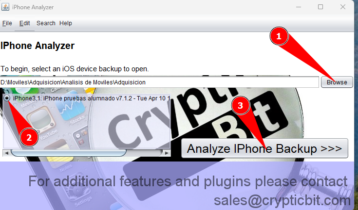
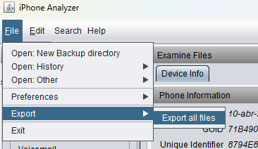
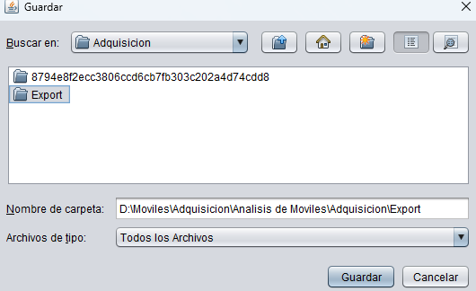
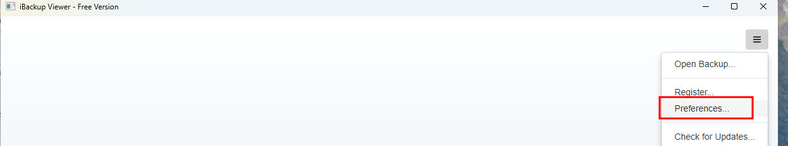
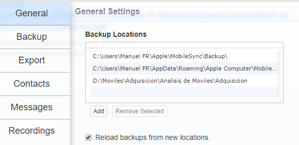
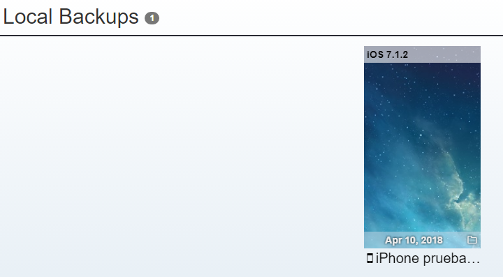
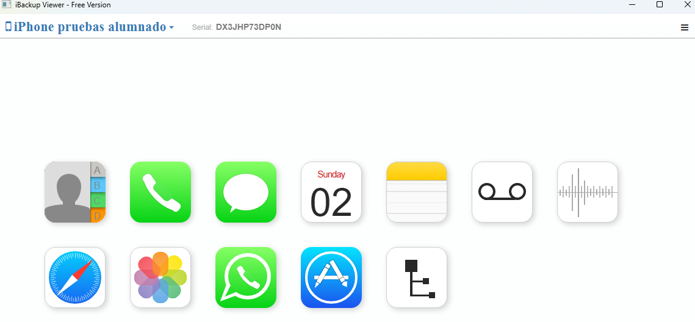

> [[02 - MODULOS/05 - Prácticas (PoCs)|← Volver a Prácticas (PoCs)]] | [[02 - MODULOS/Prácticas (PoCs)/Gestión de Incidentes/00 - Índice del Módulo Gestión de Incidentes|Índice del Módulo]]

---
# Análisis Forense de Móviles (iPhone / iOS)

# Análisis Forense de Móviles

 

## Introducción al análisis forense de dispositivos móviles

 

El análisis forense de dispositivos móviles es una de las áreas de mayor crecimiento dentro de la informática forense. Los smartphones acumulan una cantidad enorme de información sobre sus propietarios: contactos, mensajes, llamadas, correos electrónicos, fotos, vídeos, ubicaciones GPS, historial de navegación, contraseñas almacenadas, actividad en redes sociales y mucho más. En muchas investigaciones, el teléfono móvil se ha convertido en la fuente de evidencia más valiosa.

 

A diferencia del análisis de disco de un ordenador, el forense móvil presenta desafíos particulares:
 

 
* Los sistemas operativos móviles (iOS, Android) aplican **cifrado por defecto** que dificulta el acceso a los datos.
 
* Los backups (copias de seguridad) son frecuentemente la vía de acceso más accesible a los datos del dispositivo.
 
* Cada fabricante y versión de sistema operativo puede almacenar los datos de forma diferente.
 
* Los datos se distribuyen entre múltiples formatos: bases de datos SQLite, archivos PList, imágenes y documentos.
 

 

En esta práctica analizaremos una **adquisición de un iPhone** a través de su backup. Trabajaremos con varias herramientas especializadas que nos permitirán extraer y visualizar los distintos tipos de datos almacenados en el dispositivo.

 

### Herramientas que usaremos

 

 
* **iPhone Analyzer:** herramienta de análisis forense de backups de iOS que permite explorar la estructura de archivos y exportar el contenido para su análisis individual.
 
* **iBackup Viewer:** visualizador de backups de iPhone que presenta la información de forma organizada por categorías (mensajes, contactos, fotos, etc.), facilitando la localización de evidencias concretas.
 
* **DB Browser for SQLite:** explorador de bases de datos SQLite. iOS almacena gran parte de su información (mensajes, historial de llamadas, contactos, notas) en este formato.
 
* **PListExplorer:** visor de archivos PList, el formato XML propietario de Apple usado para almacenar configuraciones, preferencias y datos de aplicaciones.
 

 

## Preparación del entorno

 

Descarga el archivo con todos los recursos necesarios:

 

 
* ⬇️ Descargar analisis_moviles.7z
 

 

Descomprime el archivo usando la contraseña: `Z2$bAF2siVx4`

 

Se creará una carpeta llamada **Análisis de Móviles** con dos subcarpetas: `programas` (herramientas) y `adquisicion` (la imagen del iPhone).

 

### Instalación de herramientas

 

Entra en la carpeta `programas` y sigue estos pasos:
 

 
1. Instalar **jre-8u311** (Java Runtime Environment, necesario para iPhone Analyzer).
 
2. Instalar **iBackup Viewer Setup**.
 
3. Descomprimir **pslistexplorer**.
 
4. Descomprimir **Sqlite** (DB Browser for SQLite).
 
5. Abrir y tener preparados: **iBackup Viewer**, **iPhone Analyzer**, **SQLite** y **PListExplorer**.
 

 

### Preparar la adquisición

 

Entra en la carpeta `adquisicion` y descomprime:
 

```
8794e8f2ecc3806ccd6cb7fb303c202a4d74cdd8.zip
```

 

> [!note]
> 
 
> La carpeta `export` contiene los archivos de la adquisición ya extraídos con iPhone Analyzer. Si el proceso de exportación tarda demasiado durante la práctica, puedes usar directamente los archivos de esta carpeta.
> 

 

## Abrir la adquisición con iPhone Analyzer

 

iPhone Analyzer es una herramienta de análisis forense que interpreta la estructura interna de los backups de iOS, permitiendo explorar sus archivos y exportarlos para su análisis posterior con otras herramientas.

 

 
1. Abre **iPhone Analyzer**.
 
2. Pulsa **Browse** y navega hasta la carpeta `adquisicion`.
 
3. Marca **iPhone 3.1** y pulsa el botón **Analyze iPhone Backup**.
 

 



 

Una vez abierta la adquisición, podemos **exportar todos los archivos** para analizarlos individualmente con DB Browser o PListExplorer.

 



 

Elige el destino de exportación.

 



 

## Abrir la adquisición con iBackup Viewer

 

iBackup Viewer presenta los datos del backup de forma organizada por categorías (mensajes, fotos, contactos, notas, historial de navegación...), lo que facilita enormemente la localización de información relevante sin necesidad de explorar los archivos en bruto.

 

 
1. Abre **iBackup Viewer**.
 
2. Configura dónde buscar los backups: pulsa las **tres líneas** de la derecha y elige **Preferencias**.
 

 



 

 
1. En la pestaña **General**, añade la carpeta donde se encuentra el backup (carpeta `adquisicion`). Marca **Reload Backups** y pulsa **Save**.
 

 



 

Si todo va bien, el programa reconocerá la adquisición y aparecerá en pantalla.

 



 

Entramos en ella y ya podremos ver la información organizada por categorías.

 



 

> [!note]
> 
 
> Con las herramientas preparadas y la adquisición cargada, ya puedes pasar a la práctica de preguntas que consolidará los conocimientos adquiridos en el análisis del dispositivo iOS.
> 

 

## 📚 Navegación

 
 
 → Práctica de preguntas
 
 
 ← Anterior: Práctica HDD
 
 
 ↑ Volver al Índice

---

> [[02 - MODULOS/05 - Prácticas (PoCs)|← Volver a Prácticas (PoCs)]] | [[02 - MODULOS/Prácticas (PoCs)/Gestión de Incidentes/00 - Índice del Módulo Gestión de Incidentes|Índice del Módulo]]
