> [[02 - MODULOS/05 - Prácticas (PoCs)|← Volver a Prácticas (PoCs)]] | [[02 - MODULOS/Prácticas (PoCs)/Gestión de Incidentes/00 - Índice del Módulo Gestión de Incidentes|Índice del Módulo]]

---
# Práctica: Análisis Forense de Móviles (iPhone)

# Práctica: Análisis Forense de Móviles

 

## Instrucciones

 

Usa las herramientas preparadas en la práctica anterior (iPhone Analyzer, iBackup Viewer, DB Browser for SQLite y PListExplorer) para analizar la adquisición del iPhone y responde las siguientes preguntas. Bajo cada pregunta encontrarás una pista que te indica en qué archivo o ruta buscar la respuesta. Selecciona tu respuesta y pulsa **Comprobar**.

 
 
 Pregunta 1
 

¿Cuál es la fecha de creación del último backup?
 A. 10/04/2018 15:38 (GMT +2).
 B. 10/04/2018 17:38 (GMT +2).
 C. 10/04/2018 15:38 (GMT +1).
 D. 10/04/2018 17:38 (GMT +1).
 Comprobar
 
 

💡 Pista: En el archivo `Info.plist`, campo "Last Backup Date". El valor está en formato ISO 8601 con "Z" al final, que indica UTC (GMT+0). Suma 2 horas para obtener GMT+2.
 

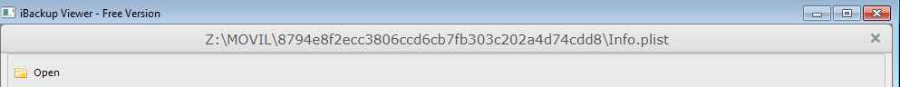

 

 

 
 
 Pregunta 2
 

¿Cuál es el ICCID de la SIM utilizada en el terminal?
 A. 71B49050A78052451EE54F29D8EBF50B.
 B. 013267008063125.
 C. 8934013371805024041.
 D. DX3JHP73DP0N.
 Comprobar
 
 

💡 Pista: En el archivo `Info.plist`, campo "ICCID".
 

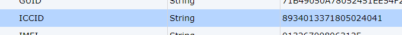

 

 
 
 Pregunta 3
 

¿Cuántas llamadas se han realizado con el dispositivo?
 A. Una llamada entrante y dos salientes.
 B. Tres llamadas entrantes.
 C. Tres llamadas salientes.
 D. Una llamada saliente y dos entrantes.
 Comprobar
 
 

💡 Pista: Analiza la base de datos SQLite `call_history.db`.
 

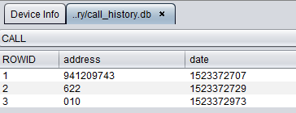

 

 
 
 Pregunta 4
 

¿A qué número se realizó la llamada de mayor duración?
 A. A ninguno, no se estableció ninguna llamada.
 B. Al 622 (Yoigo).
 C. Al 010.
 D. Al 941209743 (UNIR).
 Comprobar
 
 

💡 Pista: En `call_history.db`, compara la columna de duración entre todas las llamadas. La más larga tuvo 10 segundos.
 

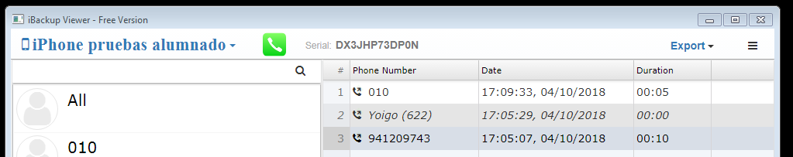

 

 
 
 Pregunta 5
 

¿Cuántos SMS se han recibido?
 A. Tres mensajes de texto.
 B. Un mensaje de texto y tres mensajes a través de WhatsApp.
 C. Cuatro mensajes de texto.
 D. No se ha recibido ningún mensaje de texto.
 Comprobar
 
 

💡 Pista: Analiza la base de datos SQLite `sms.db` y filtra los mensajes recibidos.
 

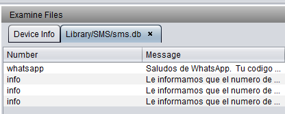

 

 
 
 Pregunta 6
 

¿Cuántos SMS se han enviado?
 A. Un mensaje de texto.
 B. Cuatro mensajes de texto.
 C. No se ha enviado ningún mensaje de texto.
 D. No se ha enviado ningún mensaje de texto ni ningún mensaje a través de WhatsApp.
 Comprobar
 
 

💡 Pista: En `sms.db`, filtra los mensajes enviados.
 

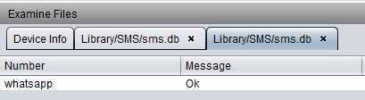

 

 
 
 Pregunta 7
 

¿Cuál de los siguientes contactos NO estaba en la agenda del dispositivo?
 A. Yoigo (Tel. 622).
 B. Pepito (Tel. 123456789).
 C. Manolete (Tel. 941209743).
 D. Todos los anteriores estaban en la agenda.
 Comprobar
 
 

💡 Pista: Analiza `AddressBook.sqlitedb`. Hay cuatro contactos; verifica que el número asociado a "Manolete" no es el 941 20 97 43.
 

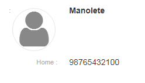

 

 
 
 Pregunta 8
 

¿Cuál es el IMEI del dispositivo?
 A. 71B49050A78052451EE54F29D8EBF50B.
 B. 013267008063125.
 C. 8934013371805024041.
 D. DX3JHP73DP0N.
 Comprobar
 
 

💡 Pista: En el archivo `Info.plist`, campo "IMEI".
 

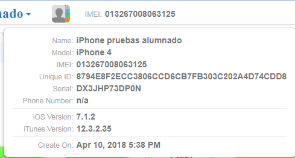

 

 
 
 Pregunta 9
 

¿Cuál es el nombre del dispositivo?
 A. iPhone 4.
 B. iPhone 3,1.
 C. iPhone pruebas alumnado.
 D. Ninguno de los anteriores es correcto.
 Comprobar
 
 

💡 Pista: En el archivo `Info.plist`, campo "Device Name".
 

 
 
 Pregunta 10
 

¿Cuál de las siguientes aplicaciones NO estaba instalada en el dispositivo?
 A. WhatsApp.
 B. Telegram.
 C. Safari.
 D. Todas las anteriores estaban instaladas.
 Comprobar
 
 

💡 Pista: En el archivo `Manifest.plist` (archivo PLIST Binario) puedes verificar las aplicaciones instaladas.
 

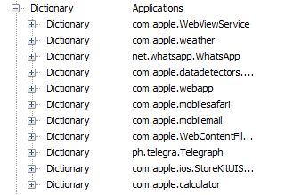

 

 
 
 Pregunta 11
 

¿Existe en el dispositivo alguna grabación de voz?
 A. Sí, hay dos grabaciones de voz en la ruta: Media/Recordings/
 B. Sí, hay tres grabaciones de voz en la ruta: Media/Recordings/
 C. Sí, hay una grabación de voz en la ruta: Media/Voice Recordings/
 D. Sí, hay una grabación de voz en la ruta: Media/Recordings/
 Comprobar
 
 

💡 Pista: Accede a la ruta `Media/Recordings` con iPhone Analyzer o iBackup Viewer.
 

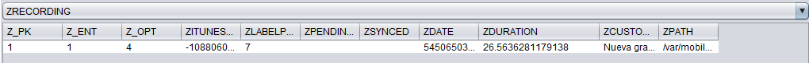

 

 
 
 Pregunta 12
 

¿Existe en el dispositivo alguna nota de texto?
 A. Sí, tres notas de texto.
 B. Sí, dos notas de texto.
 C. Sí, una nota de texto.
 D. No, no hay ninguna nota almacenada.
 Comprobar
 
 

💡 Pista: Analiza la base de datos SQLite `notes.sqlite`. Una nota fue creada en el dispositivo y otra se sincronizó desde una cuenta Gmail.
 

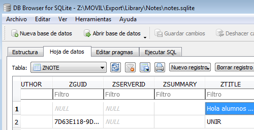

 

 
 
 Pregunta 13
 

Suponiendo que había alguna nota de texto, ¿en qué fecha se creó?
 A. No hay ninguna nota almacenada.
 B. Hay una nota guardada el 10/04/2018 y otra el 04/10/2018.
 C. Hay una única nota guardada el 04/10/2018.
 D. Hay dos notas guardadas el 10/04/2018.
 Comprobar
 
 

💡 Pista: En `notes.sqlite`, columna `ZCREATIONDATE` de la tabla `ZNOTE`. La fecha está en formato EPOCH pero debes sumar 31 años para obtener la fecha real.
 

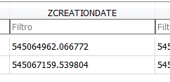

 

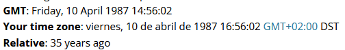

 

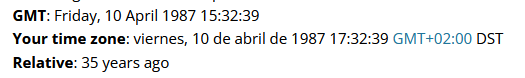

 

 
 
 Pregunta 14
 

¿Cuál es el número de serie del dispositivo?
 A. 71B49050A78052451EE54F29D8EBF50B.
 B. 013267008063125.
 C. 8934013371805024041.
 D. DX3JHP73DP0N.
 Comprobar
 
 

💡 Pista: En el archivo `Info.plist`, campo "Serial Number".
 

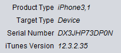

 

 
 
 Pregunta 15
 

¿Existen indicios de acceso a la página web de la Universidad Internacional de La Rioja (UNIR)?
 A. No, no hay indicios de acceso alguno a la web de UNIR.
 B. Sí, hay indicios de descarga de una imagen de la web de UNIR.
 C. Sí, en el historial de Chrome hay registro del acceso a la web de UNIR.
 D. Sí, en el historial de Safari hay registro del acceso a la web de UNIR.
 Comprobar
 
 

💡 Pista: Analiza el archivo `History.plist` (PLIST Binario) en `Library → Safari`. Busca el último acceso a www.unir.net.
 

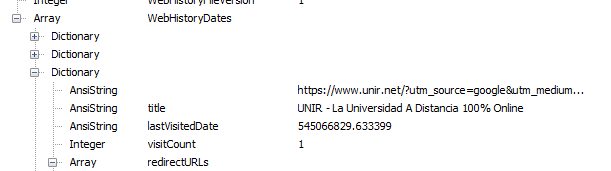

 

 
 
 Pregunta 16
 

¿Cuál es el estado de WhatsApp del usuario?
 A. iPhone pruebas alumnado.
 B. ¡Hola! Estoy usando WhatsApp.
 C. ¡Hola alumnos! Estoy usando WhatsApp.
 D. Sin estado.
 Comprobar
 
 

💡 Pista: Archivo `net.whatsapp.WhatsApp.plist` en `Library → Preferences`. Campo "CurrentStatusText".
 

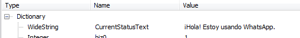

 

 
 
 Pregunta 17
 

¿Cuál de las siguientes búsquedas se realizó a través del navegador Safari?
 A. Google.
 B. El país.
 C. Yahoo! answers.
 D. unir La Rioja.
 Comprobar
 
 

💡 Pista: Analiza el archivo `RecentSearches.plist`. Aparece una única búsqueda.
 

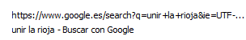

 

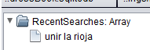

 

 
 
 Pregunta 18
 

Se sospecha que hay una fotografía de la tarjeta de una compañía de telefonía móvil. ¿De qué compañía se trata?
 A. Yoigo.
 B. Simyo.
 C. Movistar.
 D. Orange.
 Comprobar
 
 

💡 Pista: En la ruta `Media/DCIM/100APPLE/` hay una fotografía (IMG_0004.JPG) de una tarjeta SIM.
 

 
 
 Pregunta 19
 

¿A cuál de las siguientes redes WiFi (por su SSID) se ha conectado o pudiera haberse conectado el dispositivo?
 A. 626f7fe3267.
 B. Movistar_2662.
 C. MiRedWifi.
 D. boton2g.
 Comprobar
 
 

💡 Pista: Analiza el archivo `com.apple.wifi.plist` en `System configuration`. Busca "List of known networks".
 

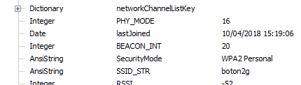

 

 
 
 Pregunta 20
 

¿Cuál de los siguientes contactos NO aparece como contacto de WhatsApp?
 A. UNIR.
 B. Manolete.
 C. Pepito.
 D. Simyo.
 Comprobar
 
 

💡 Pista: Analiza `ContactsV2.sqlite` en `Documents`. Los contactos son "UNIR", "Yoigo", "Manolete" y "Pepito". Revisa la columna de WhatsApp en el extremo derecho.
 

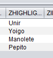

 

 

## 📚 Navegación

 
 
 ← Anterior: Análisis de Móviles
 
 
 ↑ Volver al Índice

---

> [[02 - MODULOS/05 - Prácticas (PoCs)|← Volver a Prácticas (PoCs)]] | [[02 - MODULOS/Prácticas (PoCs)/Gestión de Incidentes/00 - Índice del Módulo Gestión de Incidentes|Índice del Módulo]]
