# 📊 Introducción a Wireshark - Análisis de Tráfico de Red

## 📖 ENUNCIADO (DESCRIPCIÓN)

**Wireshark** es la herramienta de análisis de redes de código abierto más popular del mundo. Permite capturar y analizar el tráfico de red en tiempo real, siendo ampliamente utilizada por profesionales de redes y seguridad para solucionar problemas, realizar tareas de depuración, análisis forense y auditorías de seguridad.

> [!warning] ⚠️ USO RESPONSABLE
>        Wireshark captura TODO el tráfico de red que pasa por tu interfaz. Solo debes analizar tráfico de redes donde tengas  autorización explícita .
>         Capturar tráfico de terceros sin permiso es ilegal y constituye un delito de interceptación de comunicaciones.

## 🎯 ¿Qué es Wireshark?

Wireshark es un **analizador de protocolos de red** (también conocido como "packet sniffer" o capturador de paquetes) que permite examinar datos desde una red activa o desde un archivo de captura guardado en disco.

### ✨ Características Principales

#### 1. 📡 Captura de Tráfico en Tiempo Real

Wireshark puede interceptar y capturar paquetes en una red local o en una interfaz de red específica, permitiendo examinar el tráfico entrante y saliente mientras ocurre.

* Captura en interfaces Ethernet, WiFi, USB, Bluetooth, etc.

* Modo promiscuo para capturar todo el tráfico del segmento de red

* Captura simultánea en múltiples interfaces

#### 2. 🌐 Soporte de Protocolos Extenso

Wireshark soporta la decodificación de más de **2000 protocolos de red**, desde los más básicos hasta los más especializados:

* Capa de enlace: Ethernet, WiFi (802.11), PPP, ARP

* Capa de red: IPv4, IPv6, ICMP, IPsec

* Capa de transporte: TCP, UDP, SCTP

* Capa de aplicación: HTTP, HTTPS, DNS, SSH, FTP, SMTP, POP3, IMAP, SMB, etc.

* Protocolos industriales: Modbus, OPC UA, PROFINET

* Protocolos de VoIP: SIP, RTP, H.323

#### 3. 🔍 Análisis Detallado de Paquetes

Proporciona información exhaustiva sobre cada paquete capturado:

* Direcciones MAC de origen y destino

* Direcciones IP de origen y destino

* Puertos de origen y destino

* Protocolos utilizados en cada capa

* Tiempos de llegada y respuesta

* Tamaño de paquetes y payloads

* Flags TCP, números de secuencia

* Contenido hexadecimal y ASCII del payload

#### 4. 🎨 Filtros Personalizados Potentes

Sistema de filtrado en dos niveles:

* Filtros de captura: Limitan qué tráfico se captura (sintaxis BPF)

* Filtros de visualización: Filtran paquetes ya capturados para análisis específico

#### 5. 🔬 Funcionalidades Avanzadas

* Análisis estadístico: Gráficos de IO, jerarquía de protocolos, conversaciones

* Seguimiento de flujos: Reconstruir sesiones TCP, HTTP, UDP completas

* Reconstrucción de archivos: Extraer archivos transferidos (HTTP, FTP, SMB)

* Decodificación de protocolos cifrados: Si tienes las claves (SSL/TLS)

* Análisis de VoIP: Reproducir llamadas VoIP capturadas

* Exportación de datos: CSV, XML, PDML, JSON

* Coloreado de paquetes: Reglas visuales para identificar tráfico rápidamente

#### 6. 👥 Comunidad y Documentación

Wireshark cuenta con:

* Comunidad activa de millones de usuarios y desarrolladores

* Actualizaciones frecuentes con nuevos protocolos

* Plugins y extensiones desarrollados por la comunidad

* Documentación oficial extensa

* Tutoriales, libros y cursos especializados

* Foros de soporte y listas de correo

## 📥 Instalación de Wireshark

Wireshark está disponible para Linux, Windows y macOS. Puedes descargarlo desde la web oficial:

> 🔗  Sitio web oficial:   https://www.wireshark.org/

### 🐧 Instalación en Debian/Ubuntu Linux

#### Paso 1: Instalar Wireshark

```bash
sudo apt update
sudo apt install wireshark
```

#### Paso 2: Configurar permisos de captura

Durante la instalación aparecerá una pregunta:

> "Should non-superusers be able to capture packets?"

Responde **YES** (Sí) para permitir que usuarios no-root puedan capturar paquetes.


#### Paso 3: Añadir usuario al grupo wireshark

```bash
sudo usermod -aG wireshark $USER
```

O para un usuario específico:

```bash
sudo usermod -aG wireshark nombre_usuario
```

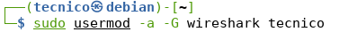

> [!warning] ⚠️ Importante:  Debes cerrar sesión y volver a iniciarla para que los cambios de grupo surtan efecto.

#### Paso 4: Verificar instalación

```bash
wireshark --version
```

Para iniciar Wireshark:

```bash
wireshark
```

### 💻 Instalación en Windows

En Windows, además de Wireshark, se instalará automáticamente **Npcap** (anteriormente WinPcap), una librería necesaria para capturar paquetes en Windows.

#### Paso 1: Descargar instalador

Descarga el instalador desde [https://www.wireshark.org/download.html](https://www.wireshark.org/download.html)

Selecciona la versión de 64 bits para sistemas modernos.

#### Paso 2: Ejecutar instalador

Ejecuta el instalador descargado (.exe) con permisos de administrador.

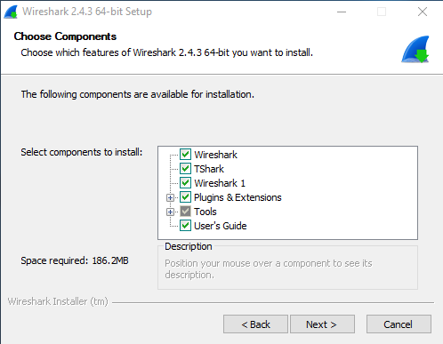

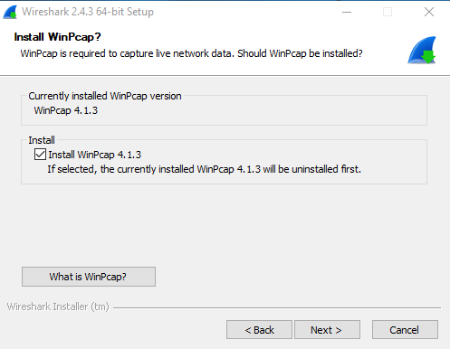

#### Paso 3: Instalación de Npcap

Durante la instalación se te pedirá instalar **Npcap**, que es la librería que permite capturar paquetes en Windows.

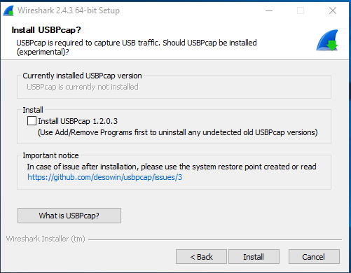

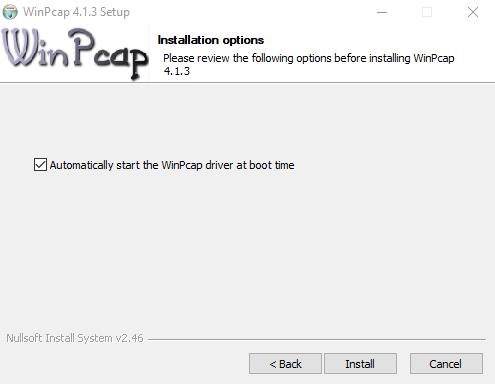

**📋 Sobre Npcap/WinPcap:**

* Proporciona acceso a la capa de enlace de datos en Windows

* Permite capturar paquetes sin procesar (raw packets)

* Utilizado también por otras herramientas (nmap, tcpdump, etc.)

* Npcap es el sucesor moderno de WinPcap

#### Paso 4: Finalizar instalación

Completa la instalación y reinicia el sistema si se te solicita.

Wireshark estará disponible en el menú Inicio.

## 🎬 Captura de Tráfico con Wireshark

### 🖥️ Interfaz Principal

Al abrir Wireshark verás la pantalla principal:

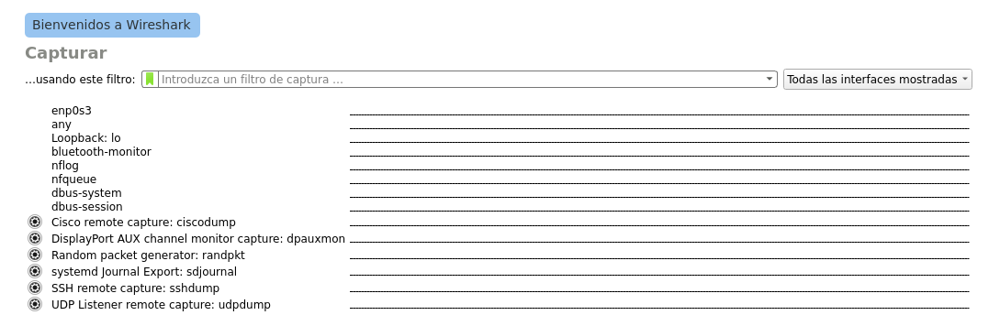

En esta pantalla se muestran:

* Interfaces de red disponibles (Ethernet, WiFi, Loopback, etc.)

* Gráficos de actividad en tiempo real de cada interfaz

* Barra de filtros de captura en la parte superior

### 🎯 Iniciar una Captura

#### Captura básica sin filtros

* Selecciona la interfaz de red donde deseas capturar (ej: Ethernet, WiFi)

* Haz doble clic en la interfaz o pulsa el botón de inicio (aleta de tiburón azul)

* Verás los paquetes comenzando a capturarse en tiempo real

### 🔍 Filtros de Captura

Los **filtros de captura** se aplican ANTES de iniciar la captura y limitan qué tráfico se guarda en memoria. Esto es útil para reducir el volumen de datos cuando solo te interesa un tipo específico de tráfico.

#### Ejemplo: Capturar solo tráfico HTTP

Antes de iniciar la captura, escribe en el campo de filtro:

```bash
tcp port http
```

O de forma equivalente:

```bash
tcp port 80
```

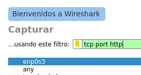

#### Ejemplo: Capturar solo protocolo ARP

```bash
arp
```

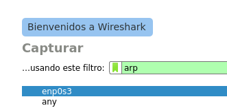

Inicia la captura y espera unos segundos. Verás paquetes ARP apareciendo (cuando dispositivos buscan MACs de IPs).

#### Ejemplo: Capturar solo ICMP (ping)

```bash
icmp
```

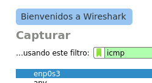

Inicia la captura y desde otra terminal ejecuta:

```bash
ping 8.8.8.8
```

Verás las peticiones Echo Request y respuestas Echo Reply.

### 📋 Sintaxis de Filtros de Captura

Los filtros de captura utilizan la sintaxis de **libpcap/BPF (Berkeley Packet Filter)**:

#### 📐 Sintaxis básica

```bash
[not] primitive [and|or [not] primitive ...]
```

#### 🔤 Primitivas disponibles

| Primitiva | Descripción | Ejemplo |
| --- | --- | --- |
| `[src/dst] host ` | Filtra por IP de origen o destino | `host 192.168.1.1``src host 10.0.0.5` |
| `ether [src/dst] host ` | Filtra por dirección MAC | `ether host aa:bb:cc:dd:ee:ff` |
| `gateway host ` | Paquetes que usan ese host como gateway | `gateway host 192.168.1.1` |
| `[src/dst] net ` | Filtra por red (con máscara o longitud) | `net 192.168.0.0/24``src net 10.0.0.0 mask 255.255.255.0` |
| `[tcp/udp] [src/dst] port ` | Filtra por puerto TCP o UDP | `tcp port 80``udp dst port 53` |
| `[src/dst] portrange ` | Rango de puertos | `portrange 1000-2000` |
| `less/greater ` | Longitud de paquete menor/mayor | `less 100``greater 1000` |

#### 📚 Ejemplos de filtros de captura

| Filtro | Descripción |
| --- | --- |
| `host 192.168.1.10` | Todo el tráfico desde/hacia 192.168.1.10 |
| `src host 192.168.1.10` | Solo tráfico originado en 192.168.1.10 |
| `dst host 8.8.8.8` | Solo tráfico con destino a 8.8.8.8 |
| `net 192.168.0.0/16` | Tráfico de la red 192.168.0.0/16 |
| `tcp port 443` | Tráfico HTTPS |
| `udp port 53` | Consultas DNS |
| `portrange 20-21` | Puertos FTP (20 y 21) |
| `not port 22` | Todo excepto SSH |
| `host 10.0.0.5 and tcp port 80` | HTTP desde/hacia 10.0.0.5 |
| `tcp port 80 or tcp port 443` | Tráfico HTTP o HTTPS |

### ⏹️ Detener y Guardar la Captura

#### Detener captura

Pulsa el botón rojo de "Stop" en la barra de herramientas:

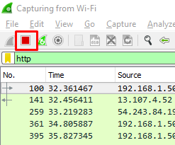

#### Guardar captura

Menú: **Archivo → Guardar** o **Archivo → Guardar como...**

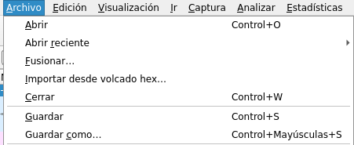

Formatos comunes:

* `.pcapng` - Formato nativo de Wireshark (recomendado)

* `.pcap` - Formato tcpdump/libpcap (compatible)

## 🖼️ Entorno del Programa Wireshark

La interfaz de Wireshark se divide en varias áreas funcionales:

### 1️⃣ Barra de Menús


Contiene todas las opciones: Archivo, Editar, Ver, Ir, Capturar, Analizar, Estadísticas, Telefonía, Inalámbrico, Herramientas, Ayuda.

### 2️⃣ Barra de Herramientas Principal

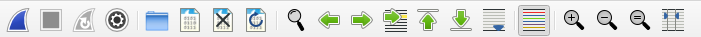

Acceso rápido a:

* ▶️ Iniciar captura

* ⏹️ Detener captura

* 🔄 Reiniciar captura

* ⚙️ Opciones de captura

* 💾 Guardar/Abrir archivos

* 🔍 Buscar paquetes

### 3️⃣ Barra de Filtros de Visualización

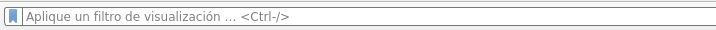

Permite filtrar paquetes YA capturados para visualizar solo los que cumplen ciertas condiciones. A diferencia de los filtros de captura, estos no descartan datos, solo los ocultan temporalmente.

### 4️⃣ Panel de Lista de Paquetes

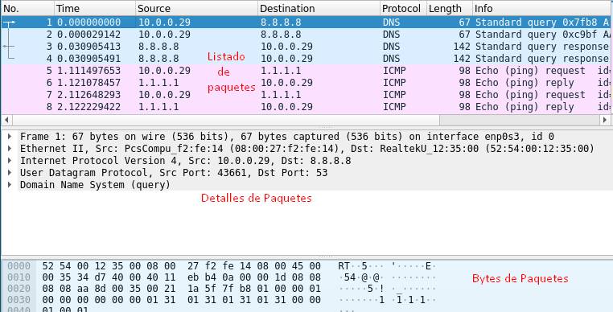

Muestra todos los paquetes capturados en formato de tabla con columnas:

* No.: Número de paquete

* Time: Tiempo desde el inicio de la captura

* Source: Dirección de origen

* Destination: Dirección de destino

* Protocol: Protocolo de capa superior

* Length: Tamaño del paquete en bytes

* Info: Información resumida del paquete

**🎨 Coloreado de paquetes:** Los paquetes aparecen con diferentes colores según reglas predefinidas (ver menú Ver → Reglas de coloreado).

### 5️⃣ Panel de Detalles del Paquete

Al seleccionar un paquete en la lista, este panel muestra su estructura en formato de árbol expandible, desde la capa más baja (física/enlace) hasta la capa de aplicación:

* 📦 Frame: Información de la trama capturada

* 🔗 Ethernet II: Capa de enlace (MACs)

* 🌐 Internet Protocol: Capa de red (IPs)

* 🚚 TCP/UDP: Capa de transporte (puertos)

* 📄 HTTP/DNS/etc: Capa de aplicación (datos)

Cada sección se puede expandir para ver todos los campos del protocolo.

### 6️⃣ Panel de Bytes del Paquete

Muestra el contenido completo del paquete en tres formatos:

* Hexadecimal: Representación en bytes hex

* ASCII: Caracteres imprimibles

* Resaltado: Al seleccionar un campo en el panel de detalles, se resalta su posición en bytes

### 7️⃣ Barra de Estado

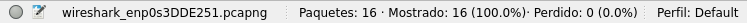

Muestra información sobre:

* Número total de paquetes capturados

* Número de paquetes mostrados (tras filtrar)

* Paquetes marcados

* Perfil activo

* Información del elemento seleccionado

### ⚙️ Personalización de la Interfaz

Puedes ocultar/mostrar paneles desde el menú **Ver**:

* Ver → Barra de herramientas principal

* Ver → Barra de filtros

* Ver → Barra de estado

* Ver → Lista de paquetes

* Ver → Detalles del paquete

* Ver → Bytes del paquete

## 🔍 Filtros de Visualización

Los **filtros de visualización** (display filters) se aplican DESPUÉS de capturar el tráfico. Permiten mostrar solo los paquetes que cumplen ciertas condiciones sin descartar datos de la captura.

#### 💡 Diferencia clave

**Filtros de captura:** Se aplican ANTES → Descartan paquetes (no se guardan)

**Filtros de visualización:** Se aplican DESPUÉS → Ocultan paquetes (pero están guardados)

### 🔤 Sintaxis de Filtros de Visualización

Los filtros de visualización tienen su propia sintaxis, más potente y flexible que los filtros de captura:

```bash
campo operador valor [operador_logico campo operador valor ...]
```

#### ⚖️ Operadores de Comparación

| Operador | Símbolo | Descripción | Ejemplo |
| --- | --- | --- | --- |
| Igual a | `==` o `eq` | Igualdad exacta | `ip.addr == 192.168.1.1` |
| No igual | `!=` o `ne` | Diferente de | `tcp.port != 80` |
| Mayor que | `>` o `gt` | Estrictamente mayor | `frame.len > 1000` |
| Menor que | `=` o `ge` | Mayor o igual que | `ip.ttl >= 64` |
| Menor o igual | `= 1024` | Puertos TCP altos (efímeros) |

#### 🌐 Filtros por Protocolo

| Filtro | Descripción |
| --- | --- |
| `http` | Todo el tráfico HTTP |
| `http.request` | Solo peticiones HTTP (GET, POST, etc.) |
| `http.response` | Solo respuestas HTTP |
| `http.request.method == "POST"` | Solo peticiones POST (login, formularios) |
| `dns` | Consultas y respuestas DNS |
| `ssl` o `tls` | Tráfico cifrado SSL/TLS |
| `ssh` | Tráfico SSH |
| `ftp` | Tráfico FTP |
| `smtp` | Correo saliente (SMTP) |
| `pop` o `imap` | Recepción de correo |

#### 🔍 Filtros por Contenido

| Filtro | Descripción |
| --- | --- |
| `http contains "login"` | HTTP que contenga la palabra "login" |
| `http contains "password"` | HTTP que contenga "password" |
| `tcp contains "GET"` | Paquetes TCP con la cadena "GET" |
| `http.user_agent contains "Chrome"` | Peticiones desde navegador Chrome |
| `http.host == "www.example.com"` | Tráfico hacia dominio específico |

#### 🎨 Filtros por Tipo de Archivo/Imagen

| Filtro | Descripción |
| --- | --- |
| `png` | Imágenes PNG |
| `image-gif` | Imágenes GIF |
| `image-jfif` | Imágenes JPEG |
| `http.content_type contains "image"` | Cualquier imagen HTTP |

#### 📧 Filtros para Análisis de Seguridad

| Filtro | Uso |
| --- | --- |
| `http.request.method == "POST"` | Buscar envío de credenciales/formularios |
| `http contains "login"` | Detectar páginas de login |
| `http contains "password"` | Detectar envío de contraseñas (HTTP no seguro) |
| `smtp.req.command == "AUTH"` | Autenticación en correo SMTP |
| `ftp.request.command == "USER"` | Usuarios FTP |
| `ftp.request.command == "PASS"` | Contraseñas FTP (texto plano) |

### 🎯 Ejemplos Prácticos de Filtros Combinados

```bash
ip.addr == 192.168.1.10 and http
```

→ Tráfico HTTP desde/hacia 192.168.1.10

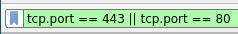

```bash
tcp.port == 80 or tcp.port == 443
```

→ Tráfico HTTP o HTTPS

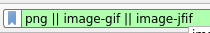

```bash
http.request.method == "POST" and http contains "password"
```

→ Peticiones POST que contienen la palabra "password"

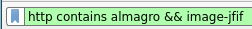

## 🛠️ Operaciones Avanzadas

### 🖱️ Menú Contextual (Clic Derecho)

Al hacer clic derecho sobre un paquete o campo, aparecen opciones muy útiles:

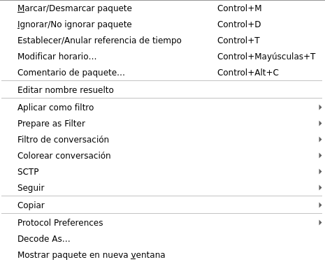

#### Opciones principales:

* Aplicar como filtro: Crea automáticamente un filtro con ese valor

          Seleccionado (==)

* No seleccionado (!=)

* ... y seleccionado (&&)

* ... o seleccionado (||)

* Preparar como filtro: Igual que anterior pero sin aplicarlo aún

* Conversación: Ver todos los paquetes de esa conversación

* Marcar/Ignorar paquete: Marcar para análisis posterior

* Seguir → Flujo TCP/HTTP/UDP: Ver conversación completa

* Mostrar bytes del paquete: Ver contenido en ventana aparte

### 🔗 Seguir Flujo (Follow Stream)

Una de las funciones más útiles es **Seguir → Flujo TCP/HTTP**:

* Clic derecho en un paquete

* Seguir → Flujo TCP (o HTTP)

* Se abre una ventana mostrando la conversación completa

**Colores en el flujo:**

* 🔴 Rojo: Datos del cliente (request)

* 🔵 Azul: Datos del servidor (response)

Esto es especialmente útil para:

* Ver páginas web completas transferidas

* Detectar credenciales en texto plano

* Reconstruir archivos transferidos

* Analizar sesiones de protocolos de aplicación

### 🖼️ Visualizar Imágenes Capturadas

#### Extraer una imagen de la captura

* Aplica el filtro: `png` o `image-jfif` o `image-gif`

* Selecciona un paquete de la lista

* En el panel de detalles, expande hasta la última capa (ej: Portable Network Graphics)

* Clic derecho en esa capa → Mostrar bytes del paquete

* Se abrirá una ventana mostrando la imagen

### 📊 Estadísticas

El menú **Estadísticas** ofrece análisis muy útiles:

* Jerarquía de protocolos: Gráfico de qué protocolos predominan

* Conversaciones: Pares IP que se comunican más

* Endpoints: IPs más activas

* HTTP → Peticiones: Lista de URLs visitadas

* HTTP → Load Distribution: Distribución de carga HTTP

* Gráfico IO: Tráfico de red a lo largo del tiempo

### 📝 Añadir Columnas Personalizadas

#### Añadir una columna personalizada

* Clic derecho en el encabezado de columnas

* Preferencias de columnas...

* Pulsa el botón + para añadir

* Dale un nombre (ej: "User Agent")

* En "Tipo", despliega y selecciona el campo que quieres mostrar

* Acepta

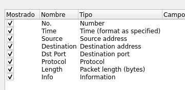

## 🎯 Práctica Básica

### Ejercicio completo de captura y análisis

#### Paso 1: Iniciar captura

* Abre Wireshark

* Selecciona tu interfaz de red principal (Ethernet o WiFi)

* Inicia la captura (sin filtros de captura)

#### Paso 2: Generar tráfico web

* Abre tu navegador

* Visita: `http://www.almagro.es/` (HTTP no seguro)

* Navega por algunas páginas internas

* Busca y abre algunas imágenes en pestañas nuevas

* Descarga alguna imagen

#### Paso 3: Visitar otras webs

* Visita: `http://www.destinosmanchegos.com/`

* Visita: `http://www.turismocastillalamancha.es/`

* Descarga algunas imágenes

#### Paso 4: Wikipedia

* Visita: `https://www.wikipedia.org/`

* Navega por varios artículos

#### Paso 5: Webmail (¡ATENCIÓN!)

* Visita: `http://webmail.cursosmfr.es/`

* Inicia sesión con:

            Usuario: `ifct0109@cursosmfr.es`

* Contraseña: `XXXXXXXXXX`

> [!warning] ⚠️ Importante:  Este paso demuestra por qué NUNCA debes usar protocolos no cifrados para datos sensibles. HTTP envía TODO en texto plano.

#### Paso 6: Detener y guardar

* Detén la captura en Wireshark

* Guarda el archivo como `practica_web.pcapng`

#### Paso 7: Aplicar filtros de visualización

Ahora aplica estos filtros para analizar lo capturado:

| Filtro | ¿Qué verás? |
| --- | --- |
| `tcp.dstport == 80` | Todo el tráfico HTTP saliente |
| `tcp.dstport == 80 || tcp.dstport == 443` | HTTP + HTTPS |
| `tcp contains "almagro"` | Paquetes TCP con la palabra "almagro" |
| `tcp contains "wiki"` | Paquetes con "wiki" |
| `http contains "almagro"` | Solo HTTP con "almagro" |
| `http contains "wiki"` | Solo HTTP con "wiki" |
| `png || image-gif || image-jfif` | Todas las imágenes transferidas |
| `http.request` | Solo peticiones HTTP (no respuestas) |

#### Paso 8: Buscar credenciales (demostración de inseguridad)

* Aplica el filtro: `http contains "webmail"`

* Clic derecho en un paquete → Seguir → Flujo HTTP

* Busca en la conversación (Ctrl+F): `login` o `password`

* ¡Verás la contraseña en texto plano!

**Alternativa más directa:**

```bash
http contains "login"
```

#### Paso 9: Ver imágenes capturadas

* Aplica: `png || image-gif || image-jfif`

* Selecciona un paquete de imagen

* En detalles, expande la última capa (ej: "Portable Network Graphics")

* Clic derecho → Mostrar bytes del paquete

* ¡Verás la imagen!

### 🎓 Conclusiones de la Práctica

#### 📚 Lo que has aprendido:

* ✅ Capturar tráfico de red en tiempo real

* ✅ Aplicar filtros de visualización para analizar datos específicos

* ✅ Seguir flujos TCP/HTTP para ver conversaciones completas

* ✅ Extraer imágenes de capturas

* ✅ Detectar credenciales en texto plano (HTTP sin cifrar)

* ⚠️ Lección de seguridad: HTTP no cifrado expone TODO tu tráfico, incluyendo contraseñas

* ✅ Por eso es crítico usar HTTPS en sitios sensibles

## 📚 Conclusiones

Wireshark es una herramienta fundamental para cualquier profesional de redes y seguridad. Permite:

* 🔍 Diagnosticar problemas de red

* 🛡️ Analizar tráfico sospechoso

* 📊 Optimizar el rendimiento de red

* 🎓 Aprender cómo funcionan los protocolos

* 🔐 Realizar análisis forense

* ⚠️ Detectar tráfico no cifrado vulnerable

> [!warning] ⚖️ Uso Ético y Legal
>        Recuerda que capturar tráfico de terceros sin autorización es ilegal. Usa Wireshark solo en:
>
>          ✅ Tu propia red doméstica
>          ✅ Redes corporativas donde tengas autorización
>          ✅ Laboratorios de pruebas
>          ✅ Auditorías de seguridad contratadas

    [
      🎯 Continuar con los Retos Prácticos →
    ]([[02 - MODULOS/Prácticas (PoCs)/Herramientas de Auditoría/08a - Wireshark - Retos Prácticos de Análisis de Tráfico|08a - Wireshark - Retos Prácticos de Tráfico]])
