# 🩸 BloodHound - Instalación y Configuración

  
    

## 📖 ¿Qué es BloodHound?

    

**BloodHound** es una herramienta de código abierto utilizada tanto por atacantes como por defensores para analizar la seguridad de los dominios de Active Directory.

    

Esta herramienta recopila una gran cantidad de datos de un dominio de Active Directory y utiliza la teoría de grafos para representar visualmente las relaciones entre los objetos y detectar posibles rutas de ataque en el dominio, las cuales serían difíciles o incluso imposibles de identificar con métodos tradicionales.

    

      

#### 🔑 Características Principales:

      
        
* ✅ Análisis visual de dominios Active Directory mediante grafos
        
* ✅ Identificación de rutas de escalada de privilegios
        
* ✅ Detección de configuraciones inseguras en AD
        
* ✅ A partir de la versión 4.0, también es compatible con **Azure**
        
* ✅ Recopilación de datos mediante el colector **SharpHound** (PowerShell y C#)
      
    

    

      

**📚 Documentación Oficial:**

      

[https://bloodhound.readthedocs.io/en/latest/index.html](https://bloodhound.readthedocs.io/en/latest/index.html)

    

  

  
    

## 🧮 Teoría de Grafos y Lenguaje Cypher

    

### 🔍 Teoría de Grafos en BloodHound

    

La **teoría de grafos** en BloodHound se utiliza para mapear y visualizar las relaciones entre los diferentes objetos dentro de un dominio de Active Directory. Cada objeto, como usuarios, grupos o equipos, se representa como un **nodo** en el grafo, y las relaciones entre ellos, como membresía en grupos o permisos, se representan como **aristas** (o conexiones) entre esos nodos.

    

Esto permite identificar de forma visual y rápida posibles rutas de ataque, como escalamiento de privilegios o movimientos laterales, que podrían pasar desapercibidas con métodos de análisis tradicionales.

    

      

#### 🔗 Componentes de un Grafo:

      

| Componente | Descripción | Ejemplo en AD |
| --- | --- | --- |
| Nodo | Representa un objeto en el dominio | Usuario, Grupo, Equipo, OU |
| Arista | Representa una relación o conexión | MemberOf, AdminTo, CanRDP, GenericAll |
| Dirección | Indica el sentido de la relación | Usuario → tiene permisos sobre → Grupo |

    

    

### 💬 Lenguaje de Consultas Cypher

    

El **lenguaje de consulta Cypher** es la herramienta que BloodHound utiliza para interactuar con estos grafos. Cypher es el lenguaje de consultas de grafos de Neo4j que nos permite extraer datos del grafo.

    

Cypher permite a los usuarios hacer preguntas específicas sobre el grafo, como:

    
      
* "¿Qué usuarios tienen acceso a este grupo privilegiado?"
      
* "¿Qué caminos existen para que un usuario común adquiera privilegios de administrador?"
      
* "¿Quién puede resetear la contraseña de un Domain Admin?"
    

    

Con Cypher, los defensores pueden explorar diferentes escenarios de ataque y reforzar la seguridad del dominio, mientras que los atacantes pueden identificar vulnerabilidades para explotar.

    

### 🔗 Aristas: El Corazón de BloodHound

    

En BloodHound, las **aristas** son un elemento clave en la representación visual de los grafos. Cada arista indica una relación o una conexión entre dos nodos, que representan diferentes objetos dentro del dominio de Active Directory, como usuarios, grupos o equipos.

    

La **dirección de la arista** muestra el sentido de la relación, es decir, quién tiene acceso o control sobre quién. Por ejemplo, si un usuario tiene permisos administrativos sobre un equipo, verás una arista que va desde el nodo del usuario hacia el nodo del equipo, indicando esa relación de poder o control.

    

Estas aristas ayudan a entender rápidamente cómo están conectados los diferentes objetos y a identificar posibles rutas de ataque, como escalamiento de privilegios o movimientos laterales dentro de la red.

    

### 📊 Ejemplo Gráfico 1: Camino Más Corto

    

El siguiente gráfico muestra ocho (8) nodos y diez (10) aristas. El nodo H puede llegar al nodo G, pero ningún nodo tiene un camino directo hacia el nodo H. Para llegar al nodo C desde el nodo A, podemos saltar al nodo G, movernos al nodo F y luego al nodo C, pero ese no es el camino más corto.

    

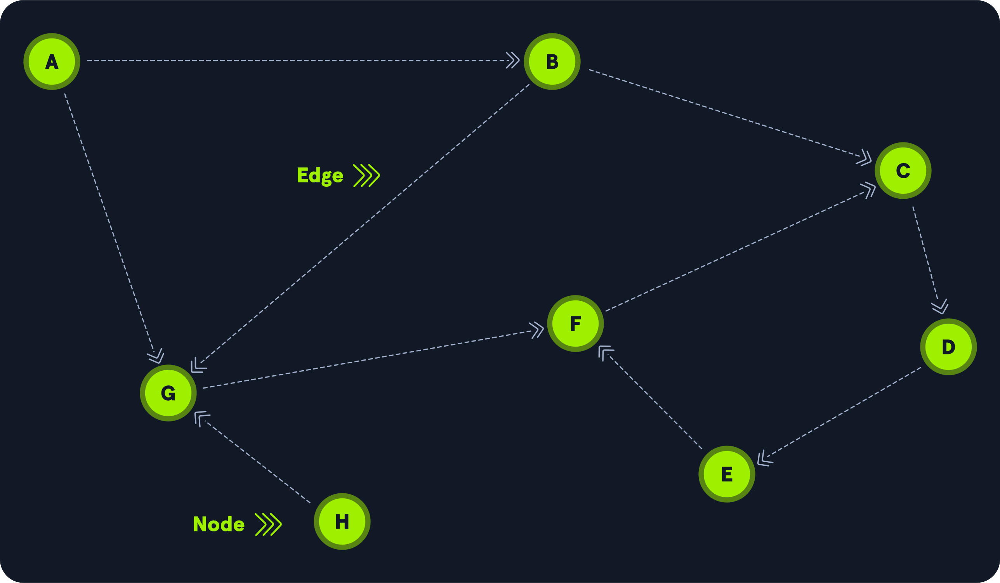

    

Una de las capacidades de BloodHound es buscar el **camino más corto**. En este ejemplo, el camino más corto desde el nodo A hasta el nodo C es un salto a través del nodo B.

    

### 📊 Ejemplo Gráfico 2: Escalada de Privilegios

    

Veamos el siguiente ejemplo:

    

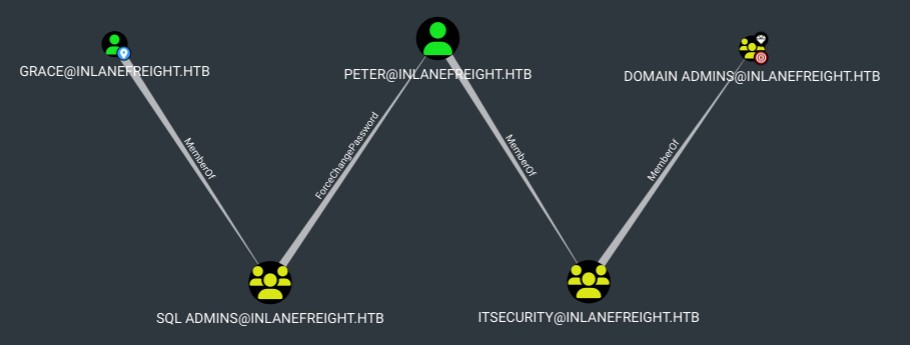

    

      

#### 💡 Interpretación del Grafo:

      

Esto significa que **Grace**, como miembro del grupo **SQL Admins**, puede cambiar la contraseña de **Peter**. Después, puede autenticarse con la nueva contraseña de Peter y realizar operaciones como miembro del grupo **Domain Admins**. Aunque Peter no es miembro directo, es miembro de un grupo que sí lo es.

      

**Ruta de ataque:**

      
        
* Grace ∈ SQL Admins
        
* SQL Admins → ForceChangePassword → Peter
        
* Peter ∈ IT Support
        
* IT Support ∈ Domain Admins
        
* **Resultado:** Grace puede convertirse en Domain Admin
      
    

  

  
    

## 🐳 Instalación en Kali Linux (Docker) - Versión Legacy

    

Una de las formas más cómodas de usar la versión legacy (ya discontinuada) es usar Docker.

    

### 📥 Paso 1: Descargar BloodHound Legacy

    

```bash
$ wget https://github.com/SpecterOps/BloodHound-Legacy/releases/download/v4.3.1/BloodHound-linux-x64.zip
```

    

### 📦 Paso 2: Descomprimir BloodHound Legacy

    

```bash
$ unzip BloodHound-linux-x64.zip
```

    

### 📂 Paso 3: Cambiar al Directorio de BloodHound

    

```bash
$ cd BloodHound-linux-x64
```

    

### 📝 Paso 4: Crear docker-compose.yml

    

```bash
services:
  neo4j:
    image: neo4j:4.4
    container_name: bloodhound-neo4j
    environment:
      - NEO4J_AUTH=neo4j/BloodHound
      - NEO4JLABS_PLUGINS=["apoc"]
      - NEO4J_dbms_security_procedures_unrestricted=apoc.\\*
    volumes:
      - neo4j_data:/data
      - neo4j_logs:/logs
      - neo4j_import:/var/lib/neo4j/import
    ports:
      - "7474:7474"
      - "7687:7687"
    restart: unless-stopped

volumes:
  neo4j_data:
  neo4j_logs:
  neo4j_import:
```

    

### 🚀 Paso 5: Ejecutar Docker Compose

    

```bash
$ docker compose up
```

    

### 🔓 Paso 6: Ejecutar BloodHound Legacy

    

```bash
$ ./BloodHound --no-sandbox
```

    

### 🔑 Paso 7: Credenciales de Neo4j

    

```bash
Usuario: neo4j
Contraseña: BloodHound
```

    

      

**💾 Alternativa desde Recursos:**

      

También puedes descargar desde `[recursos/docker_bloodhound.7z`](../../../archivos_descargados/paquetes_7z/docker_bloodhound.7z)

      
        
* Descomprimirlo
        
* Ejecutar `./start.sh`
      
    

  

  
    

## 🔧 Instalación de BloodHound Legacy en Kali Linux (Nativo)

    

      

**📚 Guías de Referencia:**

      
        
* [Documentación Oficial](https://bloodhound.readthedocs.io/en/latest/index.html)
        
* [Guía Medium - BloodHound & PlumHound](https://medium.com/@mauriceboon88/bloodhound-plumhound-on-kali-linux-2025-the-guide-i-wish-existed-before-i-lost-2-hours-fighting-397e43035fa7)
      
    

    

### 📥 Método 1: Instalación Manual

    

```bash
# Descargar BloodHound 4.3.1 (última versión legacy)
$ wget https://github.com/BloodHoundAD/BloodHound/releases/download/v4.3.1/BloodHound-linux-x64.zip

# Extraer
$ unzip BloodHound-linux-x64.zip

# Mover a /opt
$ sudo mv BloodHound-linux-x64 /opt/bloodhound-legacy

# Crear enlace simbólico
$ sudo ln -s /opt/bloodhound-legacy/BloodHound /usr/local/bin/bloodhound
```

    

### 📦 Método 2: Instalación desde APT (Recomendado)

    

#### Paso 1: Instalar Neo4j

    

```bash
$ sudo apt update && sudo apt install neo4j
```

    

#### Paso 2: Iniciar Neo4j

    

```bash
$ sudo neo4j console
```

    

#### Paso 3: Acceder a la Interfaz Web de Neo4j

    

Accedemos con el navegador a `http://localhost:7474/` e iniciamos con las credenciales por defecto:

    

```bash
Usuario: neo4j
Contraseña: neo4j
```

    

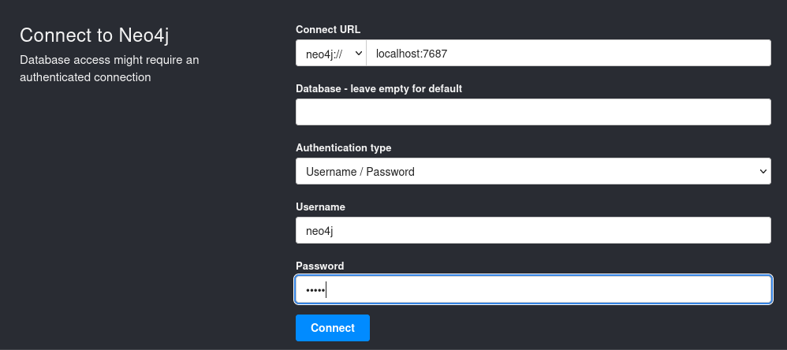

    

#### Paso 4: Cambiar la Contraseña

    

Nos pedirá que generemos una nueva contraseña:

    

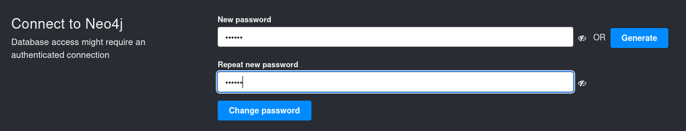

    

#### Paso 5: Iniciar BloodHound

    

Y una vez generada ya podemos abrir BloodHound:

    

```bash
$ bloodhound --no-sandbox --disable-gpu
```

    

#### Paso 6: Conectar a Neo4j

    

Accedemos con las credenciales nuevas a `http://localhost:7687/`

    

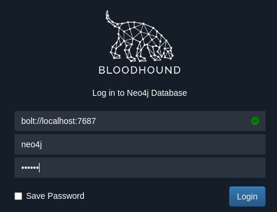

    

### 📤 Cargar Datos en BloodHound

    

Una vez dentro podemos cargar información recolectada en el botón **Upload data**:

    

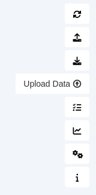

    

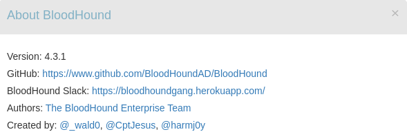

    

### 🔍 Descargar el Recolector SharpHound

    

```bash
$ wget https://raw.githubusercontent.com/BloodHoundAD/BloodHound/master/Collectors/SharpHound.exe
```

    

      

**📁 Recolector en Recursos:**

      

También disponible en `[collectors/SharpHound.exe`](../../../archivos_descargados/recursos/SharpHound.exe) y [`collectors/SharpHound.ps1`](../../../archivos_descargados/recursos/SharpHound.ps1)

    

  

  
    

## 🐳 Instalación en Kali Linux (Docker) - Community Edition

    

En Kali podemos instalar la Community Edition con Docker Compose.

    

      

**📚 Repositorio Oficial:**

      

[https://github.com/SpecterOps/BloodHound](https://github.com/SpecterOps/BloodHound?tab=readme-ov-file)

    

    

### 🔧 Paso 1: Instalar Docker

    

```bash
$ sudo apt install docker.io
```

    

### 👤 Paso 2: Añadir Usuario al Grupo Docker

    

```bash
$ sudo usermod -aG docker $USER
```

    

      

**⚠️ Importante:** Cerrar sesión y volver a iniciar para que los cambios surtan efecto.

    

    

### 📦 Paso 3: Instalar Docker Compose

    

#### Descargar la Última Versión:

    

```bash
$ sudo curl -L 'https://github.com/docker/compose/releases/download/v2.29.1/docker-compose-linux-x86_64' -o /usr/local/bin/docker-compose
```

    

#### Dar Permisos de Ejecución:

    

```bash
$ sudo chmod +x /usr/local/bin/docker-compose
```

    

#### Verificar la Instalación:

    

```bash
$ docker-compose --version
Docker Compose version v2.29.1
```

    

### 📥 Paso 4: Descargar e Iniciar BloodHound CE

    

```bash
$ curl -L https://ghst.ly/getbhce -o bloodhound.yml
```

    

### 🚀 Paso 5: Ejecutar Docker Compose

    

```bash
$ sudo docker-compose -f bloodhound.yml up
```

    

### 🔑 Paso 6: Obtener Contraseña Generada

    

En el proceso genera una contraseña automáticamente:

    

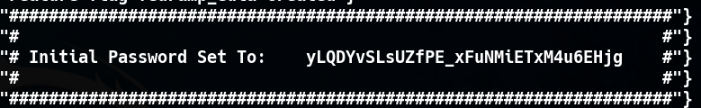

    

      

#### 🔑 Credenciales de Acceso:

      
        
* **Usuario:** admin
        
* **Contraseña:** (la generada en los logs)
      
    

    

### 🌐 Paso 7: Acceder a la Interfaz Web

    

```bash
http://localhost:8080/ui/login
```

    

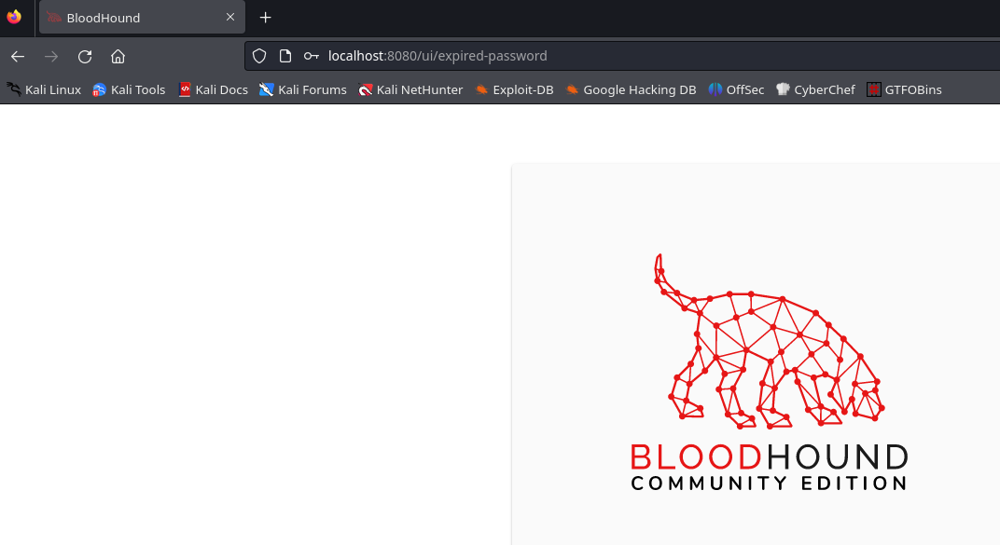

    

### 📤 Paso 8: Subir Datos Recolectados

    

Ahora ya podremos subir los datos que hayamos recolectado:

    
      
* Vamos a **Administration** → **File Ingest**
      
* Pulsamos en **Upload Files**
    

    

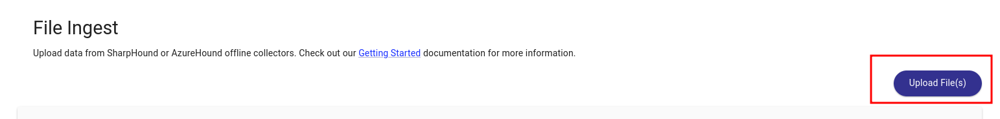

    

Seleccionamos el archivo `ad_example_data.zip` de los recursos:

    

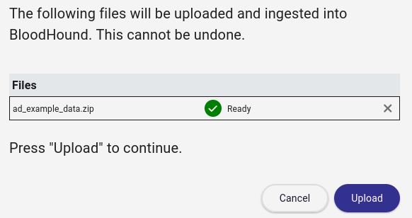

    

Esperamos a que termine de subir y de analizar los datos.

    

### 🔍 Paso 9: Primera Búsqueda

    

Podemos hacer la primera búsqueda con:

    

```bash
domain:WRAITH.CORP
```

    

### 📥 Descargar el Recolector

    

Recolector SharpHound disponible en:

    
      
* [https://github.com/BloodHoundAD/SharpHound/releases](https://github.com/BloodHoundAD/SharpHound/releases)
      
* `collectors/SharpHound.exe`
      
* `collectors/SharpHound.ps1`
    
  

  
    

## 📚 Resumen de Instalación

    

      

### 🎓 Versiones de BloodHound:

      
      

| Versión | Base de Datos | Interfaz | Estado |
| --- | --- | --- | --- |
| Legacy (v4.3.1) | Neo4j 4.4 | Aplicación de escritorio (Electron) | ❌ Discontinuada |
| Community Edition (v5.x) | PostgreSQL | Interfaz web | ✅ Actual y mantenida |

      

### 🔧 Métodos de Instalación:

      

| Método | Ventajas | Desventajas |
| --- | --- | --- |
| Docker (Legacy) | Fácil y rápido, entorno aislado | Versión discontinuada |
| Nativo (Legacy) | Mayor control, integración con Kali | Más complejo, versión discontinuada |
| Docker (CE) | Versión actual, interfaz web moderna | Requiere más recursos |

      

### 🎯 Navegación:

      

→ [Siguiente: 02 - Recolectando Información]([[02 - MODULOS/Prácticas (PoCs)/Herramientas de Auditoría/09b - BloodHound - Práctica 2 - Recolección de Información|09b - BloodHound - Práctica 2 - Recolección]])

      

↑ [Volver al Índice del Módulo]([[02 - MODULOS/Prácticas (PoCs)/Herramientas de Auditoría/01 - Escaneo y Enumeración de Redes con Nmap|Índice de Herramientas de Auditoría]])
