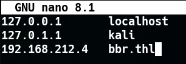
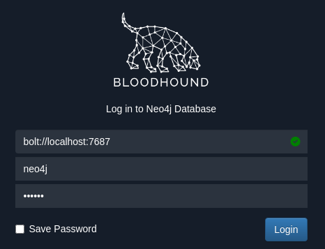
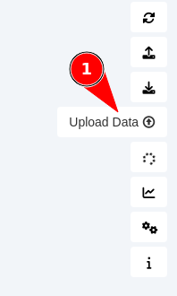
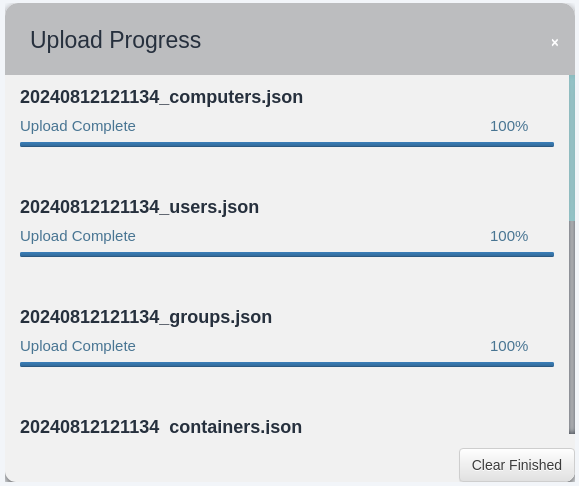

# 🩸 BloodHound - Recolección de Información

  
    

## 📖 Introducción a la Recolección de Datos

    

La recolección de información para BloodHound se realiza mediante el uso de una herramienta llamada **SharpHound**, que está disponible en dos versiones: una para entornos Windows y otra para Linux.

    

      

#### 🔑 ¿Qué Recopila SharpHound?

      
        
* ✅ Membresías de grupos y usuarios
        
* ✅ Políticas de acceso y permisos
        
* ✅ Relaciones entre objetos de AD
        
* ✅ Sesiones activas en equipos
        
* ✅ ACLs (Access Control Lists)
        
* ✅ Trusts entre dominios
        
* ✅ Delegaciones y GPOs
      
    

  

  
    

## 🪟 Recolección en Windows - SharpHound

    

En Windows, la recolección de datos para BloodHound se realiza utilizando [SharpHound](https://github.com/BloodHoundAD/SharpHound). Este se puede ejecutar en varios modos, dependiendo de qué información se necesita recolectar:

    

### 📝 Formatos Disponibles de SharpHound

    

      

#### 🔧 Dos Versiones Disponibles:

      
      

| Versión | Descripción | Uso Ideal |
| --- | --- | --- |
| PowerShell | Script de PowerShell (`SharpHound.ps1`) | Ejecución directa en sistemas con PowerShell, ideal para administradores |
| Binario C# | Ejecutable compilado (`SharpHound.exe`) | Más discreto, no requiere PowerShell, ideal para pentesting |

    

    

### 🚀 Ejecución Básica de SharpHound

    

```bash
# Recopilar todos los datos posibles
PS> .\SharpHound.exe -c All

# Alternativa con PowerShell
PS> Import-Module .\SharpHound.ps1
PS> Invoke-BloodHound -CollectionMethod All
```

    

El parámetro `-c All` indica que se recopilarán todos los datos posibles. Estos datos se guardan en archivos JSON que luego se importan en BloodHound para su análisis.

    

### 🎯 Métodos de Recolección

    

| Método | Descripción | Comando |
| --- | --- | --- |
| `All` | Recopila todos los datos disponibles | `SharpHound.exe -c All` |
| `DCOnly` | Solo consulta el Domain Controller (no requiere acceso local) | `SharpHound.exe -c DCOnly` |
| `Session` | Solo sesiones activas | `SharpHound.exe -c Session` |
| `Group` | Solo membresías de grupos | `SharpHound.exe -c Group` |
| `LocalAdmin` | Solo administradores locales | `SharpHound.exe -c LocalAdmin` |
| `Trusts` | Solo trusts entre dominios | `SharpHound.exe -c Trusts` |

  

  
    

## 🐧 Recolección en Linux - BloodHound.py

    

SharpHound no tiene una herramienta oficial de recolección de datos para Linux. Sin embargo, **Dirk-jan Mollema** creó **BloodHound.py**, un recolector para BloodHound basado en Python e Impacket, que nos permite recopilar información de Active Directory desde Linux para usar en BloodHound.

    

### 📦 Instalación de BloodHound.py

    

#### Opción 1: Instalación con pip

    

```bash
$ pip install bloodhound
```

    

#### Opción 2: Instalación desde GitHub

    

```bash
$ git clone https://github.com/fox-it/BloodHound.py -q
$ cd BloodHound.py/
$ sudo python3 setup.py install
$ python3 bloodhound.py
```

    

### 🚀 Uso de BloodHound.py

    

#### Recolección Básica

    

```bash
$ bloodhound-python -d ifct0109.local -c DCOnly -u user -p pass -ns 192.168.10.100
```

    

#### Uso con Kerberos

    

```bash
$ bloodhound-python -d ifct0109.local -c DCOnly -u user -p pass -ns 192.168.10.100 --kerberos
```

    

      

#### 🔧 Parámetros de BloodHound.py:

      
        
* `-d` - Dominio objetivo
        
* `-u` - Nombre de usuario
        
* `-p` - Contraseña
        
* `-ns` - Servidor DNS/Domain Controller
        
* `-c` - Método de recolección (DCOnly, All, etc.)
        
* `--kerberos` - Usar autenticación Kerberos
      
    

  

  
    

## 🎯 Práctica: Recolección desde VM BIG.ova

    

### 🔧 Paso 1: Configurar el Entorno de Red

    

Primero nos añadimos en su entorno de red:

    

```bash
$ sudo ip addr add 192.168.212.10/24 dev eth0
```

    

### 📝 Paso 2: Configurar /etc/hosts

    

Añadimos su IP en `/etc/hosts` como `bbr.thl`:

    



    

```bash
192.168.212.4    bbr.thl
```

    

### 🔑 Paso 3: Cambiar Contraseñas Expiradas

    

      

**⚠️ Nota:** Las credenciales están expiradas, las cambiamos por las siguientes:

      
        
* `juicy:Bigpoppa.1974`
      
    

    

```bash
$ impacket-changepasswd bbr.thl/juicy:Bigpoppa1972@192.168.212.4 -newpass 'Bigpoppa.1974'
```

    

También vamos a cambiar las de otro usuario que necesitaremos más adelante:

    

```bash
$ impacket-changepasswd bbr.thl/adm_puffy:'Passwordsave@'@192.168.212.4 -newpass 'Demo@123'
```

    

### 🔌 Paso 4: Conectar con Evil-WinRM

    

```bash
$ evil-winrm -i bbr.thl -u 'Juicy' -p 'Bigpoppa.1974'
```

  

  
    

## 📊 Recolectando Información con SharpHound

    

Ahora vamos a usar SharpHound para recolectar información.

    

### 📥 Descargar SharpHound

    

En función del BloodHound que usemos tenemos que descargar una versión u otra:

    

      

#### 📦 Opciones de Descarga:

      
      

| Versión de BloodHound | Recolector Recomendado | Enlace |
| --- | --- | --- |
| Legacy (v4.x) | SharpHound v1.x | 🌐 GitHub Legacy |
| Community Edition (v5.x) | SharpHound v2.x | 🌐 GitHub Releases |
| Recursos Locales - Collectors | SharpHound.exe | 📥 Descargar SharpHound.exe |
| SharpHound.ps1 | 📥 Descargar SharpHound.ps1 |

    

    

### 📥 Paso 1: Descargar SharpHound en Kali

    

#### Opción A: Descargar desde GitHub

    

```bash
$ wget https://raw.githubusercontent.com/BloodHoundAD/BloodHound/master/Collectors/SharpHound.exe
```

    

#### Opción B: Usar los Archivos Locales

    

      

#### 📁 Descargas Disponibles:

      
        
* 📥 [**SharpHound.exe**](../../../archivos_descargados/recursos/SharpHound.exe) - Binario compilado (1.0 MB)
        
* 📥 [**SharpHound.ps1**](../../../archivos_descargados/recursos/SharpHound.ps1) - Script PowerShell (1.2 MB)
      
    

    

```bash
# Si descargaste los archivos locales
$ cp collectors/SharpHound.exe ~/big/
$ cd ~/big/
```

    

### 📤 Paso 2: Subir SharpHound a la Máquina Windows

    

Desde Evil-WinRM lo subimos:

    

```bash
*Evil-WinRM* PS C:\Users\Juicy\Documents> upload /home/tecnico/big/SharpHound.exe
```

    

### 🚀 Paso 3: Ejecutar SharpHound

    

```bash
*Evil-WinRM* PS C:\Users\Juicy\Documents> .\SharpHound.exe -c All
```

    

Esperamos que termine la recolección...

    

### 📥 Paso 4: Descargar el Archivo ZIP Resultante

    

```bash
*Evil-WinRM* PS C:\Users\Juicy\Documents> download 20240812121134_BloodHound.zip
```

    

      

**📁 Archivos de Ejemplo Disponibles en Recursos:**

      
        
* 📥 [**20240812121134_BloodHound.zip**](../../../archivos_descargados/recursos/20240812121134_BloodHound.zip) - Datos recolectados de ejemplo (11 KB)
        
* 📥 [**20240811202959_BloodHound_ce.zip**](../../../archivos_descargados/recursos/20240811202959_BloodHound_ce.zip) - Datos Community Edition (23 KB)
        
* 📥 [**ad_example_data_ce.zip**](../../../archivos_descargados/recursos/ad_example_data_ce.zip) - Datos de ejemplo AD (149 KB)
        
* 📥 [**docker_bloodhound.7z**](../../../archivos_descargados/paquetes_7z/docker_bloodhound.7z) - Docker completo (95 MB)
      
    

    

### 🐧 Alternativa: Recolectar desde Kali con BloodHound.py

    

Una alternativa desde Kali es usar el siguiente comando:

    

```bash
$ bloodhound-python -u juicy -p 'Bigpoppa.1974' -d bbr.thl -ns 192.168.212.4 -c all
```

    

      

**💾 Datos de Práctica:**

      

Para la práctica vamos a usar el archivo:

      

📥 [Descargar 20240812121134_BloodHound.zip](../../../archivos_descargados/recursos/20240812121134_BloodHound.zip)

    

  

  
    

## 📤 Cargando Datos Recolectados en BloodHound

    

### 🔓 Paso 1: Abrir BloodHound

    


    

```bash
$ bloodhound --no-sandbox --disable-gpu
```

    

### 🔑 Paso 2: Iniciar Sesión

    



    

### 📤 Paso 3: Subir los Datos Recolectados

    

Subimos los datos que hemos recolectado en el archivo ZIP:

    



    

      

#### 📁 Formatos Soportados:

      
        
* ✅ Archivos ZIP (recomendado)
        
* ✅ Archivos JSON individuales
        
* ✅ Múltiples archivos a la vez
      
    

    

### ⏳ Paso 4: Esperar la Importación

    

El proceso ahora hay que esperar a que suba los archivos y analice todos los datos:

    



    

      

**⏱️ Tiempo de Importación:**

      

El tiempo de importación depende del tamaño del dominio:

      
        
* Dominios pequeños ( 1000 usuarios): 15-30 minutos
      
    

  

  
    

## 📚 Resumen

    

      

### 🎓 Lo que hemos aprendido:

      
        
* ✅ SharpHound recopila datos de Active Directory
        
* ✅ Dos versiones: PowerShell y binario C#
        
* ✅ BloodHound.py permite recolectar desde Linux
        
* ✅ Métodos de recolección: All, DCOnly, Session, Group
        
* ✅ Los datos se exportan en formato ZIP con archivos JSON
        
* ✅ La importación en BloodHound puede tardar varios minutos
      

      

### 🔧 Comandos Clave:

      

| Plataforma | Herramienta | Comando |
| --- | --- | --- |
| Windows | SharpHound.exe | `.\SharpHound.exe -c All` |
| Windows | SharpHound.ps1 | `Invoke-BloodHound -CollectionMethod All` |
| Linux | BloodHound.py | `bloodhound-python -c All -d domain -u user -p pass` |

      

### 📁 Recursos Descargables:

      
      

#### 🔧 Recolectores (Collectors):

      
        
* 📥 [SharpHound.exe](../../../archivos_descargados/recursos/SharpHound.exe) (1.0 MB)
        
* 📥 [SharpHound.ps1](../../../archivos_descargados/recursos/SharpHound.ps1) (1.2 MB)
      

      

#### 📦 Datos de Ejemplo (Recursos):

      
        
* 📥 [20240812121134_BloodHound.zip](../../../archivos_descargados/recursos/20240812121134_BloodHound.zip) (11 KB) - **Para la práctica**
        
* 📥 [20240811202959_BloodHound_ce.zip](../../../archivos_descargados/recursos/20240811202959_BloodHound_ce.zip) (23 KB) - Community Edition
        
* 📥 [ad_example_data_ce.zip](../../../archivos_descargados/recursos/ad_example_data_ce.zip) (149 KB) - Datos de ejemplo AD
        
* 📥 [docker_bloodhound.7z](../../../archivos_descargados/paquetes_7z/docker_bloodhound.7z) (95 MB) - Docker completo
      

      

### 🎯 Navegación:

      

← [Anterior: 01 - Instalación]([[02 - MODULOS/Prácticas (PoCs)/Herramientas de Auditoría/09a - BloodHound - Práctica 1 - Instalación de BloodHound|09a - BloodHound - Práctica 1 - Instalación]])

      

→ [Siguiente: 03 - Analizando Datos]([[02 - MODULOS/Prácticas (PoCs)/Herramientas de Auditoría/09c - BloodHound - Práctica 3 - Análisis de Datos y Rutas de Ataque|09c - BloodHound - Práctica 3 - Análisis]])

      

↑ [Volver al Índice del Módulo]([[02 - MODULOS/Prácticas (PoCs)/Herramientas de Auditoría/01 - Escaneo y Enumeración de Redes con Nmap|Índice de Herramientas de Auditoría]])
