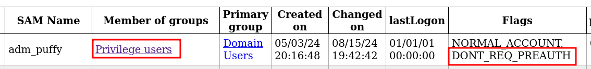
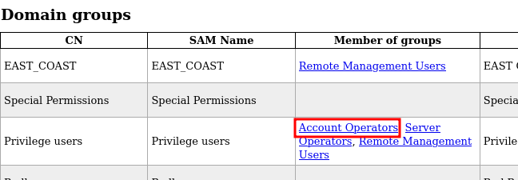
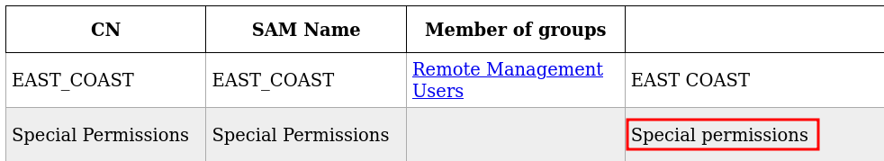

# 🩸 Alternativas a BloodHound

  
    

## 📖 Introducción

    

Aunque BloodHound es la herramienta más popular para análisis de Active Directory, existen varias alternativas y herramientas complementarias que permiten enumerar y analizar dominios de AD desde Linux sin necesidad de usar la interfaz gráfica completa de BloodHound.

    

      

#### 🔧 Herramientas Alternativas:

      
        
* ✅ **ldapdomaindump** - Volcado de información LDAP en formato HTML
        
* ✅ **PywerView** - PowerView en Python para Linux
        
* ✅ **BloodHound.py** - Recolector Python para BloodHound
      
    

    


  

  
    

## 📊 LDAP Domain Dump

    

Podemos extraer la información con **ldapdomaindump** y luego analizarla en formato HTML sin necesidad de BloodHound.

    

### 📥 Instalación

    

```bash
$ pip install ldapdomaindump
```

    

### 🚀 Uso de ldapdomaindump

    

#### Paso 1: Crear Directorio de Volcado

    

```bash
$ mkdir dump
$ cd dump
```

    

#### Paso 2: Ejecutar ldapdomaindump

    

```bash
$ ldapdomaindump -u 'bbr.thl\juicy' -p 'Bigpoppa.1974' 192.168.212.4
```

    

      

#### 📁 Archivos Generados:

      

ldapdomaindump crea varios archivos HTML con información del dominio:

      
        
* `domain_computers.html` - Lista de equipos del dominio
        
* `domain_groups.html` - Lista de grupos
        
* `domain_users.html` - Lista de usuarios
        
* `domain_policy.html` - Políticas del dominio
        
* `domain_trusts.html` - Relaciones de confianza
      
    

    

### 🔍 Analizando los Resultados

    



    

El usuario `adm_puffy` tiene la vulnerabilidad **AS-REP** en entornos con Kerberos y además pertenece al grupo `Privilege Users`.

    

El grupo `Privilege Users` a su vez es miembro del `Account Operators`:

    



    

      

#### 🔑 Account Operators:

      

Los miembros del grupo **Account Operators** pueden administrar usuarios y grupos del dominio:

      


    

    

### ⚡ Abuso de Permisos

    

Gracias a eso nos podemos añadir al grupo de `Special Permissions`:

    

```bash
*Evil-WinRM* PS C:\Users\adm_puffy\Documents> net group "Special Permissions" adm_puffy /add
```

    

Que vemos que ese grupo tiene habilitado los **permisos especiales**:

    



    

      

#### 💡 ¿Qué son los Permisos Especiales?

      

En Active Directory, los **permisos especiales** son configuraciones de permisos avanzadas que permiten un control granular sobre lo que los usuarios o grupos pueden hacer con un objeto en el directorio.

      

Y es lo que nos permite asignarle a ese usuario permisos **DCSync** para leer los hashes.

    

    

### 📊 Ventajas de ldapdomaindump

    

| Ventaja | Descripción |
| --- | --- |
| ✅ Salida HTML | Fácil de visualizar en cualquier navegador |
| ✅ Sin dependencias gráficas | No requiere Neo4j ni interfaz gráfica |
| ✅ Rápido | Más rápido que BloodHound para análisis simple |
| ✅ Exportable | Fácil de incluir en informes |
| ❌ Sin visualización de grafos | No muestra relaciones visuales como BloodHound |

  

  
    

## 🐍 PywerView

    

Otra alternativa es usar la herramienta **PywerView.py**, que es una implementación en Python de PowerView (parte de PowerSploit) para Linux.

    

      

**📚 Repositorio Oficial:**

      

[https://github.com/the-useless-one/pywerview](https://github.com/the-useless-one/pywerview)

    

    

### 📥 Instalación

    

```bash
$ pip install pywerview
```

    

### 🔍 Comandos Útiles de PywerView

    

#### 1. Políticas de Seguridad del Dominio

    

```bash
$ pywerview get-domainpolicy -d bbr.thl -u juicy -p 'Bigpoppa.1974' -t 192.168.212.4
```

    

#### 2. Listado de Usuarios

    

```bash
$ pywerview get-netuser -d bbr.thl -u juicy -p 'Bigpoppa.1974' -t 192.168.212.4
```

    

#### 3. Usuarios con Vulnerabilidad AS-REP

    

```bash
$ pywerview get-netuser -d bbr.thl -u juicy -p 'Bigpoppa.1974' -t 192.168.212.4 | grep DONT_REQ_PREAUTH -C3
```

    

      

#### 🎯 Detectar AS-REP Roasting:

      

El atributo `DONT_REQ_PREAUTH` indica que el usuario es vulnerable a **AS-REP Roasting**, permitiendo obtener el TGT sin necesidad de contraseña.

    

    

#### 4. Información de un Usuario Concreto

    

```bash
$ pywerview get-netuser -d bbr.thl -u juicy -p 'Bigpoppa.1974' -t 192.168.212.4 --username 'adm_puffy'
```

    

#### 5. Listado de Grupos del Dominio

    

```bash
$ pywerview get-netgroup -w bbr.thl/ -u juicy -p 'Bigpoppa.1974' -t 192.168.212.4
```

    

#### 6. Listado de Miembros de un Grupo

    

```bash
# Domain Admins
$ pywerview get-netgroupmember -w bbr.thl/ -u juicy -p 'Bigpoppa.1974' -t 192.168.212.4 --group "Domain Admins"

# Privilege Users
$ pywerview get-netgroupmember -w bbr.thl/ -u juicy -p 'Bigpoppa.1974' -t 192.168.212.4 --group "Privilege Users"

# Account Operators
$ pywerview get-netgroupmember -w bbr.thl/ -u juicy -p 'Bigpoppa.1974' -t 192.168.212.4 --group "Account Operators"
```

    

### 📊 Comandos Adicionales de PywerView

    

      

#### 🔧 Más Comandos Útiles:

      
      

| Comando | Descripción |
| --- | --- |
| `get-netcomputer` | Listar equipos del dominio |
| `get-netgpo` | Listar Group Policy Objects |
| `get-netou` | Listar Organizational Units |
| `get-netdomaintrust` | Listar relaciones de confianza |
| `get-netloggedon` | Usuarios loggeados en un equipo |
| `get-netsession` | Sesiones activas en un equipo |
| `get-netshare` | Recursos compartidos |

    

    

### 📊 Ventajas de PywerView

    

| Ventaja | Descripción |
| --- | --- |
| ✅ Línea de comandos | Perfecto para scripting y automatización |
| ✅ Sin GUI | Funciona en servidores sin entorno gráfico |
| ✅ Compatible con PowerView | Mismos comandos que PowerView de Windows |
| ✅ Rápido | Consultas directas sin procesamiento de grafo |
| ❌ Sin análisis de rutas | No calcula caminos de escalada automáticamente |

  

  
    

## 🐍 BloodHound.py

    

Otra alternativa es utilizar desde Linux **BloodHound.py** para obtener la información y pasarla luego a BloodHound para su análisis visual.

    

      

**📚 Repositorio Oficial:**

      

[https://github.com/dirkjanm/BloodHound.py](https://github.com/dirkjanm/BloodHound.py)

    

    

### 📥 Instalación

    

#### Opción 1: Con pip

    

```bash
$ pip install bloodhound
```

    

#### Opción 2: Desde GitHub

    

```bash
$ git clone https://github.com/dirkjanm/BloodHound.py
$ cd BloodHound.py
$ python setup.py install
```

    

### 🚀 Recolectar Información

    

Recolectar con el siguiente comando:

    

```bash
$ bloodhound-python -u juicy -p 'Bigpoppa.1974' -d bbr.thl -ns 192.168.212.4 -c all
```

    

      

#### 🔧 Parámetros Explicados:

      
        
* `-u` - Usuario del dominio
        
* `-p` - Contraseña
        
* `-d` - Nombre del dominio
        
* `-ns` - Servidor DNS / Domain Controller
        
* `-c all` - Recolectar toda la información disponible
      
    

    

### 📁 Archivos Generados

    

BloodHound.py genera archivos JSON compatibles con BloodHound:

    

```bash
20240812121134_computers.json
20240812121134_users.json
20240812121134_groups.json
20240812121134_domains.json
20240812121134_gpos.json
```

    

Estos archivos se pueden importar directamente en BloodHound para su análisis visual.

    

### 🎯 Opciones de Recolección

    

| Opción | Descripción | Comando |
| --- | --- | --- |
| `-c all` | Recopilar toda la información | `-c all` |
| `-c DCOnly` | Solo consultar el Domain Controller | `-c DCOnly` |
| `-c Group` | Solo membresías de grupos | `-c Group` |
| `-c LocalAdmin` | Solo administradores locales | `-c LocalAdmin` |
| `-c Session` | Solo sesiones activas | `-c Session` |
| `-c Trusts` | Solo relaciones de confianza | `-c Trusts` |

    

### 📊 Ventajas de BloodHound.py

    

| Ventaja | Descripción |
| --- | --- |
| ✅ Compatible con BloodHound | Genera archivos JSON importables directamente |
| ✅ Funciona desde Linux | No necesita Windows para recolectar datos |
| ✅ Menos intrusivo | Solo consultas LDAP, no ejecuta código en equipos |
| ✅ Análisis visual posterior | Mejor de ambos mundos: recolección Linux + análisis BloodHound |
| ❌ Menos información que SharpHound | No recopila sesiones locales tan bien como SharpHound.exe |

  

  
    

## 📊 Comparación de Herramientas

    

| Herramienta | Plataforma | Salida | Análisis Visual | Uso Ideal |
| --- | --- | --- | --- | --- |
| BloodHound + SharpHound | Windows + GUI | JSON → Neo4j | ✅ Excelente | Análisis completo con visualización de grafos |
| ldapdomaindump | Linux | HTML | ❌ Sin grafos | Análisis rápido, informes en HTML |
| PywerView | Linux | Texto / JSON | ❌ Sin grafos | Scripting, automatización, consultas específicas |
| BloodHound.py | Linux | JSON → Neo4j | ✅ Con BloodHound | Recolección desde Linux + análisis visual |

    

      

#### 🎯 ¿Cuál Usar?

      
        
* 🔴 **Pentesting completo:** BloodHound + SharpHound
        
* 🟠 **Análisis rápido sin GUI:** ldapdomaindump
        
* 🟡 **Scripting y automatización:** PywerView
        
* 🟢 **Recolección desde Linux:** BloodHound.py
      
    

  

  
    

## 📚 Resumen

    

      

### 🎓 Lo que hemos aprendido:

      
        
* ✅ ldapdomaindump exporta información de AD en HTML
        
* ✅ PywerView es PowerView en Python para Linux
        
* ✅ BloodHound.py recolecta datos compatibles con BloodHound
        
* ✅ Cada herramienta tiene casos de uso específicos
        
* ✅ Las alternativas no requieren interfaz gráfica
        
* ✅ Podemos combinar herramientas según necesidades
      

      

### 🔧 Comandos Clave:

      

| Herramienta | Comando Base |
| --- | --- |
| ldapdomaindump | `ldapdomaindump -u 'DOMAIN\user' -p 'pass' DC_IP` |
| PywerView | `pywerview get-netuser -d domain -u user -p pass -t DC_IP` |
| BloodHound.py | `bloodhound-python -u user -p pass -d domain -ns DC_IP -c all` |

      

### 🎯 Navegación:

      

← [Anterior: 03 - Análisis de Datos]([[02 - MODULOS/Prácticas (PoCs)/Herramientas de Auditoría/09c - BloodHound - Práctica 3 - Análisis de Datos y Rutas de Ataque|09c - BloodHound - Práctica 3 - Análisis]])

      

↑ [Volver al Índice del Módulo]([[02 - MODULOS/Prácticas (PoCs)/Herramientas de Auditoría/01 - Escaneo y Enumeración de Redes con Nmap|Índice de Herramientas de Auditoría]])

    

  

  
    

## 🎉 ¡Módulo de BloodHound Completado!

    

      Has completado todas las prácticas del módulo de BloodHound, cubriendo instalación, recolección, análisis y herramientas alternativas para auditoría de Active Directory.
    

    

      [📚 Volver al Índice del Módulo]([[02 - MODULOS/Prácticas (PoCs)/Herramientas de Auditoría/01 - Escaneo y Enumeración de Redes con Nmap|Índice de Herramientas de Auditoría]])
    

    

      ¡Excelente trabajo dominando BloodHound y sus alternativas! 🩸🔍
