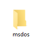
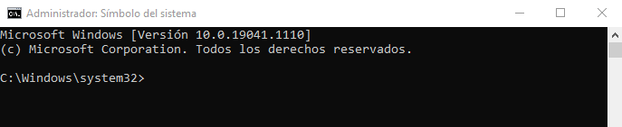
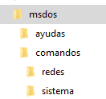
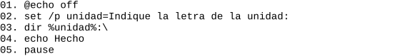

# 💻 Práctica de MS-DOS — Comandos del Sistema

> [!abstract] Enunciado y Descripción General
> El sistema operativo **MS-DOS** y la interfaz de línea de comandos (**CMD / Símbolo del sistema**), si bien a nivel de usuario común han quedado desplazados por entornos gráficos modernos, continúan siendo una **herramienta fundamental a nivel técnico y de ciberseguridad**. Permiten realizar tareas de bajo nivel, análisis forense rápido en vivo (*live triage*), scripting para automatización mediante archivos por lotes (`.bat`), consultas de red, auditoría del sistema operativo y administración sin dependencias complejas.

---

## 🎯 Prueba de Concepto (PoC)

> [!warning] Preparación del Entorno
> **Antes de comenzar:** Crea en la raíz de tu disco local `C:\` una carpeta denominada `msdos`.
> El laboratorio está planteado y optimizado para ejecutarse en un entorno con **Windows 10 / Windows 11**.



---

### 📋 Guía de Laboratorio Paso a Paso (24 Ejercicios)

#### 1. Inicio de Consola con Privilegios Administrativos
Abre el **Símbolo del sistema (CMD)** como **Administrador** (clic derecho sobre el menú Inicio o buscando `cmd` y seleccionando *Ejecutar como administrador*).
Al contar con permisos elevados de administrador, la ruta de trabajo por defecto al iniciar la terminal es:
```cmd
C:\Windows\System32>
```



---

#### 2. Sistema de Ayuda Integrado: Comando `help`
Es prioritario saber cómo obtener ayuda sobre cualquier herramienta del intérprete. Al ejecutar el comando base `help` se despliega el listado completo de los comandos internos y externos admitidos junto a una breve descripción de su función:
```cmd
help
```

---

#### 3. Personalización del Entorno con `COLOR`
Utilizando el comando `help`, consulta la sintaxis y los códigos hexadecimales del comando `COLOR`:
```cmd
help color
```
Prueba combinaciones de color para el fondo y el texto. Por ejemplo, para configurar el estilo clásico de terminal hacker (fondo negro y letras verde claro):
```cmd
color 0a
```

---

#### 4. Control de Apagado y Reinicio con `SHUTDOWN`
Consulta la ayuda detallada del comando de control de energía:
```cmd
help shutdown
```
* **a) Programar reinicio diferido:** Para reiniciar el equipo dentro de un intervalo de 120 segundos:
  ```cmd
  shutdown /r /t 120
  ```
  *(El parámetro `/r` indica reinicio y `/t 120` define el temporizador en segundos).*

* **b) Abortar o cancelar el reinicio:** Si el proceso de reinicio o apagado ya ha comenzado y se desea anular inmediatamente:
  ```cmd
  shutdown /a
  ```
  *(El parámetro `/a` aborta cualquier operación de apagado pendiente).*

> [!tip] Comprobación Segura
> Puedes probar la secuencia ejecutando primero la orden diferida y acto seguido el comando de cancelación (`shutdown /a`) antes de que transcurran los dos minutos.

---

#### 5. Obtención de Parámetros con el Flag `/?` y Diagnóstico con `PING`
Muchos comandos no se detallan en la lista corta de `help` (como herramientas de red y binarios ejecutables). La forma estándar de consultar las opciones de cualquier comando en Windows es añadir `/?` al final:
```cmd
ping /?
```
Lanza un envío de prueba hacia Google para verificar conectividad ICMP (enviará 4 paquetes eco):
```cmd
ping www.google.es
```
* **a) Ejecución continua e indefinida:** El parámetro `-t` envía paquetes de forma ininterrumpida hasta que sea detenido manualmente:
  ```cmd
  ping www.google.es -t
  ```
* **b) Interrupción de procesos en ejecución:** Para detener este o cualquier otro proceso en curso dentro de la consola:
  ```cmd
  Ctrl + C
  ```

---

#### 6. Investigación de la Variable de Entorno `%PATH%`
La variable del sistema `PATH` especifica los directorios en los que el intérprete de comandos busca archivos ejecutables cuando no se indica una ruta absoluta:
```cmd
echo %PATH%
```

> [!important] Implicación en Seguridad (Privilege Escalation & Hijacking)
> Si un programa malicioso o herramienta de auditoría de credenciales (como `LaZagne`, `Mimikatz` o un script personalizado) se aloja en una de las rutas listadas en `%PATH%`, cualquier usuario o proceso del sistema podrá invocarlo desde cualquier ubicación de la consola sin necesidad de escribir la ruta completa. Además, si un directorio con permisos de escritura para usuarios no privilegiados se encuentra antes en el orden de búsqueda del `PATH`, un atacante puede realizar un **DLL Hijacking** o **Binary Planting** para suplantar binarios legítimos del sistema.

---

#### 7. Listado Básico de Archivos con `DIR`
Situándonos en la ruta `C:\Windows\System32`, lista el contenido de la carpeta:
```cmd
dir
```

---

#### 8. Paginación de Resultados con `DIR /P`
Para pausar la salida tras cada pantalla completa y facilitar la lectura en directorios con miles de ficheros:
```cmd
dir /p
```
*(Pulsa cualquier tecla para avanzar a la siguiente página de resultados).*

---

#### 9. Filtrado por Extensión
Filtra la salida para visualizar exclusivamente los archivos de configuración con extensión `.ini`:
```cmd
dir *.ini
```

---

#### 10. Filtrado por Letra Inicial
Muestra todos los ficheros y directorios cuyo nombre comience por la letra `Z`:
```cmd
dir z*.*
```

---

#### 11. Filtrado Combinado (Prefijo y Extensión)
Muestra todos los archivos que inicien por la palabra `AUTO` y pertenezcan a la librería dinámica `.dll`:
```cmd
dir auto*.dll
```

---

#### 12. Búsqueda Recursiva con `DIR /S`
Realiza un escaneo en todo el árbol de subdirectorios de la carpeta actual para localizar el archivo `license.rtf`:
```cmd
dir license.rtf /s
```
*(El modificador `/s` busca en el directorio actual y en todas sus subcarpetas).*

---

#### 13. Copia de Archivos con `COPY`
Copia el archivo `license.rtf` localizado en el ejercicio anterior hacia la carpeta de trabajo `C:\msdos` creada al inicio:
```cmd
copy C:\Windows\System32\license.rtf C:\msdos
```

---

#### 14. Navegación de Directorios con `CD`
Desplázate a la carpeta de trabajo:
```cmd
cd C:\msdos
```

---

#### 15. Creación de Estructura de Directorios con `MKDIR`
Crea la siguiente jerarquía de carpetas directamente desde la línea de comandos:



```cmd
mkdir ayudas
mkdir comandos
cd comandos
mkdir sistema
mkdir redes
cd ..
```

---

#### 16. Copia Entre Rutas Relativas y Absolutas
Sitúate en la subcarpeta `ayudas` y copia el archivo `license.rtf` (ubicado en `C:\msdos`) dentro del directorio `C:\msdos\comandos\sistema`:
```cmd
cd C:\msdos\ayudas
copy C:\msdos\license.rtf C:\msdos\comandos\sistema
```

---

#### 17. Desplazamiento de Archivos con `MOVE`
Desde la misma ruta (`C:\msdos\ayudas`), mueve el archivo recién copiado hacia la carpeta actual utilizando la referencia relativa `.\`:
```cmd
move C:\msdos\comandos\sistema\license.rtf .\
```

---

#### 18. Eliminación de Archivos con `DEL`
Vuelve a la raíz de la práctica (`C:\msdos`) y elimina de forma limpia las copias temporales existentes:
```cmd
cd C:\msdos
del C:\msdos\ayudas\license.rtf
del C:\msdos\comandos\sistema\license.rtf
```

---

#### 19. Redirección de Salida Simple (`>`) para Generar Documentación
Entra en la carpeta `ayudas` y exporta la ayuda de distintos comandos a archivos de texto planos:
```cmd
cd C:\msdos\ayudas
help > help.txt
ping /? > ping.txt
ipconfig /? > ipconfig.txt
dir /? > dir.txt
```
*(El operador `>` crea el archivo si no existe o sobreescribe su contenido si ya existía).*

---

#### 20. Creación y Concatenación de Reportes del Sistema (`>>`)
Sitúate en la carpeta `comandos` y genera un informe de auditoría básico en `sistema.txt` concatenando información con el operador `>>`:
```cmd
cd C:\msdos\comandos
echo %date% - %time% > sistema.txt
echo --------EQUIPO--------- >> sistema.txt
systeminfo >> sistema.txt
echo --------PROCESOS--------- >> sistema.txt
tasklist >> sistema.txt
```

> [!info] Operadores de Redirección
> * `>`: Redirige el flujo de salida estándar (`stdout`) hacia un archivo, **reemplazando** su contenido previo.
> * `>>`: Redirige el flujo de salida estándar hacia un archivo, **añadiendo** el nuevo contenido al final (*append*).

---

#### 21. Organización de Archivos de Reporte
Mueve el fichero `sistema.txt` a su subcarpeta temática correspondiente:
```cmd
move sistema.txt C:\msdos\comandos\sistema
```

---

#### 22. Creación de Scripts Batch con `COPY CON`
Sitúate en la ruta `C:\msdos\comandos\redes` y crea un script interactivo por lotes llamado `infored.bat` directamente desde la consola mediante el comando `copy con`:
```cmd
cd C:\msdos\comandos\redes
copy con infored.bat
```
Introduce línea por línea las siguientes instrucciones:
```bat
@echo off
echo ------- REDES --------- > infored.txt
ipconfig /all >> infored.txt
echo -------- CONEXIONES ---------- >> infored.txt
netstat -ano >> infored.txt
```

---

#### 23. Cierre y Ejecución del Script Batch
Para guardar y cerrar el archivo creado con `copy con`, presiona:
```cmd
Ctrl + Z
Enter
```
El sistema confirmará: `1 archivo(s) copiado(s)`.
A continuación, ejecuta el script para verificar que genera correctamente el informe consolidado de interfaces y sockets de red:
```cmd
infored.bat
type infored.txt
```

---

#### 24. Análisis de Script Interactivo con Variables de Entrada (`SET /P`)
A continuación se presenta el siguiente script por lotes:



```bat
@echo off
set /p unidad=Indique la letra de la unidad:
dir %unidad%:\
echo Hecho
pause
```

> [!abstract] Explicación Técnica del Funcionamiento
> 1. **`@echo off`**: Desactiva la visualización de los comandos en la pantalla mientras se ejecutan, mostrando únicamente sus salidas. El símbolo `@` evita que la propia orden `@echo off` se imprima.
> 2. **`set /p unidad=Indique la letra de la unidad:`**: El modificador `/p` pausa la ejecución y solicita al usuario que introduzca una cadena por teclado, asignando dicha entrada a la variable `unidad`.
> 3. **`dir %unidad%:\`**: El intérprete expande la variable `%unidad%` sustituyéndola por la letra introducida (por ejemplo `C` o `D`) y ejecuta un comando `dir` sobre la raíz de dicha unidad (`C:\` o `D:\`).
> 4. **`echo Hecho`**: Muestra un mensaje informativo de finalización en pantalla.
> 5. **`pause`**: Suspende la ejecución del script y muestra el mensaje del sistema *"Presione una tecla para continuar . . ."*, impidiendo que la ventana de la consola se cierre automáticamente tras finalizar la tarea.

---

## 🔗 Referencias Cruzadas y Enlaces Relacionados
* 🔗 [[02 - MODULOS/Prácticas (PoCs)/MS-DOS/02 - Conexiones Directas e Inversas con Netcat|Práctica de Conexiones Directas e Inversas con Netcat]]
* 📄 [[03 - EXTRA/Documentos/MS-DOS CheatSheet|MS-DOS CheatSheet de Comandos Rápidos]]
* 🗂️ [[02 - MODULOS/05 - Prácticas (PoCs)|Catálogo General de Prácticas (PoCs)]]
