# 📱 Android Studio - Entorno de Desarrollo

## 🎯 ¿Qué es Android Studio?

**Android Studio** es el entorno de desarrollo integrado (IDE) oficial para el desarrollo de aplicaciones para el sistema operativo Android. Fue anunciado por Google en 2013 durante la conferencia Google I/O, y está basado en **IntelliJ IDEA** de JetBrains.

> 💡 Importancia en Pentesting:  Android Studio no solo se usa para desarrollar aplicaciones, sino también para  analizar, modificar y probar la seguridad  de aplicaciones Android existentes. El emulador incluido permite ejecutar y depurar apps en un entorno controlado.

## ✨ Características Principales

### 1. 📝 Editor de Código y Diseño

* Editor de código avanzado: Soporta la finalización de código, la navegación inteligente y la refactorización

* Editor de diseño visual: Permite arrastrar y soltar componentes de la interfaz de usuario (UI) y ofrece vistas previas en tiempo real de las aplicaciones en múltiples configuraciones de dispositivos y versiones de Android

### 2. 🔧 Sistema de Construcción Basado en Gradle

* Facilita la administración de dependencias y la configuración de variantes de compilación

* Integra capacidades para la construcción, prueba y despliegue de aplicaciones

### 3. 📱 Emulador de Android

Proporciona un **emulador rápido y rico en funciones** para probar aplicaciones en diversas configuraciones de dispositivos sin necesidad de dispositivos físicos.

> 🔍 Uso en Pentesting:  El emulador permite instalar y analizar APKs sospechosas sin comprometer un dispositivo real. Ideal para análisis dinámico de malware y pruebas de seguridad.

### 4. 🔗 Integración con GitHub

Soporte para la integración con sistemas de control de versiones como Git y plataformas como GitHub, facilitando la colaboración y el control de versiones.

### 5. 💻 Soporte para Kotlin y Java

Soporta tanto el lenguaje de programación **Kotlin** como **Java**, con recomendaciones y plantillas de proyectos para ambos.

### 6. 📊 Analizadores y Herramientas de Rendimiento

Ofrece herramientas para monitorear y mejorar el rendimiento de las aplicaciones:

* Analizador de memoria

* Analizador de CPU

* Analizador de red

* Profiler de energía

### 7. 🧩 Asistentes y Plantillas

Incluye asistentes y plantillas para la creación rápida de componentes comunes de aplicaciones Android, como actividades, fragmentos y servicios.

### 8. 🐛 Pruebas y Depuración

Proporciona herramientas integradas para realizar pruebas unitarias, pruebas de integración y depuración de aplicaciones.

## 📦 Componentes Principales

| Componente | Descripción |
| --- | --- |
| Project Structure | Estructura jerárquica de proyectos que organiza todos los archivos y recursos necesarios para el desarrollo de aplicaciones |
| Android Manifest | Archivo de configuración central que define elementos esenciales de la aplicación, como actividades, permisos y servicios |
| Resources | Carpeta que contiene todos los recursos de la aplicación: layouts, imágenes, strings y estilos |
| Gradle Scripts | Scripts de Gradle que manejan la configuración de la construcción y las dependencias del proyecto |

## 🔄 Actualizaciones y Soporte

Android Studio recibe actualizaciones frecuentes que incorporan:

* Nuevas características

* Mejoras en el rendimiento

* Parches de seguridad

Además, Google ofrece una amplia documentación, tutoriales y soporte comunitario para los desarrolladores que utilizan esta herramienta.

### 🔌 Integraciones Adicionales

| Integración | Funcionalidad |
| --- | --- |
| Firebase | Plataforma de desarrollo móvil que proporciona servicios como autenticación, base de datos en tiempo real, análisis y almacenamiento en la nube |
| Android Jetpack | Conjunto de bibliotecas y herramientas que ayudan a los desarrolladores a seguir las mejores prácticas y simplificar tareas comunes |

## 💾 Instalación de Android Studio en Windows

### 📥 Paso 1: Descargar Android Studio

Comenzamos descargando Android Studio desde el sitio oficial:

> 🔗 Enlace de Descarga:
>         https://developer.android.com/studio?hl=es-419

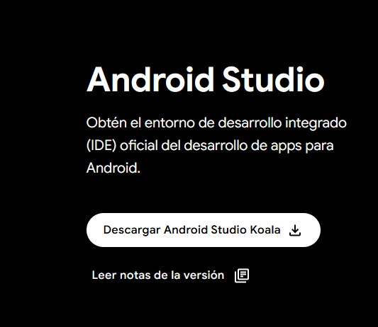

Aceptamos las condiciones y lo descargamos:

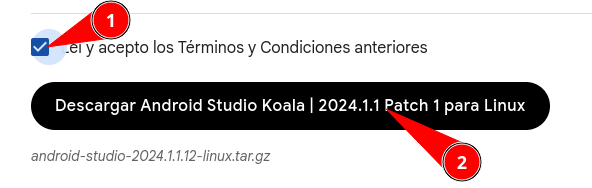

### ⚙️ Paso 2: Instalación

Una vez descargado lo instalamos con los **valores por defecto**.

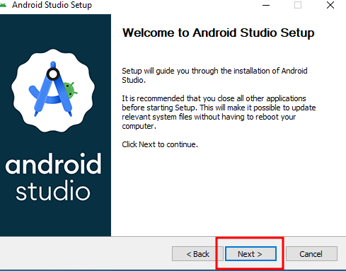

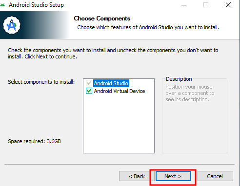

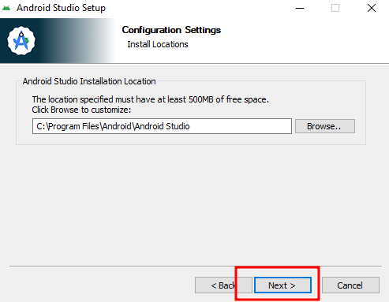

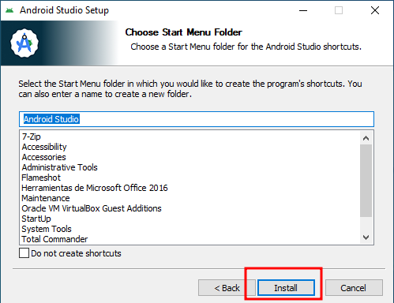

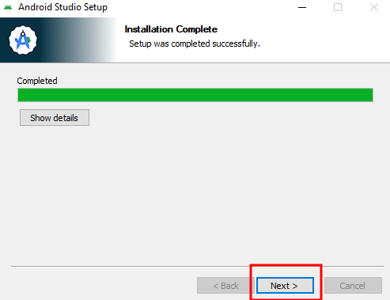

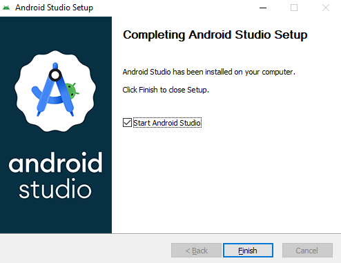

### 🚀 Paso 3: Configuración Inicial

Pulsamos en **no enviar estadísticas a Google**:

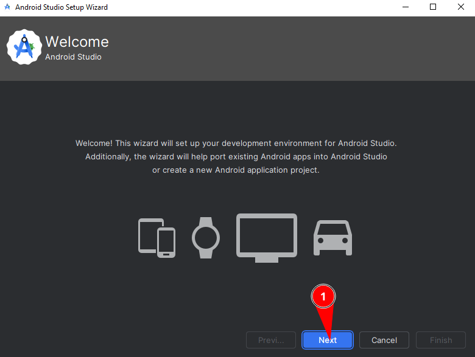

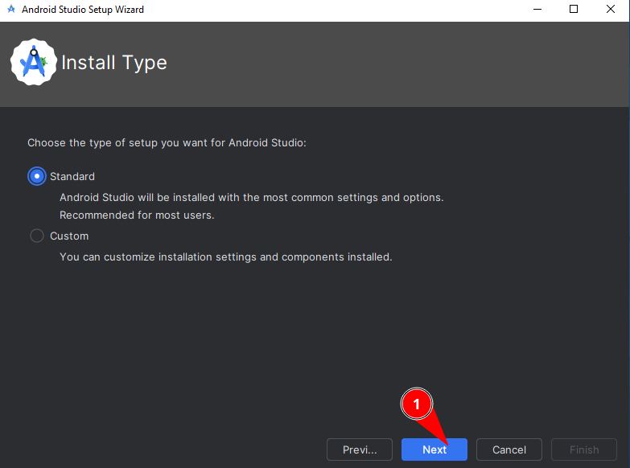

No cambiamos nada en los componentes y pulsamos siguiente:

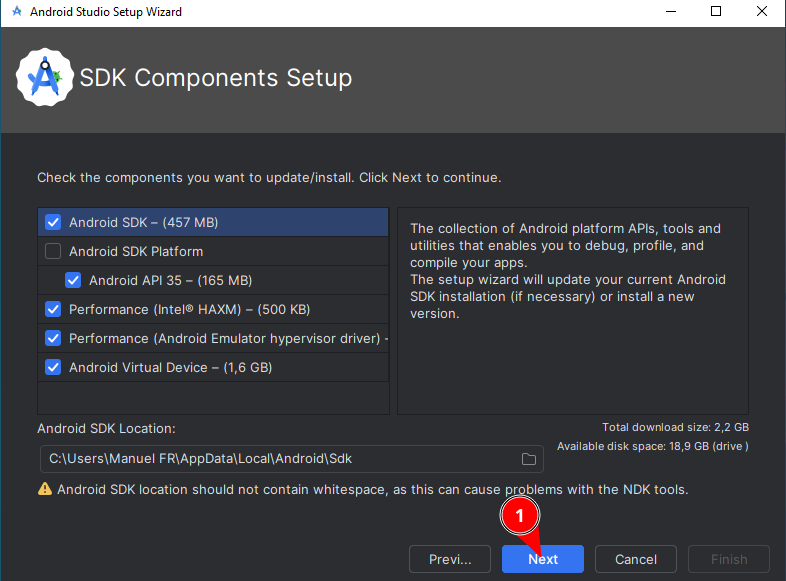

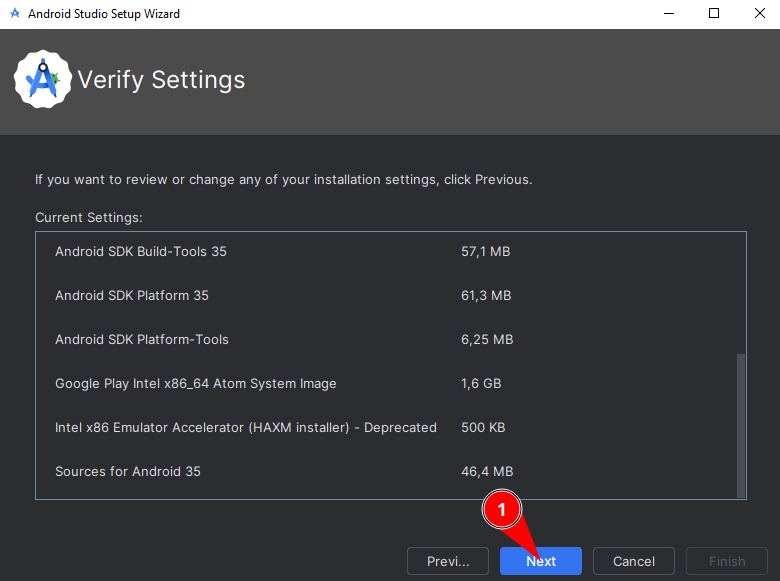

### 📜 Paso 4: Aceptar Licencias

Aceptamos todas las licencias y pulsamos en **Finalizar**:

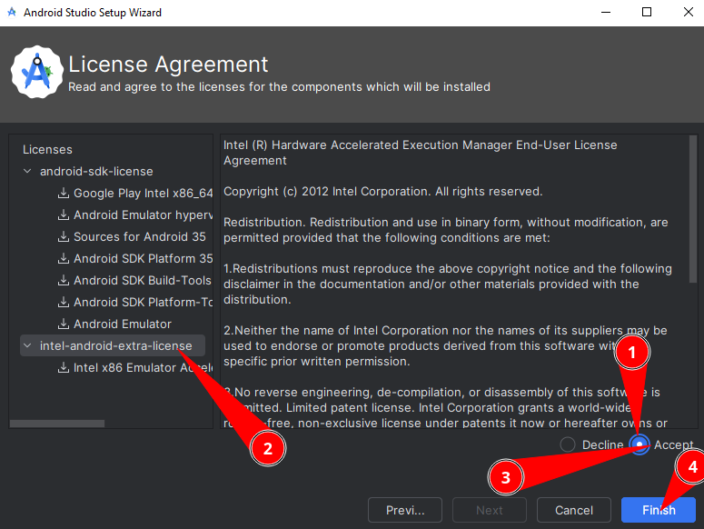

Cuando termine pulsamos en **Finalizar**:

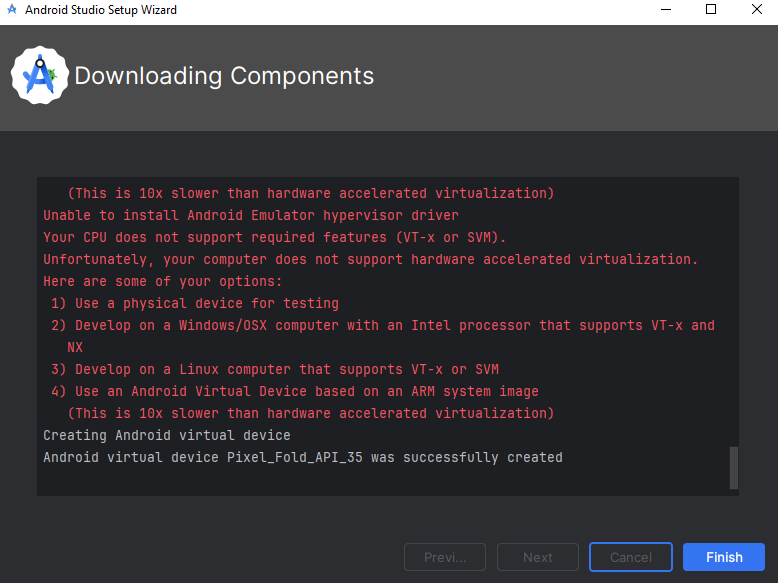

> ✅ Instalación Completada:  Android Studio ya está listo para usar. A continuación crearemos un proyecto de prueba y configuraremos el emulador.

## 📱 Crear un Proyecto Base

### 🆕 Paso 1: Nuevo Proyecto

Vamos a crear un proyecto base. Pulsamos en **Nuevo Proyecto**:

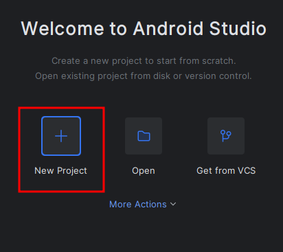

Marcamos **BasicViews Activity** y pulsamos en siguiente:

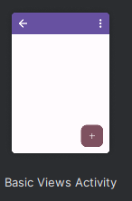

### ⚙️ Paso 2: Configurar el Proyecto

Ponemos el nombre del proyecto y pulsamos en **Finalizar**:

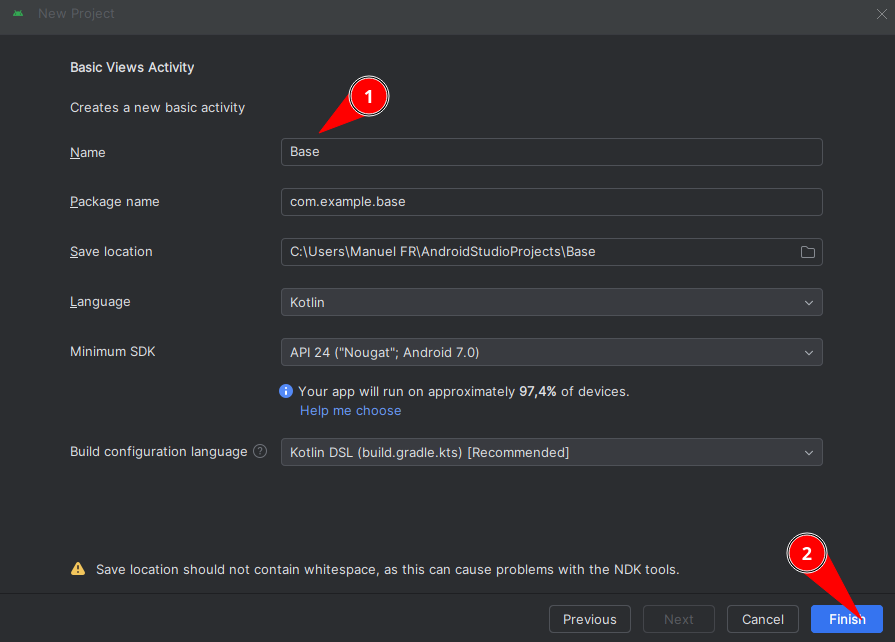

Cuando acabe de configurar el proyecto, esperamos a que termine de descargar y configurar todo.

En la parte inferior derecha vemos cómo va realizando tareas:

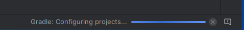

> ⏱️ Paciencia:  La primera vez que se crea un proyecto, Android Studio descarga dependencias de Gradle. Este proceso puede tardar varios minutos dependiendo de la conexión a internet.

## 📲 Crear un Dispositivo Virtual (Emulador)

### 🔧 Paso 1: Abrir Device Manager

Ahora vamos a crear un nuevo dispositivo virtual. Vamos al **Device Manager**:

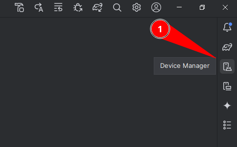

Pulsamos en el signo **(+)** y seleccionamos **Crear dispositivo virtual**:

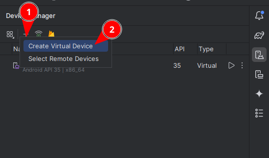

### 📱 Paso 2: Seleccionar Modelo de Dispositivo

Elegimos **Pixel 2** y pulsamos **Siguiente**:

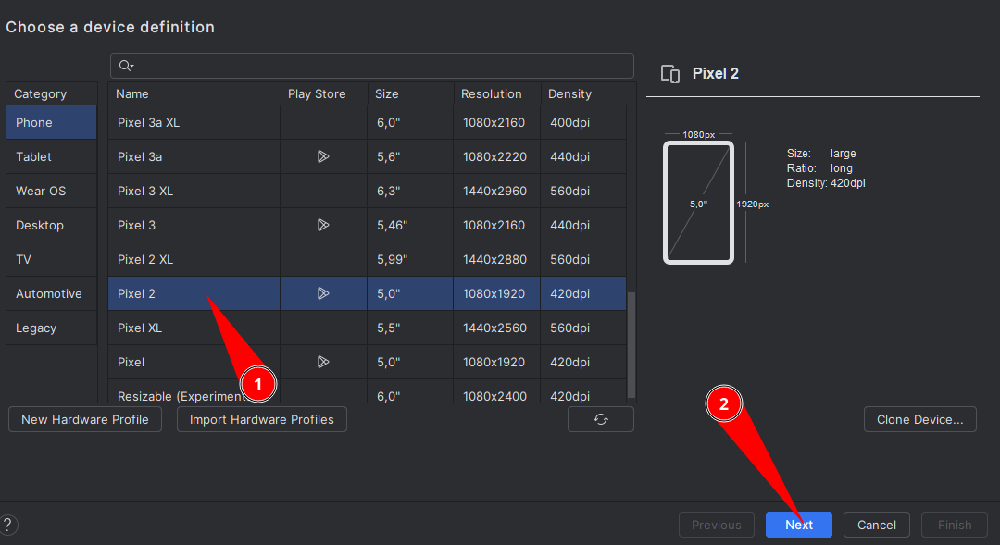

> 💡 ¿Por qué Pixel 2?  Es un dispositivo equilibrado con buen rendimiento en emulación. Para pentesting, es importante tener un dispositivo que permita rootear fácilmente y tenga APIs de Google.

### 📥 Paso 3: Descargar Imagen del Sistema

Ahora vamos a elegir **Android 11.0** y primero vamos a pulsar en el botón de descarga:

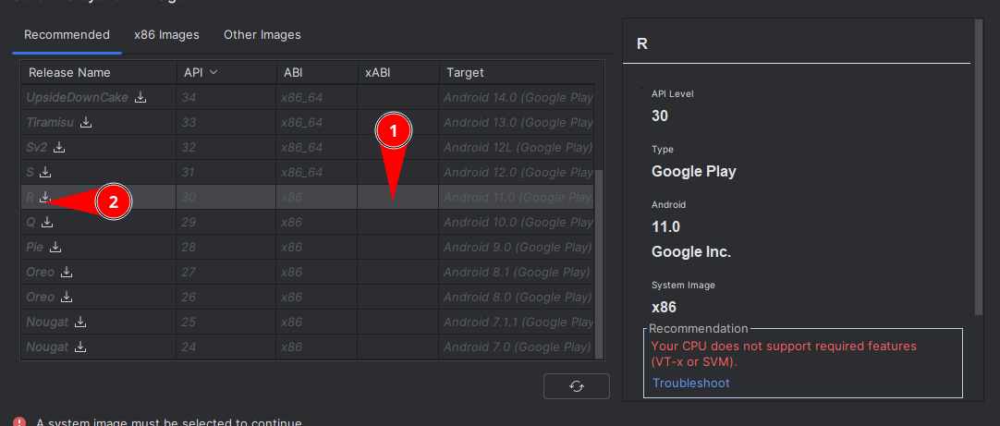

Al pulsar el botón de descarga comienza a descargarla. **Esperamos que termine.**

| Versión Android | API Level | Uso en Pentesting |
| --- | --- | --- |
| Android 11.0 | API 30 | ✅ Buena compatibilidad, rooteable, APIs completas |
| Android 12.0 | API 31 | ⚠️ Restricciones de seguridad adicionales |
| Android 10.0 | API 29 | ✅ Muy estable, amplio soporte de herramientas |
| Android 9.0 | API 28 | ✅ Compatible con muchas apps legacy |

Cuando finalice podremos seleccionarla y pulsar en **Siguiente**:

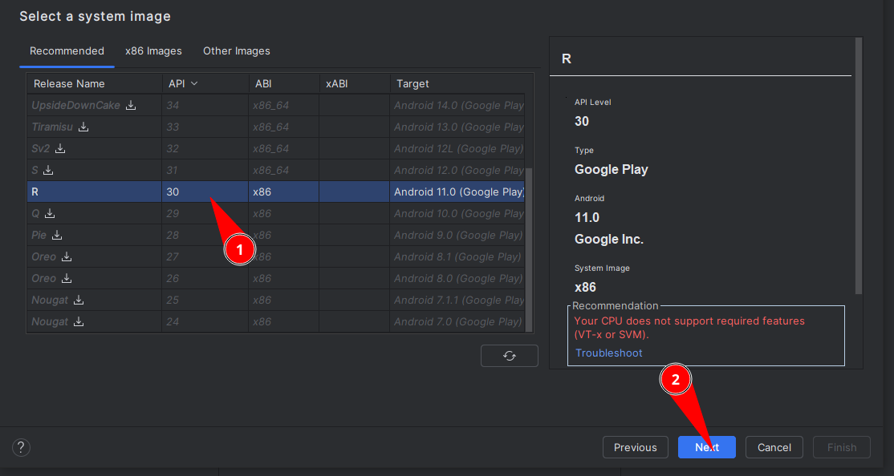

Y finalizamos en la siguiente ventana.

### ▶️ Paso 4: Iniciar el Emulador

Ahora en el **Device Manager** podemos darle al **Play** para que inicie:

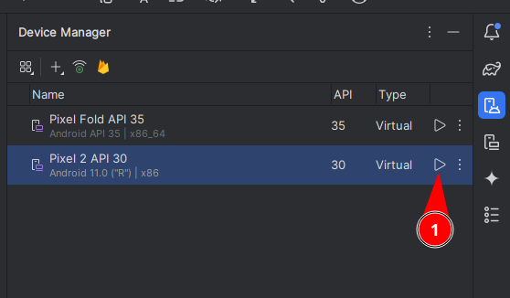

O en la parte superior del proyecto elegimos nuestro **Pixel 2** y pulsamos en **Play**:

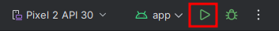

### 🚀 Paso 5: Instalación de HAXM

Iniciará un proceso de instalación de **HAXM** (Intel Hardware Accelerated Execution Manager):

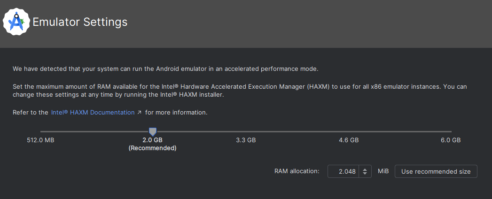

> 💡 ¿Qué es HAXM?  Es un motor de virtualización asistida por hardware que acelera significativamente el emulador de Android en sistemas con procesadores Intel. Sin HAXM, el emulador sería extremadamente lento.

Pulsamos **Siguiente** y tendremos acceso al emulador. Hay que esperar que termine de iniciar:

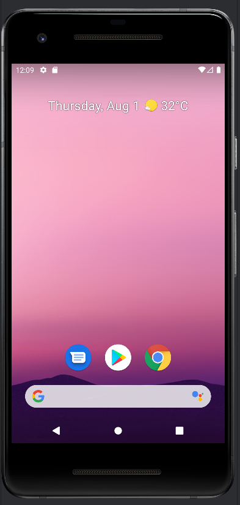

> ✅ Emulador Listo:  Una vez completado el arranque, el emulador está listo para instalar y probar aplicaciones Android. En las siguientes prácticas lo usaremos para análisis de seguridad y pentesting.

## 🎯 Resumen de Instalación

| Paso | Acción | Resultado |
| --- | --- | --- |
| 1 | Descargar Android Studio | Instalador descargado |
| 2 | Instalar con valores por defecto | Android Studio instalado |
| 3 | Configuración inicial (rechazar estadísticas) | Entorno configurado |
| 4 | Aceptar licencias y descargar componentes | SDK y herramientas instaladas |
| 5 | Crear proyecto BasicViews Activity | Proyecto de prueba creado |
| 6 | Crear dispositivo virtual Pixel 2 | Emulador configurado |
| 7 | Descargar imagen Android 11.0 | Sistema operativo descargado |
| 8 | Instalar HAXM e iniciar emulador | ✅ Entorno completo operativo |

## 📚 Navegación

      [
        → Siguiente: Pentesting en Android
      ]([[02 - MODULOS/Prácticas (PoCs)/Pentesting en Android/02 - Metodología de Pentesting en Aplicaciones Android|02 - Metodología de Pentesting en Aplicaciones Android]])

      [
        ↑ Volver al Índice
      ]([[02 - MODULOS/05 - Prácticas (PoCs)|Índice de Prácticas]])
