# 🖥️ Active Directory en Windows Server 2019

  

## Parte 2: Instalar Características de Active Directory

  
  
    

## 📦 Instalar Características de Active Directory

    
    

Vamos a promover el Servidor a un Controlador de dominio siguiendo los siguientes pasos.

    
    

Comenzamos pulsando en Inicio > Administrador del servidor

    
    

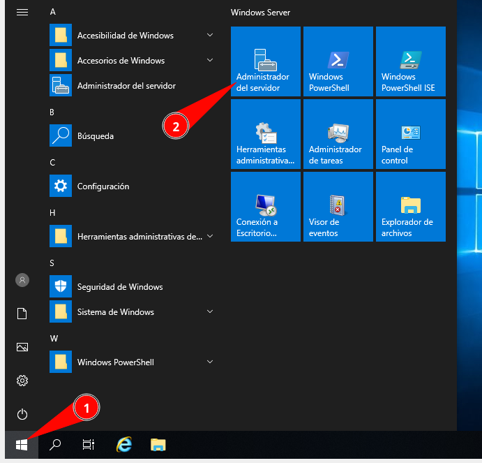

    
    

Cerramos la ventana de advertencia que aparece.

    
    

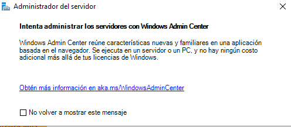

    
    

A continuación pulsamos en Agregar roles y características:

    

### 📋 Tipo de instalación

    
    

Instalación basada en roles y pulsamos siguiente.

    
    

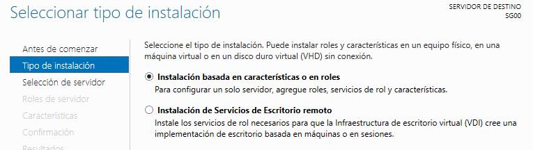

    

### 🖥️ Elegir servidor

    
    

Marcamos el servidor y pulsamos siguiente

    
    

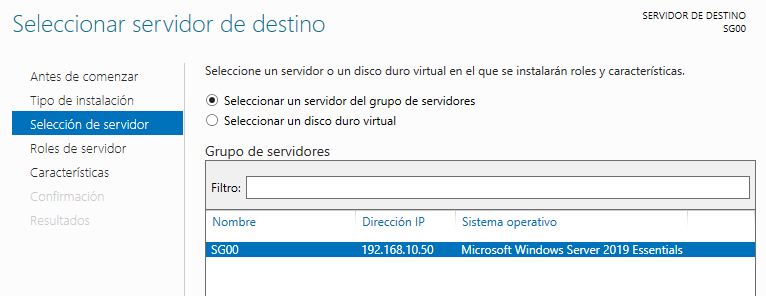

    
    

Ahora tenemos que marcar Servicios de dominio de active directory. Importante NO hay que marcar Servicios de Certificados de active directory.

    
    

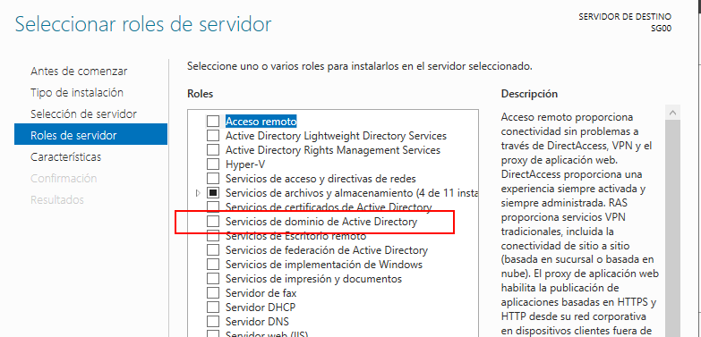

    
    

Al marcarlo aparece una ventana en la que pulsamos en agregar características.

    
    

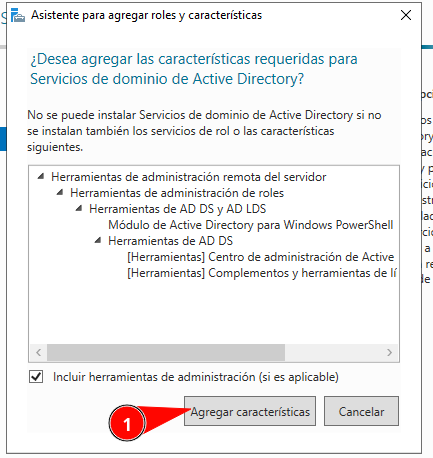

    
    

Una vez marcado Servicios de dominio de Active Directory pulsamos en Siguiente:

    
    

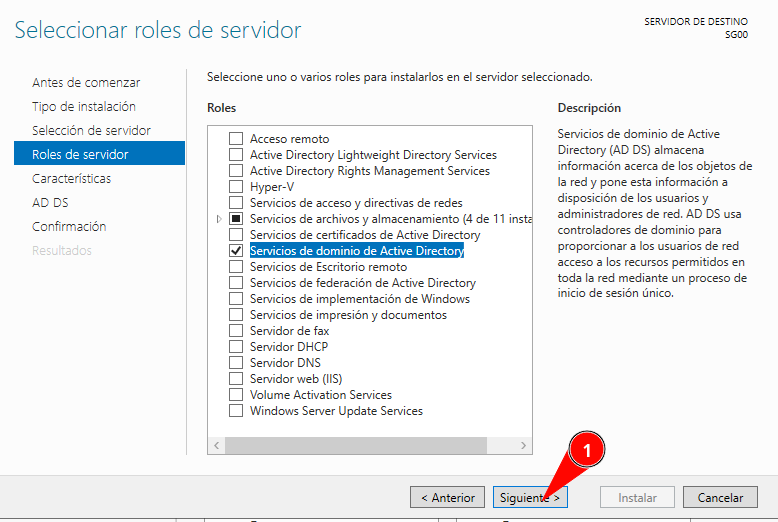

    
    

En la ventana de Seleccionar características también pulsamos en Siguiente sin marcar nada:

    
    

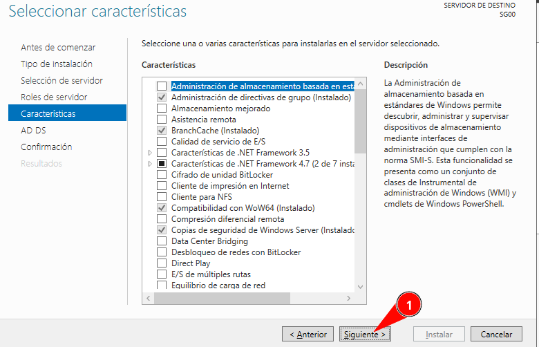

    
    

Nuevamente Siguiente en la ventana.

    
    

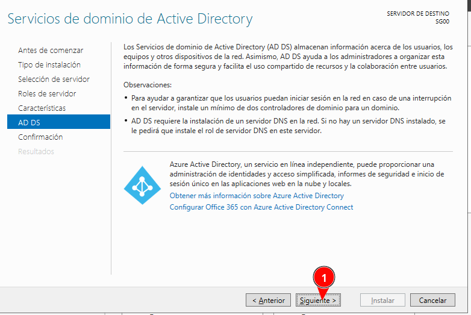

    
    

Y en ahora marcamos Reiniciar si es necesario (sale una ventana pidiendo confirmación y pulsamos en si) y ya pulsamos en Instalar.

    
    

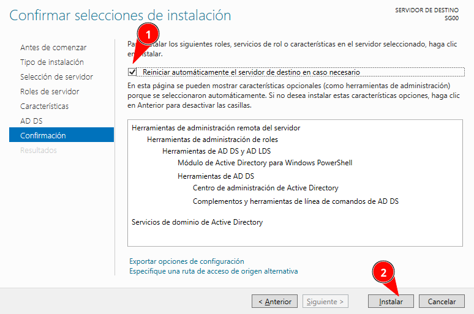

    
    

Comenzará ahora el proceso de instalación.

    
    

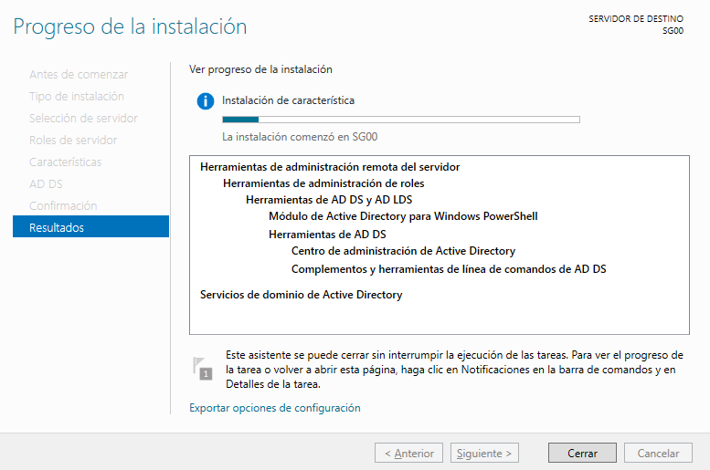

    
    

Esta ventana podemos cerrarla.

    
    

En la ventana de Administrador del servidor hay un icono de una bandera. Cuando termina de instalarse las características necesarios, en esa zona aparece un enlace para promover el servidor a controlador de dominio.

    
    

Si hemos tenido que reiniciar deberíamos acceder a Inicio > Administrador del servidor.

    
    

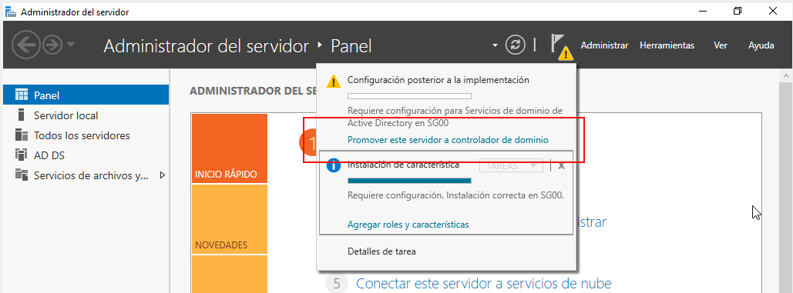

    
    

Esta opción sólo aparece disponible cuando termina de instalar todo.

  

  
    

## 🎖️ Promover servidor a controlador de dominio

    
    

Entramos en Inicio > Administrador del Servidor.

    
    

En el área de notificaciones pulsamos a promover este servidor a controlador de dominio.

    
    

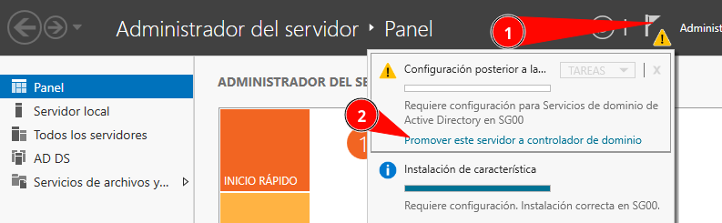

    
    

Ahora vamos a crear un nuevo bosque. El nombre del bosque tendrá la siguiente estructura:

    
    

wsgr**XX**.local (Donde XX es el número que tienes asignado)

    
    

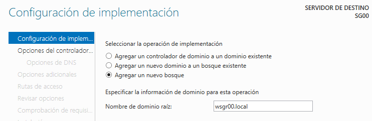

    
    

Pulsamos en siguiente.

    
    

En la siguiente ventana definimos la contraseña de restauración. Puede que tarde un poco hasta que nos deje escribirla.

    
    

Contraseña restauración: SegInf.2131

    
    

(Es contraseña de laboratorio se deben usar siempre contraseñas seguras)

    
    

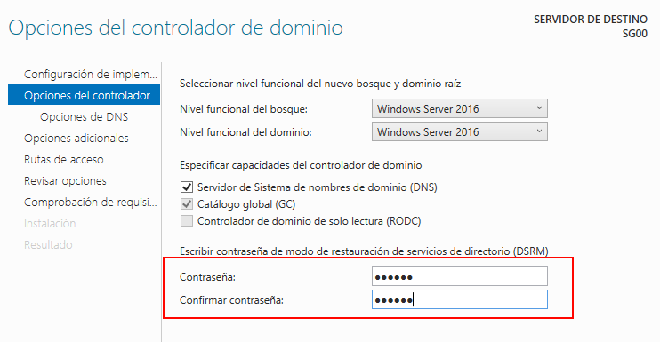

    
    

Pulsamos en siguiente.

    
    

En la siguiente ventana NO vamos a crear delegación DNS por lo que pulsamos en siguiente sin marcar nada.

    
    

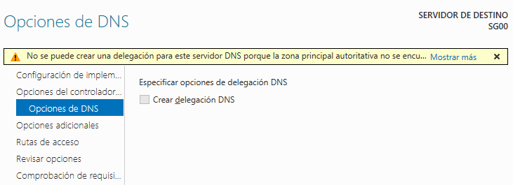

    
    

Ahora esperamos hasta que nos deje escribir el Nombre de Dominio NetBIOS, si todo va bien cogerá el nombre automáticamente con la estructura WSGRXX (Donde XX es el número que se te asignó)

    
    

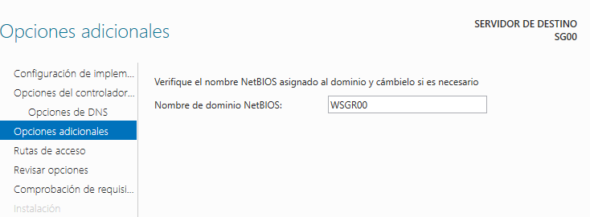

    
    

Pulsamos si todo es correcto en siguiente.

    
    

En la siguiente ventana dejamos las rutas de acceso como está y pulsamos en siguiente:

    
    

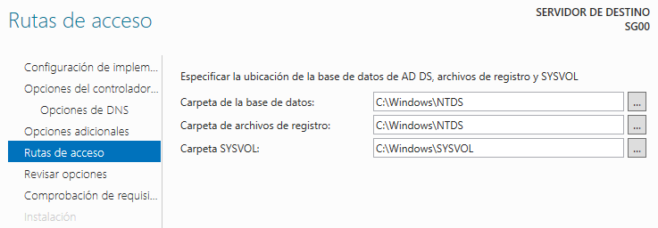

    
    

Igualmente en la ventana revisar opciones pulsamos siguiente:

    
    

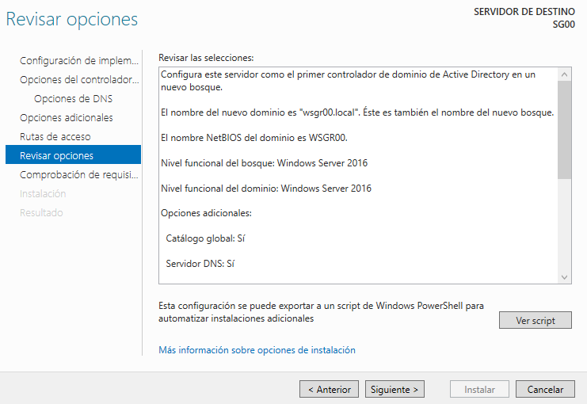

    
    

Ahora hace una comprobación de requisitos previos si todo va bien el botón de instalar aparece como disponible, lo pulsamos.

    
    

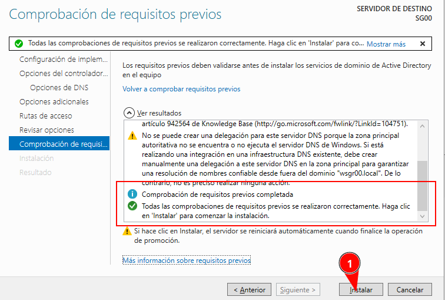

    
    

Comienza el proceso de instalación, el cual se reiniciará automáticamente.

    
    

Al iniciar después del reinicio ya tendremos el dominio creado.

    
    

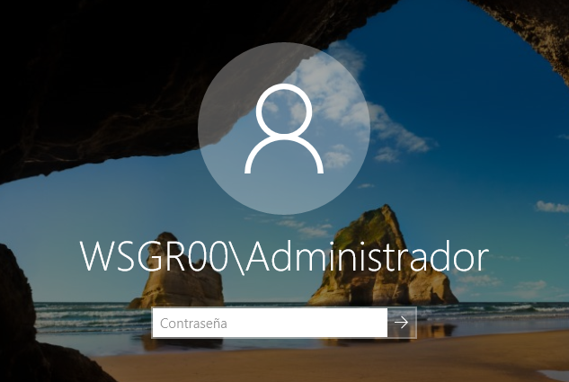

  

  
  

    [Anterior: Configuración Inicial]([[02 - MODULOS/Prácticas (PoCs)/Sistemas/02a - Active Directory - Parte 1 - Configuración Inicial|Parte 1: Configuración Inicial]])
    [Siguiente: Configuración del AD]([[02 - MODULOS/Prácticas (PoCs)/Sistemas/02c - Active Directory - Parte 3 - Configuración del AD|Parte 3: Configuración del AD]])
