# 🖥️ Active Directory en Windows Server 2019

  

## Parte 3: Configuración del Active Directory

  
  
    

## ⚙️ Configuración del active directory

    
    

Vamos ahora a configurar el Dominio. Suponemos la siguiente estructura empresarial que tenemos que tener en cuenta para la configuración que realizaremos:

    
    

### 🏢 Estructura de Empresa

    
    

Nombre Empresa: Nuestra Empresa S.L

    
    

Dpto Dirección: Pedro García, Ana Gutiérrez

    
    

Dpto Administración: María Marfil, Pablo Castillo

    
    

Dpto Informática: Roberto Márquez, tecnico

  

  
    

## 👥 Usuarios y Grupos

    
    

Vamos a crear los grupos y usuarios que se van a utilizar en la estructura de la empresa.

    
    

Pulsamos en Inicio > Herramientas Administrativas > Usuarios y Equipos de Active Directory

    
    

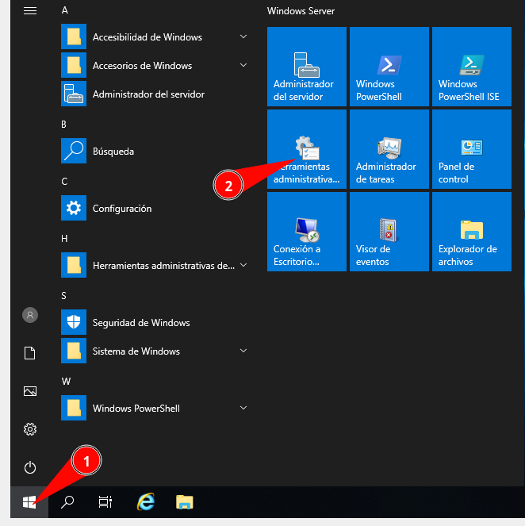

    
    

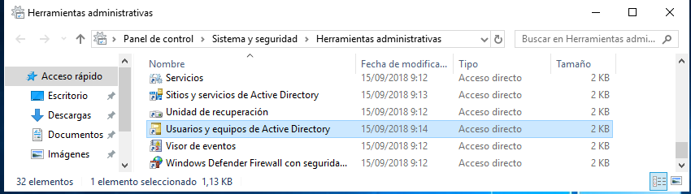

    
    

Ahora desplegamos el nombre del dominio y vamos a la zona de Users

    
    

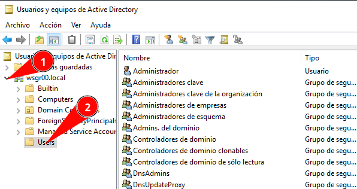

    
    

Con la sección de Users seleccionado vamos al menú Acción > Nuevo > Grupo

    
    

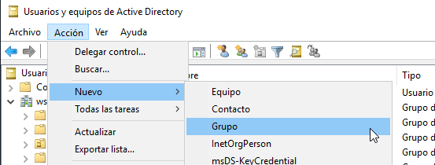

    
    

Y creamos los grupos que caracterizan a la empresa:

    
    

El ámbito para todos será Global

    
    

El tipo de grupo es Seguridad, que es el que permite asignar permisos.

    
    

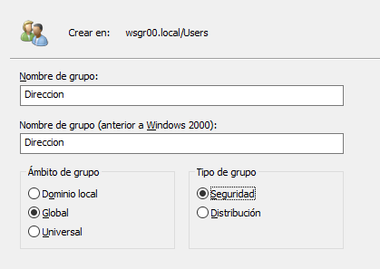

    
    

Creamos los grupos Direccion, Administracion e Informatica. Es preferible NO utilizar tildes.

    
    

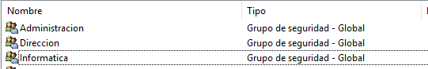

    
    

Ahora vamos a definir cada grupo como miembro de Usuarios de Dominio

    
    

Hacemos doble clic en el grupo Direccion y en la pestaña Miembro de... Pulsamos agregar.

    
    

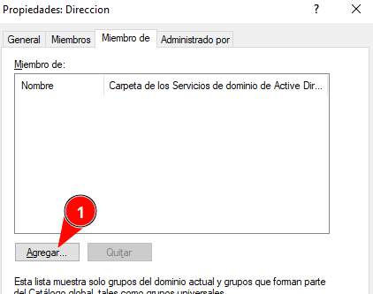

    
    

En la siguiente ventana pulsamos en Opciones avanzadas, luego en buscar ahora y en el listado inferior seleccionamos Usuarios del dominio y pulsamos en aceptar.

    
    

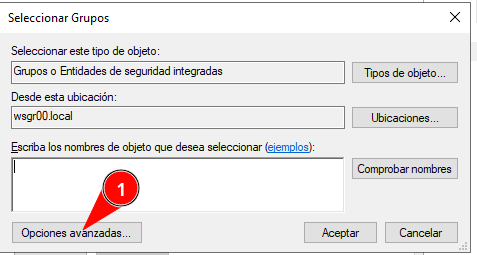

    
    

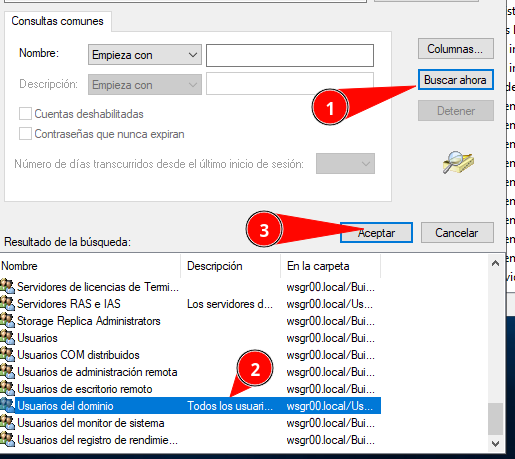

    
    

Aparecerá en la lista, y pulsamos nuevamente aceptar.

    
    

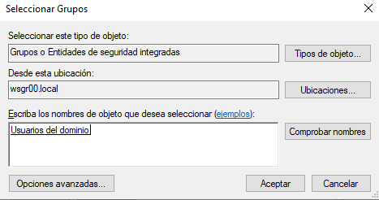

    
    

Vemos cómo aparece ya también en la lista Miembro de... Y pulsamos aceptar.

    
    

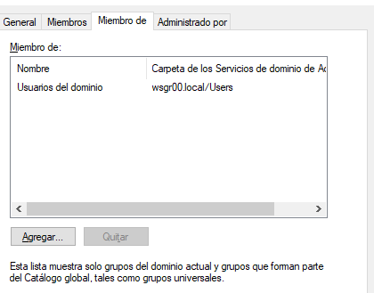

    
    

Realizamos estos mismos pasos para el grupo de administración y de informática.

    
    

Ahora vamos a crear los siguientes usuarios y tendremos que asignar cada unos a su correspondiente grupo.

    
    

Con Users seleccionado Pulsamos en Acción > Nuevo > Usuario y creamos los siguientes usuarios, cada uno de ellos una vez creados entramos en sus propiedades haciendo doble clic sobre su nombre y en la pestaña miembro de lo añadimos a su grupo correspondiente.

    
    

      

Dpto Dirección: pedrogarcia, anagutierrez

      

Dpto Administración: mariamarfil, pablocastillo

      

Dpto Informática: robertomarquez, tecnico

    

    
    

Ejemplo:

    
    

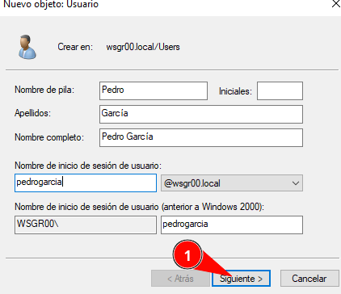

    
    

Rellenamos la contraseña: SegInf.2131

    
    

Y desmarcamos El usuario debe cambiar la contraseña... Y marcamos la contraseña nunca expira.

    
    

Estas opciones están marcadas para favorecer el flujo de la práctica NO son las recomendadas en un entorno real.

    
    

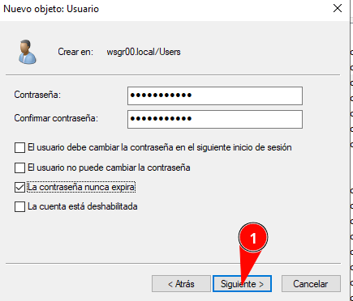

    
    

Y finalizar en la siguiente pantalla.

    
    

Vamos creando todos los usuarios según hemos visto y los vamos añadiendo cada uno a su grupo correspondiente y los quitamos del grupo usuarios del dominio.

    
    

Ejemplo: Una vez creado el usuario de Pedro García hacemos doble clic sobre su nombre para abrir la ficha de propiedades:

    
    

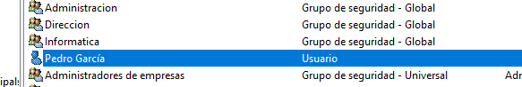

    
    

En esa ficha vamos a Miembro de... Y le agregamos como hemos visto antes al grupo de Direccion en este caso, aparecerá en la lista junto con el de usuarios del dominio:

    
    

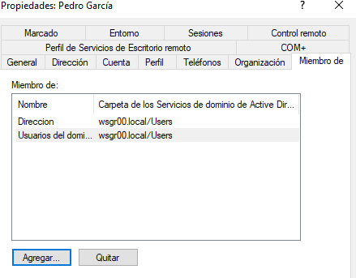

    
    

Ahora marcamos dirección y pulsamos en establecer grupo principal, para hacer el grupo predeterminado de Pedro García.

    
    

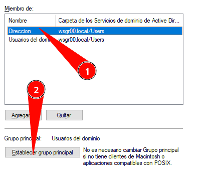

    
    

Y ahora marcamos el grupo usuarios del dominio y lo quitamos de él.

    
    

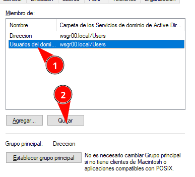

    
    

Saldrá una confirmación que debemos pulsar en si para eliminarlo de ese grupo.

    
    

Hacemos lo mismo con el resto de usuario que creamos, asignando cada uno a su correspondiente grupo y quitándolo de usuarios de dominio.

    
    

Finalmente el usuario tecnico además de agregarlo al grupo de informática, lo añadimos al grupo Admins de dominio (Movimiento muy peligroso pero exclusivamente para nuestro laboratorio).

    
    

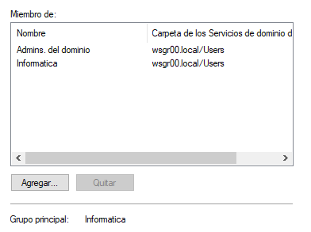

  

  
    

## 📁 Permisos de carpeta

    
    

Abrimos el explorador de archivos y en disco local C creamos una carpeta llamada Datos.

    
    

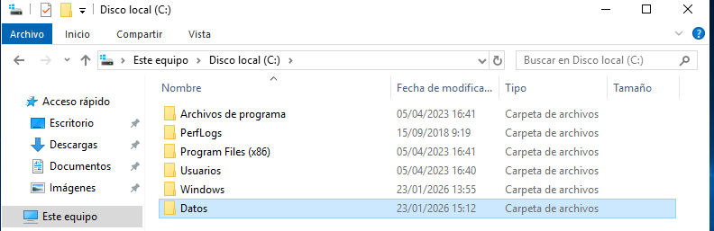

    
    

Dentro creamos las siguientes carpetas: administracion, direccion e informatica. quedará una estructura como la siguiente:

    
    

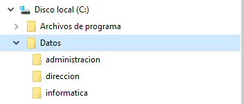

    

### Ahora asignamos según el siguiente esquema:

    

### **Direccion:**

    
      
* SYSTEM → Control total
      
* Administradores → Control total
      
* Dpto Dirección → Control total
    

    

### **Administracion:**

    
      
* SYSTEM → Control total
      
* Administradores → Control total
      
* Dpto Administración → Control total
      
* Dpto Dirección → Lectura
    

    

### **Informatica:**

    
      
* SYSTEM → Control total
      
* Administradores → Control total
      
* Dpto Informática → Control total
    
    
    

Ejemplo: Para asignar los permisos realizamos los siguientes pasos:

    
    

Desde el Explorador de archivos accedemos a C:\Datos\Administracion

    
    

Clic derecho sobre la carpeta → Propiedades

    
    

Ir a la pestaña Seguridad y Opciones avanzadas.

    
    

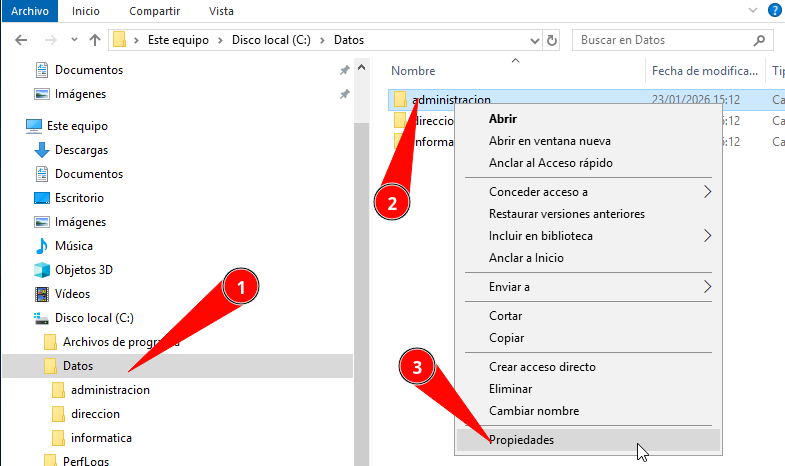

    
    

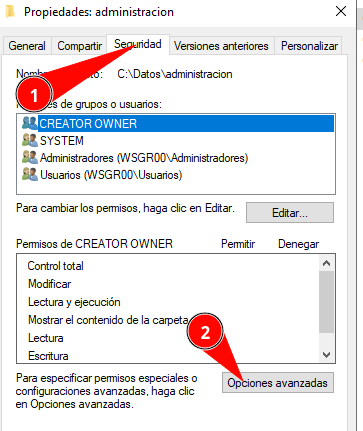

    
    

Aquí tenemos que hacer clic en Deshabilitar Herencia:

    
    

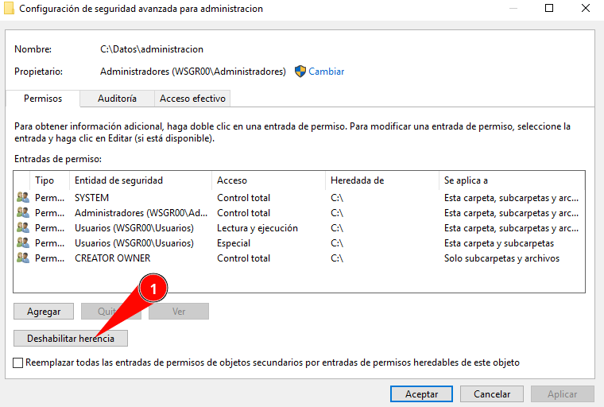

    
    

Elegir Convertir los permisos heredados en permisos explícitos en este objeto.

    
    

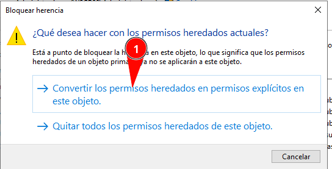

    
    

Pulsamos Aplicar para que guarde los cambios.

    
    

Ahora quitamos todos los objetos que aparezcan salvo SYSTEM y Administradores. Vamos marcándolos y pulsando en quitar.

    
    

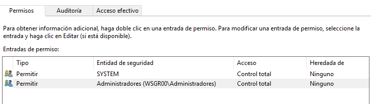

    
    

Añadimos ahora en este caso al grupo de administración con control total. Pulsamos en agregar, seleccionar una entidad de seguridad, opciones avanzadas, buscar ahora y elegimos al grupo de administración y pulsamos aceptar, obtendremos la siguiente pantalla.

    
    

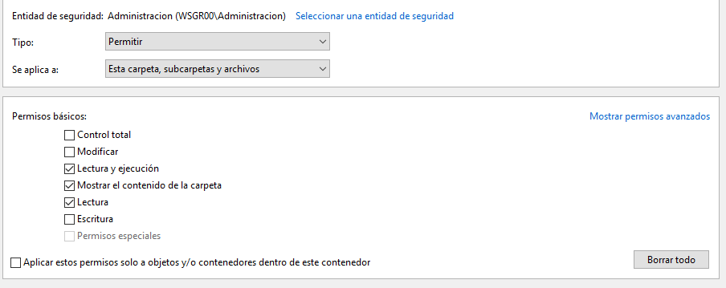

    
    

Como vamos a dar control total al grupo de administración, marcaríamos control total y pulsamos aceptar.

    
    

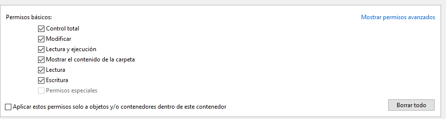

    
    

Veremos como aparece en la lista.

    
    

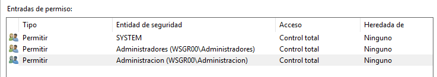

    
    

En esta carpeta vamos a añadir al grupo dirección pero sólo lectura.

    
    

Pulsamos agregar y como hemos hecho antes añadimos al grupo Direccion.

    
    

Y dejamos las opciones que ves en la imagen para que sólo tenga permisos de lectura y que son los que por defecto nos pone.

    
    

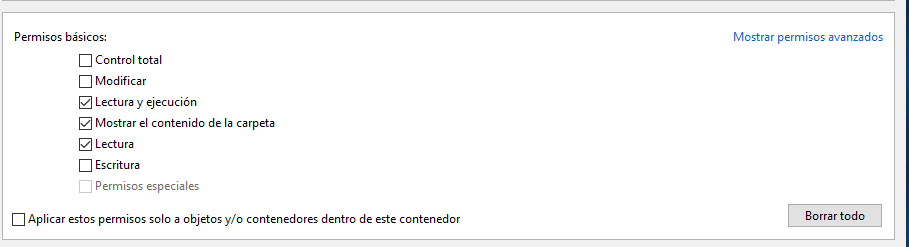

    
    

Pulsamos aceptar y nos aparece en la lista.

    
    

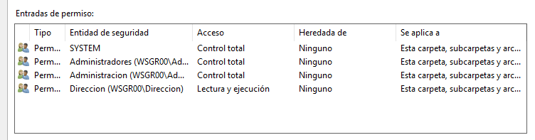

    
    

Si todo es correcto pulsamos ya aceptar las veces que sea necesario y ya estarían los permisos de la carpeta administración.

    
    

Realizamos lo mismo en la carpeta de dirección e informática, asignando los permisos según lo siguiente:

    

### **Direccion:**

    
      
* SYSTEM → Control total
      
* Administradores → Control total
      
* Dpto Dirección → Control total
    

    

### **Informatica:**

    
      
* SYSTEM → Control total
      
* Administradores → Control total
      
* Dpto Informática → Control total
    
  

  
    

## 🖥️ Acceso remoto

    
    

Para probar el acceso de los usuarios y los permisos de las carpetas creadas, vamos a habilitar el acceso por escritorio remoto.

    
    

Vamos a Inicio > Panel de Control > Sistema y Seguridad Y Sistema. Aquí dentro seleccionamos Configuración de acceso remoto.

    
    

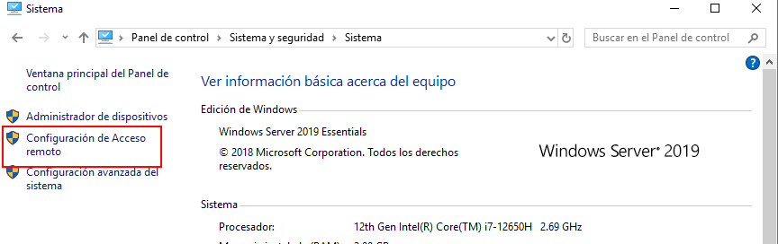

    
    

En la siguiente pantalla pulsamos en permitir la conexiones remotas a este equipo.

    
    

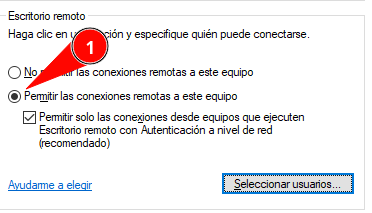

    
    

Le daos luego a Seleccionar Usuarios: Y agregamos a los grupos de administración, dirección e informática.

    
    

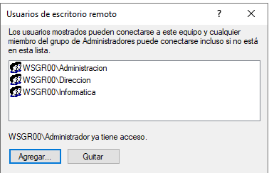

    
    

Aceptamos todas las ventanas abiertas.

    
    

En un entorno con windows Server el acceso local de usuarios NO administradores está deshabilitarlo por lo que para nuestra práctica vamos a habilitarlo siguiendo estas instrucciones.

    
    

Presiona Windows + R

    
    

Escribir: gpmc.msc

    
    

      

Clic en Aceptar

    

    
    

Ahora expandir en el lado izquierdo:

    
    

Bosque wsgrXX.local

    

└─ Dominio

    

└─ wsgrXX.local

    
    

Clic derecho en Default Domain Controllers Policy y sellecionamos editar.

    
    

En el editor que se abre navegar a:

    
    

Configuración del equipo

    

└─ Directivas

    

└─ Configuración de Windows

    

└─ Configuración de seguridad

    

└─ Directivas locales

    

└─ Asignación de derechos de usuario (Hacemos clic en él)

    
    

Ahora buscamos **Permitir el inicio de sesión a través de Servicios de Escritorio Remoto** y hacemos doble clic en él.

    
    

Marcamos Definir esta configuracoón de directiva y agregamos al grupo **Usuarios de escritorio remoto.**

    
    

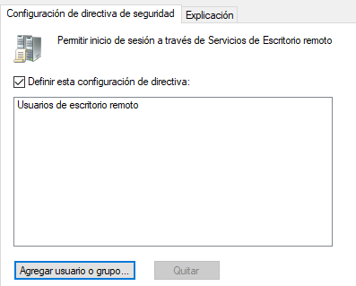

    
    

Abrir PowerShell o CMD como Administrador y ejecutar:

    
    

```bash
gpupdate /force
```

    
    

Ahora desde NUESTRO ORDENADOR DE WINDOWS abrimos conexión a escritorio remoto:

    
    

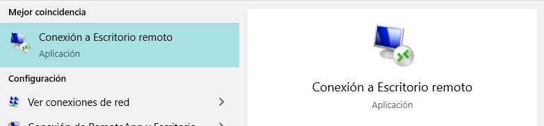

    
    

Escribimos la IP o el nombre de nuestro servidor.

    
    

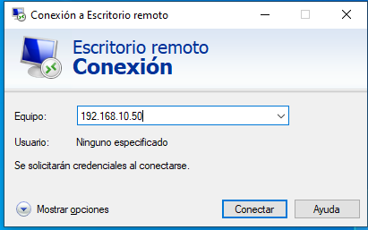

    
    

Pedirá las credenciales y accederemos por escritorio remoto.

    
    

En este punto podemos acceder con los distintos usuarios de los distintos departamentos que hemos creado para comprobar los permisos de acceso a las carpetas de la carpeta Datos que antes hemos definido.

    
    

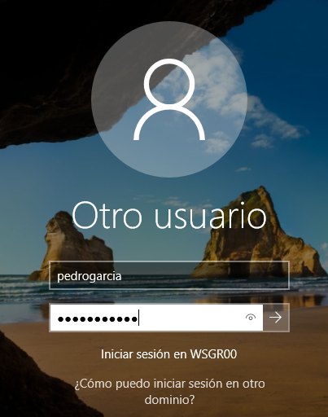

    
    

Usuarios para probar:

    
    

Dirección: pedrogarcia

    
    

Administración: mariamarfil

    
    

Informatica: robertomarquez, tecnico

  

  
  

    [Anterior: Instalar Características de AD]([[02 - MODULOS/Prácticas (PoCs)/Sistemas/02b - Active Directory - Parte 2 - Instalar Características|Parte 2: Instalar Características]])
    [Siguiente: Unidades Organizativas]([[02 - MODULOS/Prácticas (PoCs)/Sistemas/02d - Active Directory - Parte 4 - Unidades Organizativas|Parte 4: Unidades Organizativas]])
