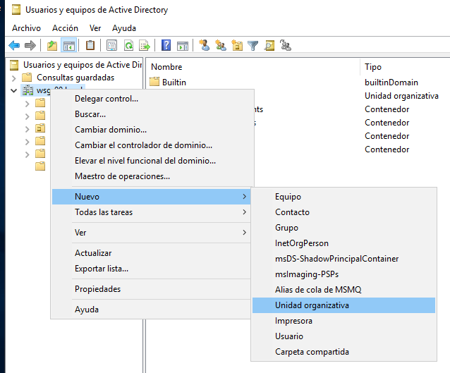
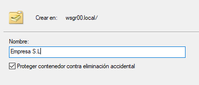
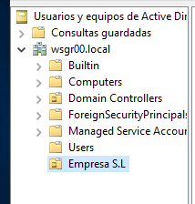
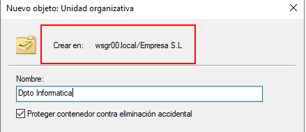
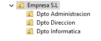
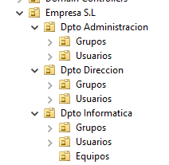
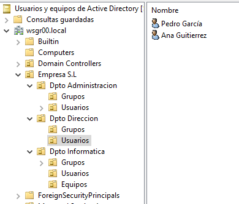
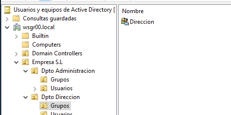

# 🖥️ Active Directory en Windows Server 2019

  

## Parte 4: Unidades Organizativas

  
  
    

## 🗂️ Unidades Organizativas

    
    

Una unidad organizativa (OU) en Active Directory es una estructura de contenedor que se utiliza para organizar y gestionar de manera más eficiente los recursos dentro de un dominio. Dentro de una OU, puedes almacenar usuarios, grupos, equipos o incluso otras OUs.

    
    

Este tipo de organización de elementos en una jerarquía, facilita tanto la administración de permisos y políticas, como las directivas de seguridad, sin afectar a todo el dominio.

    
    

En nuestra estructura jerárquica tenemos:

    
    

Empresa S.L

    

└─ Dpto. Administración

    

└─ Dpto. Dirección

    

└─ Dpto. Informática

    
    

Definir UO para cada uno de los departamentos nos permitiría aplicar configuraciones o permisos específicos a los usuarios, grupos o equipos de esos departamentos independientemente del resto de la red.

    
    

Para crear las Unidades Organizativas vamos a:

    
    

En Inicio > Herramientas Administrativas > Usuarios y Equipos de Active Directory

    
    

Pulsamos el botón derecho sobre nuestro dominio WSGRXX.local y vamos a Nuevo > Unidad Organizativa.

    
    

    
    

La llamamos Empresa S.L y dejamos marcado Proteger contenedor contra eliminación accidental.

    
    

    
    

Pulsamos Aceptar y aparecerá en la lista la nueva Unidad Organizativa.

    
    

    
    

Tenemos tres departamentos en la empresa, por lo que vamos a crear una UO para cada uno de ellos.

    
    

Ahora si pulsamos botón derecho sobre la UO Empresa S.L > Nuevo > Unidad Organizativa.

    
    

      

**NOTA IMPORTANTE:** Vigilar bien donde se crea cada elemento ya que al proteger contra borrado accidental si nos equivocamos el proceso de borrado del elemento es complejo. Ver mas abajo si te ocurre.

    

    
    

En la parte superior te pone donde se va a crear la UO.

    
    

    
    

Creamos la siguiente estructura.

    
    

    
    

Para poder definir aún más las políticas de seguridad vamos a crear en todas ellas una unidad organizativa para Usuarios y para Grupos, y debido la peligrosidad del Departamento de Informática vamos a crear en él también una UO para los Equipos.

    
    

El esquema quedaría de la siguiente forma: (Todos se crean como Unidades Organizativas)

    
    

    
    

      

NOTA: En caso de equivocarnos y necesitar eliminar algún elemento.

      
      

Hay que ir al menú Ver > Características avanzadas.

      
      

Luego nos dirigimos al elemento que queramos eliminar y pulsamos con el botón derecho sobre él y elegimos propiedades.

      
      

Ahora en la pestaña Objeto debemos desmarcar la opción Proteger contra eliminación accidental.

      
      

Pulsamos aceptar y ahora nos deja eliminarlo.

      
      

Es conveniente luego quitar la vista de Características avanzadas.

    

    
    

Ahora que tenemos nuestras Unidades Organizativas, arrastramos al interior de cada una de ellas los grupos y usuarios correspondientes, según la estructura de nuestra empresa:

    
    

Nombre Empresa: Nuestra Empresa S.L

    
    

Dpto Dirección: Pedro García, Ana Gutiérrez

    
    

Dpto Administración: María Marfil, Pablo Castillo

    
    

Dpto Informática: Roberto Márquez, tecnico

    
    

Simplemente vamos al menú Users de esta misma ventana y arrastramos cada uno donde corresponda. Pedirá confirmación para los movimientos que hagamos.

    
    

Ejemplo de los usuarios del grupo de Dirección:

    
    

    
    

    
    

A partir de ahora los nuevos usuarios lo podemos crear directamente en esta estructura.

  

  
  

    [Anterior: Configuración del AD]([[02 - MODULOS/Prácticas (PoCs)/Sistemas/02c - Active Directory - Parte 3 - Configuración del AD|Parte 3: Configuración del AD]])
    [Siguiente: Directivas de Seguridad]([[02 - MODULOS/Prácticas (PoCs)/Sistemas/02e - Active Directory - Parte 5 - Directivas de Seguridad|Parte 5: Directivas de Seguridad]])
