# 🖥️ Active Directory en Windows Server 2019

  

## Parte 5: Directivas de Seguridad

  
  
    

## 🔐 Directivas de Seguridad

    
    

Las **Directivas de Seguridad o GPOs** (Group Policy Objects) son un conjunto de reglas o configuraciones que los administradores de sistemas pueden aplicar a usuarios y equipos dentro de una red gestionada con Active Directory. Estas políticas se utilizan para definir y controlar el comportamiento de los sistemas operativos, aplicaciones y usuarios de la red, permitiendo establecer directrices de seguridad y configuraciones del sistema de manera centralizada.

    
    

**Herencia y jerarquía:** Las políticas se pueden aplicar a nivel de dominio, unidad organizativa (OU) o sitio, y pueden heredarse de niveles superiores, lo que permite flexibilidad y control granular.

    
    

Para acceder a las Directivas de seguridad pulsamos WINDOWS+R escrimios gpmc.msc y pulsamos en aceptar o ENTER.

    
    

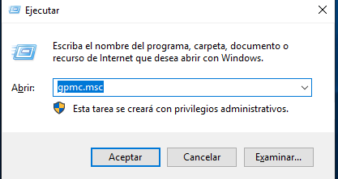

    
    

Al abrir las Directivas de seguridad veremos una estructura jerárquica que podemos desplegar.

    
    

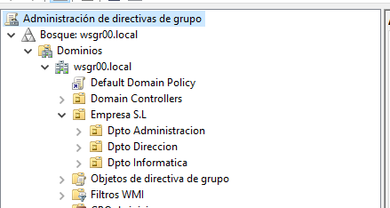

    
    

En la imagen superior observa que hay un elemento llamado Default Domain Policy, ese elemento es lo que se define como una **GPO** (Group Policy Object) y se crea automáticamente al configurar el **Active Directory**. Contine la política que se aplica a **todos** los usuarios y equipos de ese dominio, amenos que se sobreescriba a nivel de **Unidad Organizativa**.

    
    

Las políticas más específicas prevalecen sobre las generales. Independientemente de si son mas o menos restrictivas.

  

  
    

## 🌐 Directivas de seguridad de todo el dominio

    
    

Vamos a definir GPOs a diferentes niveles, empezamos a nivel de dominio.

    
    

En Active Directory, las GPOs se aplican principalmente a los dominios y OUs dentro de esos dominios, no a nivel de bosque. Por lo tanto, la opción para crear una GPO solo estará disponible dentro de un dominio específico.

    
    

Pulsar Inicio > Ejecutar y escribir "gpmc.msc" sin las comillas

    
    

Desplegamos el árbol hasta ver el Default Domain Policy que se situa debajo del nombre de nuestro dominio

    
    

A las directivas se accede pulsando botón derecho sobre la directiva y editar.

    
    

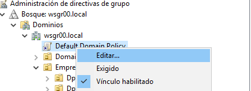

    
    

Ahora aparece una pantalla en la que tenemos que navegar por las diferentes opciones hasta llegar a lo que queremos configurar.

    
    

Como ejemplo, para todo el dominio vamos a crear una **política de contraseñas** basado en CIS, según los siguientes requisitos:

    
    

Conf Equipo > Directivas > Conf Windows > Conf Seguridad > Directivas Cuenta > Directivas Contraseña ( En el último de la ruta siempre hacemos clic para que en la parte de la derecha se muestren las opciones como vemos en la imagen inferior)

    
    

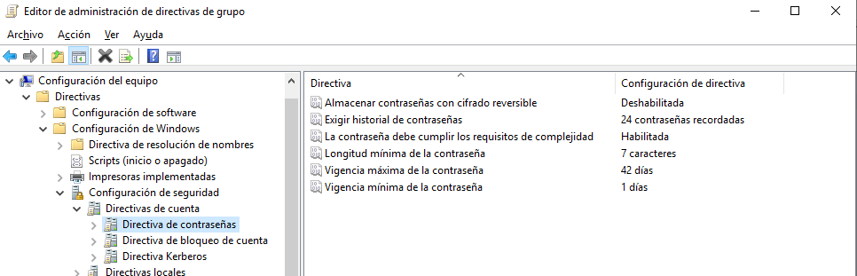

    
    

A continuación vamos a configurar la **directiva de contraseñas** tal y como define CIS en su manual de robustecimiento de sistemas windows server. A continuación tienes los controles.

    
    
      
* (1.1.1.5.2.2) Longitud mínima de la contraseña de 8 caracteres, salvo en entornos de alta seguridad, donde se recomiendan 14 caracteres.
      
* (1.1.1.5.2.3) Edad máxima de la contraseña de 60 días.
      
* (1.1.1.5.2.5) Edad mínima de la contraseña de 1 día.
      
* (1.1.1.5.2.6) Complejidad de la contraseña requerida.
      
* (1.1.1.5.2.4) Histórico de contraseñas a recordar, para no repetir ninguna de las últimas 24 contraseñas empleadas.
      
* (1.1.1.5.2.1) Deshabilitar almacenamiento de contraseñas con cifrado reversible.
    
    
    

Hay que ir haciendo doble clic en cada directiva y definirla como el control nos recomienda.

    
    

Otro control recomendado es habilitar la **auditoría del uso de privilegios**, **eventos de inicio de sesión**, **eventos inicio de sesión de cuenta**, **eventos del sistema** y la **administración de cuentas (ERRORES)**. Es decir que todo los relacionado con esas acciones se quede registrado en el Visor de eventos.

    
    

Conf Equipo > Directivas > Conf Windows > Conf Seguridad > Directivas Locales > Directiva de auditoría.

    
    

Cambiamos según lo siguiente: En cada elemento hay una pestaña **explicación** que explica lo que audita esa opción.

    
    
      
* Auditoría del uso de privilegios, (Correcto, Errores)
      
* Eventos de inicio de sesión, (Correcto, Errores)
      
* Eventos inicio de sesión de cuenta, (Correcto, Errores)
      
* Eventos del sistema, (Correcto)
      
* Auditar la administración de cuentas (Correcto, Errores)
    
    
    

Finalmente vamos a configurar la directiva para que se bloquee el inicio de sesión de un usuario cada 3 intentos fallidos.

    
    

Conf Equipo > Directivas > Conf Windows > Conf Seguridad > Direct Cuenta > Direct Bloqueo de Cuentas

    
    
      
* Umbral de bloqueo de cuenta (Lo ponemos en 3)
        
          Aquí nos pide que habilitemos dos directivas. Pulsamos en si o aceptar.
        
      
      
* Duración del bloqueo de cuenta 30 minutos
      
* Restablecer el bloqueo de cuenta después de 5 minutos
    
    
    

Cerramos el editor de la directiva de grupo.

  

  
    

## 🏢 Directivas de Seguridad de unidad organizativa

    
    

La siguiente GPO que vamos a crear se va a aplicar sólo a los diferentes departamentos de nuestra empresa, por lo que tendremos que crear GPOs en cada uno de ellos para aplicar estas configuraciones de seguridad.

    
    

Para crear una nueva GPO en cada departamento navegamos al departamento correspondiente, pulsamos el botón derecho sobre dicho departamento y elegimos la opción Crear un GPO en este dominio y vincularlo aquí.

    
    

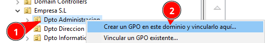

    
    

Y lo nombramos

    
    

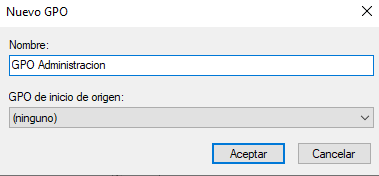

    
    

Aparece ahora bajo la UO

    
    

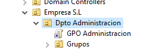

    
    

Creamos un GPO para cada departamento

    
    

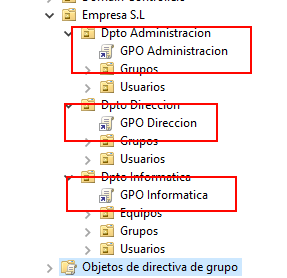

    
    

Ahora ya creados vamos a realizar **a modo instructivo** las siguientes configuraciones.

    

### 📁 Dpto de Dirección:

    
    

Editamos la directiva correspondiente a este departamento.

    
    

Vamos a Ocultar la pestaña de hardware

    
    

Conf Usuario > Directivas > Plantillas > Comp. Windows > Explorador de archivos

    
    
      
* Ocultar pestaña de hardware
    
    
    

      

Entramos en esta opción y la Habilitamos. Al habilitar esta opción estamos Ocultando la pestaña de hardware.

    

    
    

Cerramos el Editos de directivas de grupo.

    

### 💼 Dpto de Administración:

    
    

Editamos la directiva correspondiente a este departamento.

    
    

Vamos a Prohibir el acceso al Panel de Control

    
    

Conf Usuario > Directivas > Plantillas > Panel de control

    
    
      
* Prohibir el acceso a Configuración de PC y Panel de Control
    
    
    

      

Igualmente entramos en este elemento y marcamos Habilitar.

    

    
    

Para este departamento vamos a deshabilitar el uso de dispositivos externos de almacenamiento.

    
    

Configuración del equipo > Directivas > Plantillas Administrativas > Sistema > Acceso de almacenamiento extraíble

    
    
      
* Todas las clases de almacenamiento extraíble: denegar acceso a todo
    
    
    

      

Igualmente entramos en este elemento y marcamos Habilitar.

    

    
    

Finalmente, vamos a realizar algo más complejo en este mismo departamento, queremos que al entrar un usuario de este departamento automáticamente se cree una unidad de red con una carpeta compartida que tenemos en la red.

    
    

Primero tenemos que compartir la carpetas Datos que creamos anteriormente.

    
    

Abrimos el explorador de archivos y navegamos a Disco Local C:

    
    

Pulsamos botón derecho sobre Datos y vamos a conceder acceso a usuarios específicos:

    
    

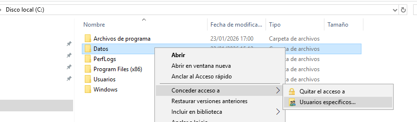

    
    

En la lista superior elegimos todos y le damos a agregar. Quedará en la parte inferior todos con permisos de lectura. Sólo en entornos de laboratorios.

    
    

Recomendación: Agregar solo a los grupos de usuarios o grupos de seguridad de los departamentos que necesitan acceder a esa carpeta específica. Esto ayuda a reducir el riesgo de accesos no autorizados y a garantizar que solo los usuarios correctos puedan acceder a los recursos.

    
    

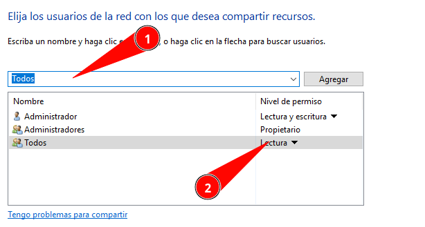

    
    

Pulsamos en compartir y MUY IMPORTANTE en la siguiente ventana marcamos No Cambiar la configuración ya que si la cambiamos modificamos los permisos que estuvimos configurando anteriormente.

    
    

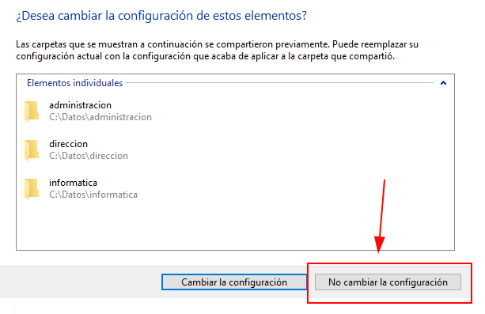

    
    

Ya en la siguiente ventana pulsamos Listo y tenemos nuestra carpeta compartida en la red.

    
    

Vamos a comprobar el acceso, pulsamos WINDOWS+R y escribimos la IP de nuestro servidor y pulsamos aceptar:

    
    

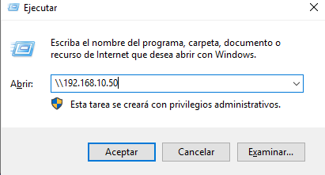

    
    

Aparecen las carpetas creadas, entramos en Datos y administracion.

    
    


    
    

Importante para nuestra práctica, hacemos un clic en la barra de dirección y copiamos la ruta entera que aparece.

    
    

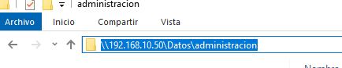

    
    

Esa dirección nos hará falta para pegarla posteriormente.

    
    

Con la carpeta configurada vamos ahora a agregar un Directiva al grupo de administración para que al iniciar sesión cualquier usuario de ese grupo automáticamente le cree las unidades de red de su carpeta.

    
    

Si no estamos en el administrador de grupos pulsamos WINDOWS+R y escribimos gpmc.msc y pulsamos aceptar o ENTER.

    
    

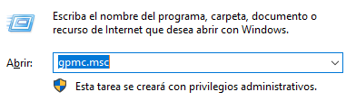

    
    

Vamos a la directiva de la UO de administración y la editamos.

    
    

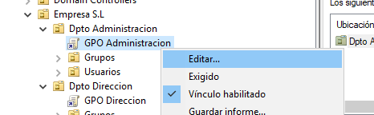

    
    

Ahora navegamos a:

    
    

Conf Usuario > Preferencias > Conf Windows > Asignaciones de unidades

    
    

En la parte de la derecha pulsamos Botón derecho nuevo > Unidad Asignada

    
    

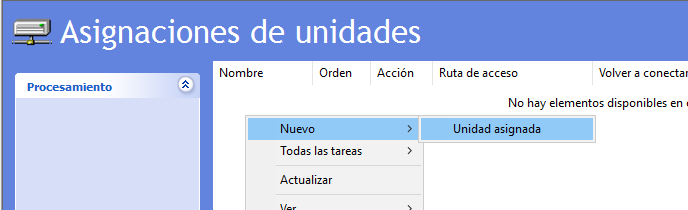

    
    

Acción: Actualizar

    
    

Ubicación: \\192.168.10.50\Datos\administracion

    
    

Aquí pegamos la dirección que habíamos copiado anteriormente. Debe estar escrita igual que aparecía en la barra de dirección.

    
    

Etiqueta: Administración

    
    

Marcar RECONECTAR

    
    

Letra Z

    
    

La captura final de todo quedaría:

    
    

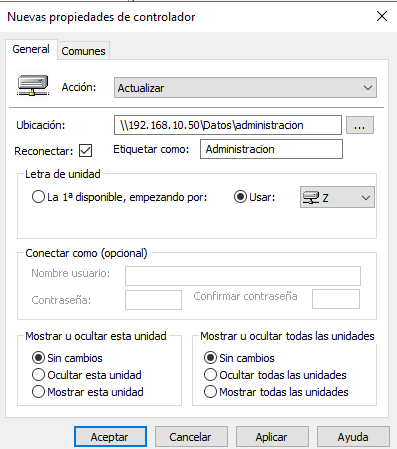

    
    

Pulsamos aceptar.

  

  
    

## ⚡ Forzar que se apliquen las directivas

    
    

Una vez configuradas las directivas hay que forzar su ejecución de la siguiente manera.

    
    

Abrimos un cmd o powershell como administrador y ejecutamos:

    
    

```bash
gpupdate /force
```

    
    

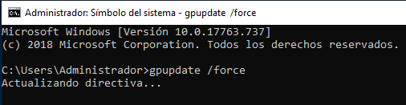

    
    

Y si queremos un informe en html con todas las configuraciones.

    
    

```bash
gpresult /h informe.html
```

    
    

En este punto podemos acceder por escritorio remoto o unir un equipo al dominio y se aplicarán las diferentes directivas en función del usuario con el que iniciemos y el grupo al que pertenezca.

    
    

Usuarios para probar:

    
    

Dirección: pedrogarcia

    
    

Administración: mariamarfil

  

  
  

    [Anterior: Unidades Organizativas]([[02 - MODULOS/Prácticas (PoCs)/Sistemas/02d - Active Directory - Parte 4 - Unidades Organizativas|Parte 4: Unidades Organizativas]])
    [Siguiente: Registro de Windows]([[02 - MODULOS/Prácticas (PoCs)/Sistemas/02f - Active Directory - Parte 6 - Registro de Windows|Parte 6: Registro de Windows]])
