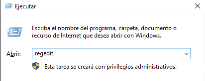
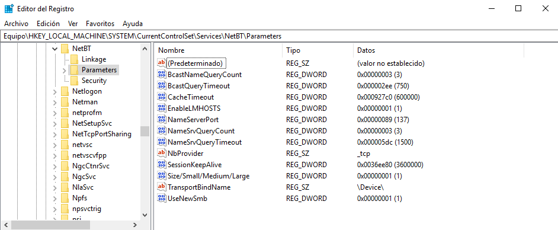
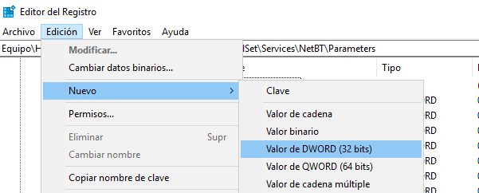
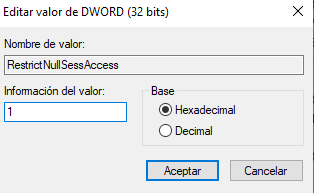
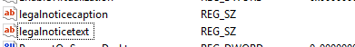
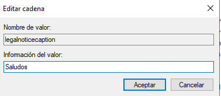
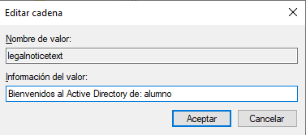

# 🖥️ Active Directory en Windows Server 2019

  

## Parte 6: Registro de Windows

  
  
    

## 📝 Registro de Windows

    
    

Una vulnerabilidad bastante conocida que puede ser explotada en redes de Windows es el uso de Responder, una herramienta que aprovecha el protocolo NetBIOS (NBT-NS) para realizar ataques de envenenamiento de caché DNS o NTLM relay attacks. Este ataque se produce cuando un equipo o usuario realiza solicitudes de nombres de host a través de NetBIOS (nombre NetBIOS de un equipo) y el atacante responde a esas solicitudes para capturar credenciales de acceso.

    
    

En una red de Active Directory, Responder puede ser utilizado para **capturar hashes** de contraseñas NTLM si la configuración de seguridad no es correcta.

    

### 🔐 Configurar el registro de Windows para mitigar la vulnerabilidad de Responder

    
    

El **registro de Windows** es una base de datos centralizada utilizada por el sistema operativo Windows para **almacenar configuraciones y opciones del sistema, hardware, software y preferencias del usuario**. Es esencial para el funcionamiento del sistema operativo, ya que almacena información vital sobre controladores, configuraciones de aplicaciones, configuraciones de seguridad, y muchas otras opciones del sistema.

    
    

Para acceder pulsamos Windows+R escribimos regedit y pulsamos aceptar o Enter.

    
    

    
    

Ahora tenemos que navegar a la siguiente clave del registro.

    
    

HKEY_LOCAL_MACHINE\SYSTEM\CurrentControlSet\Services\NetBT\Parameters

    
    

(En el último hacemos clic para mostrar las opciones en la parte derecha de la ventana.)

    
    

    
    

Aquí tenemos que crear dos valores:

    
    

Con Parameters seleccionado pulsamos en Edición > Nuevo > Valor DWORD (32 Bits)

    
    

    
    

El nombre del valor tiene que ser: **RestrictNullSessAccess**

    
    

Respetando mayúsculas y minúsculas.

    
    

    
    

Cuando esté creado hacemos doble clic sobre él y lo ponemos a 1 y pulsamos aceptar.

    
    

    
    

El segundo valor se crea igual pero debe llamarse: **DisableStrictNameChecking**

    
    

e igualmente una vez creado lo ponemos en 1.

    
    

Finalmente no queda.

    
    

    
    

Para que se apliquen los cambios debemos reiniciar windows, y una vez inicie ya NO existirá esta vulnerabilidad.

  

  
    

## 💬 Mensaje de Bienvenida al Iniciar Sesión

    
    

Para finalizar con el uso del registro vamos a hacer que cada vez que un usuario inicie sesión aparezca un mensaje de bienvenida.

    
    

Accedemos al registro, pulsamos Windows+R escribimos regedit y pulsamos aceptar o Enter.

    
    

Navegamos a la siguiente clave:

    
    

HKEY_LOCAL_MACHINE\SOFTWARE\Microsoft\Windows\CurrentVersion\Policies\System

    
    

Dentro de esta clave hay dos elementos:

    
    

"LegalNoticeCaption": Este valor mostrará el título de la ventana de mensaje

    
    

"LegalNoticeText": Este valor será el texto del mensaje que se mostrará a los usuarios al iniciar sesión.

    
    

    
    

Hacemos doble clic en LegalNoticeCaption y escribimos "Saludos"

    
    

    
    

Ahora hacemos doble clic en legalnoticetext y escribimos el mensaje de bienvenida al usuario.

    
    

    
    

Para ver resultados ya podemos reiniciar el servidor.

  

  
    

## 🎓 Conclusión

    
    

Has completado con éxito la configuración completa de Active Directory en Windows Server 2019. Ahora tienes:

    
    
      
* ✅ Un dominio configurado y funcional
      
* ✅ Usuarios y grupos organizados por departamentos
      
* ✅ Unidades Organizativas (OUs) estructuradas
      
* ✅ Directivas de seguridad (GPOs) aplicadas
      
* ✅ Permisos de carpetas configurados
      
* ✅ Acceso remoto habilitado y seguro
      
* ✅ Registro de Windows endurecido contra vulnerabilidades
    
    
    

Este entorno de Active Directory representa una infraestructura básica pero completa para la gestión centralizada de una red empresarial.

  

  
  

    [Anterior: Directivas de Seguridad]([[02 - MODULOS/Prácticas (PoCs)/Sistemas/02e - Active Directory - Parte 5 - Directivas de Seguridad|Parte 5: Directivas de Seguridad]])
    [Volver al Indice de PoCs]([[02 - MODULOS/Prácticas (PoCs)/Sistemas/02 - Active Directory en Windows Server 2019|Índice de Active Directory]])
