> [[02 - MODULOS/05 - Prácticas (PoCs)|← Volver a Prácticas (PoCs)]] | [[02 - MODULOS/Prácticas (PoCs)/Vulnerabilidades Web/00 - Índice del Módulo Vulnerabilidades Web|Índice del Módulo]]

---
# Brute Force (DVWA)

# 🔨 Brute Force (Fuerza Bruta)

 
 

## 📖 Prueba de Concepto (PoC)

 

**Brute Force:** El objetivo es conseguir la clave del administrador. Existe un bonus si conseguimos las claves de los otros cuatro usuarios.

 

> [!note]
> 
 
> #### 🛠️ Herramientas Disponibles:
> 
 

> 
> * **Burp Suite** - Proxy interceptor con Intruder para ataques automatizados
> 
> * **Wfuzz** - Fuzzer de aplicaciones web desde línea de comandos
> 
> * **Hydra** - (No funciona en este escenario)
> 

> 

 

 
 

## ⚡ Opción 1: Ataque con Wfuzz

 

### 📋 Paso 1: Capturar la Petición con Firefox

 

 
* Entramos en la web de DVWA y ponemos las primeras credenciales. Luego bajamos la seguridad a baja y vamos al menú "Brute Force".
 
* Pulsamos **SHIFT + CTRL + E** o **F12** en el navegador Mozilla Firefox
 
* Ponemos una credencial de prueba, por ejemplo, `test:test` y pulsamos en "Login"
 
* Veremos abajo en la pestaña "Network", la línea que corresponde con el envío de contraseña al servidor.
 

 

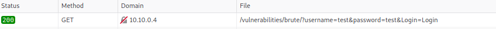

 

 
* Pulsamos botón derecho encima y "Copiar" → "Copiar como cURL" y pegamos el resultado en nuestro terminal de Kali Linux
 

 

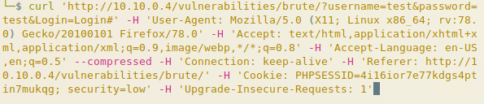

 

### 🔧 Paso 2: Adaptar el Comando para Wfuzz

 

 
* Borramos los Headers (`-H`) salvo el que contiene la cookie y cambiamos el comando `curl` por `wfuzz` con sus correspondientes parámetros.
 

 

> [!tip]
> 
 
> #### 🔑 Parámetros de Wfuzz:
> 
 

> 
> * `--hs 'incorrect'` - Ocultar respuestas que contengan la cadena "incorrect"
> 
> * `-b` - Para pasar la cookie
> 
> * `-z payload,ruta_de_diccionario` - Especificar el diccionario a usar
> 
> * `-u dirección` - URL objetivo
> 

> 
> Sustituimos `test` por `FUZZ` y `FUZ2Z` respectivamente y añadimos dos diccionarios: uno de usuarios y otro de claves.
> 

 

 
* Quedaría así:
 

 

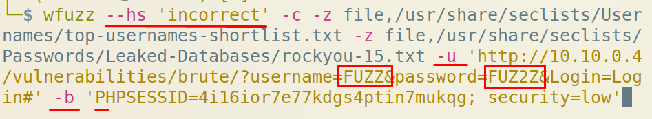

 

### 📊 Paso 3: Filtros de Wfuzz

 

Si ponemos en el terminal `wfuzz --help` nos muestra la ayuda y entre esa ayuda están los filtros para mostrar u ocultar información.

 

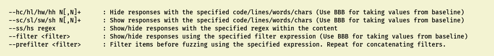

 

> [!tip]
> 
 
> #### 🔍 Filtros Útiles:
> 
 
> 
> 
> 
> 
> 
> 
> 
> 
> `--hs 'texto'`
> 
> 
> 
> `--hw N`
> 
> 
> 
> `--hc N`
> 
> 
> 
> `--sw N`
> 
> 
> 
> 
> | Parámetro | Descripción |
> | --- | --- |
> | | Ocultar respuestas que contengan 'texto' |
> | | Ocultar respuestas con N palabras |
> | | Ocultar respuestas con código HTTP N |
> | | Mostrar solo respuestas con N palabras |
> 
 

 

### ✅ Paso 4: Obtener las Credenciales

 

 
* Obtendremos las credenciales:
 

 

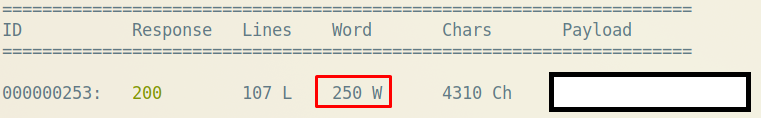

 

El valor marcado también es importante. Sabiendo que la respuesta correcta mide 250, podríamos también usar el parámetro `--hw 246`

 

### 🔍 Paso 5: Descubrir Otros Usuarios

 

 
* Una vez tenemos las credenciales iniciamos sesión con las credenciales.
 
* Vemos abajo una imagen y la visitamos en una nueva pestaña.
 
* Parece un avatar del usuario.
 
* Averiguamos el resto de usuarios del sistema y crearemos un archivo `users.txt` que contenga los 4 nombres.
 
* Repetimos con wfuzz pero ahora usamos el diccionario de usuarios recién creado y el de password usamos todo el rockyou.
 
* También en vez de usar el parámetro `--hs` vamos a usar el `--sw` ya que sabemos que su valor es 250 cuando es correcto.
 

 

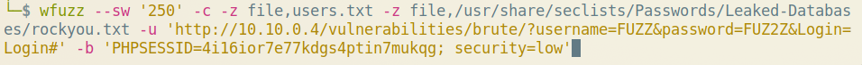

 

```bash
$ wfuzz -b "cookie_value" -z file,users.txt -z file,/usr/share/wordlists/rockyou.txt --sw 250 "http://dvwa_ip/vulnerabilities/brute/?username=FUZZ&password=FUZ2Z&Login=Login"
```

 

Iremos apuntando la clave del usuario y quitándolo del diccionario.

 

> [!warning]
> 
 
> **📝 Ejercicio Adicional:**
> 
> Repetir la práctica con Burp Suite, usando Intruder con ataque tipo **Cluster Bomb** para combinación de payloads (usuario + contraseña).
> 

 

 
 

## 🔒 Dificultad Alta - Tokens CSRF

 

Ahora vamos a usar **Burp Suite** para este ataque. Seleccionamos dificultad **High**.

 

### 🎯 Paso 1: Identificar el Token CSRF

 

**1.- Comenzamos interceptando el envío de un usuario y contraseña de prueba. Y veremos que hay un token, que además varía según cargamos la web.**

 

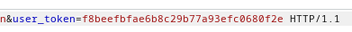

 

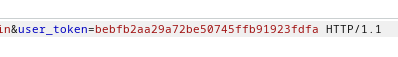

 

> [!warning]
> 
 
> #### ⚠️ Problema del Token CSRF:
> 
 
> **Cada vez que enviamos e interceptamos, el token es diferente**, por lo que necesitamos ese token para enviar el usuario y contraseña.
> 
> Esto requiere que Burp Suite capture el token dinámicamente antes de cada intento.
> 

 

### 🔧 Paso 2: Configurar Intruder con Pitchfork

 

**2.- Enviamos al Intruder y fijamos la posición de password y el token. Y en el usuario ponemos admin.**

 

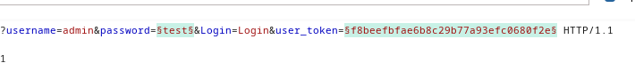

 

**3.- Elegimos tipo de ataque en "Pitchfork"**

 

> [!note]
> 
 
> #### 💡 ¿Por qué Pitchfork?
> 
 
> **Pitchfork** permite usar múltiples payloads de forma sincronizada:
> 

> 
> * Payload 1 (contraseña) se toma del diccionario
> 
> * Payload 2 (token) se extrae dinámicamente de cada respuesta
> 

> 
> Cada payload avanza en paralelo, uno a uno.
> 

 

### 📦 Paso 3: Configurar los Payloads

 

**4.- Vamos a la pestaña de "Payloads" y definimos de la siguiente forma las posiciones del payload:**

 

#### Payload Set 1 (Contraseña):

 

 
* **Payload set:** 1
 
* **Payload type:** Simple list y leemos el `rockyou-15.txt`
 

 

#### Configurar Grep-Match:

 

En la pestaña **Settings**, en la lista de **Grep-Match** limpiamos todas las entradas y añadimos `incorrect`.

 

#### Payload Set 2 (Token CSRF):

 

 
* **Payload set:** 2 (Volvemos a la pestaña Payloads)
 
* **Payload type:** Recursive grep, que nos permitirá tomar el token y poner el correcto
 

 

### ⚙️ Paso 4: Configurar Grep-Extract

 

En la pestaña **Settings**, en la zona **Grep-Extract** pulsamos **Add** → **Refetch Response**, buscamos el token y lo seleccionamos, y en la zona de arriba marcar la opción:

 

 
* **Start at offset:** 3088 // O dejar la opción "comenzar a partir de value='"
 
* **End at fixed...:** 32
 

 

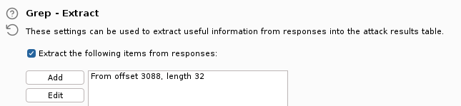

 

### 🔄 Paso 5: Configurar Redirections y Resource Pool

 

Un poco más abajo en **Redirections** marcamos **Always**.

 

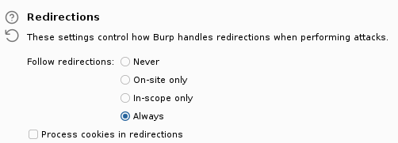

 

En **Resource Pool** crear uno nuevo y en **Maximum concurrent requests** ponemos **1**.

 

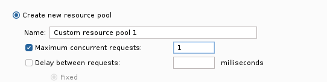

 

> [!warning]
> 
 
> **⚠️ Importante - Solo 1 Request Concurrente:**
> 
> Debemos configurar **maximum concurrent requests = 1** porque necesitamos que cada petición espere a obtener el token CSRF de la respuesta anterior antes de continuar.
> 
> Si enviamos múltiples peticiones simultáneas, los tokens no se sincronizarán correctamente.
> 

 

### 🚀 Paso 6: Iniciar el Ataque

 

Iniciamos ataque.

 


 

> [!tip]
> 
 
> #### 🔍 Identificar Credenciales Correctas:
> 
 
> Durante el ataque, observar la columna **Grep-Match**:
> 

> 
> * Si aparece `incorrect` → Credencial incorrecta
> 
> * Si NO aparece `incorrect` → ¡Credencial correcta encontrada!
> 

> 
> También se puede observar el tamaño de la respuesta (Length) o el código de estado HTTP.
> 

 

 
 

## 📚 Resumen

 

> [!tip]
> 
 
> ### 🎓 Lo que hemos aprendido:
> 
 

> 
> * ✅ Brute Force es un ataque de adivinación de credenciales mediante diccionarios
> 
> * ✅ Wfuzz es una herramienta rápida para fuzzing desde línea de comandos
> 
> * ✅ Burp Suite Intruder permite ataques más complejos con tokens CSRF
> 
> * ✅ Pitchfork sincroniza múltiples payloads en paralelo
> 
> * ✅ Recursive Grep permite extraer tokens dinámicos de las respuestas
> 
> * ✅ Los tokens CSRF protegen contra ataques automatizados
> 
> * ✅ Limitar a 1 request concurrente es necesario para tokens dinámicos
> 

> 
 
> ### 🔑 Conceptos Clave:
> 
 
> 
> 
> 
> 
> 
> 
> 
> 
> **Brute Force**
> 
> 
> 
> **CSRF Token**
> 
> 
> 
> **Pitchfork**
> 
> 
> 
> **Recursive Grep**
> 
> 
> 
> **Grep-Match**
> 
> 
> 
> 
> | Concepto | Descripción |
> | --- | --- |
> | | Ataque de adivinación sistemática de credenciales |
> | | Token anti-CSRF que cambia en cada petición |
> | | Tipo de ataque que sincroniza múltiples payloads |
> | | Extrae valores de respuestas para usar en siguientes peticiones |
> | | Busca patrones en las respuestas para identificar éxito/fallo |
> 

> 
> ### 🎯 Navegación:
> 
 
> ← Anterior: 01 - Command Injection
> 
> → Siguiente: 03 - CSRF
> 
> ↑ Volver al Índice del Módulo
>

---

> [[02 - MODULOS/05 - Prácticas (PoCs)|← Volver a Prácticas (PoCs)]] | [[02 - MODULOS/Prácticas (PoCs)/Vulnerabilidades Web/00 - Índice del Módulo Vulnerabilidades Web|Índice del Módulo]]
