> [[02 - MODULOS/05 - Prácticas (PoCs)|← Volver a Prácticas (PoCs)]] | [[02 - MODULOS/Prácticas (PoCs)/Vulnerabilidades Web/00 - Índice del Módulo Vulnerabilidades Web|Índice del Módulo]]

---
# SQL Injection - Fundamentos y Error-Based (DVWA)

# 💾 SQL Injection - Fundamentos y Preparación

 
 

## 📖 Prueba de Concepto (PoC)

 

### 🔓 ¿Qué es SQL Injection?

 

La **inyección de SQL (SQL injection)** es una vulnerabilidad común en aplicaciones web que permite a los atacantes manipular y ejecutar consultas SQL no deseadas en una base de datos subyacente. Esta vulnerabilidad ocurre cuando la aplicación web no valida o escapa correctamente los datos de entrada que se utilizan en consultas SQL.

 

> [!warning]
> 
 
> #### ⚠️ Consecuencias de SQL Injection:
> 

> 
> SQL Injection puede tener consecuencias graves, ya que los atacantes pueden aprovechar esta vulnerabilidad para realizar diversas acciones maliciosas:
> 
 
> 
> 
> 
> 
> 
> 
> 
> 
> 
> **Extracción de datos sensibles**
> 
> 
> 
> 
> **Modificación de datos**
> 
> 
> 
> 
> **Bypass de autenticación**
> 
> 
> 
> 
> **Ejecución de comandos**
> 
> 
> 
> 
> 
> | Tipo de Ataque | Descripción | Impacto |
> | --- | --- | --- |
> | | Utilizar consultas SQL inyectadas para extraer información confidencial | 🔴 Crítico - Robo de credenciales, datos personales, información sensible |
> | | Realizar cambios no autorizados en registros, insertar datos maliciosos o eliminar información | 🔴 Crítico - Pérdida de integridad de datos |
> | | Evadir mecanismos de login sin conocer credenciales | 🔴 Crítico - Acceso no autorizado como administrador |
> | | En casos extremos, ejecutar comandos arbitrarios en el sistema operativo | 🔴 Crítico - Compromiso completo del servidor |
> 
 

 

### 🛡️ Prevención de SQL Injection

 

Para prevenir y mitigar las vulnerabilidades de inyección de SQL, es importante seguir buenas prácticas de seguridad:

 

> [!tip]
> 
 
> #### 🔐 Mejores Prácticas:
> 
 

> 
> * **Uso de consultas preparadas (prepared statements):** En lugar de concatenar directamente los datos de entrada en las consultas SQL, se deben utilizar parámetros y consultas preparadas que permitan separar los datos de la lógica de la consulta
> 
> * **Validación y saneamiento de datos:** Los datos de entrada deben ser validados y saneados para asegurarse de que cumplan con los criterios esperados
> 
> * **Uso de listas de control de acceso:** Asegurarse de que los usuarios y roles de la base de datos tengan los privilegios mínimos necesarios
> 
> * **Implementación de WAF y IDS:** Firewalls de aplicaciones web y sistemas de detección de intrusos pueden ayudar a detectar y bloquear intentos de SQLi
> 
> * **Educación y concienciación:** Los desarrolladores deben estar capacitados en las mejores prácticas de seguridad
> 

> 

 

 
 

## 🔧 Preparación del Entorno

 

Antes de comenzar debemos conocer unos conceptos básicos sobre Bases de Datos SQL.

 

Vamos a utilizar la VM DVWA, por lo que para la práctica empezamos cargando dicha máquina y localizando su IP.

 

> [!warning]
> 
 
> **📋 Configuración del Entorno:**
> 
> En mi caso para la práctica las IPs del entorno son las siguientes:
> 

> 
> * **IP Kali Linux:** 10.0.0.6
> 
> * **IP VM DVWA:** 10.0.0.32
> 

> 

 

### 🔐 Paso 1: Conexión SSH a DVWA

 

Accedemos a ella por SSH usando las credenciales `user:SegInf`:

 

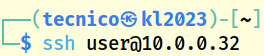

 

```bash
$ ssh user@10.0.0.32
```

 

### 📄 Paso 2: Localizar Credenciales de MySQL

 

Una vez dentro, podemos ver el archivo de configuración de MySQL:

 

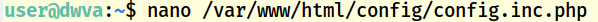

 

```bash
$ cat /var/www/html/config/config.inc.php
```

 

Donde podemos ver las credenciales de acceso a la misma:

 

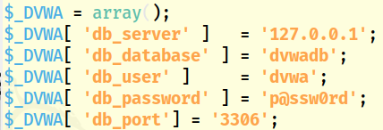

 

Como vemos las credenciales son `dvwa:p@ssw0rd`

 

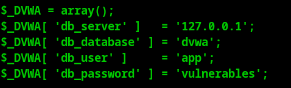

 

> [!warning]
> 
 
> **🐳 Si usas Docker:**
> 
> Las credenciales son `app:vulnerables`
> 

 

 
 

## 📚 SQL Basics - Comandos Fundamentales

 

### 🔌 Conectarse a MySQL

 

Para conectarnos a MySQL la sintaxis es la siguiente:

 

```bash
$ mysql -u <usuario> -h <dirección> -P <puerto> -p
```

 

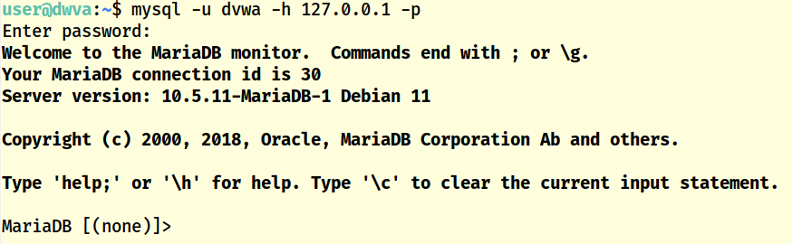

 

```bash
$ mysql -u dvwa -h localhost -p
Enter password: p@ssw0rd
```

 

### 📊 Listar Bases de Datos

 

Una vez conectados a MySQL, podemos mostrar las bases de datos:

 

```
mysql> SHOW DATABASES;
```

 

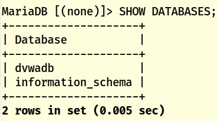

 

### 🔄 Cargar una Base de Datos

 

Y cargar aquella sobre la que vamos a trabajar:

 

```
mysql> USE <database>;
```

 

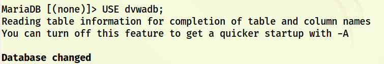

 

```
mysql> USE dvwa;
```

 

### 📋 Listar Tablas

 

Una vez cargada la base de datos podemos mostrar las tablas que contiene:

 

```
mysql> SHOW TABLES;
```

 

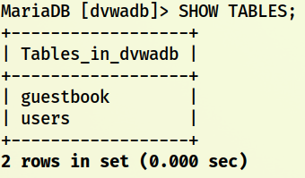

 

### 🔍 Ver Contenido de Tablas

 

Ver el contenido de las mismas:

 

```sql
mysql> SELECT * FROM <TABLA>;
```

 

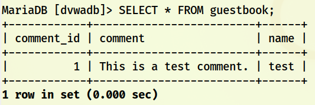

 

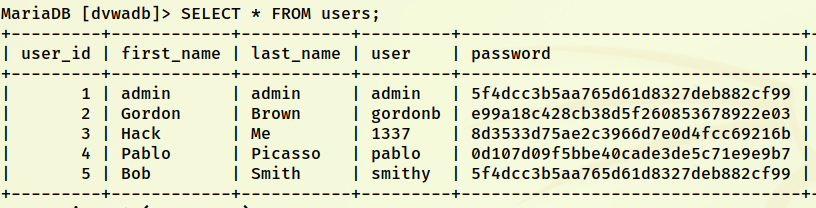

 

```sql
mysql> SELECT * FROM users;
```

 

### 🎯 Seleccionar Columnas Específicas

 

**Para evitar que muestre todas las columnas, podemos definir aquellas que queremos que muestre:**

 

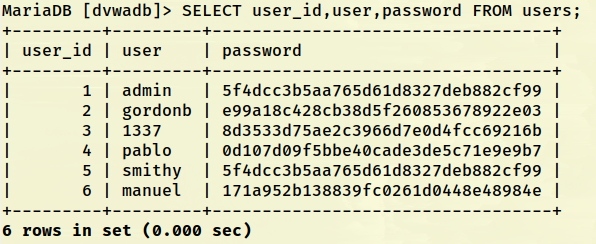

 

```sql
mysql> SELECT user, password FROM users;
```

 

### 📝 Ejemplos de Consultas SQL

 

**Algunos otros ejemplos para realizar consultas sobre las tablas:**

 

#### Ejemplo 1: WHERE con condición

 

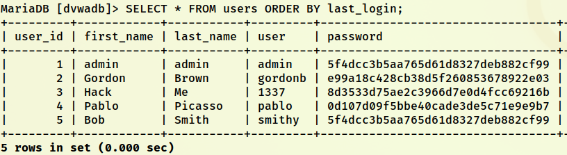

 

```sql
mysql> SELECT user, password FROM users WHERE user = 'admin';
```

 

#### Ejemplo 2: LIKE para búsqueda parcial

 

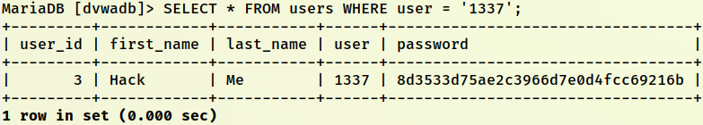

 

```sql
mysql> SELECT user, password FROM users WHERE user LIKE 'a%';
```

 

> [!note]
> 
 
> #### 💡 Operador LIKE:
> 
 
> El operador `LIKE` permite búsquedas con patrones:
> 

> 
> * `%` - Representa cero o más caracteres
> 
> * `_` - Representa un solo carácter
> 

> 
> **Ejemplos:**
> 

> 
> * `'a%'` - Usuarios que empiezan con 'a'
> 
> * `'%a'` - Usuarios que terminan con 'a'
> 
> * `'%a%'` - Usuarios que contienen 'a'
> 

> 

 

#### Ejemplo 3: Mostrar solo primeras filas con LIMIT

 

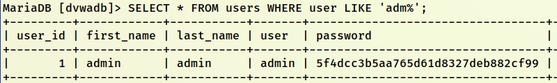

 

```sql
mysql> SELECT user, password FROM users LIMIT 2;
```

 

### 🔐 Trabajando con Hashes de Contraseñas

 

Mirando en **hashes.com** los hashes, vemos que nos dice que son **MD5**:

 

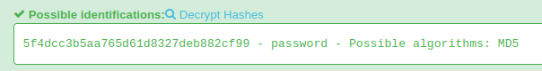

 

#### Generar un Hash MD5:

 

Podemos generar un hash de una clave conocida y crearnos un usuario con dicha clave:

 

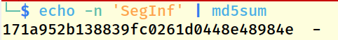

 

```bash
$ echo -n "password123" | md5sum
482c811da5d5b4bc6d497ffa98491e38 -
```

 

#### Insertar un Nuevo Usuario:

 

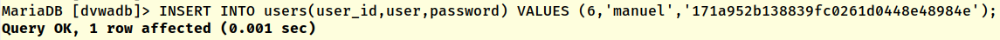

 

```
mysql> INSERT INTO users (user, password) VALUES ('hacker', '482c811da5d5b4bc6d497ffa98491e38');
```

 

#### Modificar Hash de Usuario Existente:

 

O modificar el hash de otro usuario por el nuestro conocido:

 

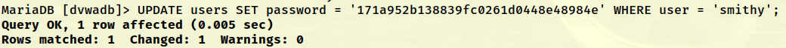

 

```
mysql> UPDATE users SET password = '482c811da5d5b4bc6d497ffa98491e38' WHERE user = 'admin';
```

 

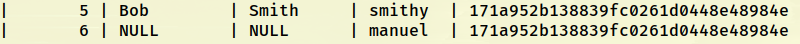

 

Le dejamos la que tenía:

 

```
mysql> UPDATE users SET password = '5f4dcc3b5aa765d61d8327deb882cf99' WHERE user = 'admin';
```

 

> [!warning]
> 
 
> **⚠️ Nota de Seguridad:**
> 
> MD5 es un algoritmo de hash obsoleto y NO debe usarse para almacenar contraseñas en aplicaciones reales. Usar bcrypt, Argon2, o scrypt en su lugar.
> 

 

 
 

## 🔗 UNION - Uniendo Consultas SQL

 

### 📖 ¿Qué es UNION?

 

El operador **UNION** permite extraer información de varias tablas diferentes enlazando los distintos SELECT. Por ejemplo:

 

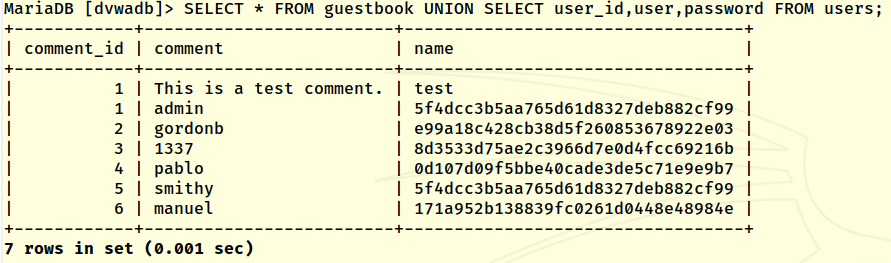

 

```sql
mysql> SELECT user, password FROM users UNION SELECT name, comment FROM guestbook;
```

 

> [!note]
> 
 
> #### 💡 Reglas del UNION:
> 
 

> 
> * Ambos SELECT deben tener el **mismo número de columnas**
> 
> * Las columnas deben tener **tipos de datos compatibles**
> 
> * El resultado se combina en una sola tabla
> 

> 

 

### ❌ UNION con Número Incorrecto de Columnas

 

Este UNION es importante para saber la cantidad de campos que puedan existir en una tabla.

 

Por ejemplo, si ponemos lo siguiente nos daría error:

 

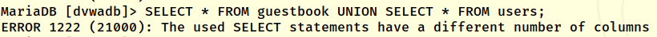

 

También lo siguiente:

 

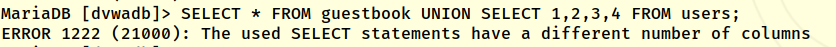

 

### ✅ UNION con Número Correcto de Columnas

 

Sin embargo, con la siguiente línea no da error y nos daría información de la cantidad de columnas o campos que hay en la primera tabla:

 

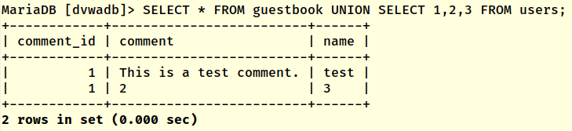

 

> [!tip]
> 
 
> #### 🎯 Importancia en SQL Injection:
> 
 
> Este dato puede ser muy importante cuando se accede a la base de datos mediante **SQL Injection**, como ya veremos más adelante.
> 
> **Técnica de enumeración de columnas:**
> 
> ```sql
> -- Probar con 1 columna
> ' UNION SELECT NULL--
> 
-- Probar con 2 columnas
> ' UNION SELECT NULL, NULL--
> 
-- Probar con 3 columnas
> ' UNION SELECT NULL, NULL, NULL--
> 
-- Continuar hasta que no dé error
> ```
> 
 
> Una vez que sabemos el número de columnas, podemos extraer información sensible de otras tablas.
> 

 

 
 

## 📚 Resumen

 

> [!tip]
> 
 
> ### 🎓 Lo que hemos aprendido:
> 
 

> 
> * ✅ SQL Injection es una de las vulnerabilidades web más críticas
> 
> * ✅ Permite extraer, modificar o eliminar datos de la base de datos
> 
> * ✅ Las consultas preparadas son la mejor defensa
> 
> * ✅ Comandos básicos de MySQL: SHOW DATABASES, USE, SHOW TABLES, SELECT
> 
> * ✅ El operador UNION permite combinar resultados de múltiples consultas
> 
> * ✅ UNION requiere el mismo número de columnas en ambos SELECT
> 
> * ✅ Podemos enumerar columnas usando UNION SELECT NULL, NULL,...
> 

> 
 
> ### 🔑 Comandos SQL Clave:
> 
 
> 
> 
> 
> 
> 
> 
> 
> 
> 
> `SHOW DATABASES`
> 
> `SHOW DATABASES;`
> 
> 
> `USE`
> 
> `USE dvwa;`
> 
> 
> `SHOW TABLES`
> 
> `SHOW TABLES;`
> 
> 
> `SELECT`
> 
> `SELECT * FROM users;`
> 
> 
> `WHERE`
> 
> `WHERE user = 'admin'`
> 
> 
> `LIKE`
> 
> `WHERE user LIKE 'a%'`
> 
> 
> `LIMIT`
> 
> `LIMIT 10`
> 
> 
> `UNION`
> 
> `SELECT 1 UNION SELECT 2`
> 
> 
> `INSERT`
> 
> `INSERT INTO users VALUES (...)`
> 
> 
> `UPDATE`
> 
> `UPDATE users SET...`
> 
> 
> 
> | Comando | Descripción | Ejemplo |
> | --- | --- | --- |
> | | Listar todas las bases de datos | |
> | | Seleccionar una base de datos | |
> | | Listar tablas de la BD actual | |
> | | Consultar datos de una tabla | |
> | | Filtrar resultados | |
> | | Búsqueda con patrones | |
> | | Limitar número de resultados | |
> | | Combinar resultados de consultas | |
> | | Insertar nuevos registros | |
> | | Modificar registros existentes | |
> 

> 
> ### 🎯 Navegación:
> 
 
> ← Anterior: 06 - XSS (Cross-Site Scripting)
> 
> → Siguiente: 07-02 - SQL Injection en web
> 
> ↑ Volver al Índice del Módulo
>

---

> [[02 - MODULOS/05 - Prácticas (PoCs)|← Volver a Prácticas (PoCs)]] | [[02 - MODULOS/Prácticas (PoCs)/Vulnerabilidades Web/00 - Índice del Módulo Vulnerabilidades Web|Índice del Módulo]]
